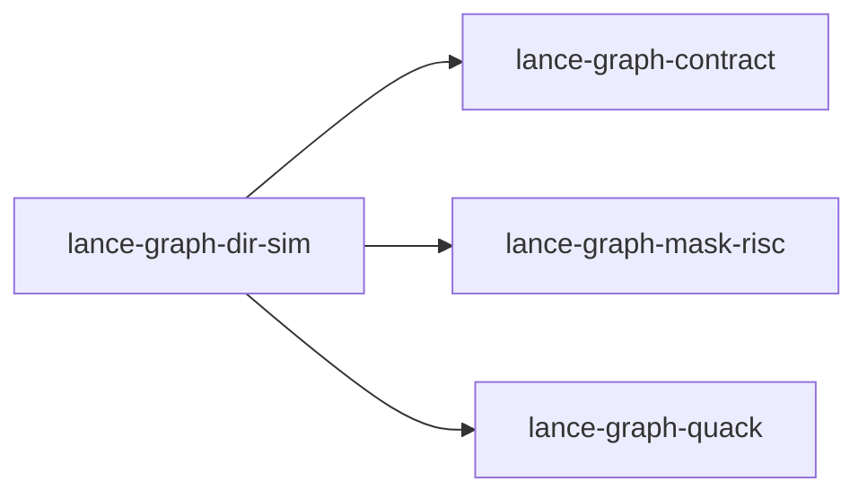

# lance-graph-dir-sim

crate: lance-graph-dir-sim
path: crates/lance-graph-dir-sim
workspace: excluded
digest: faa6eb31da9ac20a
evidence legend: ../index.md#evidence-legend

Generated; the code is the truth. See ../index.md.

## Depends on

- dep lance-graph-contract dev — crates/lance-graph-dir-sim/Cargo.toml:52 CONFIRMED
- dep lance-graph-contract normal optional — crates/lance-graph-dir-sim/Cargo.toml:40 CONFIRMED
- dep lance-graph-dt64 dev — crates/lance-graph-dir-sim/Cargo.toml:51 CONFIRMED
- dep lance-graph-mask-risc normal — crates/lance-graph-dir-sim/Cargo.toml:33 CONFIRMED
- dep lance-graph-quack normal — crates/lance-graph-dir-sim/Cargo.toml:32 CONFIRMED
- dep ogar-ad normal — crates/lance-graph-dir-sim/Cargo.toml:36 CONFIRMED
- dep ogar-az normal — crates/lance-graph-dir-sim/Cargo.toml:37 CONFIRMED
- dep ogar-dir-core normal — crates/lance-graph-dir-sim/Cargo.toml:34 CONFIRMED
- dep ogar-dir-sim normal — crates/lance-graph-dir-sim/Cargo.toml:35 CONFIRMED
- dep ogar-rbac normal optional — crates/lance-graph-dir-sim/Cargo.toml:44 CONFIRMED
- dep unicase normal — crates/lance-graph-dir-sim/Cargo.toml:48 CONFIRMED
- dep unicode-normalization normal — crates/lance-graph-dir-sim/Cargo.toml:46 CONFIRMED

## Depended on by

## Public items

- struct GroupRoles [pub] — crates/lance-graph-dir-sim/src/actors.rs:40 CONFIRMED
- fn GroupRoles::new [pub] — crates/lance-graph-dir-sim/src/actors.rs:47 CONFIRMED
- fn GroupRoles::read [pub] — crates/lance-graph-dir-sim/src/actors.rs:53 CONFIRMED
- fn GroupRoles::from_policy [pub] — crates/lance-graph-dir-sim/src/actors.rs:64 CONFIRMED
- fn GroupRoles::of [pub] — crates/lance-graph-dir-sim/src/actors.rs:72 CONFIRMED
- enum RoleEvidence [pub] — crates/lance-graph-dir-sim/src/actors.rs:79 CONFIRMED
- fn RoleEvidence::is_held [pub] — crates/lance-graph-dir-sim/src/actors.rs:108 CONFIRMED
- fn GroupRoles::role_evidence [pub] — crates/lance-graph-dir-sim/src/actors.rs:125 CONFIRMED
- struct RoleImpact [pub] — crates/lance-graph-dir-sim/src/actors.rs:165 CONFIRMED
- fn RoleImpact::between [pub] — crates/lance-graph-dir-sim/src/actors.rs:176 CONFIRMED
- fn RoleImpact::is_lost [pub] — crates/lance-graph-dir-sim/src/actors.rs:193 CONFIRMED
- fn RoleImpact::is_gained [pub] — crates/lance-graph-dir-sim/src/actors.rs:199 CONFIRMED
- struct ViewActors [pub] — crates/lance-graph-dir-sim/src/actors.rs:206 CONFIRMED
- fn ViewActors::for_principal [pub] — crates/lance-graph-dir-sim/src/actors.rs:220 CONFIRMED
- fn ViewActors::subject [pub] — crates/lance-graph-dir-sim/src/actors.rs:251 CONFIRMED
- fn ViewActors::principal [pub] — crates/lance-graph-dir-sim/src/actors.rs:257 CONFIRMED
- fn ViewActors::roles [pub] — crates/lance-graph-dir-sim/src/actors.rs:263 CONFIRMED
- fn ViewActors::unread_groups [pub] — crates/lance-graph-dir-sim/src/actors.rs:271 CONFIRMED
- enum Origin [pub] — crates/lance-graph-dir-sim/src/ad.rs:44 CONFIRMED
- fn Origin::as_str [pub] — crates/lance-graph-dir-sim/src/ad.rs:58 CONFIRMED
- enum Source [pub] — crates/lance-graph-dir-sim/src/ad.rs:70 CONFIRMED
- enum Value [pub] — crates/lance-graph-dir-sim/src/ad.rs:83 CONFIRMED
- struct Entry [pub] — crates/lance-graph-dir-sim/src/ad.rs:92 CONFIRMED
- fn Entry::text [pub] — crates/lance-graph-dir-sim/src/ad.rs:105 CONFIRMED
- enum ProjectError [pub] — crates/lance-graph-dir-sim/src/ad.rs:119 CONFIRMED
- const ATTRIBUTES [pub] — crates/lance-graph-dir-sim/src/ad.rs:137 CONFIRMED
- struct Projection [pub] — crates/lance-graph-dir-sim/src/ad.rs:153 CONFIRMED
- fn escape_rdn_value [pub] — crates/lance-graph-dir-sim/src/ad.rs:165 CONFIRMED
- fn project [pub] — crates/lance-graph-dir-sim/src/ad.rs:203 CONFIRMED
- fn to_ldif [pub] — crates/lance-graph-dir-sim/src/ad.rs:465 CONFIRMED
- fn base64 [pub] — crates/lance-graph-dir-sim/src/ad.rs:519 CONFIRMED
- struct UserBinder [pub] — crates/lance-graph-dir-sim/src/bind.rs:34 CONFIRMED
- fn UserBinder<'a>::new [pub] — crates/lance-graph-dir-sim/src/bind.rs:43 CONFIRMED
- fn UserBinder<'a>::issued [pub] — crates/lance-graph-dir-sim/src/bind.rs:53 CONFIRMED
- enum WhereEqError [pub] — crates/lance-graph-dir-sim/src/bind.rs:90 CONFIRMED
- fn where_eq [pub] — crates/lance-graph-dir-sim/src/bind.rs:105 CONFIRMED
- struct CloudMailboxes [pub] — crates/lance-graph-dir-sim/src/cloud.rs:52 CONFIRMED
- enum MailboxGuid [pub] — crates/lance-graph-dir-sim/src/cloud.rs:61 CONFIRMED
- fn MailboxGuid::migratable [pub] — crates/lance-graph-dir-sim/src/cloud.rs:90 CONFIRMED
- fn CloudMailboxes::from_fold [pub] — crates/lance-graph-dir-sim/src/cloud.rs:98 CONFIRMED
- fn CloudMailboxes::with_exchange_guids [pub] — crates/lance-graph-dir-sim/src/cloud.rs:125 CONFIRMED
- fn CloudMailboxes::contains [pub] — crates/lance-graph-dir-sim/src/cloud.rs:141 CONFIRMED
- fn CloudMailboxes::owners [pub] — crates/lance-graph-dir-sim/src/cloud.rs:146 CONFIRMED
- fn CloudMailboxes::mailbox_guid [pub] — crates/lance-graph-dir-sim/src/cloud.rs:152 CONFIRMED
- fn CloudMailboxes::delivers_to [pub] — crates/lance-graph-dir-sim/src/cloud.rs:182 CONFIRMED
- fn receives_mail [pub] — crates/lance-graph-dir-sim/src/cloud.rs:200 CONFIRMED
- fn program [pub(crate)] — crates/lance-graph-dir-sim/src/exec.rs:18 CONFIRMED
- struct Kept [pub] — crates/lance-graph-dir-sim/src/exec.rs:50 CONFIRMED
- fn Kept::rows [pub] — crates/lance-graph-dir-sim/src/exec.rs:57 CONFIRMED
- fn Kept::set [pub(crate)] — crates/lance-graph-dir-sim/src/exec.rs:62 CONFIRMED
- fn Kept::concat [pub(crate)] — crates/lance-graph-dir-sim/src/exec.rs:69 CONFIRMED
- fn count [pub(crate)] — crates/lance-graph-dir-sim/src/exec.rs:81 CONFIRMED
- fn keep [pub(crate)] — crates/lance-graph-dir-sim/src/exec.rs:92 CONFIRMED
- fn group_count_into [pub(crate)] — crates/lance-graph-dir-sim/src/exec.rs:106 CONFIRMED
- enum GroupProperty [pub] — crates/lance-graph-dir-sim/src/groups.rs:45 CONFIRMED
- enum GroupWhere [pub] — crates/lance-graph-dir-sim/src/groups.rs:58 CONFIRMED
- fn GroupWhere::both [pub] — crates/lance-graph-dir-sim/src/groups.rs:78 CONFIRMED
- fn groups_where [pub] — crates/lance-graph-dir-sim/src/groups.rs:116 CONFIRMED
- struct StoreImage [pub] — crates/lance-graph-dir-sim/src/image.rs:33 CONFIRMED
- enum RestoreError [pub] — crates/lance-graph-dir-sim/src/image.rs:49 CONFIRMED
- struct StoredRule [pub] — crates/lance-graph-dir-sim/src/image.rs:81 CONFIRMED
- enum StoredOrigin [pub] — crates/lance-graph-dir-sim/src/image.rs:99 CONFIRMED
- struct StoredVersion [pub] — crates/lance-graph-dir-sim/src/image.rs:118 CONFIRMED
- struct StoredImage [pub] — crates/lance-graph-dir-sim/src/image.rs:155 CONFIRMED
- struct RuleRegistry [pub] — crates/lance-graph-dir-sim/src/image.rs:188 CONFIRMED
- fn RuleRegistry::new [pub] — crates/lance-graph-dir-sim/src/image.rs:200 CONFIRMED
- fn RuleRegistry::with [pub] — crates/lance-graph-dir-sim/src/image.rs:208 CONFIRMED
- fn RuleRegistry::resolve [pub] — crates/lance-graph-dir-sim/src/image.rs:214 CONFIRMED
- struct UnknownRule [pub] — crates/lance-graph-dir-sim/src/image.rs:224 CONFIRMED
- fn StoredImage::resolve [pub] — crates/lance-graph-dir-sim/src/image.rs:238 CONFIRMED
- struct History [pub] — crates/lance-graph-dir-sim/src/image.rs:314 CONFIRMED
- fn History::restore [pub] — crates/lance-graph-dir-sim/src/image.rs:326 CONFIRMED
- fn History::unresolved [pub] — crates/lance-graph-dir-sim/src/image.rs:344 CONFIRMED
- fn History::rule [pub] — crates/lance-graph-dir-sim/src/image.rs:350 CONFIRMED
- fn History::version [pub] — crates/lance-graph-dir-sim/src/image.rs:356 CONFIRMED
- fn History::view [pub] — crates/lance-graph-dir-sim/src/image.rs:365 CONFIRMED
- fn History::diff [pub] — crates/lance-graph-dir-sim/src/image.rs:374 CONFIRMED
- fn History::tag [pub] — crates/lance-graph-dir-sim/src/image.rs:379 CONFIRMED
- fn History::verdict [pub] — crates/lance-graph-dir-sim/src/image.rs:384 CONFIRMED
- fn History::value [pub] — crates/lance-graph-dir-sim/src/image.rs:389 CONFIRMED
- fn History::lookup [pub] — crates/lance-graph-dir-sim/src/image.rs:394 CONFIRMED
- enum LdapError [pub] — crates/lance-graph-dir-sim/src/ldap.rs:36 CONFIRMED
- const MAX_PDU [pub] — crates/lance-graph-dir-sim/src/ldap.rs:44 CONFIRMED
- fn frame [pub] — crates/lance-graph-dir-sim/src/ldap.rs:152 CONFIRMED
- enum ResultCode [pub] — crates/lance-graph-dir-sim/src/ldap.rs:221 CONFIRMED
- trait Authority [pub] — crates/lance-graph-dir-sim/src/ldap.rs:248 CONFIRMED
- struct Session [pub] — crates/lance-graph-dir-sim/src/ldap.rs:263 CONFIRMED
- fn Session<A>::actor [pub] — crates/lance-graph-dir-sim/src/ldap.rs:279 CONFIRMED
- fn Session<A>::closed [pub] — crates/lance-graph-dir-sim/src/ldap.rs:283 CONFIRMED
- struct Directory [pub] — crates/lance-graph-dir-sim/src/ldap.rs:307 CONFIRMED
- fn Directory::new [pub] — crates/lance-graph-dir-sim/src/ldap.rs:319 CONFIRMED
- struct Server [pub] — crates/lance-graph-dir-sim/src/ldap.rs:601 CONFIRMED
- const MAX_ATTRIBUTE_SELECTORS [pub] — crates/lance-graph-dir-sim/src/ldap.rs:609 CONFIRMED
- const DEFAULT_MAX_ENTRIES [pub] — crates/lance-graph-dir-sim/src/ldap.rs:613 CONFIRMED
- const DEFAULT_MAX_BYTES [pub] — crates/lance-graph-dir-sim/src/ldap.rs:615 CONFIRMED
- const MAX_FILTER_DEPTH [pub] — crates/lance-graph-dir-sim/src/ldap.rs:682 CONFIRMED
- const MAX_FILTER_NODES [pub] — crates/lance-graph-dir-sim/src/ldap.rs:687 CONFIRMED
- fn Server<'a,P>::new [pub] — crates/lance-graph-dir-sim/src/ldap.rs:1141 CONFIRMED
- fn Server<'a,P>::with_limits [pub] — crates/lance-graph-dir-sim/src/ldap.rs:1153 CONFIRMED
- fn Server<'a,P>::handle [pub] — crates/lance-graph-dir-sim/src/ldap.rs:1162 CONFIRMED
- mod actors [pub] cfg=feature="rbac" — crates/lance-graph-dir-sim/src/lib.rs:38 CONFIRMED
- mod ad [pub] — crates/lance-graph-dir-sim/src/lib.rs:39 CONFIRMED
- mod bind [pub] — crates/lance-graph-dir-sim/src/lib.rs:40 CONFIRMED
- mod cloud [pub] — crates/lance-graph-dir-sim/src/lib.rs:41 CONFIRMED
- mod groups [pub] — crates/lance-graph-dir-sim/src/lib.rs:43 CONFIRMED
- mod image [pub] — crates/lance-graph-dir-sim/src/lib.rs:44 CONFIRMED
- mod ldap [pub] — crates/lance-graph-dir-sim/src/lib.rs:45 CONFIRMED
- mod log [pub] — crates/lance-graph-dir-sim/src/lib.rs:46 CONFIRMED
- mod observe [pub] — crates/lance-graph-dir-sim/src/lib.rs:47 CONFIRMED
- mod proxy [pub] — crates/lance-graph-dir-sim/src/lib.rs:48 CONFIRMED
- mod rule [pub] — crates/lance-graph-dir-sim/src/lib.rs:49 CONFIRMED
- mod snapshot [pub] — crates/lance-graph-dir-sim/src/lib.rs:50 CONFIRMED
- mod store [pub] — crates/lance-graph-dir-sim/src/lib.rs:51 CONFIRMED
- mod validate [pub] — crates/lance-graph-dir-sim/src/lib.rs:52 CONFIRMED
- mod view [pub] — crates/lance-graph-dir-sim/src/lib.rs:53 CONFIRMED
- fn effectively_active [pub] — crates/lance-graph-dir-sim/src/lib.rs:86 CONFIRMED
- fn effectively_inactive [pub] — crates/lance-graph-dir-sim/src/lib.rs:102 CONFIRMED
- fn key_eq_program [pub] — crates/lance-graph-dir-sim/src/lib.rs:118 CONFIRMED
- fn users_with_key [pub] — crates/lance-graph-dir-sim/src/lib.rs:137 CONFIRMED
- fn users_matching [pub(crate)] — crates/lance-graph-dir-sim/src/lib.rs:144 CONFIRMED
- struct ScopeMismatch [pub] — crates/lance-graph-dir-sim/src/lib.rs:182 CONFIRMED
- fn subtree [pub] — crates/lance-graph-dir-sim/src/lib.rs:199 CONFIRMED
- struct DecodeError [pub] — crates/lance-graph-dir-sim/src/log.rs:40 CONFIRMED
- enum RecordKind [pub] — crates/lance-graph-dir-sim/src/log.rs:682 CONFIRMED
- struct Record [pub] — crates/lance-graph-dir-sim/src/log.rs:713 CONFIRMED
- struct Header [pub] — crates/lance-graph-dir-sim/src/log.rs:726 CONFIRMED
- struct Batch [pub] — crates/lance-graph-dir-sim/src/log.rs:762 CONFIRMED
- fn Batch::number [pub] — crates/lance-graph-dir-sim/src/log.rs:770 CONFIRMED
- struct LogState [pub] — crates/lance-graph-dir-sim/src/log.rs:779 CONFIRMED
- enum LogError [pub] — crates/lance-graph-dir-sim/src/log.rs:792 CONFIRMED
- fn LogState::new [pub] — crates/lance-graph-dir-sim/src/log.rs:828 CONFIRMED
- fn LogState::next_batch [pub] — crates/lance-graph-dir-sim/src/log.rs:833 CONFIRMED
- fn LogState::batch [pub] — crates/lance-graph-dir-sim/src/log.rs:844 CONFIRMED
- fn LogState::committed [pub] — crates/lance-graph-dir-sim/src/log.rs:947 CONFIRMED
- enum ReplayError [pub] — crates/lance-graph-dir-sim/src/log.rs:1032 CONFIRMED
- fn replay [pub] — crates/lance-graph-dir-sim/src/log.rs:1072 CONFIRMED
- fn replay_prefix [pub] — crates/lance-graph-dir-sim/src/log.rs:1087 CONFIRMED
- enum ObserveError [pub] — crates/lance-graph-dir-sim/src/observe.rs:71 CONFIRMED
- fn from_ad [pub] — crates/lance-graph-dir-sim/src/observe.rs:108 CONFIRMED
- const SYNTHETIC_OU [pub] — crates/lance-graph-dir-sim/src/observe.rs:191 CONFIRMED
- struct GraphObservation [pub] — crates/lance-graph-dir-sim/src/observe.rs:196 CONFIRMED
- struct GroupMembers [pub] — crates/lance-graph-dir-sim/src/observe.rs:208 CONFIRMED
- fn from_graph [pub] — crates/lance-graph-dir-sim/src/observe.rs:231 CONFIRMED
- enum ProxyKind [pub] — crates/lance-graph-dir-sim/src/proxy.rs:32 CONFIRMED
- mod meta [pub] — crates/lance-graph-dir-sim/src/proxy.rs:44 CONFIRMED
- const PRIMARY [pub] — crates/lance-graph-dir-sim/src/proxy.rs:48 CONFIRMED
- const SMTP_SECONDARY [pub] — crates/lance-graph-dir-sim/src/proxy.rs:50 CONFIRMED
- const SMTP_PRIMARY [pub] — crates/lance-graph-dir-sim/src/proxy.rs:52 CONFIRMED
- fn encode [pub] — crates/lance-graph-dir-sim/src/proxy.rs:55 CONFIRMED
- fn decode [pub] — crates/lance-graph-dir-sim/src/proxy.rs:59 CONFIRMED
- fn parse_proxy [pub] — crates/lance-graph-dir-sim/src/proxy.rs:80 CONFIRMED
- struct ProxyRow [pub] — crates/lance-graph-dir-sim/src/proxy.rs:94 CONFIRMED
- struct ProxyRelation [pub] — crates/lance-graph-dir-sim/src/proxy.rs:109 CONFIRMED
- fn ProxyRelation::build [pub(crate)] — crates/lance-graph-dir-sim/src/proxy.rs:122 CONFIRMED
- fn ProxyRelation::len [pub] — crates/lance-graph-dir-sim/src/proxy.rs:170 CONFIRMED
- fn ProxyRelation::is_empty [pub] — crates/lance-graph-dir-sim/src/proxy.rs:174 CONFIRMED
- fn ProxyRelation::row [pub] — crates/lance-graph-dir-sim/src/proxy.rs:182 CONFIRMED
- fn ProxyRelation::owner_rows [pub(crate)] — crates/lance-graph-dir-sim/src/proxy.rs:193 CONFIRMED
- fn ProxyRelation::has_secondary_smtp [pub(crate)] — crates/lance-graph-dir-sim/src/proxy.rs:200 CONFIRMED
- trait Rule [pub] — crates/lance-graph-dir-sim/src/rule.rs:19 CONFIRMED
- fn member_counts [pub] — crates/lance-graph-dir-sim/src/rule.rs:30 CONFIRMED
- struct GrantGroup [pub] — crates/lance-graph-dir-sim/src/rule.rs:68 CONFIRMED
- struct ImplyGroup [pub] — crates/lance-graph-dir-sim/src/rule.rs:112 CONFIRMED
- struct SetPrimarySmtp [pub] — crates/lance-graph-dir-sim/src/rule.rs:143 CONFIRMED
- const MAX_USERS [pub] — crates/lance-graph-dir-sim/src/snapshot.rs:62 CONFIRMED
- const MAX_GROUPS [pub] — crates/lance-graph-dir-sim/src/snapshot.rs:64 CONFIRMED
- const NONE [pub] — crates/lance-graph-dir-sim/src/snapshot.rs:68 CONFIRMED
- struct UserOrdinal [pub] — crates/lance-graph-dir-sim/src/snapshot.rs:72 CONFIRMED
- struct GroupOrdinal [pub] — crates/lance-graph-dir-sim/src/snapshot.rs:76 CONFIRMED
- struct Dict [pub] — crates/lance-graph-dir-sim/src/snapshot.rs:81 CONFIRMED
- fn Dict::intern [pub] — crates/lance-graph-dir-sim/src/snapshot.rs:88 CONFIRMED
- fn Dict::get [pub] — crates/lance-graph-dir-sim/src/snapshot.rs:101 CONFIRMED
- fn Dict::resolve [pub] — crates/lance-graph-dir-sim/src/snapshot.rs:105 CONFIRMED
- fn Dict::len [pub] — crates/lance-graph-dir-sim/src/snapshot.rs:109 CONFIRMED
- fn Dict::is_empty [pub] — crates/lance-graph-dir-sim/src/snapshot.rs:113 CONFIRMED
- struct DictCounters [pub] — crates/lance-graph-dir-sim/src/snapshot.rs:122 CONFIRMED
- fn DictCounters::snapshot [pub] — crates/lance-graph-dir-sim/src/snapshot.rs:133 CONFIRMED
- struct Dicts [pub] — crates/lance-graph-dir-sim/src/snapshot.rs:156 CONFIRMED
- fn Dicts::intern [pub] — crates/lance-graph-dir-sim/src/snapshot.rs:175 CONFIRMED
- fn Dicts::lookup [pub] — crates/lance-graph-dir-sim/src/snapshot.rs:187 CONFIRMED
- fn Dicts::key_lookup [pub] — crates/lance-graph-dir-sim/src/snapshot.rs:194 CONFIRMED
- fn Dicts::value [pub] — crates/lance-graph-dir-sim/src/snapshot.rs:199 CONFIRMED
- fn Dicts::values_in_order [pub] — crates/lance-graph-dir-sim/src/snapshot.rs:205 CONFIRMED
- fn Dicts::value_count [pub] — crates/lance-graph-dir-sim/src/snapshot.rs:209 CONFIRMED
- fn Dicts::key_of [pub] — crates/lance-graph-dir-sim/src/snapshot.rs:213 CONFIRMED
- fn Dicts::routing_alias [pub(crate)] — crates/lance-graph-dir-sim/src/snapshot.rs:218 CONFIRMED
- fn Dicts::key_label [pub] — crates/lance-graph-dir-sim/src/snapshot.rs:223 CONFIRMED
- fn Dicts::key_count [pub] — crates/lance-graph-dir-sim/src/snapshot.rs:228 CONFIRMED
- fn Dicts::lane_ids [pub(crate)] — crates/lance-graph-dir-sim/src/snapshot.rs:233 CONFIRMED
- struct ObservedNode [pub] — crates/lance-graph-dir-sim/src/snapshot.rs:243 CONFIRMED
- struct ObservedRecipient [pub] — crates/lance-graph-dir-sim/src/snapshot.rs:289 CONFIRMED
- fn is_owner [pub(crate)] — crates/lance-graph-dir-sim/src/snapshot.rs:306 CONFIRMED
- fn is_mail_recipient [pub] — crates/lance-graph-dir-sim/src/snapshot.rs:326 CONFIRMED
- fn ObservedNode::user [pub] — crates/lance-graph-dir-sim/src/snapshot.rs:340 CONFIRMED
- fn ObservedNode::group [pub] — crates/lance-graph-dir-sim/src/snapshot.rs:356 CONFIRMED
- struct Observation [pub] — crates/lance-graph-dir-sim/src/snapshot.rs:375 CONFIRMED
- enum BuildError [pub] — crates/lance-graph-dir-sim/src/snapshot.rs:387 CONFIRMED
- fn bit [pub(crate)] — crates/lance-graph-dir-sim/src/snapshot.rs:401 CONFIRMED
- fn set_bit [pub(crate)] — crates/lance-graph-dir-sim/src/snapshot.rs:404 CONFIRMED
- fn clear_bit [pub(crate)] — crates/lance-graph-dir-sim/src/snapshot.rs:407 CONFIRMED
- truncated (321 total), see symbols.tsv

## Imports from in-scope crates

### lance-graph-contract
- use lance_graph_contract::rbac::ActorId — crates/lance-graph-dir-sim/src/actors.rs:29 CONFIRMED
- use lance_graph_contract::rbac::RoleId — crates/lance-graph-dir-sim/src/actors.rs:29 CONFIRMED
- use lance_graph_contract::rbac_plug::ActorSource — crates/lance-graph-dir-sim/src/actors.rs:30 CONFIRMED
- use lance_graph_contract::rbac_plug::RbacBinding — crates/lance-graph-dir-sim/src/actors.rs:30 CONFIRMED
- use lance_graph_contract::rbac_plug::SubjectRoles — crates/lance-graph-dir-sim/src/actors.rs:30 CONFIRMED
### lance-graph-mask-risc
- use lance_graph_mask_risc::Foreign — crates/lance-graph-dir-sim/src/exec.rs:11 CONFIRMED
- use lance_graph_mask_risc::Out — crates/lance-graph-dir-sim/src/exec.rs:11 CONFIRMED
- use lance_graph_mask_risc::Planes — crates/lance-graph-dir-sim/src/exec.rs:11 CONFIRMED
- use lance_graph_mask_risc::Program — crates/lance-graph-dir-sim/src/exec.rs:11 CONFIRMED
- use lance_graph_mask_risc::Scratch — crates/lance-graph-dir-sim/src/exec.rs:11 CONFIRMED
- use lance_graph_mask_risc::Terminal — crates/lance-graph-dir-sim/src/exec.rs:11 CONFIRMED
- use lance_graph_mask_risc::execute_into — crates/lance-graph-dir-sim/src/exec.rs:11 CONFIRMED
- use lance_graph_mask_risc::materialize_rows — crates/lance-graph-dir-sim/src/exec.rs:11 CONFIRMED
- use lance_graph_mask_risc::words_for — crates/lance-graph-dir-sim/src/exec.rs:11 CONFIRMED
- use lance_graph_mask_risc::Value — crates/lance-graph-dir-sim/src/exec.rs:12 CONFIRMED
- use lance_graph_mask_risc::Foreign — crates/lance-graph-dir-sim/src/groups.rs:36 CONFIRMED
- use lance_graph_mask_risc::LaneRef — crates/lance-graph-dir-sim/src/groups.rs:36 CONFIRMED
- use lance_graph_mask_risc::Planes — crates/lance-graph-dir-sim/src/groups.rs:36 CONFIRMED
- use lance_graph_mask_risc::Foreign — crates/lance-graph-dir-sim/src/lib.rs:69 CONFIRMED
- use lance_graph_mask_risc::LaneRef — crates/lance-graph-dir-sim/src/lib.rs:69 CONFIRMED
- use lance_graph_mask_risc::Planes — crates/lance-graph-dir-sim/src/lib.rs:69 CONFIRMED
- use lance_graph_mask_risc::Program — crates/lance-graph-dir-sim/src/lib.rs:69 CONFIRMED
- use lance_graph_mask_risc::StridedRef — crates/lance-graph-dir-sim/src/lib.rs:69 CONFIRMED
- use lance_graph_mask_risc::words_for — crates/lance-graph-dir-sim/src/lib.rs:69 CONFIRMED
- use lance_graph_mask_risc::words_for — crates/lance-graph-dir-sim/src/proxy.rs:25 CONFIRMED
- use lance_graph_mask_risc::Foreign — crates/lance-graph-dir-sim/src/rule.rs:12 CONFIRMED
- use lance_graph_mask_risc::LaneRef — crates/lance-graph-dir-sim/src/rule.rs:12 CONFIRMED
- use lance_graph_mask_risc::Planes — crates/lance-graph-dir-sim/src/rule.rs:12 CONFIRMED
- use lance_graph_mask_risc::words_for — crates/lance-graph-dir-sim/src/snapshot.rs:53 CONFIRMED
- use lance_graph_mask_risc::Foreign — crates/lance-graph-dir-sim/src/validate.rs:28 CONFIRMED
- use lance_graph_mask_risc::ForeignPlane as FPlane — crates/lance-graph-dir-sim/src/validate.rs:28 CONFIRMED
- use lance_graph_mask_risc::LaneRef — crates/lance-graph-dir-sim/src/validate.rs:28 CONFIRMED
- use lance_graph_mask_risc::Planes — crates/lance-graph-dir-sim/src/validate.rs:28 CONFIRMED
- use lance_graph_mask_risc::Program — crates/lance-graph-dir-sim/src/validate.rs:28 CONFIRMED
- use lance_graph_mask_risc::Foreign — crates/lance-graph-dir-sim/src/view.rs:32 CONFIRMED
- use lance_graph_mask_risc::LaneRef — crates/lance-graph-dir-sim/src/view.rs:32 CONFIRMED
- use lance_graph_mask_risc::Planes — crates/lance-graph-dir-sim/src/view.rs:32 CONFIRMED
- use lance_graph_mask_risc::words_for — crates/lance-graph-dir-sim/src/view.rs:32 CONFIRMED
### lance-graph-quack
- use lance_graph_quack::bind::BindError — crates/lance-graph-dir-sim/src/bind.rs:21 CONFIRMED
- use lance_graph_quack::bind::Binder — crates/lance-graph-dir-sim/src/bind.rs:21 CONFIRMED
- use lance_graph_quack::bind::BoundField — crates/lance-graph-dir-sim/src/bind.rs:21 CONFIRMED
- use lance_graph_quack::bind::FieldKind — crates/lance-graph-dir-sim/src/bind.rs:21 CONFIRMED
- use lance_graph_quack::bind::TableId — crates/lance-graph-dir-sim/src/bind.rs:21 CONFIRMED
- use lance_graph_quack::bind::table — crates/lance-graph-dir-sim/src/bind.rs:21 CONFIRMED
- use lance_graph_quack::Col — crates/lance-graph-dir-sim/src/bind.rs:22 CONFIRMED
- use lance_graph_quack::LowerError — crates/lance-graph-dir-sim/src/bind.rs:22 CONFIRMED
- use lance_graph_quack::Mask — crates/lance-graph-dir-sim/src/bind.rs:22 CONFIRMED
- use lance_graph_quack::lower — crates/lance-graph-dir-sim/src/bind.rs:22 CONFIRMED
- use lance_graph_quack::Agg — crates/lance-graph-dir-sim/src/exec.rs:14 CONFIRMED
- use lance_graph_quack::Col — crates/lance-graph-dir-sim/src/exec.rs:14 CONFIRMED
- use lance_graph_quack::Filter — crates/lance-graph-dir-sim/src/exec.rs:14 CONFIRMED
- use lance_graph_quack::GroupAddr — crates/lance-graph-dir-sim/src/exec.rs:14 CONFIRMED
- use lance_graph_quack::GroupAgg — crates/lance-graph-dir-sim/src/exec.rs:14 CONFIRMED
- use lance_graph_quack::Query — crates/lance-graph-dir-sim/src/exec.rs:14 CONFIRMED
- use lance_graph_quack::lower — crates/lance-graph-dir-sim/src/exec.rs:14 CONFIRMED
- use lance_graph_quack::Agg — crates/lance-graph-dir-sim/src/groups.rs:37 CONFIRMED
- use lance_graph_quack::Cmp — crates/lance-graph-dir-sim/src/groups.rs:37 CONFIRMED
- use lance_graph_quack::Col — crates/lance-graph-dir-sim/src/groups.rs:37 CONFIRMED
- use lance_graph_quack::Filter — crates/lance-graph-dir-sim/src/groups.rs:37 CONFIRMED
- use lance_graph_quack::Mask — crates/lance-graph-dir-sim/src/groups.rs:37 CONFIRMED
- use lance_graph_quack::Cmp — crates/lance-graph-dir-sim/src/lib.rs:70 CONFIRMED
- use lance_graph_quack::Col — crates/lance-graph-dir-sim/src/lib.rs:70 CONFIRMED
- use lance_graph_quack::Filter — crates/lance-graph-dir-sim/src/lib.rs:70 CONFIRMED
- use lance_graph_quack::Mask — crates/lance-graph-dir-sim/src/lib.rs:70 CONFIRMED
- use lance_graph_quack::Cmp — crates/lance-graph-dir-sim/src/rule.rs:13 CONFIRMED
- use lance_graph_quack::Col — crates/lance-graph-dir-sim/src/rule.rs:13 CONFIRMED
- use lance_graph_quack::Filter — crates/lance-graph-dir-sim/src/rule.rs:13 CONFIRMED
- use lance_graph_quack::Mask — crates/lance-graph-dir-sim/src/rule.rs:13 CONFIRMED
- use lance_graph_quack::Agg — crates/lance-graph-dir-sim/src/validate.rs:29 CONFIRMED
- use lance_graph_quack::Cmp — crates/lance-graph-dir-sim/src/validate.rs:29 CONFIRMED
- use lance_graph_quack::Col — crates/lance-graph-dir-sim/src/validate.rs:29 CONFIRMED
- use lance_graph_quack::Filter — crates/lance-graph-dir-sim/src/validate.rs:29 CONFIRMED
- use lance_graph_quack::ForeignPlane — crates/lance-graph-dir-sim/src/validate.rs:29 CONFIRMED
- use lance_graph_quack::Mask — crates/lance-graph-dir-sim/src/validate.rs:29 CONFIRMED
- use lance_graph_quack::Cmp — crates/lance-graph-dir-sim/src/view.rs:33 CONFIRMED
- use lance_graph_quack::Col — crates/lance-graph-dir-sim/src/view.rs:33 CONFIRMED
- use lance_graph_quack::Filter — crates/lance-graph-dir-sim/src/view.rs:33 CONFIRMED
- use lance_graph_quack::Mask — crates/lance-graph-dir-sim/src/view.rs:33 CONFIRMED

## Calls

CALL_GRAPH=ARTIFACT_MISSING
- calls ARTIFACT_MISSING — no ruff_charon artifact for this crate UNKNOWN

## Architecture

- none

Generated from Cargo manifests — extracted relationships only.

