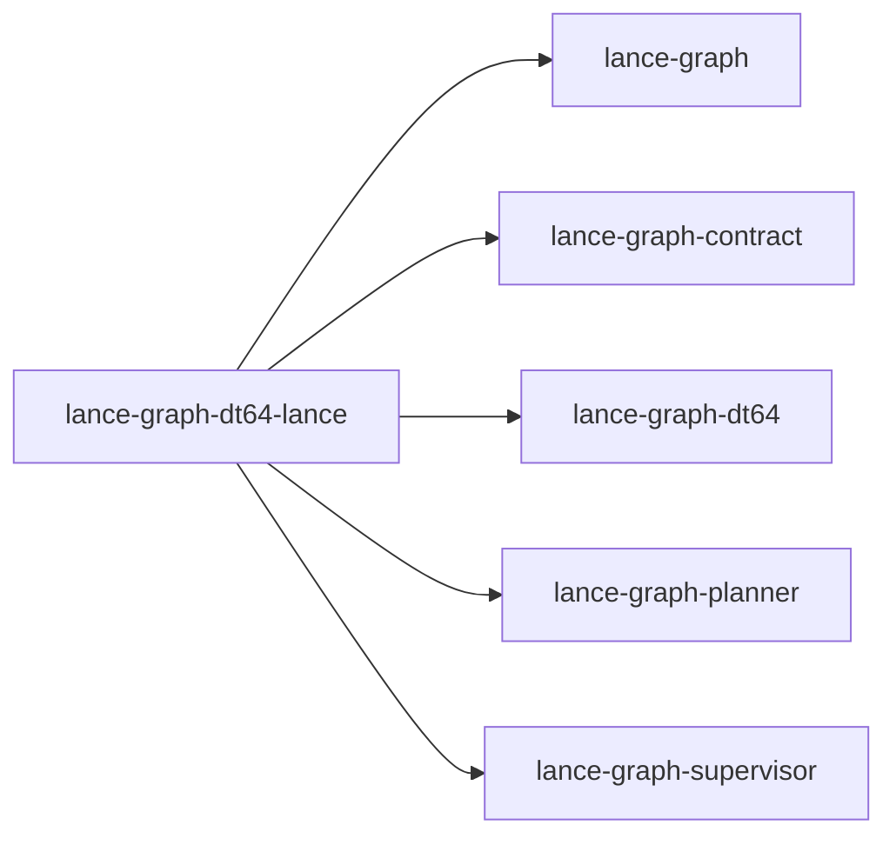

# lance-graph-dt64-lance

crate: lance-graph-dt64-lance
path: crates/lance-graph-dt64-lance
workspace: excluded
digest: 19f394be7cbe3f5c
evidence legend: ../index.md#evidence-legend

Generated; the code is the truth. See ../index.md.

## Depends on

- dep lance-graph normal — crates/lance-graph-dt64-lance/Cargo.toml:32 CONFIRMED
- dep lance-graph-contract normal — crates/lance-graph-dt64-lance/Cargo.toml:27 CONFIRMED
- dep lance-graph-dt64 normal — crates/lance-graph-dt64-lance/Cargo.toml:26 CONFIRMED
- dep lance-graph-planner normal — crates/lance-graph-dt64-lance/Cargo.toml:28 CONFIRMED
- dep lance-graph-supervisor normal — crates/lance-graph-dt64-lance/Cargo.toml:29 CONFIRMED
- dep tempfile dev — crates/lance-graph-dt64-lance/Cargo.toml:36 CONFIRMED
- dep tokio dev — crates/lance-graph-dt64-lance/Cargo.toml:35 CONFIRMED

## Depended on by

## Public items

- const CAST_BYTES [pub] — crates/lance-graph-dt64-lance/src/lib.rs:57 CONFIRMED
- const RESERVED_ID [pub] — crates/lance-graph-dt64-lance/src/lib.rs:66 CONFIRMED
- enum AdvanceError [pub] — crates/lance-graph-dt64-lance/src/lib.rs:86 CONFIRMED
- enum Settled [pub] — crates/lance-graph-dt64-lance/src/lib.rs:105 CONFIRMED
- struct MapLog [pub] — crates/lance-graph-dt64-lance/src/lib.rs:159 CONFIRMED
- struct Undrained [pub] — crates/lance-graph-dt64-lance/src/lib.rs:174 CONFIRMED
- fn Undrained::pending [pub] — crates/lance-graph-dt64-lance/src/lib.rs:181 CONFIRMED
- fn Undrained::diverged [pub] — crates/lance-graph-dt64-lance/src/lib.rs:187 CONFIRMED
- fn Undrained::into_log [pub] — crates/lance-graph-dt64-lance/src/lib.rs:193 CONFIRMED
- fn MapLog::create [pub] — crates/lance-graph-dt64-lance/src/lib.rs:211 CONFIRMED
- fn MapLog::resume [pub] — crates/lance-graph-dt64-lance/src/lib.rs:236 CONFIRMED
- fn MapLog::table [pub] — crates/lance-graph-dt64-lance/src/lib.rs:249 CONFIRMED
- fn MapLog::into_table [pub] — crates/lance-graph-dt64-lance/src/lib.rs:264 CONFIRMED
- fn MapLog::pending [pub] — crates/lance-graph-dt64-lance/src/lib.rs:275 CONFIRMED
- fn MapLog::advance [pub] — crates/lance-graph-dt64-lance/src/lib.rs:282 CONFIRMED
- fn MapLog::settle [pub] — crates/lance-graph-dt64-lance/src/lib.rs:312 CONFIRMED
- fn MapLog::settle_next [pub] — crates/lance-graph-dt64-lance/src/lib.rs:331 CONFIRMED
- trait SealedImages [pub] — crates/lance-graph-dt64-lance/src/lib.rs:451 CONFIRMED
- struct Restored [pub] — crates/lance-graph-dt64-lance/src/lib.rs:463 CONFIRMED
- enum RestoreError [pub] — crates/lance-graph-dt64-lance/src/lib.rs:473 CONFIRMED
- enum ReplayError [pub] — crates/lance-graph-dt64-lance/src/lib.rs:482 CONFIRMED
- fn restore [pub] — crates/lance-graph-dt64-lance/src/lib.rs:513 CONFIRMED

## Imports from in-scope crates

### lance-graph
- use lance_graph::graph::cycle_sink::LanceCycleWriter — crates/lance-graph-dt64-lance/src/lib.rs:47 CONFIRMED
### lance-graph-contract
- use lance_graph_contract::collapse_gate::MailboxId — crates/lance-graph-dt64-lance/src/lib.rs:48 CONFIRMED
### lance-graph-dt64
- use lance_graph_dt64::dr::AdvanceRefusal — crates/lance-graph-dt64-lance/src/lib.rs:50 CONFIRMED
- use lance_graph_dt64::dr::LocalMap — crates/lance-graph-dt64-lance/src/lib.rs:50 CONFIRMED
- use lance_graph_dt64::dr::MapRefusal — crates/lance-graph-dt64-lance/src/lib.rs:50 CONFIRMED
- use lance_graph_dt64::dr::MapTable — crates/lance-graph-dt64-lance/src/lib.rs:50 CONFIRMED
- use lance_graph_dt64::dr::RouteVersion — crates/lance-graph-dt64-lance/src/lib.rs:50 CONFIRMED
- use lance_graph_dt64::dr::TileId — crates/lance-graph-dt64-lance/src/lib.rs:50 CONFIRMED
- use lance_graph_dt64::dr::VersionClock — crates/lance-graph-dt64-lance/src/lib.rs:50 CONFIRMED
- use lance_graph_dt64::dr::Width — crates/lance-graph-dt64-lance/src/lib.rs:50 CONFIRMED
### lance-graph-planner
- use lance_graph_planner::persist_sink::CycleId — crates/lance-graph-dt64-lance/src/lib.rs:52 CONFIRMED
- use lance_graph_planner::persist_sink::SweepSlot — crates/lance-graph-dt64-lance/src/lib.rs:52 CONFIRMED
- use lance_graph_planner::persist_sink::WalSink — crates/lance-graph-dt64-lance/src/lib.rs:52 CONFIRMED
- use lance_graph_planner::persist_sink::WriteFailed — crates/lance-graph-dt64-lance/src/lib.rs:52 CONFIRMED
### lance-graph-supervisor
- use lance_graph_supervisor::cycle_driver::SealRecovery — crates/lance-graph-dt64-lance/src/lib.rs:53 CONFIRMED
- use lance_graph_supervisor::cycle_writer::CycleWriterHandle — crates/lance-graph-dt64-lance/src/lib.rs:54 CONFIRMED
- use lance_graph_supervisor::cycle_writer::SealError — crates/lance-graph-dt64-lance/src/lib.rs:54 CONFIRMED
- use lance_graph_supervisor::cycle_writer::SealTicket — crates/lance-graph-dt64-lance/src/lib.rs:54 CONFIRMED
- use lance_graph_supervisor::cycle_writer::SubmitError — crates/lance-graph-dt64-lance/src/lib.rs:54 CONFIRMED

## Calls

CALL_GRAPH=ARTIFACT_MISSING
- calls ARTIFACT_MISSING — no ruff_charon artifact for this crate UNKNOWN

## Architecture

- arch DR durable-map-table-via lance-graph-dt64-lance::MapLog [CONFIRMED] validation=OK — crates/lance-graph-dt64-lance/src/lib.rs:159 CONFIRMED

Generated from Cargo manifests — extracted relationships only.

