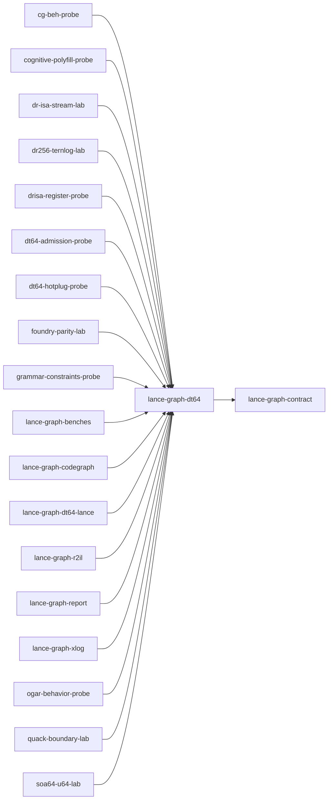

# lance-graph-dt64

crate: lance-graph-dt64
path: crates/lance-graph-dt64
workspace: member
digest: 9cffbb86670f09e6
evidence legend: ../index.md#evidence-legend

Generated; the code is the truth. See ../index.md.

## Depends on

- dep lance-graph-contract normal — crates/lance-graph-dt64/Cargo.toml:10 CONFIRMED

## Depended on by

- rdep cg-beh-probe normal — crates/cg-beh-probe/Cargo.toml:21 CONFIRMED
- rdep cognitive-polyfill-probe normal — crates/cognitive-polyfill-probe/Cargo.toml:14 CONFIRMED
- rdep dr-isa-stream-lab normal — crates/dr-isa-stream-lab/Cargo.toml:18 CONFIRMED
- rdep dr256-ternlog-lab normal — crates/dr256-ternlog-lab/Cargo.toml:10 CONFIRMED
- rdep drisa-register-probe normal — crates/drisa-register-probe/Cargo.toml:19 CONFIRMED
- rdep dt64-admission-probe normal — crates/dt64-admission-probe/Cargo.toml:18 CONFIRMED
- rdep dt64-hotplug-probe normal — crates/dt64-hotplug-probe/Cargo.toml:19 CONFIRMED
- rdep foundry-parity-lab normal — crates/foundry-parity-lab/Cargo.toml:22 CONFIRMED
- rdep grammar-constraints-probe normal — crates/grammar-constraints-probe/Cargo.toml:14 CONFIRMED
- rdep lance-graph-benches normal — crates/lance-graph-benches/Cargo.toml:30 CONFIRMED
- rdep lance-graph-codegraph normal — crates/lance-graph-codegraph/Cargo.toml:13 CONFIRMED
- rdep lance-graph-dir-sim dev — crates/lance-graph-dir-sim/Cargo.toml:51 CONFIRMED
- rdep lance-graph-dt64-lance normal — crates/lance-graph-dt64-lance/Cargo.toml:26 CONFIRMED
- rdep lance-graph-r2il normal — crates/lance-graph-r2il/Cargo.toml:29 CONFIRMED
- rdep lance-graph-rbac dev — crates/lance-graph-rbac/Cargo.toml:13 CONFIRMED
- rdep lance-graph-report normal — crates/lance-graph-report/Cargo.toml:20 CONFIRMED
- rdep lance-graph-xlog normal — crates/lance-graph-xlog/Cargo.toml:13 CONFIRMED
- rdep ogar-behavior-probe normal — crates/ogar-behavior-probe/Cargo.toml:21 CONFIRMED
- rdep quack-boundary-lab normal — crates/quack-boundary-lab/Cargo.toml:10 CONFIRMED
- rdep soa64-u64-lab normal — crates/soa64-u64-lab/Cargo.toml:16 CONFIRMED

## Public items

- enum Width [pub] — crates/lance-graph-dt64/src/dr.rs:32 CONFIRMED
- fn Width::positions [pub] — crates/lance-graph-dt64/src/dr.rs:38 CONFIRMED
- struct Axis [pub] — crates/lance-graph-dt64/src/dr.rs:48 CONFIRMED
- fn Axis::new [pub] — crates/lance-graph-dt64/src/dr.rs:54 CONFIRMED
- fn Axis::reserved [pub] — crates/lance-graph-dt64/src/dr.rs:59 CONFIRMED
- fn Axis::for_survivors [pub] — crates/lance-graph-dt64/src/dr.rs:69 CONFIRMED
- fn Axis::tile_of [pub] — crates/lance-graph-dt64/src/dr.rs:86 CONFIRMED
- struct Extent [pub] — crates/lance-graph-dt64/src/dr.rs:97 CONFIRMED
- const Extent::DR64_CUBE [pub] — crates/lance-graph-dt64/src/dr.rs:106 CONFIRMED
- const Extent::DR256_SQ_X64 [pub] — crates/lance-graph-dt64/src/dr.rs:113 CONFIRMED
- const Extent::DR256_GLOBAL_X64 [pub] — crates/lance-graph-dt64/src/dr.rs:121 CONFIRMED
- fn Extent::reserved_cells [pub] — crates/lance-graph-dt64/src/dr.rs:128 CONFIRMED
- fn Extent::tile_bytes [pub] — crates/lance-graph-dt64/src/dr.rs:135 CONFIRMED
- struct Claim [pub] — crates/lance-graph-dt64/src/dr.rs:142 CONFIRMED
- const MAX_RESERVED [pub] — crates/lance-graph-dt64/src/dr.rs:151 CONFIRMED
- struct RouteVersion [pub] — crates/lance-graph-dt64/src/dr.rs:156 CONFIRMED
- struct VersionClock [pub] — crates/lance-graph-dt64/src/dr.rs:167 CONFIRMED
- fn VersionClock::new [pub] — crates/lance-graph-dt64/src/dr.rs:170 CONFIRMED
- fn VersionClock::current [pub] — crates/lance-graph-dt64/src/dr.rs:175 CONFIRMED
- fn VersionClock::tick [pub] — crates/lance-graph-dt64/src/dr.rs:180 CONFIRMED
- fn VersionClock::fork [pub] — crates/lance-graph-dt64/src/dr.rs:185 CONFIRMED
- enum RouteRefusal [pub] — crates/lance-graph-dt64/src/dr.rs:192 CONFIRMED
- struct RouteLog [pub] — crates/lance-graph-dt64/src/dr.rs:210 CONFIRMED
- fn RouteLog::new [pub] — crates/lance-graph-dt64/src/dr.rs:229 CONFIRMED
- fn RouteLog::with_clock [pub] — crates/lance-graph-dt64/src/dr.rs:235 CONFIRMED
- fn RouteLog::clock [pub] — crates/lance-graph-dt64/src/dr.rs:243 CONFIRMED
- fn RouteLog::current_version [pub] — crates/lance-graph-dt64/src/dr.rs:248 CONFIRMED
- fn RouteLog::route [pub] — crates/lance-graph-dt64/src/dr.rs:255 CONFIRMED
- fn RouteLog::check [pub] — crates/lance-graph-dt64/src/dr.rs:268 CONFIRMED
- fn RouteLog::retract [pub] — crates/lance-graph-dt64/src/dr.rs:281 CONFIRMED
- fn RouteLog::routed_at [pub] — crates/lance-graph-dt64/src/dr.rs:296 CONFIRMED
- fn RouteLog::claimed [pub] — crates/lance-graph-dt64/src/dr.rs:319 CONFIRMED
- enum AxisKind [pub] — crates/lance-graph-dt64/src/dr.rs:340 CONFIRMED
- struct ClassAxis [pub] — crates/lance-graph-dt64/src/dr.rs:349 CONFIRMED
- struct FrameRevisions [pub] — crates/lance-graph-dt64/src/dr.rs:357 CONFIRMED
- enum FrameRefusal [pub] — crates/lance-graph-dt64/src/dr.rs:365 CONFIRMED
- struct FrameStore [pub] — crates/lance-graph-dt64/src/dr.rs:379 CONFIRMED
- fn FrameStore::new [pub] — crates/lance-graph-dt64/src/dr.rs:388 CONFIRMED
- fn FrameStore::with_clock [pub] — crates/lance-graph-dt64/src/dr.rs:393 CONFIRMED
- fn FrameStore::seal [pub] — crates/lance-graph-dt64/src/dr.rs:414 CONFIRMED
- fn FrameStore::advance [pub] — crates/lance-graph-dt64/src/dr.rs:426 CONFIRMED
- fn FrameStore::issued [pub] — crates/lance-graph-dt64/src/dr.rs:441 CONFIRMED
- fn FrameStore::revisions [pub] — crates/lance-graph-dt64/src/dr.rs:448 CONFIRMED
- fn FrameStore::same_store [pub(crate)] — crates/lance-graph-dt64/src/dr.rs:455 CONFIRMED
- fn FrameStore::check [pub] — crates/lance-graph-dt64/src/dr.rs:462 CONFIRMED
- struct Frame [pub] — crates/lance-graph-dt64/src/dr.rs:486 CONFIRMED
- fn Frame::version [pub] — crates/lance-graph-dt64/src/dr.rs:495 CONFIRMED
- fn Frame::revisions [pub] — crates/lance-graph-dt64/src/dr.rs:500 CONFIRMED
- fn Frame::same_issue [pub] — crates/lance-graph-dt64/src/dr.rs:505 CONFIRMED
- struct Focus [pub] — crates/lance-graph-dt64/src/dr.rs:513 CONFIRMED
- struct Scope [pub] — crates/lance-graph-dt64/src/dr.rs:520 CONFIRMED
- struct Guards [pub] — crates/lance-graph-dt64/src/dr.rs:526 CONFIRMED
- enum GuardRefusal [pub] — crates/lance-graph-dt64/src/dr.rs:534 CONFIRMED
- fn Guards::check [pub] — crates/lance-graph-dt64/src/dr.rs:543 CONFIRMED
- enum MapRefusal [pub] — crates/lance-graph-dt64/src/dr.rs:557 CONFIRMED
- struct LocalMap [pub] — crates/lance-graph-dt64/src/dr.rs:573 CONFIRMED
- fn LocalMap::prepare [pub] — crates/lance-graph-dt64/src/dr.rs:586 CONFIRMED
- fn LocalMap::view [pub] — crates/lance-graph-dt64/src/dr.rs:610 CONFIRMED
- fn LocalMap::width [pub] — crates/lance-graph-dt64/src/dr.rs:617 CONFIRMED
- fn LocalMap::local [pub] — crates/lance-graph-dt64/src/dr.rs:622 CONFIRMED
- fn LocalMap::global [pub] — crates/lance-graph-dt64/src/dr.rs:631 CONFIRMED
- fn LocalMap::len [pub] — crates/lance-graph-dt64/src/dr.rs:635 CONFIRMED
- fn LocalMap::is_empty [pub] — crates/lance-graph-dt64/src/dr.rs:639 CONFIRMED
- fn LocalMap::lookups [pub] — crates/lance-graph-dt64/src/dr.rs:644 CONFIRMED
- fn LocalMap::digest [pub] — crates/lance-graph-dt64/src/dr.rs:652 CONFIRMED
- type TileId [pub] — crates/lance-graph-dt64/src/dr.rs:670 CONFIRMED
- enum AdvanceRefusal [pub] — crates/lance-graph-dt64/src/dr.rs:674 CONFIRMED
- enum MapRead [pub] — crates/lance-graph-dt64/src/dr.rs:689 CONFIRMED
- struct TileMap [pub] — crates/lance-graph-dt64/src/dr.rs:763 CONFIRMED
- fn TileMap<'t>::width [pub] — crates/lance-graph-dt64/src/dr.rs:769 CONFIRMED
- fn TileMap<'t>::len [pub] — crates/lance-graph-dt64/src/dr.rs:773 CONFIRMED
- fn TileMap<'t>::is_empty [pub] — crates/lance-graph-dt64/src/dr.rs:777 CONFIRMED
- fn TileMap<'t>::local [pub] — crates/lance-graph-dt64/src/dr.rs:783 CONFIRMED
- fn TileMap<'t>::global [pub] — crates/lance-graph-dt64/src/dr.rs:793 CONFIRMED
- fn TileMap<'t>::globals [pub] — crates/lance-graph-dt64/src/dr.rs:802 CONFIRMED
- fn TileMap<'t>::lookups [pub] — crates/lance-graph-dt64/src/dr.rs:807 CONFIRMED
- fn TileMap<'t>::digest [pub] — crates/lance-graph-dt64/src/dr.rs:812 CONFIRMED
- fn TileMap<'t>::extends [pub] — crates/lance-graph-dt64/src/dr.rs:818 CONFIRMED
- struct MapDiagnostic [pub] — crates/lance-graph-dt64/src/dr.rs:831 CONFIRMED
- fn MapDiagnostic<'_>::width [pub] — crates/lance-graph-dt64/src/dr.rs:834 CONFIRMED
- fn MapDiagnostic<'_>::len [pub] — crates/lance-graph-dt64/src/dr.rs:838 CONFIRMED
- fn MapDiagnostic<'_>::is_empty [pub] — crates/lance-graph-dt64/src/dr.rs:842 CONFIRMED
- fn MapDiagnostic<'_>::local [pub] — crates/lance-graph-dt64/src/dr.rs:846 CONFIRMED
- fn MapDiagnostic<'_>::global [pub] — crates/lance-graph-dt64/src/dr.rs:850 CONFIRMED
- fn MapDiagnostic<'_>::digest [pub] — crates/lance-graph-dt64/src/dr.rs:854 CONFIRMED
- struct MapTable [pub] — crates/lance-graph-dt64/src/dr.rs:871 CONFIRMED
- fn MapTable::new [pub] — crates/lance-graph-dt64/src/dr.rs:879 CONFIRMED
- fn MapTable::with_clock [pub] — crates/lance-graph-dt64/src/dr.rs:885 CONFIRMED
- fn MapTable::with_clock_at [pub] — crates/lance-graph-dt64/src/dr.rs:905 CONFIRMED
- fn MapTable::clock [pub] — crates/lance-graph-dt64/src/dr.rs:935 CONFIRMED
- fn MapTable::current_version [pub] — crates/lance-graph-dt64/src/dr.rs:940 CONFIRMED
- fn MapTable::advance [pub] — crates/lance-graph-dt64/src/dr.rs:970 CONFIRMED
- fn MapTable::claim [pub] — crates/lance-graph-dt64/src/dr.rs:985 CONFIRMED
- fn MapTable::advance_at [pub] — crates/lance-graph-dt64/src/dr.rs:997 CONFIRMED
- fn MapTable::seal [pub] — crates/lance-graph-dt64/src/dr.rs:1045 CONFIRMED
- fn MapTable::revisions [pub] — crates/lance-graph-dt64/src/dr.rs:1049 CONFIRMED
- fn MapTable::map [pub] — crates/lance-graph-dt64/src/dr.rs:1057 CONFIRMED
- fn MapTable::diagnose_at [pub] — crates/lance-graph-dt64/src/dr.rs:1075 CONFIRMED
- fn MapTable::generation_count [pub] — crates/lance-graph-dt64/src/dr.rs:1099 CONFIRMED
- fn MapTable::event_count [pub] — crates/lance-graph-dt64/src/dr.rs:1104 CONFIRMED
- fn MapTable::locate [pub] — crates/lance-graph-dt64/src/dr.rs:1113 CONFIRMED
- enum LocateRefusal [pub] — crates/lance-graph-dt64/src/dr.rs:1138 CONFIRMED
- fn LocalMap::extends [pub] — crates/lance-graph-dt64/src/dr.rs:1155 CONFIRMED
- fn address [pub] — crates/lance-graph-dt64/src/dr.rs:1165 CONFIRMED
- fn coordinates [pub] — crates/lance-graph-dt64/src/dr.rs:1175 CONFIRMED
- fn rotate_yz [pub] — crates/lance-graph-dt64/src/dr.rs:1186 CONFIRMED
- struct ValueKey [pub] — crates/lance-graph-dt64/src/dr.rs:1197 CONFIRMED
- struct CodeSpaceId [pub] — crates/lance-graph-dt64/src/dr.rs:1203 CONFIRMED
- enum CodeRead [pub] — crates/lance-graph-dt64/src/dr.rs:1210 CONFIRMED
- struct CodeTable [pub] — crates/lance-graph-dt64/src/dr.rs:1247 CONFIRMED
- fn CodeTable<C>::new [pub] — crates/lance-graph-dt64/src/dr.rs:1254 CONFIRMED
- fn CodeTable<C>::advance [pub] — crates/lance-graph-dt64/src/dr.rs:1271 CONFIRMED
- fn CodeTable<C>::key [pub] — crates/lance-graph-dt64/src/dr.rs:1316 CONFIRMED
- fn CodeTable<C>::code [pub] — crates/lance-graph-dt64/src/dr.rs:1329 CONFIRMED
- struct CoordSpace [pub] — crates/lance-graph-dt64/src/lane.rs:28 CONFIRMED
- struct LaneAddr [pub] — crates/lance-graph-dt64/src/lane.rs:36 CONFIRMED
- trait LaneSource [pub] — crates/lance-graph-dt64/src/lane.rs:51 CONFIRMED
- struct SelAddr [pub] — crates/lance-graph-dt64/src/lane.rs:85 CONFIRMED
- trait SelectionSource [pub] — crates/lance-graph-dt64/src/lane.rs:110 CONFIRMED
- struct RouteAt [pub] — crates/lance-graph-dt64/src/lane.rs:118 CONFIRMED
- struct LaneRequest [pub] — crates/lance-graph-dt64/src/lane.rs:125 CONFIRMED
- enum LaneRefusal [pub] — crates/lance-graph-dt64/src/lane.rs:138 CONFIRMED
- struct LaneBinding [pub] — crates/lance-graph-dt64/src/lane.rs:212 CONFIRMED
- fn BindStore::bind_lanes [pub] — crates/lance-graph-dt64/src/lane.rs:234 CONFIRMED
- fn LaneBinding::class [pub] — crates/lance-graph-dt64/src/lane.rs:332 CONFIRMED
- fn LaneBinding::rev [pub] — crates/lance-graph-dt64/src/lane.rs:336 CONFIRMED
- fn LaneBinding::route [pub] — crates/lance-graph-dt64/src/lane.rs:340 CONFIRMED
- fn LaneBinding::frame [pub] — crates/lance-graph-dt64/src/lane.rs:344 CONFIRMED
- fn LaneBinding::selection [pub] — crates/lance-graph-dt64/src/lane.rs:348 CONFIRMED
- fn LaneBinding::fields [pub] — crates/lance-graph-dt64/src/lane.rs:353 CONFIRMED
- fn LaneBinding::addr [pub] — crates/lance-graph-dt64/src/lane.rs:358 CONFIRMED
- fn LaneBinding::check [pub] — crates/lance-graph-dt64/src/lane.rs:374 CONFIRMED
- fn LaneBinding::lane [pub] — crates/lance-graph-dt64/src/lane.rs:424 CONFIRMED
- fn LaneBinding::selected [pub] — crates/lance-graph-dt64/src/lane.rs:463 CONFIRMED
- fn LaneBinding::borrow_all [pub] — crates/lance-graph-dt64/src/lane.rs:512 CONFIRMED
- struct BoundLanes [pub] — crates/lance-graph-dt64/src/lane.rs:529 CONFIRMED
- mod dr [pub] — crates/lance-graph-dt64/src/lib.rs:99 CONFIRMED
- mod lane [pub] — crates/lance-graph-dt64/src/lib.rs:105 CONFIRMED
- struct MethodId [pub] — crates/lance-graph-dt64/src/lib.rs:114 CONFIRMED
- struct SigRev [pub] — crates/lance-graph-dt64/src/lib.rs:119 CONFIRMED
- struct SchemaRev [pub] — crates/lance-graph-dt64/src/lib.rs:123 CONFIRMED
- struct AlgebraRef [pub] — crates/lance-graph-dt64/src/lib.rs:130 CONFIRMED
- struct Effect [pub] — crates/lance-graph-dt64/src/lib.rs:147 CONFIRMED
- enum Arg [pub] — crates/lance-graph-dt64/src/lib.rs:159 CONFIRMED
- struct Guard [pub] — crates/lance-graph-dt64/src/lib.rs:171 CONFIRMED
- fn Guard::new [pub] — crates/lance-graph-dt64/src/lib.rs:177 CONFIRMED
- fn Guard::witness [pub] — crates/lance-graph-dt64/src/lib.rs:186 CONFIRMED
- struct GuardWitness [pub] — crates/lance-graph-dt64/src/lib.rs:200 CONFIRMED
- enum ValueDemand [pub] — crates/lance-graph-dt64/src/lib.rs:208 CONFIRMED
- struct MethodBinding [pub] — crates/lance-graph-dt64/src/lib.rs:216 CONFIRMED
- fn MethodBinding::writes [pub] — crates/lance-graph-dt64/src/lib.rs:238 CONFIRMED
- fn MethodBinding::footprint [pub] — crates/lance-graph-dt64/src/lib.rs:245 CONFIRMED
- struct ClassSchema [pub] — crates/lance-graph-dt64/src/lib.rs:255 CONFIRMED
- fn view_class [pub] — crates/lance-graph-dt64/src/lib.rs:266 CONFIRMED
- const MAX_FIELDS [pub] — crates/lance-graph-dt64/src/lib.rs:271 CONFIRMED
- struct BasisDigest [pub(crate)] — crates/lance-graph-dt64/src/lib.rs:305 CONFIRMED
- enum BasisSource [pub] — crates/lance-graph-dt64/src/lib.rs:334 CONFIRMED
- struct MethodRef [pub] — crates/lance-graph-dt64/src/lib.rs:354 CONFIRMED
- struct Stamp [pub] — crates/lance-graph-dt64/src/lib.rs:372 CONFIRMED
- fn Stamp::binding [pub] — crates/lance-graph-dt64/src/lib.rs:381 CONFIRMED
- enum Refusal [pub] — crates/lance-graph-dt64/src/lib.rs:474 CONFIRMED
- struct Resolved [pub] — crates/lance-graph-dt64/src/lib.rs:647 CONFIRMED
- struct FieldRow [pub] — crates/lance-graph-dt64/src/lib.rs:661 CONFIRMED
- struct FieldMeaning [pub] — crates/lance-graph-dt64/src/lib.rs:669 CONFIRMED
- fn Resolved<'s,'v>::methods_on [pub] — crates/lance-graph-dt64/src/lib.rs:678 CONFIRMED
- fn Resolved<'s,'v>::field_view [pub] — crates/lance-graph-dt64/src/lib.rs:684 CONFIRMED
- fn Resolved<'s,'v>::field_meaning [pub] — crates/lance-graph-dt64/src/lib.rs:701 CONFIRMED
- fn Resolved<'s,'v>::mask_where [pub] — crates/lance-graph-dt64/src/lib.rs:720 CONFIRMED
- fn Resolved<'s,'v>::unspecified [pub] — crates/lance-graph-dt64/src/lib.rs:730 CONFIRMED
- fn Resolved<'s,'v>::methods_touching [pub] — crates/lance-graph-dt64/src/lib.rs:747 CONFIRMED
- fn Resolved<'s,'v>::action_ordinals [pub] — crates/lance-graph-dt64/src/lib.rs:761 CONFIRMED
- struct BindStore [pub] — crates/lance-graph-dt64/src/lib.rs:773 CONFIRMED
- fn BindStore::new [pub] — crates/lance-graph-dt64/src/lib.rs:795 CONFIRMED
- fn BindStore::register [pub] — crates/lance-graph-dt64/src/lib.rs:815 CONFIRMED
- fn BindStore::register_derived [pub] — crates/lance-graph-dt64/src/lib.rs:827 CONFIRMED
- fn BindStore::declare_algebra [pub] — crates/lance-graph-dt64/src/lib.rs:918 CONFIRMED
- fn BindStore::arity [pub] — crates/lance-graph-dt64/src/lib.rs:944 CONFIRMED
- fn BindStore::resolve_algebra [pub] — crates/lance-graph-dt64/src/lib.rs:955 CONFIRMED
- fn BindStore::words_used [pub] — crates/lance-graph-dt64/src/lib.rs:978 CONFIRMED
- fn BindStore::users_of [pub] — crates/lance-graph-dt64/src/lib.rs:995 CONFIRMED
- fn BindStore::class_count [pub] — crates/lance-graph-dt64/src/lib.rs:1008 CONFIRMED
- fn BindStore::current_version [pub] — crates/lance-graph-dt64/src/lib.rs:1013 CONFIRMED
- fn BindStore::route [pub] — crates/lance-graph-dt64/src/lib.rs:1019 CONFIRMED
- fn BindStore::check_route [pub] — crates/lance-graph-dt64/src/lib.rs:1035 CONFIRMED
- fn BindStore::claimed [pub] — crates/lance-graph-dt64/src/lib.rs:1053 CONFIRMED
- fn BindStore::retract [pub] — crates/lance-graph-dt64/src/lib.rs:1063 CONFIRMED
- fn BindStore::routed_at [pub] — crates/lance-graph-dt64/src/lib.rs:1069 CONFIRMED
- fn BindStore::resolve [pub] — crates/lance-graph-dt64/src/lib.rs:1074 CONFIRMED
- fn BindStore::resolve_counted [pub(crate)] — crates/lance-graph-dt64/src/lib.rs:1099 CONFIRMED
- fn BindStore::bound_basis [pub(crate)] — crates/lance-graph-dt64/src/lib.rs:1114 CONFIRMED
- fn BindStore::resolve_at [pub] — crates/lance-graph-dt64/src/lib.rs:1120 CONFIRMED
- fn BindStore::method_ref [pub] — crates/lance-graph-dt64/src/lib.rs:1137 CONFIRMED
- fn BindStore::check_issuer [pub] — crates/lance-graph-dt64/src/lib.rs:1162 CONFIRMED
- fn BindStore::admit [pub] — crates/lance-graph-dt64/src/lib.rs:1181 CONFIRMED

## Imports from in-scope crates

### lance-graph-contract
- use lance_graph_contract::class_view::ClassId — crates/lance-graph-dt64/src/dr.rs:27 CONFIRMED
- use lance_graph_contract::morton8x8::Morton8x8 — crates/lance-graph-dt64/src/dr.rs:28 CONFIRMED
- use lance_graph_contract::class_view::ClassView — crates/lance-graph-dt64/src/lane.rs:19 CONFIRMED
- use lance_graph_contract::class_view::WideFieldMask — crates/lance-graph-dt64/src/lane.rs:19 CONFIRMED
- use lance_graph_contract::ontology::FieldRef — crates/lance-graph-dt64/src/lane.rs:20 CONFIRMED
- use lance_graph_contract::class_view::ClassId — crates/lance-graph-dt64/src/lib.rs:92 CONFIRMED
- use lance_graph_contract::class_view::ClassView — crates/lance-graph-dt64/src/lib.rs:92 CONFIRMED
- use lance_graph_contract::class_view::WideFieldMask — crates/lance-graph-dt64/src/lib.rs:92 CONFIRMED
- use lance_graph_contract::class_view::is_behaviour_lens — crates/lance-graph-dt64/src/lib.rs:92 CONFIRMED
- use lance_graph_contract::ogar_codebook::classid_concept — crates/lance-graph-dt64/src/lib.rs:93 CONFIRMED
- use lance_graph_contract::ontology::FieldRef — crates/lance-graph-dt64/src/lib.rs:94 CONFIRMED
- use lance_graph_contract::property::PropertySchema — crates/lance-graph-dt64/src/lib.rs:95 CONFIRMED
- use lance_graph_contract::property::PropertySpec — crates/lance-graph-dt64/src/lib.rs:95 CONFIRMED
- use lance_graph_contract::set_algebra::Logic — crates/lance-graph-dt64/src/lib.rs:96 CONFIRMED
- use lance_graph_contract::set_algebra::SetExpr — crates/lance-graph-dt64/src/lib.rs:96 CONFIRMED
- use lance_graph_contract::set_algebra::normalize — crates/lance-graph-dt64/src/lib.rs:96 CONFIRMED
- use lance_graph_contract::set_algebra::normalize_kleene — crates/lance-graph-dt64/src/lib.rs:96 CONFIRMED
- use lance_graph_contract::set_rules::Population — crates/lance-graph-dt64/src/lib.rs:97 CONFIRMED
- use lance_graph_contract::set_rules::Truth — crates/lance-graph-dt64/src/lib.rs:97 CONFIRMED

## Calls

CALL_GRAPH=ARTIFACT_MISSING
- calls ARTIFACT_MISSING — no ruff_charon artifact for this crate UNKNOWN

## Architecture

- arch DR owns-addressing MapTable [CONFIRMED] validation=OK — crates/lance-graph-dt64/src/dr.rs:871 CONFIRMED
- arch DR owns-addressing RouteLog [CONFIRMED] validation=OK — crates/lance-graph-dt64/src/dr.rs:210 CONFIRMED
- arch DT64 admits MethodRef [CONFIRMED] validation=OK — crates/lance-graph-dt64/src/lib.rs:1181 CONFIRMED
- arch LaneBinding borrowed-by LaneBinding::borrow_all [CONFIRMED] validation=OK — crates/lance-graph-dt64/src/lane.rs:512 CONFIRMED
- arch LaneBinding checked-by LaneBinding::check [CONFIRMED] validation=OK — crates/lance-graph-dt64/src/lane.rs:374 CONFIRMED
- arch LaneSource implemented-by lance-graph-report::AbiLanes [CONFIRMED] validation=OK — crates/lance-graph-report/src/lane_source.rs:143 CONFIRMED

Generated from Cargo manifests — extracted relationships only.

