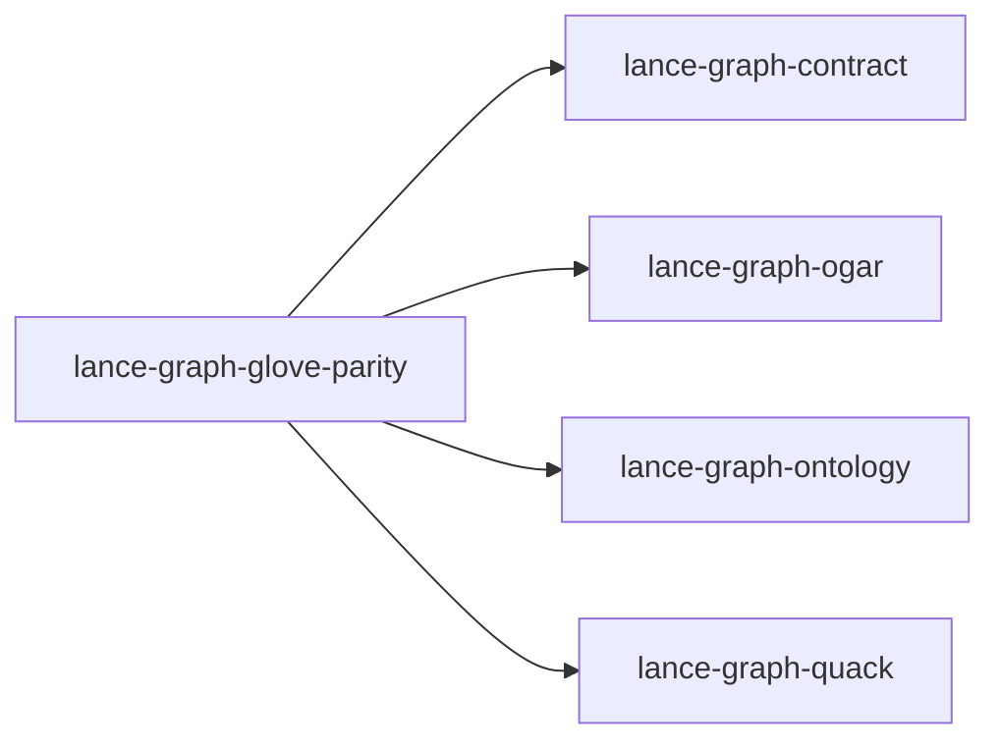

# lance-graph-glove-parity

crate: lance-graph-glove-parity
path: crates/lance-graph-glove-parity
workspace: excluded
digest: 6c47a0e14dd892f9
evidence legend: ../index.md#evidence-legend

Generated; the code is the truth. See ../index.md.

## Depends on

- dep lance-graph-contract normal — crates/lance-graph-glove-parity/Cargo.toml:14 CONFIRMED
- dep lance-graph-mask-risc dev — crates/lance-graph-glove-parity/Cargo.toml:22 CONFIRMED
- dep lance-graph-ogar normal — crates/lance-graph-glove-parity/Cargo.toml:19 CONFIRMED
- dep lance-graph-ontology normal — crates/lance-graph-glove-parity/Cargo.toml:15 CONFIRMED
- dep lance-graph-quack normal — crates/lance-graph-glove-parity/Cargo.toml:16 CONFIRMED
- dep lance-graph-sap dev — crates/lance-graph-glove-parity/Cargo.toml:23 CONFIRMED

## Depended on by

## Public items

- const CONCEPTS [pub] — crates/lance-graph-glove-parity/src/basis.rs:28 CONFIRMED
- const SAP_HOT_PLUG [pub] — crates/lance-graph-glove-parity/src/basis.rs:33 CONFIRMED
- const ODOO_HOT_PLUG [pub] — crates/lance-graph-glove-parity/src/basis.rs:40 CONFIRMED
- enum Grade [pub] — crates/lance-graph-glove-parity/src/basis.rs:48 CONFIRMED
- struct FieldMap [pub] — crates/lance-graph-glove-parity/src/basis.rs:59 CONFIRMED
- const SAP_FIELDS [pub] — crates/lance-graph-glove-parity/src/basis.rs:81 CONFIRMED
- const ODOO_FIELDS [pub] — crates/lance-graph-glove-parity/src/basis.rs:120 CONFIRMED
- const WOA_HOURS_TABLE [pub] — crates/lance-graph-glove-parity/src/basis.rs:130 CONFIRMED
- const WOA_PINNED_TABLE [pub] — crates/lance-graph-glove-parity/src/basis.rs:137 CONFIRMED
- const WOA_FIELDS [pub] — crates/lance-graph-glove-parity/src/basis.rs:152 CONFIRMED
- const ANCHORS [pub] — crates/lance-graph-glove-parity/src/basis.rs:172 CONFIRMED
- fn canonical_fields [pub] — crates/lance-graph-glove-parity/src/basis.rs:176 CONFIRMED
- mod basis [pub] — crates/lance-graph-glove-parity/src/lib.rs:14 CONFIRMED
- fn native_field [pub] — crates/lance-graph-glove-parity/src/lib.rs:31 CONFIRMED
- struct CanonicalBinder [pub] — crates/lance-graph-glove-parity/src/lib.rs:40 CONFIRMED
- fn CanonicalBinder<'a>::new [pub] — crates/lance-graph-glove-parity/src/lib.rs:52 CONFIRMED

## Imports from in-scope crates

### lance-graph-contract
- use lance_graph_contract::hotplug::HotPlug — crates/lance-graph-glove-parity/src/basis.rs:22 CONFIRMED
- use lance_graph_contract::ClassView — crates/lance-graph-glove-parity/src/basis.rs:23 CONFIRMED
### lance-graph-ogar
- use lance_graph_ogar::ogar_vocab::class_ids::BILLABLE_WORK_ENTRY — crates/lance-graph-glove-parity/src/basis.rs:24 CONFIRMED
- use lance_graph_ogar::OgarClassView — crates/lance-graph-glove-parity/src/basis.rs:25 CONFIRMED
### lance-graph-ontology
- use lance_graph_ontology::namespace::SchemaKind — crates/lance-graph-glove-parity/src/lib.rs:16 CONFIRMED
- use lance_graph_ontology::OntologyRegistry — crates/lance-graph-glove-parity/src/lib.rs:17 CONFIRMED
### lance-graph-quack
- use lance_graph_quack::bind::Binder — crates/lance-graph-glove-parity/src/lib.rs:18 CONFIRMED
- use lance_graph_quack::bind::BoundField — crates/lance-graph-glove-parity/src/lib.rs:18 CONFIRMED
- use lance_graph_quack::bind::TableId — crates/lance-graph-glove-parity/src/lib.rs:18 CONFIRMED
- use lance_graph_quack::Col — crates/lance-graph-glove-parity/src/lib.rs:19 CONFIRMED
- use lance_graph_quack::Mask — crates/lance-graph-glove-parity/src/lib.rs:19 CONFIRMED

## Calls

CALL_GRAPH=ARTIFACT_MISSING
- calls ARTIFACT_MISSING — no ruff_charon artifact for this crate UNKNOWN

## Architecture

- none

Generated from Cargo manifests — extracted relationships only.

