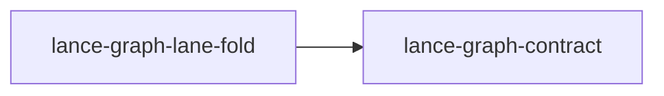

# lance-graph-lane-fold

crate: lance-graph-lane-fold
path: crates/lance-graph-lane-fold
workspace: member
digest: 6806a00a4e9aad08
evidence legend: ../index.md#evidence-legend

Generated; the code is the truth. See ../index.md.

## Depends on

- dep lance-graph-contract normal — crates/lance-graph-lane-fold/Cargo.toml:15 CONFIRMED
- dep lance-graph-report dev — crates/lance-graph-lane-fold/Cargo.toml:11 CONFIRMED

## Depended on by

## Public items

- struct Tableau [pub] — crates/lance-graph-lane-fold/src/clifford_fold.rs:59 CONFIRMED
- fn Tableau::zero [pub] — crates/lance-graph-lane-fold/src/clifford_fold.rs:64 CONFIRMED
- fn Tableau::h [pub] — crates/lance-graph-lane-fold/src/clifford_fold.rs:81 CONFIRMED
- fn Tableau::s [pub] — crates/lance-graph-lane-fold/src/clifford_fold.rs:86 CONFIRMED
- fn Tableau::cnot [pub] — crates/lance-graph-lane-fold/src/clifford_fold.rs:91 CONFIRMED
- fn Tableau::t [pub] — crates/lance-graph-lane-fold/src/clifford_fold.rs:97 CONFIRMED
- fn Tableau::parity [pub] — crates/lance-graph-lane-fold/src/clifford_fold.rs:103 CONFIRMED
- struct CheckedOrdinal [pub] — crates/lance-graph-lane-fold/src/optics.rs:10 CONFIRMED
- struct AnalogEnergy [pub] — crates/lance-graph-lane-fold/src/optics.rs:17 CONFIRMED
- fn exact_popcount [pub] — crates/lance-graph-lane-fold/src/optics.rs:22 CONFIRMED
- fn analog_inner [pub] — crates/lance-graph-lane-fold/src/optics.rs:28 CONFIRMED
- fn AnalogEnergy::as_popcount [pub] — crates/lance-graph-lane-fold/src/optics.rs:37 CONFIRMED
- fn AnalogEnergy::as_ordinal [pub] — crates/lance-graph-lane-fold/src/optics.rs:45 CONFIRMED
- const N [pub] — crates/lance-graph-lane-fold/src/query.rs:4 CONFIRMED
- const MASK_WORDS [pub] — crates/lance-graph-lane-fold/src/query.rs:5 CONFIRMED
- const APERTURE_CAP [pub] — crates/lance-graph-lane-fold/src/query.rs:6 CONFIRMED
- struct Row [pub] — crates/lance-graph-lane-fold/src/query.rs:9 CONFIRMED
- struct ApertureId [pub] — crates/lance-graph-lane-fold/src/query.rs:19 CONFIRMED
- struct LaneId [pub] — crates/lance-graph-lane-fold/src/query.rs:22 CONFIRMED
- struct Aperture [pub] — crates/lance-graph-lane-fold/src/query.rs:25 CONFIRMED
- fn Aperture<'a>::resident [pub] — crates/lance-graph-lane-fold/src/query.rs:32 CONFIRMED
- enum Hom [pub] — crates/lance-graph-lane-fold/src/query.rs:45 CONFIRMED
- enum Request [pub] — crates/lance-graph-lane-fold/src/query.rs:78 CONFIRMED
- enum Refuse [pub] — crates/lance-graph-lane-fold/src/query.rs:86 CONFIRMED
- struct Query [pub] — crates/lance-graph-lane-fold/src/query.rs:100 CONFIRMED
- struct Terminal [pub] — crates/lance-graph-lane-fold/src/query.rs:110 CONFIRMED
- struct BestQuery [pub] — crates/lance-graph-lane-fold/src/query.rs:119 CONFIRMED
- fn Query<'a>::check [pub] — crates/lance-graph-lane-fold/src/query.rs:126 CONFIRMED
- fn Query<'a>::collapse [pub] — crates/lance-graph-lane-fold/src/query.rs:139 CONFIRMED
- enum Star [pub] — crates/lance-graph-lane-fold/src/stars.rs:2 CONFIRMED
- enum MapOp [pub] — crates/lance-graph-lane-fold/src/stars.rs:15 CONFIRMED
- enum Landing [pub] — crates/lance-graph-lane-fold/src/stars.rs:23 CONFIRMED
- struct Map [pub] — crates/lance-graph-lane-fold/src/stars.rs:34 CONFIRMED
- struct Teleport [pub] — crates/lance-graph-lane-fold/src/stars.rs:40 CONFIRMED
- const Map::MASK_CAP [pub] — crates/lance-graph-lane-fold/src/stars.rs:46 CONFIRMED
- fn Map::draw [pub] — crates/lance-graph-lane-fold/src/stars.rs:48 CONFIRMED
- fn Map::teleport [pub] — crates/lance-graph-lane-fold/src/stars.rs:56 CONFIRMED

## Imports from in-scope crates

### lance-graph-contract
- use lance_graph_contract::algebra_law::AlgebraDescriptor — crates/lance-graph-lane-fold/src/query.rs:1 CONFIRMED
- use lance_graph_contract::algebra_law::AlgebraLaw — crates/lance-graph-lane-fold/src/query.rs:1 CONFIRMED
- use lance_graph_contract::algebra_law::IdentityKind — crates/lance-graph-lane-fold/src/query.rs:1 CONFIRMED

## Calls

CALL_GRAPH=ARTIFACT_MISSING
- calls ARTIFACT_MISSING — no ruff_charon artifact for this crate UNKNOWN

## Architecture

- none

Generated from Cargo manifests — extracted relationships only.

