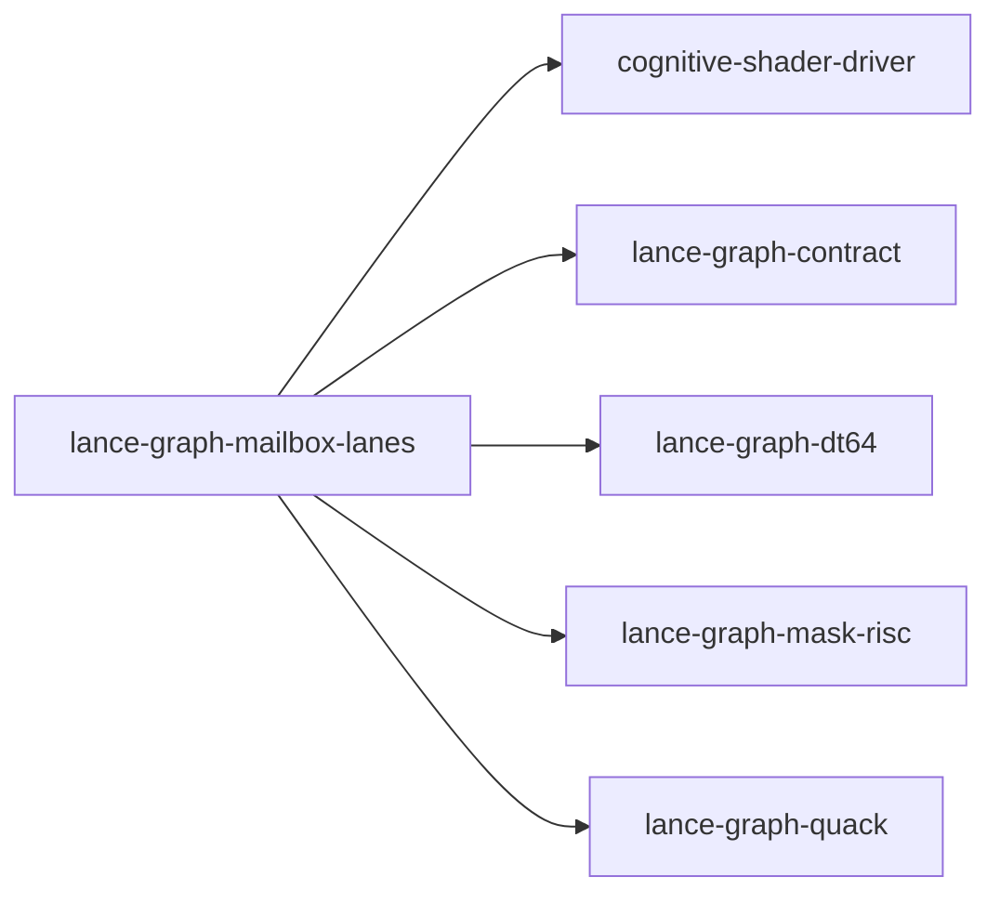

# lance-graph-mailbox-lanes

crate: lance-graph-mailbox-lanes
path: crates/lance-graph-mailbox-lanes
workspace: member
digest: eadb6fdc025a2be1
evidence legend: ../index.md#evidence-legend

Generated; the code is the truth. See ../index.md.

## Depends on

- dep causal-edge dev — crates/lance-graph-mailbox-lanes/Cargo.toml:17 CONFIRMED
- dep cognitive-shader-driver normal — crates/lance-graph-mailbox-lanes/Cargo.toml:9 CONFIRMED
- dep lance-graph-contract normal — crates/lance-graph-mailbox-lanes/Cargo.toml:10 CONFIRMED
- dep lance-graph-dt64 normal — crates/lance-graph-mailbox-lanes/Cargo.toml:11 CONFIRMED
- dep lance-graph-mask-risc normal — crates/lance-graph-mailbox-lanes/Cargo.toml:12 CONFIRMED
- dep lance-graph-quack normal — crates/lance-graph-mailbox-lanes/Cargo.toml:14 CONFIRMED
- dep lance-graph-report dev — crates/lance-graph-mailbox-lanes/Cargo.toml:19 CONFIRMED

## Depended on by

## Public items

- enum CoordRefusal [pub] — crates/lance-graph-mailbox-lanes/src/coords.rs:30 CONFIRMED
- struct Coordinates [pub] — crates/lance-graph-mailbox-lanes/src/coords.rs:47 CONFIRMED
- fn Coordinates::bind [pub] — crates/lance-graph-mailbox-lanes/src/coords.rs:55 CONFIRMED
- fn Coordinates::frame [pub] — crates/lance-graph-mailbox-lanes/src/coords.rs:64 CONFIRMED
- fn Coordinates::row_of [pub] — crates/lance-graph-mailbox-lanes/src/coords.rs:70 CONFIRMED
- mod coords [pub] — crates/lance-graph-mailbox-lanes/src/lib.rs:41 CONFIRMED
- mod when [pub] — crates/lance-graph-mailbox-lanes/src/lib.rs:42 CONFIRMED
- enum Column [pub] — crates/lance-graph-mailbox-lanes/src/lib.rs:56 CONFIRMED
- enum ColumnRefusal [pub] — crates/lance-graph-mailbox-lanes/src/lib.rs:71 CONFIRMED
- const Column::ALL [pub] — crates/lance-graph-mailbox-lanes/src/lib.rs:80 CONFIRMED
- fn Column::iri [pub] — crates/lance-graph-mailbox-lanes/src/lib.rs:90 CONFIRMED
- fn Column::from_iri [pub] — crates/lance-graph-mailbox-lanes/src/lib.rs:101 CONFIRMED
- enum Keep [pub] — crates/lance-graph-mailbox-lanes/src/lib.rs:127 CONFIRMED
- enum SelectionRefusal [pub] — crates/lance-graph-mailbox-lanes/src/lib.rs:147 CONFIRMED
- struct MailboxLanes [pub] — crates/lance-graph-mailbox-lanes/src/lib.rs:158 CONFIRMED
- fn MailboxLanes<'a,N>::new [pub] — crates/lance-graph-mailbox-lanes/src/lib.rs:174 CONFIRMED
- fn MailboxLanes<'a,N>::frame_store [pub] — crates/lance-graph-mailbox-lanes/src/lib.rs:193 CONFIRMED
- fn MailboxLanes<'a,N>::seal [pub] — crates/lance-graph-mailbox-lanes/src/lib.rs:199 CONFIRMED
- fn MailboxLanes<'a,N>::space [pub] — crates/lance-graph-mailbox-lanes/src/lib.rs:207 CONFIRMED
- fn MailboxLanes<'a,N>::rows [pub] — crates/lance-graph-mailbox-lanes/src/lib.rs:216 CONFIRMED
- fn MailboxLanes<'a,N>::issue_order [pub] — crates/lance-graph-mailbox-lanes/src/lib.rs:241 CONFIRMED
- fn MailboxLanes<'a,N>::issue_where [pub] — crates/lance-graph-mailbox-lanes/src/lib.rs:249 CONFIRMED
- fn MailboxLanes<'a,N>::issue_concat [pub] — crates/lance-graph-mailbox-lanes/src/lib.rs:258 CONFIRMED
- enum WhenRefusal [pub] — crates/lance-graph-mailbox-lanes/src/when.rs:48 CONFIRMED
- struct WhenRequest [pub] — crates/lance-graph-mailbox-lanes/src/when.rs:70 CONFIRMED
- struct Fired [pub] — crates/lance-graph-mailbox-lanes/src/when.rs:79 CONFIRMED
- fn Fired::rows [pub] — crates/lance-graph-mailbox-lanes/src/when.rs:88 CONFIRMED
- fn Fired::count [pub] — crates/lance-graph-mailbox-lanes/src/when.rs:93 CONFIRMED
- fn Fired::fields [pub] — crates/lance-graph-mailbox-lanes/src/when.rs:99 CONFIRMED
- fn Fired::holds [pub] — crates/lance-graph-mailbox-lanes/src/when.rs:106 CONFIRMED
- fn when [pub] — crates/lance-graph-mailbox-lanes/src/when.rs:129 CONFIRMED

## Imports from in-scope crates

### cognitive-shader-driver
- use cognitive_shader_driver::mailbox_soa::Published — crates/lance-graph-mailbox-lanes/src/lib.rs:46 CONFIRMED
### lance-graph-contract
- use lance_graph_contract::ontology::FieldRef — crates/lance-graph-mailbox-lanes/src/lib.rs:47 CONFIRMED
- use lance_graph_contract::soa_view::MailboxSoaView — crates/lance-graph-mailbox-lanes/src/lib.rs:48 CONFIRMED
- use lance_graph_contract::class_view::ClassView — crates/lance-graph-mailbox-lanes/src/when.rs:34 CONFIRMED
- use lance_graph_contract::class_view::WideFieldMask — crates/lance-graph-mailbox-lanes/src/when.rs:34 CONFIRMED
- use lance_graph_contract::set_algebra::Logic — crates/lance-graph-mailbox-lanes/src/when.rs:35 CONFIRMED
### lance-graph-dt64
- use lance_graph_dt64::dr::Frame — crates/lance-graph-mailbox-lanes/src/coords.rs:26 CONFIRMED
- use lance_graph_dt64::dr::FrameRefusal — crates/lance-graph-mailbox-lanes/src/coords.rs:26 CONFIRMED
- use lance_graph_dt64::dr::MapRead — crates/lance-graph-mailbox-lanes/src/coords.rs:26 CONFIRMED
- use lance_graph_dt64::dr::MapRefusal — crates/lance-graph-mailbox-lanes/src/coords.rs:26 CONFIRMED
- use lance_graph_dt64::dr::MapTable — crates/lance-graph-mailbox-lanes/src/coords.rs:26 CONFIRMED
- use lance_graph_dt64::dr::TileId — crates/lance-graph-mailbox-lanes/src/coords.rs:26 CONFIRMED
- use lance_graph_dt64::dr::Frame — crates/lance-graph-mailbox-lanes/src/lib.rs:49 CONFIRMED
- use lance_graph_dt64::dr::FrameRevisions — crates/lance-graph-mailbox-lanes/src/lib.rs:49 CONFIRMED
- use lance_graph_dt64::dr::FrameStore — crates/lance-graph-mailbox-lanes/src/lib.rs:49 CONFIRMED
- use lance_graph_dt64::dr::Scope — crates/lance-graph-mailbox-lanes/src/lib.rs:49 CONFIRMED
- use lance_graph_dt64::CoordSpace — crates/lance-graph-mailbox-lanes/src/lib.rs:50 CONFIRMED
- use lance_graph_dt64::LaneAddr — crates/lance-graph-mailbox-lanes/src/lib.rs:50 CONFIRMED
- use lance_graph_dt64::LaneSource — crates/lance-graph-mailbox-lanes/src/lib.rs:50 CONFIRMED
- use lance_graph_dt64::SchemaRev — crates/lance-graph-mailbox-lanes/src/lib.rs:50 CONFIRMED
- use lance_graph_dt64::SelAddr — crates/lance-graph-mailbox-lanes/src/lib.rs:50 CONFIRMED
- use lance_graph_dt64::SelectionSource — crates/lance-graph-mailbox-lanes/src/lib.rs:50 CONFIRMED
- use lance_graph_dt64::dr::Scope — crates/lance-graph-mailbox-lanes/src/when.rs:36 CONFIRMED
- use lance_graph_dt64::BindStore — crates/lance-graph-mailbox-lanes/src/when.rs:38 CONFIRMED
- use lance_graph_dt64::Guard — crates/lance-graph-mailbox-lanes/src/when.rs:38 CONFIRMED
- use lance_graph_dt64::LaneBinding — crates/lance-graph-mailbox-lanes/src/when.rs:38 CONFIRMED
- use lance_graph_dt64::LaneRefusal — crates/lance-graph-mailbox-lanes/src/when.rs:38 CONFIRMED
- use lance_graph_dt64::LaneRequest — crates/lance-graph-mailbox-lanes/src/when.rs:38 CONFIRMED
- use lance_graph_dt64::RouteAt — crates/lance-graph-mailbox-lanes/src/when.rs:38 CONFIRMED
- use lance_graph_dt64::SchemaRev — crates/lance-graph-mailbox-lanes/src/when.rs:38 CONFIRMED
### lance-graph-mask-risc
- use lance_graph_mask_risc::LaneRef — crates/lance-graph-mailbox-lanes/src/lib.rs:51 CONFIRMED
- use lance_graph_mask_risc::ExecError — crates/lance-graph-mailbox-lanes/src/when.rs:40 CONFIRMED
- use lance_graph_mask_risc::Foreign — crates/lance-graph-mailbox-lanes/src/when.rs:40 CONFIRMED
- use lance_graph_mask_risc::Out — crates/lance-graph-mailbox-lanes/src/when.rs:40 CONFIRMED
- use lance_graph_mask_risc::Planes — crates/lance-graph-mailbox-lanes/src/when.rs:40 CONFIRMED
- use lance_graph_mask_risc::Scratch — crates/lance-graph-mailbox-lanes/src/when.rs:40 CONFIRMED
- use lance_graph_mask_risc::execute_into — crates/lance-graph-mailbox-lanes/src/when.rs:40 CONFIRMED
- use lance_graph_mask_risc::words_for — crates/lance-graph-mailbox-lanes/src/when.rs:40 CONFIRMED
### lance-graph-quack
- use lance_graph_quack::set::SetLowerError — crates/lance-graph-mailbox-lanes/src/when.rs:41 CONFIRMED
- use lance_graph_quack::set::SetLowered — crates/lance-graph-mailbox-lanes/src/when.rs:41 CONFIRMED
- use lance_graph_quack::set::lower_set — crates/lance-graph-mailbox-lanes/src/when.rs:41 CONFIRMED
- use lance_graph_quack::Agg — crates/lance-graph-mailbox-lanes/src/when.rs:42 CONFIRMED
- use lance_graph_quack::LowerError — crates/lance-graph-mailbox-lanes/src/when.rs:42 CONFIRMED
- use lance_graph_quack::Query — crates/lance-graph-mailbox-lanes/src/when.rs:42 CONFIRMED
- use lance_graph_quack::lower — crates/lance-graph-mailbox-lanes/src/when.rs:42 CONFIRMED

## Calls

CALL_GRAPH=ARTIFACT_MISSING
- calls ARTIFACT_MISSING — no ruff_charon artifact for this crate UNKNOWN

## Architecture

- none

Generated from Cargo manifests — extracted relationships only.

