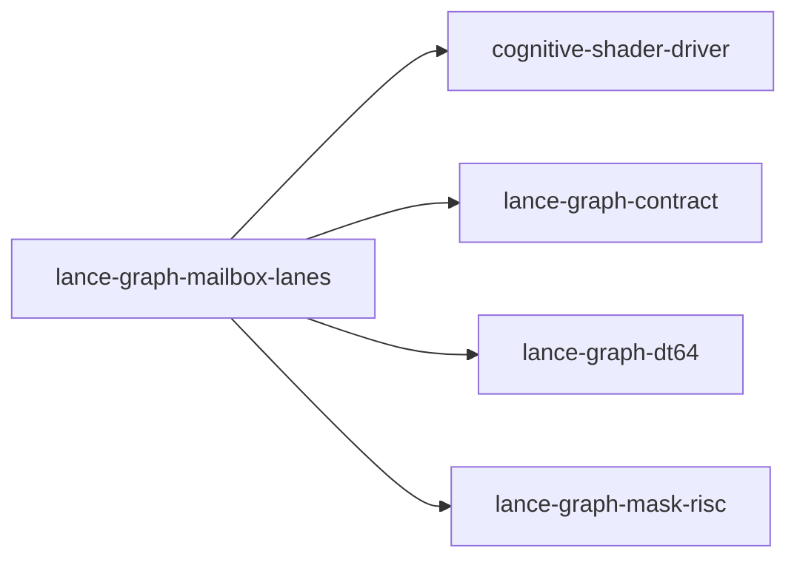

# lance-graph-mailbox-lanes

crate: lance-graph-mailbox-lanes
path: crates/lance-graph-mailbox-lanes
workspace: member
digest: c8348b27ced92e45
evidence legend: ../index.md#evidence-legend

Generated; the code is the truth. See ../index.md.

## Depends on

- dep causal-edge dev — crates/lance-graph-mailbox-lanes/Cargo.toml:15 CONFIRMED
- dep cognitive-shader-driver normal — crates/lance-graph-mailbox-lanes/Cargo.toml:9 CONFIRMED
- dep lance-graph-contract normal — crates/lance-graph-mailbox-lanes/Cargo.toml:10 CONFIRMED
- dep lance-graph-dt64 normal — crates/lance-graph-mailbox-lanes/Cargo.toml:11 CONFIRMED
- dep lance-graph-mask-risc normal — crates/lance-graph-mailbox-lanes/Cargo.toml:12 CONFIRMED

## Depended on by

## Public items

- enum CoordRefusal [pub] — crates/lance-graph-mailbox-lanes/src/coords.rs:30 CONFIRMED
- struct Coordinates [pub] — crates/lance-graph-mailbox-lanes/src/coords.rs:47 CONFIRMED
- fn Coordinates::bind [pub] — crates/lance-graph-mailbox-lanes/src/coords.rs:55 CONFIRMED
- fn Coordinates::frame [pub] — crates/lance-graph-mailbox-lanes/src/coords.rs:64 CONFIRMED
- fn Coordinates::row_of [pub] — crates/lance-graph-mailbox-lanes/src/coords.rs:70 CONFIRMED
- mod coords [pub] — crates/lance-graph-mailbox-lanes/src/lib.rs:39 CONFIRMED
- enum Column [pub] — crates/lance-graph-mailbox-lanes/src/lib.rs:51 CONFIRMED
- enum ColumnRefusal [pub] — crates/lance-graph-mailbox-lanes/src/lib.rs:66 CONFIRMED
- const Column::ALL [pub] — crates/lance-graph-mailbox-lanes/src/lib.rs:75 CONFIRMED
- fn Column::iri [pub] — crates/lance-graph-mailbox-lanes/src/lib.rs:85 CONFIRMED
- fn Column::from_iri [pub] — crates/lance-graph-mailbox-lanes/src/lib.rs:96 CONFIRMED
- enum Keep [pub] — crates/lance-graph-mailbox-lanes/src/lib.rs:122 CONFIRMED
- enum SelectionRefusal [pub] — crates/lance-graph-mailbox-lanes/src/lib.rs:142 CONFIRMED
- struct MailboxLanes [pub] — crates/lance-graph-mailbox-lanes/src/lib.rs:150 CONFIRMED
- fn MailboxLanes<'a,N>::new [pub] — crates/lance-graph-mailbox-lanes/src/lib.rs:162 CONFIRMED
- fn MailboxLanes<'a,N>::frame_store [pub] — crates/lance-graph-mailbox-lanes/src/lib.rs:179 CONFIRMED
- fn MailboxLanes<'a,N>::seal [pub] — crates/lance-graph-mailbox-lanes/src/lib.rs:185 CONFIRMED
- fn MailboxLanes<'a,N>::space [pub] — crates/lance-graph-mailbox-lanes/src/lib.rs:191 CONFIRMED
- fn MailboxLanes<'a,N>::rows [pub] — crates/lance-graph-mailbox-lanes/src/lib.rs:200 CONFIRMED
- fn MailboxLanes<'a,N>::issue_order [pub] — crates/lance-graph-mailbox-lanes/src/lib.rs:225 CONFIRMED
- fn MailboxLanes<'a,N>::issue_where [pub] — crates/lance-graph-mailbox-lanes/src/lib.rs:233 CONFIRMED
- fn MailboxLanes<'a,N>::issue_concat [pub] — crates/lance-graph-mailbox-lanes/src/lib.rs:242 CONFIRMED

## Imports from in-scope crates

### cognitive-shader-driver
- use cognitive_shader_driver::mailbox_soa::Published — crates/lance-graph-mailbox-lanes/src/lib.rs:41 CONFIRMED
### lance-graph-contract
- use lance_graph_contract::ontology::FieldRef — crates/lance-graph-mailbox-lanes/src/lib.rs:42 CONFIRMED
- use lance_graph_contract::soa_view::MailboxSoaView — crates/lance-graph-mailbox-lanes/src/lib.rs:43 CONFIRMED
### lance-graph-dt64
- use lance_graph_dt64::dr::Frame — crates/lance-graph-mailbox-lanes/src/coords.rs:26 CONFIRMED
- use lance_graph_dt64::dr::FrameRefusal — crates/lance-graph-mailbox-lanes/src/coords.rs:26 CONFIRMED
- use lance_graph_dt64::dr::MapRead — crates/lance-graph-mailbox-lanes/src/coords.rs:26 CONFIRMED
- use lance_graph_dt64::dr::MapRefusal — crates/lance-graph-mailbox-lanes/src/coords.rs:26 CONFIRMED
- use lance_graph_dt64::dr::MapTable — crates/lance-graph-mailbox-lanes/src/coords.rs:26 CONFIRMED
- use lance_graph_dt64::dr::TileId — crates/lance-graph-mailbox-lanes/src/coords.rs:26 CONFIRMED
- use lance_graph_dt64::dr::Frame — crates/lance-graph-mailbox-lanes/src/lib.rs:44 CONFIRMED
- use lance_graph_dt64::dr::FrameRevisions — crates/lance-graph-mailbox-lanes/src/lib.rs:44 CONFIRMED
- use lance_graph_dt64::dr::FrameStore — crates/lance-graph-mailbox-lanes/src/lib.rs:44 CONFIRMED
- use lance_graph_dt64::dr::Scope — crates/lance-graph-mailbox-lanes/src/lib.rs:44 CONFIRMED
- use lance_graph_dt64::CoordSpace — crates/lance-graph-mailbox-lanes/src/lib.rs:45 CONFIRMED
- use lance_graph_dt64::LaneAddr — crates/lance-graph-mailbox-lanes/src/lib.rs:45 CONFIRMED
- use lance_graph_dt64::LaneSource — crates/lance-graph-mailbox-lanes/src/lib.rs:45 CONFIRMED
- use lance_graph_dt64::SchemaRev — crates/lance-graph-mailbox-lanes/src/lib.rs:45 CONFIRMED
- use lance_graph_dt64::SelAddr — crates/lance-graph-mailbox-lanes/src/lib.rs:45 CONFIRMED
- use lance_graph_dt64::SelectionSource — crates/lance-graph-mailbox-lanes/src/lib.rs:45 CONFIRMED
### lance-graph-mask-risc
- use lance_graph_mask_risc::LaneRef — crates/lance-graph-mailbox-lanes/src/lib.rs:46 CONFIRMED

## Calls

CALL_GRAPH=ARTIFACT_MISSING
- calls ARTIFACT_MISSING — no ruff_charon artifact for this crate UNKNOWN

## Architecture

- none

Generated from Cargo manifests — extracted relationships only.

