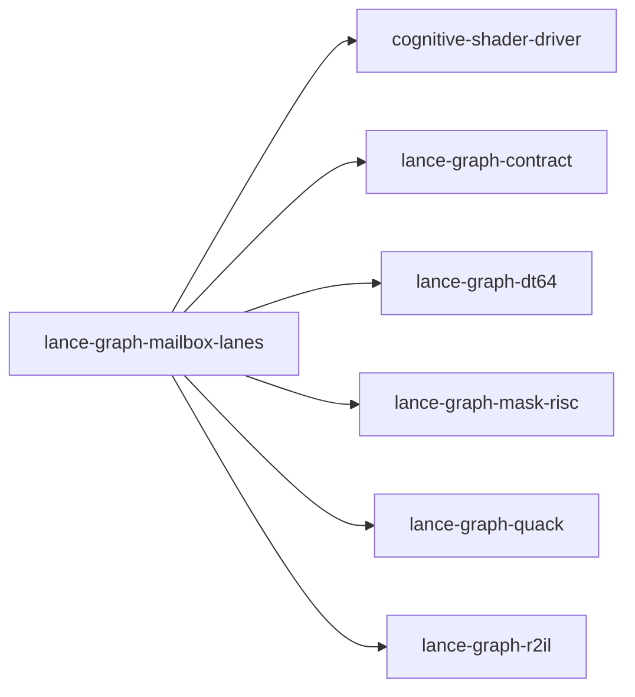

# lance-graph-mailbox-lanes

crate: lance-graph-mailbox-lanes
path: crates/lance-graph-mailbox-lanes
workspace: member
digest: 2bc646a50a15bc18
evidence legend: ../index.md#evidence-legend

Generated; the code is the truth. See ../index.md.

## Depends on

- dep causal-edge dev — crates/lance-graph-mailbox-lanes/Cargo.toml:19 CONFIRMED
- dep cognitive-shader-driver normal — crates/lance-graph-mailbox-lanes/Cargo.toml:9 CONFIRMED
- dep lance-graph-contract normal — crates/lance-graph-mailbox-lanes/Cargo.toml:10 CONFIRMED
- dep lance-graph-dt64 normal — crates/lance-graph-mailbox-lanes/Cargo.toml:11 CONFIRMED
- dep lance-graph-mask-risc normal — crates/lance-graph-mailbox-lanes/Cargo.toml:12 CONFIRMED
- dep lance-graph-quack normal — crates/lance-graph-mailbox-lanes/Cargo.toml:14 CONFIRMED
- dep lance-graph-r2il normal — crates/lance-graph-mailbox-lanes/Cargo.toml:16 CONFIRMED
- dep lance-graph-report dev — crates/lance-graph-mailbox-lanes/Cargo.toml:21 CONFIRMED

## Depended on by

## Public items

- struct ActContext [pub] — crates/lance-graph-mailbox-lanes/src/act.rs:98 CONFIRMED
- enum ActRefusal [pub] — crates/lance-graph-mailbox-lanes/src/act.rs:109 CONFIRMED
- struct Intent [pub] — crates/lance-graph-mailbox-lanes/src/act.rs:132 CONFIRMED
- fn Intent::column [pub] — crates/lance-graph-mailbox-lanes/src/act.rs:144 CONFIRMED
- fn Intent::value [pub] — crates/lance-graph-mailbox-lanes/src/act.rs:149 CONFIRMED
- struct Acted [pub] — crates/lance-graph-mailbox-lanes/src/act.rs:167 CONFIRMED
- fn act [pub] — crates/lance-graph-mailbox-lanes/src/act.rs:195 CONFIRMED
- enum ApplyRefusal [pub] — crates/lance-graph-mailbox-lanes/src/act.rs:361 CONFIRMED
- struct Applied [pub] — crates/lance-graph-mailbox-lanes/src/act.rs:380 CONFIRMED
- fn apply [pub] — crates/lance-graph-mailbox-lanes/src/act.rs:413 CONFIRMED
- struct Fire [pub] — crates/lance-graph-mailbox-lanes/src/act.rs:490 CONFIRMED
- struct Round [pub] — crates/lance-graph-mailbox-lanes/src/act.rs:510 CONFIRMED
- struct Cascade [pub] — crates/lance-graph-mailbox-lanes/src/act.rs:516 CONFIRMED
- fn cascade [pub] — crates/lance-graph-mailbox-lanes/src/act.rs:534 CONFIRMED
- enum CoordRefusal [pub] — crates/lance-graph-mailbox-lanes/src/coords.rs:30 CONFIRMED
- struct Coordinates [pub] — crates/lance-graph-mailbox-lanes/src/coords.rs:47 CONFIRMED
- fn Coordinates::bind [pub] — crates/lance-graph-mailbox-lanes/src/coords.rs:55 CONFIRMED
- fn Coordinates::frame [pub] — crates/lance-graph-mailbox-lanes/src/coords.rs:64 CONFIRMED
- fn Coordinates::row_of [pub] — crates/lance-graph-mailbox-lanes/src/coords.rs:70 CONFIRMED
- mod act [pub] — crates/lance-graph-mailbox-lanes/src/lib.rs:41 CONFIRMED
- mod coords [pub] — crates/lance-graph-mailbox-lanes/src/lib.rs:42 CONFIRMED
- mod when [pub] — crates/lance-graph-mailbox-lanes/src/lib.rs:43 CONFIRMED
- enum Column [pub] — crates/lance-graph-mailbox-lanes/src/lib.rs:58 CONFIRMED
- enum ColumnRefusal [pub] — crates/lance-graph-mailbox-lanes/src/lib.rs:73 CONFIRMED
- const Column::ALL [pub] — crates/lance-graph-mailbox-lanes/src/lib.rs:82 CONFIRMED
- fn Column::iri [pub] — crates/lance-graph-mailbox-lanes/src/lib.rs:92 CONFIRMED
- fn Column::from_iri [pub] — crates/lance-graph-mailbox-lanes/src/lib.rs:103 CONFIRMED
- enum Keep [pub] — crates/lance-graph-mailbox-lanes/src/lib.rs:129 CONFIRMED
- enum SelectionRefusal [pub] — crates/lance-graph-mailbox-lanes/src/lib.rs:149 CONFIRMED
- struct MailboxLanes [pub] — crates/lance-graph-mailbox-lanes/src/lib.rs:160 CONFIRMED
- fn MailboxLanes<'a,N>::new [pub] — crates/lance-graph-mailbox-lanes/src/lib.rs:179 CONFIRMED
- fn MailboxLanes<'a,N>::lends [pub] — crates/lance-graph-mailbox-lanes/src/lib.rs:198 CONFIRMED
- fn MailboxLanes<'a,N>::owner_cycle [pub] — crates/lance-graph-mailbox-lanes/src/lib.rs:205 CONFIRMED
- fn MailboxLanes<'a,N>::frame_store [pub] — crates/lance-graph-mailbox-lanes/src/lib.rs:213 CONFIRMED
- fn MailboxLanes<'a,N>::seal [pub] — crates/lance-graph-mailbox-lanes/src/lib.rs:219 CONFIRMED
- fn MailboxLanes<'a,N>::space [pub] — crates/lance-graph-mailbox-lanes/src/lib.rs:227 CONFIRMED
- fn MailboxLanes<'a,N>::rows [pub] — crates/lance-graph-mailbox-lanes/src/lib.rs:236 CONFIRMED
- fn MailboxLanes<'a,N>::issue_order [pub] — crates/lance-graph-mailbox-lanes/src/lib.rs:261 CONFIRMED
- fn MailboxLanes<'a,N>::issue_where [pub] — crates/lance-graph-mailbox-lanes/src/lib.rs:269 CONFIRMED
- fn MailboxLanes<'a,N>::issue_concat [pub] — crates/lance-graph-mailbox-lanes/src/lib.rs:278 CONFIRMED
- enum WhenRefusal [pub] — crates/lance-graph-mailbox-lanes/src/when.rs:48 CONFIRMED
- struct WhenRequest [pub] — crates/lance-graph-mailbox-lanes/src/when.rs:70 CONFIRMED
- struct Fired [pub] — crates/lance-graph-mailbox-lanes/src/when.rs:79 CONFIRMED
- fn Fired::rows [pub] — crates/lance-graph-mailbox-lanes/src/when.rs:88 CONFIRMED
- fn Fired::count [pub] — crates/lance-graph-mailbox-lanes/src/when.rs:93 CONFIRMED
- fn Fired::bits [pub(crate)] — crates/lance-graph-mailbox-lanes/src/when.rs:99 CONFIRMED
- fn Fired::fields [pub] — crates/lance-graph-mailbox-lanes/src/when.rs:105 CONFIRMED
- fn Fired::holds [pub] — crates/lance-graph-mailbox-lanes/src/when.rs:112 CONFIRMED
- fn when [pub] — crates/lance-graph-mailbox-lanes/src/when.rs:135 CONFIRMED

## Imports from in-scope crates

### cognitive-shader-driver
- use cognitive_shader_driver::mailbox_soa::MailboxSoA — crates/lance-graph-mailbox-lanes/src/act.rs:75 CONFIRMED
- use cognitive_shader_driver::mailbox_soa::WriteCell — crates/lance-graph-mailbox-lanes/src/act.rs:75 CONFIRMED
- use cognitive_shader_driver::mailbox_soa::WriteOutcome — crates/lance-graph-mailbox-lanes/src/act.rs:75 CONFIRMED
- use cognitive_shader_driver::mailbox_soa::Published — crates/lance-graph-mailbox-lanes/src/lib.rs:48 CONFIRMED
### lance-graph-contract
- use lance_graph_contract::class_view::ClassView — crates/lance-graph-mailbox-lanes/src/act.rs:76 CONFIRMED
- use lance_graph_contract::cognitive_shader::MetaWord — crates/lance-graph-mailbox-lanes/src/act.rs:77 CONFIRMED
- use lance_graph_contract::collapse_gate::MailboxId — crates/lance-graph-mailbox-lanes/src/act.rs:78 CONFIRMED
- use lance_graph_contract::soa_view::MailboxSoaView — crates/lance-graph-mailbox-lanes/src/act.rs:79 CONFIRMED
- use lance_graph_contract::ontology::FieldRef — crates/lance-graph-mailbox-lanes/src/lib.rs:49 CONFIRMED
- use lance_graph_contract::soa_view::MailboxSoaView — crates/lance-graph-mailbox-lanes/src/lib.rs:50 CONFIRMED
- use lance_graph_contract::class_view::ClassView — crates/lance-graph-mailbox-lanes/src/when.rs:34 CONFIRMED
- use lance_graph_contract::class_view::WideFieldMask — crates/lance-graph-mailbox-lanes/src/when.rs:34 CONFIRMED
- use lance_graph_contract::set_algebra::Logic — crates/lance-graph-mailbox-lanes/src/when.rs:35 CONFIRMED
### lance-graph-dt64
- use lance_graph_dt64::dr::Focus — crates/lance-graph-mailbox-lanes/src/act.rs:80 CONFIRMED
- use lance_graph_dt64::dr::Guards — crates/lance-graph-mailbox-lanes/src/act.rs:80 CONFIRMED
- use lance_graph_dt64::dr::Scope — crates/lance-graph-mailbox-lanes/src/act.rs:80 CONFIRMED
- use lance_graph_dt64::BindStore — crates/lance-graph-mailbox-lanes/src/act.rs:82 CONFIRMED
- use lance_graph_dt64::LaneRefusal — crates/lance-graph-mailbox-lanes/src/act.rs:82 CONFIRMED
- use lance_graph_dt64::LaneRequest — crates/lance-graph-mailbox-lanes/src/act.rs:82 CONFIRMED
- use lance_graph_dt64::MethodId — crates/lance-graph-mailbox-lanes/src/act.rs:82 CONFIRMED
- use lance_graph_dt64::MethodRef — crates/lance-graph-mailbox-lanes/src/act.rs:82 CONFIRMED
- use lance_graph_dt64::Refusal — crates/lance-graph-mailbox-lanes/src/act.rs:82 CONFIRMED
- use lance_graph_dt64::RouteAt — crates/lance-graph-mailbox-lanes/src/act.rs:82 CONFIRMED
- use lance_graph_dt64::SchemaRev — crates/lance-graph-mailbox-lanes/src/act.rs:82 CONFIRMED
- use lance_graph_dt64::dr::Frame — crates/lance-graph-mailbox-lanes/src/coords.rs:26 CONFIRMED
- use lance_graph_dt64::dr::FrameRefusal — crates/lance-graph-mailbox-lanes/src/coords.rs:26 CONFIRMED
- use lance_graph_dt64::dr::MapRead — crates/lance-graph-mailbox-lanes/src/coords.rs:26 CONFIRMED
- use lance_graph_dt64::dr::MapRefusal — crates/lance-graph-mailbox-lanes/src/coords.rs:26 CONFIRMED
- use lance_graph_dt64::dr::MapTable — crates/lance-graph-mailbox-lanes/src/coords.rs:26 CONFIRMED
- use lance_graph_dt64::dr::TileId — crates/lance-graph-mailbox-lanes/src/coords.rs:26 CONFIRMED
- use lance_graph_dt64::dr::Frame — crates/lance-graph-mailbox-lanes/src/lib.rs:51 CONFIRMED
- use lance_graph_dt64::dr::FrameRevisions — crates/lance-graph-mailbox-lanes/src/lib.rs:51 CONFIRMED
- use lance_graph_dt64::dr::FrameStore — crates/lance-graph-mailbox-lanes/src/lib.rs:51 CONFIRMED
- use lance_graph_dt64::dr::Scope — crates/lance-graph-mailbox-lanes/src/lib.rs:51 CONFIRMED
- use lance_graph_dt64::CoordSpace — crates/lance-graph-mailbox-lanes/src/lib.rs:52 CONFIRMED
- use lance_graph_dt64::LaneAddr — crates/lance-graph-mailbox-lanes/src/lib.rs:52 CONFIRMED
- use lance_graph_dt64::LaneSource — crates/lance-graph-mailbox-lanes/src/lib.rs:52 CONFIRMED
- use lance_graph_dt64::SchemaRev — crates/lance-graph-mailbox-lanes/src/lib.rs:52 CONFIRMED
- use lance_graph_dt64::SelAddr — crates/lance-graph-mailbox-lanes/src/lib.rs:52 CONFIRMED
- use lance_graph_dt64::SelectionSource — crates/lance-graph-mailbox-lanes/src/lib.rs:52 CONFIRMED
- use lance_graph_dt64::dr::Scope — crates/lance-graph-mailbox-lanes/src/when.rs:36 CONFIRMED
- use lance_graph_dt64::BindStore — crates/lance-graph-mailbox-lanes/src/when.rs:38 CONFIRMED
- use lance_graph_dt64::Guard — crates/lance-graph-mailbox-lanes/src/when.rs:38 CONFIRMED
- use lance_graph_dt64::LaneBinding — crates/lance-graph-mailbox-lanes/src/when.rs:38 CONFIRMED
- use lance_graph_dt64::LaneRefusal — crates/lance-graph-mailbox-lanes/src/when.rs:38 CONFIRMED
- use lance_graph_dt64::LaneRequest — crates/lance-graph-mailbox-lanes/src/when.rs:38 CONFIRMED
- use lance_graph_dt64::RouteAt — crates/lance-graph-mailbox-lanes/src/when.rs:38 CONFIRMED
- use lance_graph_dt64::SchemaRev — crates/lance-graph-mailbox-lanes/src/when.rs:38 CONFIRMED
### lance-graph-mask-risc
- use lance_graph_mask_risc::Foreign — crates/lance-graph-mailbox-lanes/src/act.rs:84 CONFIRMED
- use lance_graph_mask_risc::Planes — crates/lance-graph-mailbox-lanes/src/act.rs:84 CONFIRMED
- use lance_graph_mask_risc::LaneRef — crates/lance-graph-mailbox-lanes/src/lib.rs:53 CONFIRMED
- use lance_graph_mask_risc::ExecError — crates/lance-graph-mailbox-lanes/src/when.rs:40 CONFIRMED
- use lance_graph_mask_risc::Foreign — crates/lance-graph-mailbox-lanes/src/when.rs:40 CONFIRMED
- use lance_graph_mask_risc::Out — crates/lance-graph-mailbox-lanes/src/when.rs:40 CONFIRMED
- use lance_graph_mask_risc::Planes — crates/lance-graph-mailbox-lanes/src/when.rs:40 CONFIRMED
- use lance_graph_mask_risc::Scratch — crates/lance-graph-mailbox-lanes/src/when.rs:40 CONFIRMED
- use lance_graph_mask_risc::execute_into — crates/lance-graph-mailbox-lanes/src/when.rs:40 CONFIRMED
- use lance_graph_mask_risc::words_for — crates/lance-graph-mailbox-lanes/src/when.rs:40 CONFIRMED
### lance-graph-quack
- use lance_graph_quack::set::SetLowerError — crates/lance-graph-mailbox-lanes/src/when.rs:41 CONFIRMED
- use lance_graph_quack::set::SetLowered — crates/lance-graph-mailbox-lanes/src/when.rs:41 CONFIRMED
- use lance_graph_quack::set::lower_set — crates/lance-graph-mailbox-lanes/src/when.rs:41 CONFIRMED
- use lance_graph_quack::Agg — crates/lance-graph-mailbox-lanes/src/when.rs:42 CONFIRMED
- use lance_graph_quack::LowerError — crates/lance-graph-mailbox-lanes/src/when.rs:42 CONFIRMED
- use lance_graph_quack::Query — crates/lance-graph-mailbox-lanes/src/when.rs:42 CONFIRMED
- use lance_graph_quack::lower — crates/lance-graph-mailbox-lanes/src/when.rs:42 CONFIRMED
### lance-graph-r2il
- use lance_graph_r2il::binding::ExecPermit — crates/lance-graph-mailbox-lanes/src/act.rs:86 CONFIRMED
- use lance_graph_r2il::binding::ExecRefusal — crates/lance-graph-mailbox-lanes/src/act.rs:86 CONFIRMED
- use lance_graph_r2il::binding::FieldLanes — crates/lance-graph-mailbox-lanes/src/act.rs:86 CONFIRMED
- use lance_graph_r2il::binding::Gate — crates/lance-graph-mailbox-lanes/src/act.rs:86 CONFIRMED
- use lance_graph_r2il::binding::R2ilLens — crates/lance-graph-mailbox-lanes/src/act.rs:86 CONFIRMED
- use lance_graph_r2il::binding::prepare — crates/lance-graph-mailbox-lanes/src/act.rs:86 CONFIRMED
- use lance_graph_r2il::binding::prepare_gated — crates/lance-graph-mailbox-lanes/src/act.rs:86 CONFIRMED
- use lance_graph_r2il::binding::run — crates/lance-graph-mailbox-lanes/src/act.rs:86 CONFIRMED
- use lance_graph_r2il::binding::run_gated — crates/lance-graph-mailbox-lanes/src/act.rs:86 CONFIRMED
- use lance_graph_r2il::binding::Receipt — crates/lance-graph-mailbox-lanes/src/act.rs:87 CONFIRMED
- use lance_graph_r2il::binding::Resolution — crates/lance-graph-mailbox-lanes/src/act.rs:87 CONFIRMED
- use lance_graph_r2il::FoldDialect — crates/lance-graph-mailbox-lanes/src/act.rs:89 CONFIRMED

## Calls

CALL_GRAPH=ARTIFACT_MISSING
- calls ARTIFACT_MISSING — no ruff_charon artifact for this crate UNKNOWN

## Architecture

- none

Generated from Cargo manifests — extracted relationships only.

