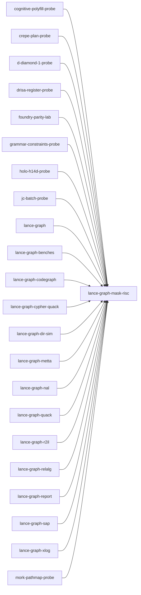

# lance-graph-mask-risc

crate: lance-graph-mask-risc
path: crates/lance-graph-mask-risc
workspace: member
digest: df13877b8cd826e5
evidence legend: ../index.md#evidence-legend

Generated; the code is the truth. See ../index.md.

## Depends on

- dep causal-edge dev — crates/lance-graph-mask-risc/Cargo.toml:36 CONFIRMED
- dep lance-graph-contract dev — crates/lance-graph-mask-risc/Cargo.toml:37 CONFIRMED
- dep ndarray normal — crates/lance-graph-mask-risc/Cargo.toml:20 CONFIRMED

## Depended on by

- rdep cognitive-polyfill-probe normal — crates/cognitive-polyfill-probe/Cargo.toml:16 CONFIRMED
- rdep crepe-plan-probe normal — crates/crepe-plan-probe/Cargo.toml:21 CONFIRMED
- rdep d-diamond-1-probe normal — crates/d-diamond-1-probe/Cargo.toml:18 CONFIRMED
- rdep drf-focus-probe dev — crates/drf-focus-probe/Cargo.toml:32 CONFIRMED
- rdep drisa-register-probe normal — crates/drisa-register-probe/Cargo.toml:20 CONFIRMED
- rdep foundry-parity-lab normal — crates/foundry-parity-lab/Cargo.toml:23 CONFIRMED
- rdep grammar-constraints-probe normal — crates/grammar-constraints-probe/Cargo.toml:16 CONFIRMED
- rdep holo-h14d-probe normal — crates/holo-h14d-probe/Cargo.toml:17 CONFIRMED
- rdep jc dev — crates/jc/Cargo.toml:44 CONFIRMED
- rdep jc-batch-probe normal — crates/jc-batch-probe/Cargo.toml:16 CONFIRMED
- rdep lance-graph normal — crates/lance-graph/Cargo.toml:56 CONFIRMED
- rdep lance-graph-benches normal — crates/lance-graph-benches/Cargo.toml:26 CONFIRMED
- rdep lance-graph-codegraph normal — crates/lance-graph-codegraph/Cargo.toml:15 CONFIRMED
- rdep lance-graph-cypher-quack normal — crates/lance-graph-cypher-quack/Cargo.toml:17 CONFIRMED
- rdep lance-graph-dir-sim normal — crates/lance-graph-dir-sim/Cargo.toml:33 CONFIRMED
- rdep lance-graph-glove-parity dev — crates/lance-graph-glove-parity/Cargo.toml:22 CONFIRMED
- rdep lance-graph-metta normal — crates/lance-graph-metta/Cargo.toml:15 CONFIRMED
- rdep lance-graph-nal normal — crates/lance-graph-nal/Cargo.toml:17 CONFIRMED
- rdep lance-graph-onnx dev — crates/lance-graph-onnx/Cargo.toml:17 CONFIRMED
- rdep lance-graph-quack normal — crates/lance-graph-quack/Cargo.toml:13 CONFIRMED
- rdep lance-graph-r2il normal — crates/lance-graph-r2il/Cargo.toml:19 CONFIRMED
- rdep lance-graph-relalg normal — crates/lance-graph-relalg/Cargo.toml:15 CONFIRMED
- rdep lance-graph-report normal — crates/lance-graph-report/Cargo.toml:15 CONFIRMED
- rdep lance-graph-sap normal — crates/lance-graph-sap/Cargo.toml:12 CONFIRMED
- rdep lance-graph-xlog normal — crates/lance-graph-xlog/Cargo.toml:11 CONFIRMED
- rdep mork-pathmap-probe normal — crates/mork-pathmap-probe/Cargo.toml:37 CONFIRMED
- rdep r2il-mask-abi-probe dev — crates/r2il-mask-abi-probe/Cargo.toml:18 CONFIRMED

## Public items

- const TILE_WORDS [pub] — crates/lance-graph-mask-risc/src/exec.rs:110 CONFIRMED
- fn tile_words_for [pub] — crates/lance-graph-mask-risc/src/exec.rs:114 CONFIRMED
- fn scratch_words_for [pub] — crates/lance-graph-mask-risc/src/exec.rs:118 CONFIRMED
- struct Scratch [pub] — crates/lance-graph-mask-risc/src/exec.rs:174 CONFIRMED
- fn Scratch<'static>::new [pub] — crates/lance-graph-mask-risc/src/exec.rs:186 CONFIRMED
- fn Scratch<'static>::for_program [pub] — crates/lance-graph-mask-risc/src/exec.rs:208 CONFIRMED
- fn Scratch<'a>::over [pub] — crates/lance-graph-mask-risc/src/exec.rs:232 CONFIRMED
- fn Scratch<'a>::over_for_program [pub] — crates/lance-graph-mask-risc/src/exec.rs:262 CONFIRMED
- fn Scratch<'a>::words [pub] — crates/lance-graph-mask-risc/src/exec.rs:276 CONFIRMED
- fn Scratch<'a>::slots [pub] — crates/lance-graph-mask-risc/src/exec.rs:281 CONFIRMED
- fn Scratch<'a>::slot [pub] — crates/lance-graph-mask-risc/src/exec.rs:288 CONFIRMED
- fn materialize_rows [pub] — crates/lance-graph-mask-risc/src/exec.rs:343 CONFIRMED
- fn execute [pub] — crates/lance-graph-mask-risc/src/exec.rs:763 CONFIRMED
- fn extent_tiles [pub(crate)] — crates/lance-graph-mask-risc/src/exec.rs:1246 CONFIRMED
- struct ExtentTiles [pub(crate)] — crates/lance-graph-mask-risc/src/exec.rs:1262 CONFIRMED
- fn execute_into [pub] — crates/lance-graph-mask-risc/src/exec.rs:1343 CONFIRMED
- fn execute_extent [pub] — crates/lance-graph-mask-risc/src/exec.rs:1393 CONFIRMED
- fn execute_compiled [pub] — crates/lance-graph-mask-risc/src/exec.rs:1469 CONFIRMED
- enum BoolExpr [pub] — crates/lance-graph-mask-risc/src/fuse.rs:14 CONFIRMED
- struct Fused [pub] — crates/lance-graph-mask-risc/src/fuse.rs:30 CONFIRMED
- enum FuseError [pub] — crates/lance-graph-mask-risc/src/fuse.rs:45 CONFIRMED
- fn ternlog_imm [pub] — crates/lance-graph-mask-risc/src/fuse.rs:52 CONFIRMED
- fn fuse [pub] — crates/lance-graph-mask-risc/src/fuse.rs:194 CONFIRMED
- fn fuse_program [pub] — crates/lance-graph-mask-risc/src/fuse.rs:210 CONFIRMED
- struct EdgeColumns [pub] cfg=feature="quarantined-gather-hop" — crates/lance-graph-mask-risc/src/graph_hop.rs:28 CONFIRMED
- struct GraphSnapshot [pub] cfg=feature="quarantined-gather-hop" — crates/lance-graph-mask-risc/src/graph_hop.rs:35 CONFIRMED
- enum HopError [pub] cfg=feature="quarantined-gather-hop" — crates/lance-graph-mask-risc/src/graph_hop.rs:43 CONFIRMED
- struct OutgoingHop [pub] cfg=feature="quarantined-gather-hop" — crates/lance-graph-mask-risc/src/graph_hop.rs:55 CONFIRMED
- fn OutgoingHop::new [pub] cfg=feature="quarantined-gather-hop" — crates/lance-graph-mask-risc/src/graph_hop.rs:62 CONFIRMED
- fn OutgoingHop::program [pub] cfg=feature="quarantined-gather-hop" — crates/lance-graph-mask-risc/src/graph_hop.rs:95 CONFIRMED
- fn OutgoingHop::run [pub] cfg=feature="quarantined-gather-hop" — crates/lance-graph-mask-risc/src/graph_hop.rs:101 CONFIRMED
- enum Operand [pub] — crates/lance-graph-mask-risc/src/ir.rs:7 CONFIRMED
- enum LaneRef [pub] — crates/lance-graph-mask-risc/src/ir.rs:16 CONFIRMED
- struct StridedRef [pub] — crates/lance-graph-mask-risc/src/ir.rs:42 CONFIRMED
- fn LaneRef<'_>::len [pub] — crates/lance-graph-mask-risc/src/ir.rs:55 CONFIRMED
- fn LaneRef<'_>::is_empty [pub] — crates/lance-graph-mask-risc/src/ir.rs:65 CONFIRMED
- struct Planes [pub] — crates/lance-graph-mask-risc/src/ir.rs:73 CONFIRMED
- struct ForeignPlane [pub] — crates/lance-graph-mask-risc/src/ir.rs:86 CONFIRMED
- struct Foreign [pub] — crates/lance-graph-mask-risc/src/ir.rs:108 CONFIRMED
- const Foreign<'_>::NONE [pub] — crates/lance-graph-mask-risc/src/ir.rs:118 CONFIRMED
- enum Pred [pub] — crates/lance-graph-mask-risc/src/ir.rs:127 CONFIRMED
- enum MaskOp [pub] — crates/lance-graph-mask-risc/src/ir.rs:210 CONFIRMED
- enum Terminal [pub] — crates/lance-graph-mask-risc/src/ir.rs:288 CONFIRMED
- enum GroupKey [pub] — crates/lance-graph-mask-risc/src/ir.rs:490 CONFIRMED
- enum GroupFold [pub] — crates/lance-graph-mask-risc/src/ir.rs:510 CONFIRMED
- fn GroupFold::seed [pub] — crates/lance-graph-mask-risc/src/ir.rs:534 CONFIRMED
- fn GroupFold::is_empty_slot [pub] — crates/lance-graph-mask-risc/src/ir.rs:547 CONFIRMED
- fn GroupFold::merge [pub] — crates/lance-graph-mask-risc/src/ir.rs:583 CONFIRMED
- fn Terminal::merge_group_sink [pub] — crates/lance-graph-mask-risc/src/ir.rs:663 CONFIRMED
- const GROUP_SUM_SYM_MAX_ROWS [pub] — crates/lance-graph-mask-risc/src/ir.rs:697 CONFIRMED
- const MASKED_SUM_I32_MAX_ROWS [pub] — crates/lance-graph-mask-risc/src/ir.rs:705 CONFIRMED
- struct Program [pub] — crates/lance-graph-mask-risc/src/ir.rs:709 CONFIRMED
- const MAX_SCRATCH_SLOTS [pub] — crates/lance-graph-mask-risc/src/ir.rs:737 CONFIRMED
- fn Program::new [pub] — crates/lance-graph-mask-risc/src/ir.rs:754 CONFIRMED
- fn Program::fused_terminal [pub] — crates/lance-graph-mask-risc/src/ir.rs:845 CONFIRMED
- fn Program::fused_ternlog [pub] — crates/lance-graph-mask-risc/src/ir.rs:908 CONFIRMED
- fn Program::fused_keep [pub] — crates/lance-graph-mask-risc/src/ir.rs:935 CONFIRMED
- fn Program::fused_tern2 [pub] — crates/lance-graph-mask-risc/src/ir.rs:1045 CONFIRMED
- fn Program::fused_tern3 [pub] — crates/lance-graph-mask-risc/src/ir.rs:1195 CONFIRMED
- fn Program::lowering [pub] — crates/lance-graph-mask-risc/src/ir.rs:1236 CONFIRMED
- fn Program::compile [pub] — crates/lance-graph-mask-risc/src/ir.rs:1254 CONFIRMED
- fn Program::requires_scratch [pub] — crates/lance-graph-mask-risc/src/ir.rs:1270 CONFIRMED
- fn Program::op_histogram [pub] — crates/lance-graph-mask-risc/src/ir.rs:1276 CONFIRMED
- enum Lowering [pub] — crates/lance-graph-mask-risc/src/ir.rs:1349 CONFIRMED
- struct Compiled [pub] — crates/lance-graph-mask-risc/src/ir.rs:1388 CONFIRMED
- fn Compiled<'p>::program [pub] — crates/lance-graph-mask-risc/src/ir.rs:1395 CONFIRMED
- fn Compiled<'p>::lowering [pub] — crates/lance-graph-mask-risc/src/ir.rs:1400 CONFIRMED
- fn Compiled<'p>::requires_scratch [pub] — crates/lance-graph-mask-risc/src/ir.rs:1405 CONFIRMED
- struct CompiledProgram [pub] — crates/lance-graph-mask-risc/src/ir.rs:1427 CONFIRMED
- fn CompiledProgram::new [pub] — crates/lance-graph-mask-risc/src/ir.rs:1434 CONFIRMED
- fn CompiledProgram::program [pub] — crates/lance-graph-mask-risc/src/ir.rs:1440 CONFIRMED
- fn CompiledProgram::lowering [pub] — crates/lance-graph-mask-risc/src/ir.rs:1445 CONFIRMED
- fn CompiledProgram::compiled [pub] — crates/lance-graph-mask-risc/src/ir.rs:1450 CONFIRMED
- struct FusedTerminal [pub] — crates/lance-graph-mask-risc/src/ir.rs:1461 CONFIRMED
- struct FusedTernlog [pub] — crates/lance-graph-mask-risc/src/ir.rs:1480 CONFIRMED
- struct FusedKeep [pub] — crates/lance-graph-mask-risc/src/ir.rs:1496 CONFIRMED
- struct FusedTern2 [pub] — crates/lance-graph-mask-risc/src/ir.rs:1513 CONFIRMED
- enum Tern2Fold [pub] — crates/lance-graph-mask-risc/src/ir.rs:1534 CONFIRMED
- struct FusedTern3 [pub] — crates/lance-graph-mask-risc/src/ir.rs:1549 CONFIRMED
- struct Tern3Step [pub] — crates/lance-graph-mask-risc/src/ir.rs:1558 CONFIRMED
- enum Tern3In [pub] — crates/lance-graph-mask-risc/src/ir.rs:1571 CONFIRMED
- const FUSED_SLOT_CAP [pub] — crates/lance-graph-mask-risc/src/ir.rs:1871 CONFIRMED
- enum FusedFold [pub] — crates/lance-graph-mask-risc/src/ir.rs:1875 CONFIRMED
- fn touched_words [pub] — crates/lance-graph-mask-risc/src/ir.rs:1885 CONFIRMED
- fn span_words [pub(crate)] — crates/lance-graph-mask-risc/src/ir.rs:1892 CONFIRMED
- struct OpHistogram [pub] — crates/lance-graph-mask-risc/src/ir.rs:1901 CONFIRMED
- fn OpHistogram::mask_passes [pub] — crates/lance-graph-mask-risc/src/ir.rs:1931 CONFIRMED
- mod exec [pub] — crates/lance-graph-mask-risc/src/lib.rs:130 CONFIRMED
- mod fuse [pub] — crates/lance-graph-mask-risc/src/lib.rs:131 CONFIRMED
- mod graph_hop [pub] cfg=feature="quarantined-gather-hop" — crates/lance-graph-mask-risc/src/lib.rs:137 CONFIRMED
- mod ir [pub] — crates/lance-graph-mask-risc/src/lib.rs:138 CONFIRMED
- mod reference [pub] — crates/lance-graph-mask-risc/src/lib.rs:139 CONFIRMED
- mod ternlog_dispatch [pub] — crates/lance-graph-mask-risc/src/lib.rs:140 CONFIRMED
- mod value [pub] — crates/lance-graph-mask-risc/src/lib.rs:141 CONFIRMED
- fn words_for [pub] — crates/lance-graph-mask-risc/src/lib.rs:166 CONFIRMED
- enum OutShape [pub(crate)] — crates/lance-graph-mask-risc/src/reference.rs:33 CONFIRMED
- fn out_shape [pub(crate)] — crates/lance-graph-mask-risc/src/reference.rs:44 CONFIRMED
- fn validate [pub(crate)] — crates/lance-graph-mask-risc/src/reference.rs:306 CONFIRMED
- fn reference_execute [pub] — crates/lance-graph-mask-risc/src/reference.rs:978 CONFIRMED
- fn reference_execute_into [pub] — crates/lance-graph-mask-risc/src/reference.rs:991 CONFIRMED
- fn reference_scratch [pub] — crates/lance-graph-mask-risc/src/reference.rs:1269 CONFIRMED
- fn reference_scratch_with_foreign [pub] — crates/lance-graph-mask-risc/src/reference.rs:1274 CONFIRMED
- fn ternlog_dispatch [pub] — crates/lance-graph-mask-risc/src/ternlog_dispatch.rs:58 CONFIRMED
- fn ternlog_dispatch_assign [pub] — crates/lance-graph-mask-risc/src/ternlog_dispatch.rs:320 CONFIRMED
- fn ternlog_popcount_dispatch [pub] — crates/lance-graph-mask-risc/src/ternlog_dispatch.rs:582 CONFIRMED
- fn ternlog_any_dispatch [pub] — crates/lance-graph-mask-risc/src/ternlog_dispatch.rs:844 CONFIRMED
- enum Value [pub] — crates/lance-graph-mask-risc/src/value.rs:18 CONFIRMED
- enum Out [pub] — crates/lance-graph-mask-risc/src/value.rs:59 CONFIRMED
- enum LaneKind [pub] — crates/lance-graph-mask-risc/src/value.rs:80 CONFIRMED
- enum ExecError [pub] — crates/lance-graph-mask-risc/src/value.rs:94 CONFIRMED

## Imports from in-scope crates

- none

## Calls

CALL_GRAPH=ARTIFACT_MISSING
- calls ARTIFACT_MISSING — no ruff_charon artifact for this crate UNKNOWN

## Architecture

- arch mask-risc quarantines graph_hop gather [CONFIRMED] validation=OK — crates/lance-graph-mask-risc/Cargo.toml:30 CONFIRMED

Generated from Cargo manifests — extracted relationships only.

