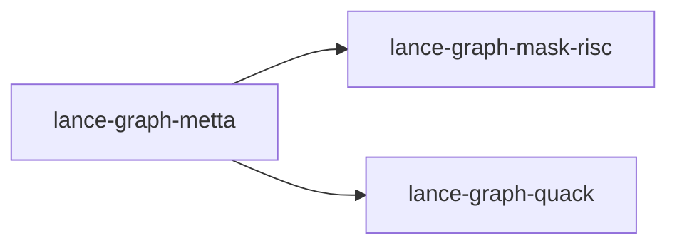

# lance-graph-metta

crate: lance-graph-metta
path: crates/lance-graph-metta
workspace: excluded
digest: 12752919056fe5bb
evidence legend: ../index.md#evidence-legend

Generated; the code is the truth. See ../index.md.

## Depends on

- dep lance-graph-mask-risc normal — crates/lance-graph-metta/Cargo.toml:15 CONFIRMED
- dep lance-graph-quack normal — crates/lance-graph-metta/Cargo.toml:16 CONFIRMED
- dep datafrog dev — crates/lance-graph-metta/Cargo.toml:20 CONFIRMED

## Depended on by

## Public items

## Imports from in-scope crates

- none

## Calls

CALL_GRAPH=ARTIFACT_MISSING
- calls ARTIFACT_MISSING — no ruff_charon artifact for this crate UNKNOWN

## Architecture

- none

Generated from Cargo manifests — extracted relationships only.

