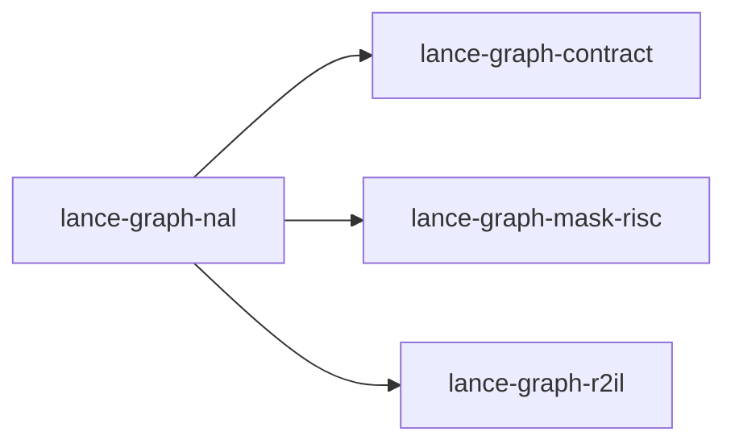

# lance-graph-nal

crate: lance-graph-nal
path: crates/lance-graph-nal
workspace: excluded
digest: 5e50d1539858fc39
evidence legend: ../index.md#evidence-legend

Generated; the code is the truth. See ../index.md.

## Depends on

- dep lance-graph-contract normal — crates/lance-graph-nal/Cargo.toml:15 CONFIRMED
- dep lance-graph-mask-risc normal — crates/lance-graph-nal/Cargo.toml:17 CONFIRMED
- dep lance-graph-r2il normal — crates/lance-graph-nal/Cargo.toml:19 CONFIRMED
- dep ogar-loco normal — crates/lance-graph-nal/Cargo.toml:21 CONFIRMED

## Depended on by

## Public items

- mod nal [pub] — crates/lance-graph-nal/src/lib.rs:77 CONFIRMED
- enum Copula [pub] — crates/lance-graph-nal/src/lib.rs:94 CONFIRMED
- const Copula::ALL [pub] — crates/lance-graph-nal/src/lib.rs:107 CONFIRMED
- struct Statement [pub] — crates/lance-graph-nal/src/lib.rs:117 CONFIRMED
- struct Belief [pub] — crates/lance-graph-nal/src/lib.rs:130 CONFIRMED
- fn Belief::statement [pub] — crates/lance-graph-nal/src/lib.rs:147 CONFIRMED
- fn guid [pub] — crates/lance-graph-nal/src/lib.rs:157 CONFIRMED
- struct Aperture [pub] — crates/lance-graph-nal/src/lib.rs:174 CONFIRMED
- fn Aperture::statement [pub] — crates/lance-graph-nal/src/lib.rs:183 CONFIRMED
- fn Aperture::subject [pub] — crates/lance-graph-nal/src/lib.rs:191 CONFIRMED
- fn Aperture::semantic [pub] — crates/lance-graph-nal/src/lib.rs:199 CONFIRMED
- const WEIGHT_SCALE [pub] — crates/lance-graph-nal/src/lib.rs:212 CONFIRMED
- const HORIZON [pub] — crates/lance-graph-nal/src/lib.rs:216 CONFIRMED
- const MAX_CONFIDENCE_CODE [pub] — crates/lance-graph-nal/src/lib.rs:220 CONFIRMED
- fn weight [pub] — crates/lance-graph-nal/src/lib.rs:225 CONFIRMED
- mod evidence [pub(crate)] — crates/lance-graph-nal/src/lib.rs:234 CONFIRMED
- const INDEPENDENT [pub] — crates/lance-graph-nal/src/lib.rs:236 CONFIRMED
- const DUPLICATE [pub] — crates/lance-graph-nal/src/lib.rs:238 CONFIRMED
- const OVERLAP [pub] — crates/lance-graph-nal/src/lib.rs:240 CONFIRMED
- const NO_PROVENANCE [pub] — crates/lance-graph-nal/src/lib.rs:242 CONFIRMED
- const CLASSES [pub] — crates/lance-graph-nal/src/lib.rs:244 CONFIRMED
- struct Evidence [pub] — crates/lance-graph-nal/src/lib.rs:250 CONFIRMED
- struct Beliefs [pub] — crates/lance-graph-nal/src/lib.rs:260 CONFIRMED
- fn Beliefs::seal [pub] — crates/lance-graph-nal/src/lib.rs:280 CONFIRMED
- fn Beliefs::seal_evidence [pub] — crates/lance-graph-nal/src/lib.rs:303 CONFIRMED
- fn Beliefs::class [pub] — crates/lance-graph-nal/src/lib.rs:353 CONFIRMED
- fn Beliefs::witness [pub] — crates/lance-graph-nal/src/lib.rs:359 CONFIRMED
- fn Beliefs::bind [pub] — crates/lance-graph-nal/src/lib.rs:369 CONFIRMED
- struct Bound [pub] — crates/lance-graph-nal/src/lib.rs:416 CONFIRMED
- const LANE_F [pub(crate)] — crates/lance-graph-nal/src/lib.rs:422 CONFIRMED
- const LANE_C [pub(crate)] — crates/lance-graph-nal/src/lib.rs:424 CONFIRMED
- const LANE_W [pub(crate)] — crates/lance-graph-nal/src/lib.rs:426 CONFIRMED
- const LANE_EVIDENCE [pub(crate)] — crates/lance-graph-nal/src/lib.rs:428 CONFIRMED
- fn Bound<'_>::n_rows [pub] — crates/lance-graph-nal/src/lib.rs:432 CONFIRMED
- fn Bound<'_>::class [pub] — crates/lance-graph-nal/src/lib.rs:437 CONFIRMED
- fn Bound<'_>::range [pub] — crates/lance-graph-nal/src/lib.rs:448 CONFIRMED
- fn Bound<'_>::witness [pub(crate)] — crates/lance-graph-nal/src/lib.rs:456 CONFIRMED
- fn Bound<'_>::lanes [pub(crate)] — crates/lance-graph-nal/src/lib.rs:461 CONFIRMED
- fn Bound<'_>::run [pub(crate)] — crates/lance-graph-nal/src/lib.rs:471 CONFIRMED
- enum NalError [pub] — crates/lance-graph-nal/src/lib.rs:494 CONFIRMED
- trait NalOp [pub] — crates/lance-graph-nal/src/nal.rs:29 CONFIRMED
- struct Prepared [pub] — crates/lance-graph-nal/src/nal.rs:61 CONFIRMED
- fn Prepared::scratch [pub] — crates/lance-graph-nal/src/nal.rs:104 CONFIRMED
- fn Prepared::lowering [pub] — crates/lance-graph-nal/src/nal.rs:109 CONFIRMED
- fn Prepared::program [pub] — crates/lance-graph-nal/src/nal.rs:114 CONFIRMED
- fn Prepared::extent [pub] — crates/lance-graph-nal/src/nal.rs:119 CONFIRMED
- fn Prepared::count [pub] — crates/lance-graph-nal/src/nal.rs:137 CONFIRMED
- fn Prepared::max [pub] — crates/lance-graph-nal/src/nal.rs:149 CONFIRMED
- struct Question [pub] — crates/lance-graph-nal/src/nal.rs:159 CONFIRMED
- fn Question::bind [pub] — crates/lance-graph-nal/src/nal.rs:177 CONFIRMED
- struct TruthAtLeast [pub] — crates/lance-graph-nal/src/nal.rs:186 CONFIRMED
- fn TruthAtLeast::bind [pub] — crates/lance-graph-nal/src/nal.rs:208 CONFIRMED
- struct Choice [pub] — crates/lance-graph-nal/src/nal.rs:216 CONFIRMED
- fn Choice::bind [pub] — crates/lance-graph-nal/src/nal.rs:234 CONFIRMED
- struct Revision [pub] — crates/lance-graph-nal/src/nal.rs:245 CONFIRMED
- struct Revised [pub] — crates/lance-graph-nal/src/nal.rs:261 CONFIRMED
- struct PreparedRevision [pub] — crates/lance-graph-nal/src/nal.rs:322 CONFIRMED
- fn Revision::bind [pub] — crates/lance-graph-nal/src/nal.rs:334 CONFIRMED
- fn PreparedRevision::scratch [pub] — crates/lance-graph-nal/src/nal.rs:370 CONFIRMED
- fn PreparedRevision::program [pub] — crates/lance-graph-nal/src/nal.rs:375 CONFIRMED
- fn PreparedRevision::revise [pub] — crates/lance-graph-nal/src/nal.rs:387 CONFIRMED

## Imports from in-scope crates

### lance-graph-contract
- use lance_graph_contract::canonical_node::NodeGuid — crates/lance-graph-nal/src/lib.rs:81 CONFIRMED
- use lance_graph_contract::facet::FacetCascade — crates/lance-graph-nal/src/lib.rs:82 CONFIRMED
- use lance_graph_contract::facet::SemanticAperture — crates/lance-graph-nal/src/lib.rs:82 CONFIRMED
- use lance_graph_contract::ordered_lane::OrderedLaneWitness — crates/lance-graph-nal/src/lib.rs:83 CONFIRMED
- use lance_graph_contract::ordered_lane::SealedFacetLane — crates/lance-graph-nal/src/lib.rs:83 CONFIRMED
- use lance_graph_contract::ordered_lane::WitnessError — crates/lance-graph-nal/src/lib.rs:83 CONFIRMED
- use lance_graph_contract::temporal_pov::LanceVersion — crates/lance-graph-nal/src/lib.rs:84 CONFIRMED
- use lance_graph_contract::ordered_lane::OrderedLaneWitness — crates/lance-graph-nal/src/nal.rs:16 CONFIRMED
### lance-graph-mask-risc
- use lance_graph_mask_risc::CompiledProgram — crates/lance-graph-nal/src/lib.rs:87 CONFIRMED
- use lance_graph_mask_risc::ExecError — crates/lance-graph-nal/src/lib.rs:87 CONFIRMED
- use lance_graph_mask_risc::LaneRef — crates/lance-graph-nal/src/lib.rs:87 CONFIRMED
- use lance_graph_mask_risc::Out — crates/lance-graph-nal/src/lib.rs:87 CONFIRMED
- use lance_graph_mask_risc::execute_compiled — crates/lance-graph-nal/src/lib.rs:87 CONFIRMED
- use lance_graph_mask_risc::CompiledProgram — crates/lance-graph-nal/src/nal.rs:18 CONFIRMED
- use lance_graph_mask_risc::CrossPowerSums — crates/lance-graph-nal/src/nal.rs:18 CONFIRMED
- use lance_graph_mask_risc::Foreign — crates/lance-graph-nal/src/nal.rs:18 CONFIRMED
- use lance_graph_mask_risc::Lowering — crates/lance-graph-nal/src/nal.rs:18 CONFIRMED
- use lance_graph_mask_risc::Out — crates/lance-graph-nal/src/nal.rs:18 CONFIRMED
- use lance_graph_mask_risc::Planes — crates/lance-graph-nal/src/nal.rs:18 CONFIRMED
- use lance_graph_mask_risc::Pred — crates/lance-graph-nal/src/nal.rs:18 CONFIRMED
- use lance_graph_mask_risc::Program — crates/lance-graph-nal/src/nal.rs:18 CONFIRMED
- use lance_graph_mask_risc::Scratch — crates/lance-graph-nal/src/nal.rs:18 CONFIRMED
- use lance_graph_mask_risc::Value — crates/lance-graph-nal/src/nal.rs:18 CONFIRMED
### lance-graph-r2il
- use lance_graph_r2il::FoldDialect — crates/lance-graph-nal/src/nal.rs:20 CONFIRMED
- use lance_graph_r2il::FoldError — crates/lance-graph-nal/src/nal.rs:20 CONFIRMED
- use lance_graph_r2il::INT_S_LESS — crates/lance-graph-nal/src/nal.rs:20 CONFIRMED
- use lance_graph_r2il::LOAD — crates/lance-graph-nal/src/nal.rs:20 CONFIRMED
- use lance_graph_r2il::POP_COUNT — crates/lance-graph-nal/src/nal.rs:20 CONFIRMED
- use lance_graph_r2il::Val — crates/lance-graph-nal/src/nal.rs:20 CONFIRMED
- use lance_graph_r2il::procs — crates/lance-graph-nal/src/nal.rs:20 CONFIRMED

## Calls

CALL_GRAPH=ARTIFACT_MISSING
- calls ARTIFACT_MISSING — no ruff_charon artifact for this crate UNKNOWN

## Architecture

- none

Generated from Cargo manifests — extracted relationships only.

