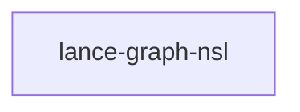

# lance-graph-nsl

crate: lance-graph-nsl
path: crates/lance-graph-nsl
workspace: excluded
digest: 31f7ff7d7e38244c
evidence legend: ../index.md#evidence-legend

Generated; the code is the truth. See ../index.md.

## Depends on

## Depended on by

## Public items

- struct Case [pub(crate)] cfg=test — crates/lance-graph-nsl/src/eval.rs:13 CONFIRMED
- fn cases [pub(crate)] cfg=test — crates/lance-graph-nsl/src/eval.rs:28 CONFIRMED
- fn ulps [pub(crate)] cfg=test — crates/lance-graph-nsl/src/eval.rs:71 CONFIRMED
- fn loss_shared [pub(crate)] cfg=test — crates/lance-graph-nsl/src/eval.rs:96 CONFIRMED
- fn softmax_table_row [pub(crate)] cfg=test — crates/lance-graph-nsl/src/eval.rs:178 CONFIRMED
- fn loss_softmax_table [pub(crate)] cfg=test — crates/lance-graph-nsl/src/eval.rs:198 CONFIRMED
- fn loss_residual [pub(crate)] cfg=test — crates/lance-graph-nsl/src/eval.rs:223 CONFIRMED
- struct FamilyGamma [pub(crate)] cfg=test — crates/lance-graph-nsl/src/eval.rs:246 CONFIRMED
- fn FamilyGamma::from_cosines [pub(crate)] cfg=test — crates/lance-graph-nsl/src/eval.rs:257 CONFIRMED
- fn FamilyGamma::encode [pub(crate)] cfg=test — crates/lance-graph-nsl/src/eval.rs:269 CONFIRMED
- fn FamilyGamma::decode [pub(crate)] cfg=test — crates/lance-graph-nsl/src/eval.rs:273 CONFIRMED
- enum Shape [pub(crate)] cfg=test — crates/lance-graph-nsl/src/eval.rs:280 CONFIRMED
- struct Envelope [pub(crate)] cfg=test — crates/lance-graph-nsl/src/eval.rs:293 CONFIRMED
- fn Envelope::fit [pub(crate)] cfg=test — crates/lance-graph-nsl/src/eval.rs:305 CONFIRMED
- fn Envelope::encode [pub(crate)] cfg=test — crates/lance-graph-nsl/src/eval.rs:331 CONFIRMED
- fn Envelope::decode [pub(crate)] cfg=test — crates/lance-graph-nsl/src/eval.rs:346 CONFIRMED
- struct Quantiles [pub(crate)] cfg=test — crates/lance-graph-nsl/src/eval.rs:362 CONFIRMED
- fn Quantiles::fit [pub(crate)] cfg=test — crates/lance-graph-nsl/src/eval.rs:368 CONFIRMED
- fn Quantiles::encode [pub(crate)] cfg=test — crates/lance-graph-nsl/src/eval.rs:378 CONFIRMED
- fn Quantiles::decode [pub(crate)] cfg=test — crates/lance-graph-nsl/src/eval.rs:381 CONFIRMED
- struct Affine8 [pub(crate)] cfg=test — crates/lance-graph-nsl/src/eval.rs:389 CONFIRMED
- fn Affine8::from_values [pub(crate)] cfg=test — crates/lance-graph-nsl/src/eval.rs:395 CONFIRMED
- fn Affine8::encode [pub(crate)] cfg=test — crates/lance-graph-nsl/src/eval.rs:403 CONFIRMED
- fn Affine8::decode [pub(crate)] cfg=test — crates/lance-graph-nsl/src/eval.rs:408 CONFIRMED
- struct Palette [pub(crate)] cfg=test — crates/lance-graph-nsl/src/eval.rs:416 CONFIRMED
- fn Palette::train [pub(crate)] cfg=test — crates/lance-graph-nsl/src/eval.rs:446 CONFIRMED
- fn Palette::index [pub(crate)] cfg=test — crates/lance-graph-nsl/src/eval.rs:500 CONFIRMED
- fn Palette::pair [pub(crate)] cfg=test — crates/lance-graph-nsl/src/eval.rs:505 CONFIRMED
- enum Lut [pub(crate)] cfg=test — crates/lance-graph-nsl/src/eval.rs:519 CONFIRMED
- fn loss_palette_cosine [pub(crate)] cfg=test — crates/lance-graph-nsl/src/eval.rs:527 CONFIRMED
- fn loss_rowscale [pub(crate)] cfg=test — crates/lance-graph-nsl/src/eval.rs:543 CONFIRMED
- fn grad_cosine [pub(crate)] cfg=test — crates/lance-graph-nsl/src/eval.rs:559 CONFIRMED
- enum NslError [pub] — crates/lance-graph-nsl/src/lib.rs:29 CONFIRMED
- struct SourceRef [pub] — crates/lance-graph-nsl/src/lib.rs:47 CONFIRMED
- struct Example [pub] — crates/lance-graph-nsl/src/lib.rs:55 CONFIRMED
- struct FeatureTable [pub] — crates/lance-graph-nsl/src/lib.rs:63 CONFIRMED
- fn FeatureTable::new [pub] — crates/lance-graph-nsl/src/lib.rs:74 CONFIRMED
- fn FeatureTable::rows [pub] — crates/lance-graph-nsl/src/lib.rs:100 CONFIRMED
- fn FeatureTable::seed_rows [pub] — crates/lance-graph-nsl/src/lib.rs:103 CONFIRMED
- fn FeatureTable::row [pub] — crates/lance-graph-nsl/src/lib.rs:106 CONFIRMED
- fn FeatureTable::id [pub] — crates/lance-graph-nsl/src/lib.rs:109 CONFIRMED
- fn FeatureTable::tag [pub] — crates/lance-graph-nsl/src/lib.rs:112 CONFIRMED
- fn FeatureTable::x [pub] — crates/lance-graph-nsl/src/lib.rs:115 CONFIRMED
- struct Graph [pub] — crates/lance-graph-nsl/src/lib.rs:125 CONFIRMED
- fn Graph::from_tsv [pub] — crates/lance-graph-nsl/src/lib.rs:133 CONFIRMED
- fn Graph::symmetrize [pub] — crates/lance-graph-nsl/src/lib.rs:215 CONFIRMED
- fn Graph::code [pub] — crates/lance-graph-nsl/src/lib.rs:222 CONFIRMED
- fn Graph::label [pub] — crates/lance-graph-nsl/src/lib.rs:229 CONFIRMED
- fn parse_weight [pub] — crates/lance-graph-nsl/src/lib.rs:241 CONFIRMED
- struct Selected [pub] — crates/lance-graph-nsl/src/lib.rs:251 CONFIRMED
- struct NeighborBatch [pub] — crates/lance-graph-nsl/src/lib.rs:258 CONFIRMED
- struct Adjacency [pub] — crates/lance-graph-nsl/src/lib.rs:277 CONFIRMED
- fn Adjacency::build [pub] — crates/lance-graph-nsl/src/lib.rs:286 CONFIRMED
- fn Adjacency::neighbors [pub] — crates/lance-graph-nsl/src/lib.rs:314 CONFIRMED
- fn Adjacency::seeds [pub] — crates/lance-graph-nsl/src/lib.rs:323 CONFIRMED
- fn select [pub] — crates/lance-graph-nsl/src/lib.rs:329 CONFIRMED
- fn compat_lines [pub] — crates/lance-graph-nsl/src/lib.rs:343 CONFIRMED
- struct FocusLease [pub] — crates/lance-graph-nsl/src/lib.rs:380 CONFIRMED
- fn FocusLease::get [pub] — crates/lance-graph-nsl/src/lib.rs:385 CONFIRMED
- mod loss [pub] — crates/lance-graph-nsl/src/lib.rs:401 CONFIRMED
- enum Distance [pub] — crates/lance-graph-nsl/src/loss.rs:17 CONFIRMED
- const KL_EPS [pub] — crates/lance-graph-nsl/src/loss.rs:28 CONFIRMED
- fn softmax_row [pub] — crates/lance-graph-nsl/src/loss.rs:32 CONFIRMED
- fn divergence_row [pub] — crates/lance-graph-nsl/src/loss.rs:42 CONFIRMED
- enum Axis [pub] — crates/lance-graph-nsl/src/loss.rs:62 CONFIRMED
- fn graph_loss [pub] — crates/lance-graph-nsl/src/loss.rs:69 CONFIRMED

## Imports from in-scope crates

- none

## Calls

CALL_GRAPH=ARTIFACT_MISSING
- calls ARTIFACT_MISSING — no ruff_charon artifact for this crate UNKNOWN

## Architecture

- none

Generated from Cargo manifests — extracted relationships only.

