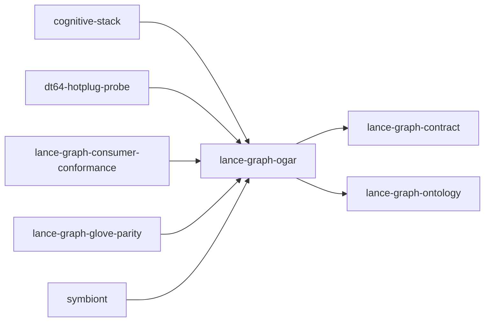

# lance-graph-ogar

crate: lance-graph-ogar
path: crates/lance-graph-ogar
workspace: excluded
digest: 8557d912b26c9363
evidence legend: ../index.md#evidence-legend

Generated; the code is the truth. See ../index.md.

## Depends on

- dep lance-graph-contract normal — crates/lance-graph-ogar/Cargo.toml:89 CONFIRMED
- dep lance-graph-ontology normal — crates/lance-graph-ogar/Cargo.toml:95 CONFIRMED
- dep ogar-adapter-surrealql normal optional — crates/lance-graph-ogar/Cargo.toml:153 CONFIRMED
- dep ogar-class-view normal — crates/lance-graph-ogar/Cargo.toml:135 CONFIRMED
- dep ogar-dismech normal — crates/lance-graph-ogar/Cargo.toml:148 CONFIRMED
- dep ogar-loco normal — crates/lance-graph-ogar/Cargo.toml:140 CONFIRMED
- dep ogar-ontology normal — crates/lance-graph-ogar/Cargo.toml:136 CONFIRMED
- dep ogar-vocab normal — crates/lance-graph-ogar/Cargo.toml:134 CONFIRMED
- dep tempfile dev — crates/lance-graph-ogar/Cargo.toml:167 CONFIRMED

## Depended on by

- rdep cognitive-stack normal — crates/cognitive-stack/Cargo.toml:98 CONFIRMED
- rdep dt64-hotplug-probe normal — crates/dt64-hotplug-probe/Cargo.toml:22 CONFIRMED
- rdep lance-graph-consumer-conformance normal — crates/lance-graph-consumer-conformance/Cargo.toml:19 CONFIRMED
- rdep lance-graph-glove-parity normal — crates/lance-graph-glove-parity/Cargo.toml:19 CONFIRMED
- rdep symbiont normal — crates/symbiont/Cargo.toml:65 CONFIRMED

## Public items

- struct OgarActionProvider [pub] — crates/lance-graph-ogar/src/actions.rs:143 CONFIRMED
- fn OgarActionProvider::new [pub] — crates/lance-graph-ogar/src/actions.rs:148 CONFIRMED
- fn OgarActionProvider::registry [pub] — crates/lance-graph-ogar/src/actions.rs:154 CONFIRMED
- fn OgarActionProvider::actions_for [pub] — crates/lance-graph-ogar/src/actions.rs:161 CONFIRMED
- fn OgarActionProvider::effective_actions [pub] — crates/lance-graph-ogar/src/actions.rs:170 CONFIRMED
- type MedcareBridge [pub] — crates/lance-graph-ogar/src/bridges/medcare_bridge.rs:45 CONFIRMED
- mod unified [pub] — crates/lance-graph-ogar/src/bridges/mod.rs:57 CONFIRMED
- type OdooBridge [pub] — crates/lance-graph-ogar/src/bridges/odoo_bridge.rs:34 CONFIRMED
- type OpenProjectBridge [pub] — crates/lance-graph-ogar/src/bridges/openproject_bridge.rs:32 CONFIRMED
- const OPENPROJECT_CODEBOOK [pub] — crates/lance-graph-ogar/src/bridges/openproject_bridge.rs:43 CONFIRMED
- type RedmineBridge [pub] — crates/lance-graph-ogar/src/bridges/redmine_bridge.rs:26 CONFIRMED
- const REDMINE_CODEBOOK [pub] — crates/lance-graph-ogar/src/bridges/redmine_bridge.rs:34 CONFIRMED
- type SmbBridge [pub] — crates/lance-graph-ogar/src/bridges/smb_bridge.rs:33 CONFIRMED
- struct UnifiedBridge [pub] — crates/lance-graph-ogar/src/bridges/unified.rs:59 CONFIRMED
- fn UnifiedBridge
::new [pub] — crates/lance-graph-ogar/src/bridges/unified.rs:75 CONFIRMED
- type WoaBridge [pub] — crates/lance-graph-ogar/src/bridges/woa_bridge.rs:40 CONFIRMED
- mod bridges [pub] — crates/lance-graph-ogar/src/lib.rs:122 CONFIRMED
- mod recipe_vocab [pub] — crates/lance-graph-ogar/src/lib.rs:123 CONFIRMED
- mod actions [pub] — crates/lance-graph-ogar/src/lib.rs:125 CONFIRMED
- mod rbac_impl [pub] — crates/lance-graph-ogar/src/lib.rs:127 CONFIRMED
- mod parity [pub] — crates/lance-graph-ogar/src/lib.rs:157 CONFIRMED
- fn domains_agree [pub] — crates/lance-graph-ogar/src/lib.rs:164 CONFIRMED
- fn assert_codebook_parity [pub] — crates/lance-graph-ogar/src/lib.rs:188 CONFIRMED
- fn assert_dismech_palette_parity [pub] — crates/lance-graph-ogar/src/lib.rs:228 CONFIRMED
- struct OgarAuthority [pub] — crates/lance-graph-ogar/src/lib.rs:565 CONFIRMED
- trait GrantSource [pub] — crates/lance-graph-ogar/src/rbac_impl.rs:44 CONFIRMED
- struct OgarRbac [pub] — crates/lance-graph-ogar/src/rbac_impl.rs:53 CONFIRMED
- fn OgarRbac<S>::new [pub] — crates/lance-graph-ogar/src/rbac_impl.rs:60 CONFIRMED
- const RECIPE_COUNT [pub] — crates/lance-graph-ogar/src/recipe_vocab.rs:92 CONFIRMED
- const RECIPE_OP_BASE [pub] — crates/lance-graph-ogar/src/recipe_vocab.rs:95 CONFIRMED
- const RECIPE_OP_END [pub] — crates/lance-graph-ogar/src/recipe_vocab.rs:99 CONFIRMED
- const CB_ATTENTION_FOCUS [pub] — crates/lance-graph-ogar/src/recipe_vocab.rs:103 CONFIRMED
- fn op_of [pub] — crates/lance-graph-ogar/src/recipe_vocab.rs:108 CONFIRMED
- fn recipe_of [pub] — crates/lance-graph-ogar/src/recipe_vocab.rs:117 CONFIRMED
- fn ladder_program [pub] — crates/lance-graph-ogar/src/recipe_vocab.rs:126 CONFIRMED
- struct RecipeVocabulary [pub] — crates/lance-graph-ogar/src/recipe_vocab.rs:136 CONFIRMED
- fn max_rung_admitted [pub] — crates/lance-graph-ogar/src/recipe_vocab.rs:213 CONFIRMED
- fn admitted_program [pub] — crates/lance-graph-ogar/src/recipe_vocab.rs:232 CONFIRMED
- fn inference_of [pub] — crates/lance-graph-ogar/src/recipe_vocab.rs:248 CONFIRMED
- enum Refusal [pub] — crates/lance-graph-ogar/src/recipe_vocab.rs:263 CONFIRMED
- fn grounded_program [pub] — crates/lance-graph-ogar/src/recipe_vocab.rs:296 CONFIRMED
- fn refusal_of [pub] — crates/lance-graph-ogar/src/recipe_vocab.rs:313 CONFIRMED

## Imports from in-scope crates

### lance-graph-contract
- use lance_graph_contract as contract — crates/lance-graph-ogar/src/actions.rs:39 CONFIRMED
- pub-use lance_graph_contract as contract — crates/lance-graph-ogar/src/lib.rs:114 CONFIRMED
- use lance_graph_contract::ogar_codebook as mirror — crates/lance-graph-ogar/src/lib.rs:158 CONFIRMED
- use lance_graph_contract::canonical_node::EdgeCodecFlavor — crates/lance-graph-ogar/src/lib.rs:417 CONFIRMED
- use lance_graph_contract::canonical_node::ReadMode — crates/lance-graph-ogar/src/lib.rs:417 CONFIRMED
- use lance_graph_contract::canonical_node::TailVariant — crates/lance-graph-ogar/src/lib.rs:417 CONFIRMED
- use lance_graph_contract::canonical_node::ValueSchema — crates/lance-graph-ogar/src/lib.rs:417 CONFIRMED
- use lance_graph_contract::hotplug::HotPlug — crates/lance-graph-ogar/src/lib.rs:418 CONFIRMED
- use lance_graph_contract::hotplug::CapabilityAuthority cfg=test — crates/lance-graph-ogar/src/lib.rs:687 CONFIRMED
- use lance_graph_contract::hotplug::HotPlug cfg=test — crates/lance-graph-ogar/src/lib.rs:687 CONFIRMED
- use lance_graph_contract::canonical_node::ReadMode cfg=test — crates/lance-graph-ogar/src/lib.rs:757 CONFIRMED
- use lance_graph_contract::canonical_node::TailVariant cfg=test — crates/lance-graph-ogar/src/lib.rs:757 CONFIRMED
- use lance_graph_contract::canonical_node::ValueSchema cfg=test — crates/lance-graph-ogar/src/lib.rs:757 CONFIRMED
- use lance_graph_contract::canonical_node::classid_read_mode cfg=test — crates/lance-graph-ogar/src/lib.rs:757 CONFIRMED
- use lance_graph_contract::hotplug::ActivationDrift cfg=test — crates/lance-graph-ogar/src/lib.rs:759 CONFIRMED
- use lance_graph_contract::hotplug::CapabilityAuthority cfg=test — crates/lance-graph-ogar/src/lib.rs:759 CONFIRMED
- use lance_graph_contract::hotplug::HotPlug cfg=test — crates/lance-graph-ogar/src/lib.rs:759 CONFIRMED
- use lance_graph_contract::rbac::ActorId — crates/lance-graph-ogar/src/rbac_impl.rs:38 CONFIRMED
- use lance_graph_contract::rbac::ClassGrant — crates/lance-graph-ogar/src/rbac_impl.rs:38 CONFIRMED
- use lance_graph_contract::rbac::ClassId — crates/lance-graph-ogar/src/rbac_impl.rs:38 CONFIRMED
- use lance_graph_contract::rbac::ClassRbac — crates/lance-graph-ogar/src/rbac_impl.rs:38 CONFIRMED
- use lance_graph_contract::rbac::Operation — crates/lance-graph-ogar/src/rbac_impl.rs:38 CONFIRMED
- use lance_graph_contract::rbac::RoleId — crates/lance-graph-ogar/src/rbac_impl.rs:38 CONFIRMED
- use lance_graph_contract::rbac::grants_permit — crates/lance-graph-ogar/src/rbac_impl.rs:38 CONFIRMED
- use lance_graph_contract::property::PrefetchDepth cfg=test — crates/lance-graph-ogar/src/rbac_impl.rs:81 CONFIRMED
- use lance_graph_contract::rbac::OpMask cfg=test — crates/lance-graph-ogar/src/rbac_impl.rs:82 CONFIRMED
- use lance_graph_contract::kanban::KanbanColumn — crates/lance-graph-ogar/src/recipe_vocab.rs:71 CONFIRMED
- use lance_graph_contract::recipe_dispatch::RecipeInference — crates/lance-graph-ogar/src/recipe_vocab.rs:73 CONFIRMED
- use lance_graph_contract::recipe_dispatch::dispatch_order — crates/lance-graph-ogar/src/recipe_vocab.rs:73 CONFIRMED
- use lance_graph_contract::recipe_dispatch::inference — crates/lance-graph-ogar/src/recipe_vocab.rs:73 CONFIRMED
- use lance_graph_contract::recipe_dispatch::ladder — crates/lance-graph-ogar/src/recipe_vocab.rs:73 CONFIRMED
- use lance_graph_contract::recipe_dispatch::nan_disqualifier — crates/lance-graph-ogar/src/recipe_vocab.rs:73 CONFIRMED
- use lance_graph_contract::recipe_dispatch::rung — crates/lance-graph-ogar/src/recipe_vocab.rs:73 CONFIRMED
- use lance_graph_contract::recipe_kernels::ThoughtCtx — crates/lance-graph-ogar/src/recipe_vocab.rs:75 CONFIRMED
- use lance_graph_contract::recipe_kernels::ThoughtField — crates/lance-graph-ogar/src/recipe_vocab.rs:75 CONFIRMED
- use lance_graph_contract::recipes::recipe — crates/lance-graph-ogar/src/recipe_vocab.rs:76 CONFIRMED
### lance-graph-ontology
- use lance_graph_ontology::bridge::BridgeError cfg=test — crates/lance-graph-ogar/src/bridges/medcare_bridge.rs:57 CONFIRMED
- use lance_graph_ontology::bridge::NamespaceBridge cfg=test — crates/lance-graph-ogar/src/bridges/medcare_bridge.rs:57 CONFIRMED
- use lance_graph_ontology::error::Error cfg=test — crates/lance-graph-ogar/src/bridges/medcare_bridge.rs:58 CONFIRMED
- use lance_graph_ontology::namespace::NamespaceId cfg=test — crates/lance-graph-ogar/src/bridges/medcare_bridge.rs:59 CONFIRMED
- use lance_graph_ontology::namespace_registry::NamespaceRegistry cfg=test — crates/lance-graph-ogar/src/bridges/medcare_bridge.rs:60 CONFIRMED
- use lance_graph_ontology::registry::OntologyRegistry cfg=test — crates/lance-graph-ogar/src/bridges/medcare_bridge.rs:61 CONFIRMED
- use lance_graph_ontology::bridge::BridgeError cfg=test — crates/lance-graph-ogar/src/bridges/odoo_bridge.rs:40 CONFIRMED
- use lance_graph_ontology::bridge::NamespaceBridge cfg=test — crates/lance-graph-ogar/src/bridges/odoo_bridge.rs:40 CONFIRMED
- use lance_graph_ontology::error::Error cfg=test — crates/lance-graph-ogar/src/bridges/odoo_bridge.rs:41 CONFIRMED
- use lance_graph_ontology::namespace::NamespaceId cfg=test — crates/lance-graph-ogar/src/bridges/odoo_bridge.rs:42 CONFIRMED
- use lance_graph_ontology::registry::OntologyRegistry cfg=test — crates/lance-graph-ogar/src/bridges/odoo_bridge.rs:43 CONFIRMED
- use lance_graph_ontology::bridge::BridgeError cfg=test — crates/lance-graph-ogar/src/bridges/openproject_bridge.rs:55 CONFIRMED
- use lance_graph_ontology::bridge::NamespaceBridge cfg=test — crates/lance-graph-ogar/src/bridges/openproject_bridge.rs:55 CONFIRMED
- use lance_graph_ontology::error::Error cfg=test — crates/lance-graph-ogar/src/bridges/openproject_bridge.rs:56 CONFIRMED
- use lance_graph_ontology::namespace::NamespaceId cfg=test — crates/lance-graph-ogar/src/bridges/openproject_bridge.rs:57 CONFIRMED
- use lance_graph_ontology::namespace_registry::NamespaceRegistry cfg=test — crates/lance-graph-ogar/src/bridges/openproject_bridge.rs:58 CONFIRMED
- use lance_graph_ontology::registry::OntologyRegistry cfg=test — crates/lance-graph-ogar/src/bridges/openproject_bridge.rs:59 CONFIRMED
- use lance_graph_ontology::bridge::BridgeError cfg=test — crates/lance-graph-ogar/src/bridges/redmine_bridge.rs:40 CONFIRMED
- use lance_graph_ontology::bridge::NamespaceBridge cfg=test — crates/lance-graph-ogar/src/bridges/redmine_bridge.rs:40 CONFIRMED
- use lance_graph_ontology::error::Error cfg=test — crates/lance-graph-ogar/src/bridges/redmine_bridge.rs:41 CONFIRMED
- use lance_graph_ontology::namespace::NamespaceId cfg=test — crates/lance-graph-ogar/src/bridges/redmine_bridge.rs:42 CONFIRMED
- use lance_graph_ontology::namespace_registry::NamespaceRegistry cfg=test — crates/lance-graph-ogar/src/bridges/redmine_bridge.rs:43 CONFIRMED
- use lance_graph_ontology::registry::OntologyRegistry cfg=test — crates/lance-graph-ogar/src/bridges/redmine_bridge.rs:44 CONFIRMED
- use lance_graph_ontology::bridge::BridgeError cfg=test — crates/lance-graph-ogar/src/bridges/smb_bridge.rs:39 CONFIRMED
- use lance_graph_ontology::bridge::NamespaceBridge cfg=test — crates/lance-graph-ogar/src/bridges/smb_bridge.rs:39 CONFIRMED
- use lance_graph_ontology::error::Error cfg=test — crates/lance-graph-ogar/src/bridges/smb_bridge.rs:40 CONFIRMED
- use lance_graph_ontology::namespace::NamespaceId cfg=test — crates/lance-graph-ogar/src/bridges/smb_bridge.rs:41 CONFIRMED
- use lance_graph_ontology::registry::OntologyRegistry cfg=test — crates/lance-graph-ogar/src/bridges/smb_bridge.rs:42 CONFIRMED
- use lance_graph_ontology::bridge::BridgeError — crates/lance-graph-ogar/src/bridges/unified.rs:48 CONFIRMED
- use lance_graph_ontology::bridge::BridgeFromRegistry — crates/lance-graph-ogar/src/bridges/unified.rs:48 CONFIRMED
- use lance_graph_ontology::bridge::EntityRef — crates/lance-graph-ogar/src/bridges/unified.rs:48 CONFIRMED
- use lance_graph_ontology::bridge::NamespaceBridge — crates/lance-graph-ogar/src/bridges/unified.rs:48 CONFIRMED
- use lance_graph_ontology::error::Error — crates/lance-graph-ogar/src/bridges/unified.rs:49 CONFIRMED
- use lance_graph_ontology::error::Result — crates/lance-graph-ogar/src/bridges/unified.rs:49 CONFIRMED
- use lance_graph_ontology::namespace::NamespaceId — crates/lance-graph-ogar/src/bridges/unified.rs:50 CONFIRMED
- use lance_graph_ontology::namespace::OgitUri — crates/lance-graph-ogar/src/bridges/unified.rs:50 CONFIRMED
- use lance_graph_ontology::namespace::SchemaKind — crates/lance-graph-ogar/src/bridges/unified.rs:50 CONFIRMED
- use lance_graph_ontology::namespace::SchemaPtr — crates/lance-graph-ogar/src/bridges/unified.rs:50 CONFIRMED
- use lance_graph_ontology::namespace_registry::NamespaceRegistry — crates/lance-graph-ogar/src/bridges/unified.rs:51 CONFIRMED
- use lance_graph_ontology::registry::OntologyRegistry — crates/lance-graph-ogar/src/bridges/unified.rs:52 CONFIRMED
- use lance_graph_ontology::bridge::BridgeError cfg=test — crates/lance-graph-ogar/src/bridges/woa_bridge.rs:46 CONFIRMED
- use lance_graph_ontology::bridge::NamespaceBridge cfg=test — crates/lance-graph-ogar/src/bridges/woa_bridge.rs:46 CONFIRMED
- use lance_graph_ontology::error::Error cfg=test — crates/lance-graph-ogar/src/bridges/woa_bridge.rs:47 CONFIRMED
- use lance_graph_ontology::namespace::NamespaceId cfg=test — crates/lance-graph-ogar/src/bridges/woa_bridge.rs:48 CONFIRMED
- use lance_graph_ontology::registry::OntologyRegistry cfg=test — crates/lance-graph-ogar/src/bridges/woa_bridge.rs:49 CONFIRMED

## Calls

CALL_GRAPH=ARTIFACT_MISSING
- calls ARTIFACT_MISSING — no ruff_charon artifact for this crate UNKNOWN

## Architecture

- none

Generated from Cargo manifests — extracted relationships only.

