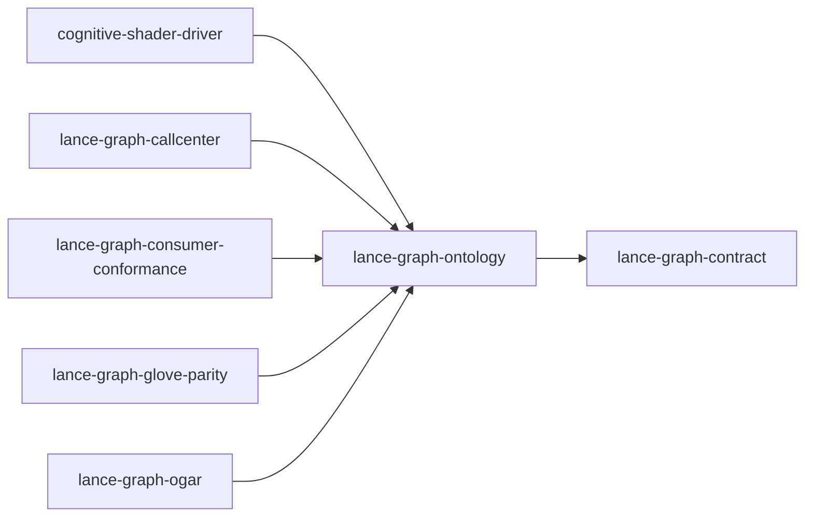

# lance-graph-ontology

crate: lance-graph-ontology
path: crates/lance-graph-ontology
workspace: member
digest: e1fe3d499d649e1f
evidence legend: ../index.md#evidence-legend

Generated; the code is the truth. See ../index.md.

## Depends on

- dep lance-graph-contract normal — crates/lance-graph-ontology/Cargo.toml:12 CONFIRMED
- dep arrow normal optional — crates/lance-graph-ontology/Cargo.toml:49 CONFIRMED
- dep arrow-array normal optional — crates/lance-graph-ontology/Cargo.toml:50 CONFIRMED
- dep arrow-schema normal optional — crates/lance-graph-ontology/Cargo.toml:51 CONFIRMED
- dep futures normal optional — crates/lance-graph-ontology/Cargo.toml:53 CONFIRMED
- dep lance normal optional — crates/lance-graph-ontology/Cargo.toml:46 CONFIRMED
- dep once_cell normal — crates/lance-graph-ontology/Cargo.toml:34 CONFIRMED
- dep oxrdf normal — crates/lance-graph-ontology/Cargo.toml:19 CONFIRMED
- dep oxrdfxml normal — crates/lance-graph-ontology/Cargo.toml:23 CONFIRMED
- dep oxttl normal — crates/lance-graph-ontology/Cargo.toml:18 CONFIRMED
- dep quick-xml normal — crates/lance-graph-ontology/Cargo.toml:28 CONFIRMED
- dep sha2 normal — crates/lance-graph-ontology/Cargo.toml:41 CONFIRMED
- dep tempfile dev — crates/lance-graph-ontology/Cargo.toml:63 CONFIRMED
- dep thiserror normal — crates/lance-graph-ontology/Cargo.toml:31 CONFIRMED
- dep tokio normal optional — crates/lance-graph-ontology/Cargo.toml:52 CONFIRMED
- dep toml normal — crates/lance-graph-ontology/Cargo.toml:38 CONFIRMED

## Depended on by

- rdep cognitive-shader-driver normal — crates/cognitive-shader-driver/Cargo.toml:234 CONFIRMED
- rdep lance-graph-callcenter normal — crates/lance-graph-callcenter/Cargo.toml:18 CONFIRMED
- rdep lance-graph-consumer-conformance normal — crates/lance-graph-consumer-conformance/Cargo.toml:16 CONFIRMED
- rdep lance-graph-glove-parity normal — crates/lance-graph-glove-parity/Cargo.toml:15 CONFIRMED
- rdep lance-graph-ogar normal — crates/lance-graph-ogar/Cargo.toml:95 CONFIRMED

## Public items

- enum BridgeError [pub] — crates/lance-graph-ontology/src/bridge.rs:21 CONFIRMED
- trait NamespaceBridge [pub] — crates/lance-graph-ontology/src/bridge.rs:44 CONFIRMED
- struct EntityRef [pub] — crates/lance-graph-ontology/src/bridge.rs:145 CONFIRMED
- struct EdgeRef [pub] — crates/lance-graph-ontology/src/bridge.rs:150 CONFIRMED
- fn make_bridge [pub] — crates/lance-graph-ontology/src/bridge.rs:156 CONFIRMED
- trait BridgeFromRegistry [pub] — crates/lance-graph-ontology/src/bridge.rs:166 CONFIRMED
- struct OgitBridge [pub] — crates/lance-graph-ontology/src/bridges/ogit_bridge.rs:28 CONFIRMED
- fn OgitBridge::for_namespace [pub] — crates/lance-graph-ontology/src/bridges/ogit_bridge.rs:36 CONFIRMED
- fn OgitBridge::namespace_name [pub] — crates/lance-graph-ontology/src/bridges/ogit_bridge.rs:47 CONFIRMED
- const NAMESPACE [pub] — crates/lance-graph-ontology/src/bridges/sharepoint_bridge.rs:36 CONFIRMED
- struct SharePointBridge [pub] — crates/lance-graph-ontology/src/bridges/sharepoint_bridge.rs:46 CONFIRMED
- fn SharePointBridge::new [pub] — crates/lance-graph-ontology/src/bridges/sharepoint_bridge.rs:52 CONFIRMED
- const NAMESPACE [pub] — crates/lance-graph-ontology/src/bridges/spear_bridge.rs:29 CONFIRMED
- struct SpearBridge [pub] — crates/lance-graph-ontology/src/bridges/spear_bridge.rs:39 CONFIRMED
- fn SpearBridge::new [pub] — crates/lance-graph-ontology/src/bridges/spear_bridge.rs:45 CONFIRMED
- const NAMESPACE [pub] — crates/lance-graph-ontology/src/bridges/woa_bridge.rs:16 CONFIRMED
- struct WoaBridge [pub] — crates/lance-graph-ontology/src/bridges/woa_bridge.rs:26 CONFIRMED
- fn WoaBridge::new [pub] — crates/lance-graph-ontology/src/bridges/woa_bridge.rs:32 CONFIRMED
- mod dolce_id [pub] — crates/lance-graph-ontology/src/class_resolver.rs:43 CONFIRMED
- const ENDURANT [pub] — crates/lance-graph-ontology/src/class_resolver.rs:45 CONFIRMED
- const PERDURANT [pub] — crates/lance-graph-ontology/src/class_resolver.rs:47 CONFIRMED
- const QUALITY [pub] — crates/lance-graph-ontology/src/class_resolver.rs:49 CONFIRMED
- const ABSTRACT [pub] — crates/lance-graph-ontology/src/class_resolver.rs:51 CONFIRMED
- struct RegistryClassView [pub] — crates/lance-graph-ontology/src/class_resolver.rs:70 CONFIRMED
- fn RegistryClassView<'a>::new [pub] — crates/lance-graph-ontology/src/class_resolver.rs:87 CONFIRMED
- fn RegistryClassView<'a>::is_known [pub] — crates/lance-graph-ontology/src/class_resolver.rs:97 CONFIRMED
- enum Error [pub] — crates/lance-graph-ontology/src/error.rs:11 CONFIRMED
- fn Error::other [pub] — crates/lance-graph-ontology/src/error.rs:61 CONFIRMED
- type Result [pub] — crates/lance-graph-ontology/src/error.rs:66 CONFIRMED
- struct OntologyAssembler [pub] — crates/lance-graph-ontology/src/foundry_map.rs:19 CONFIRMED
- fn OntologyAssembler::new [pub] — crates/lance-graph-ontology/src/foundry_map.rs:24 CONFIRMED
- fn OntologyAssembler::assemble [pub] — crates/lance-graph-ontology/src/foundry_map.rs:28 CONFIRMED
- fn hydrate_dolce [pub] — crates/lance-graph-ontology/src/hydrators/dolce.rs:88 CONFIRMED
- fn hydrate_dolce_from [pub] — crates/lance-graph-ontology/src/hydrators/dolce.rs:107 CONFIRMED
- fn hydrate_dolce_from_many [pub] — crates/lance-graph-ontology/src/hydrators/dolce.rs:114 CONFIRMED
- enum DolceCategory [pub] — crates/lance-graph-ontology/src/hydrators/dolce_odoo.rs:33 CONFIRMED
- fn classify_odoo [pub] — crates/lance-graph-ontology/src/hydrators/dolce_odoo.rs:115 CONFIRMED
- fn hydrate_fibo_fnd [pub] — crates/lance-graph-ontology/src/hydrators/fibo.rs:89 CONFIRMED
- fn hydrate_fibo_fnd_from [pub] — crates/lance-graph-ontology/src/hydrators/fibo.rs:94 CONFIRMED
- fn hydrate_fibo_be [pub] — crates/lance-graph-ontology/src/hydrators/fibo.rs:115 CONFIRMED
- fn hydrate_fibo_be_from [pub] — crates/lance-graph-ontology/src/hydrators/fibo.rs:120 CONFIRMED
- mod dolce [pub] — crates/lance-graph-ontology/src/hydrators/mod.rs:21 CONFIRMED
- mod dolce_odoo [pub] — crates/lance-graph-ontology/src/hydrators/mod.rs:22 CONFIRMED
- mod fibo [pub] — crates/lance-graph-ontology/src/hydrators/mod.rs:23 CONFIRMED
- mod odoo [pub] — crates/lance-graph-ontology/src/hydrators/mod.rs:24 CONFIRMED
- mod owl [pub] — crates/lance-graph-ontology/src/hydrators/mod.rs:25 CONFIRMED
- mod owltime [pub] — crates/lance-graph-ontology/src/hydrators/mod.rs:26 CONFIRMED
- mod provo [pub] — crates/lance-graph-ontology/src/hydrators/mod.rs:27 CONFIRMED
- mod qudt [pub] — crates/lance-graph-ontology/src/hydrators/mod.rs:28 CONFIRMED
- mod schemaorg [pub] — crates/lance-graph-ontology/src/hydrators/mod.rs:29 CONFIRMED
- mod schematron [pub] — crates/lance-graph-ontology/src/hydrators/mod.rs:30 CONFIRMED
- mod skos [pub] — crates/lance-graph-ontology/src/hydrators/mod.rs:31 CONFIRMED
- mod skr [pub] — crates/lance-graph-ontology/src/hydrators/mod.rs:32 CONFIRMED
- mod skr_datev [pub] — crates/lance-graph-ontology/src/hydrators/mod.rs:33 CONFIRMED
- mod xsd [pub] — crates/lance-graph-ontology/src/hydrators/mod.rs:34 CONFIRMED
- mod zugferd [pub] — crates/lance-graph-ontology/src/hydrators/mod.rs:35 CONFIRMED
- fn hydrate_odoo [pub] — crates/lance-graph-ontology/src/hydrators/odoo.rs:78 CONFIRMED
- fn hydrate_odoo_from [pub] — crates/lance-graph-ontology/src/hydrators/odoo.rs:100 CONFIRMED
- type EntityId [pub] — crates/lance-graph-ontology/src/hydrators/owl.rs:30 CONFIRMED
- struct OntologySlot [pub] — crates/lance-graph-ontology/src/hydrators/owl.rs:39 CONFIRMED
- fn OntologySlot::resolve_iri [pub] — crates/lance-graph-ontology/src/hydrators/owl.rs:47 CONFIRMED
- fn OntologySlot::len [pub] — crates/lance-graph-ontology/src/hydrators/owl.rs:52 CONFIRMED
- fn OntologySlot::is_empty [pub] — crates/lance-graph-ontology/src/hydrators/owl.rs:56 CONFIRMED
- struct ContextBundle [pub] — crates/lance-graph-ontology/src/hydrators/owl.rs:73 CONFIRMED
- fn ContextBundle::entity_count [pub] — crates/lance-graph-ontology/src/hydrators/owl.rs:84 CONFIRMED
- fn ContextBundle::resolve_iri [pub] — crates/lance-graph-ontology/src/hydrators/owl.rs:89 CONFIRMED
- enum HydrateErr [pub] — crates/lance-graph-ontology/src/hydrators/owl.rs:96 CONFIRMED
- trait MetaStructureHydrator [pub] — crates/lance-graph-ontology/src/hydrators/owl.rs:115 CONFIRMED
- struct OwlHydrator [pub] — crates/lance-graph-ontology/src/hydrators/owl.rs:122 CONFIRMED
- fn OwlHydrator::hydrate_many [pub] — crates/lance-graph-ontology/src/hydrators/owl.rs:187 CONFIRMED
- fn hydrate_owltime [pub] — crates/lance-graph-ontology/src/hydrators/owltime.rs:49 CONFIRMED
- fn hydrate_owltime_from [pub] — crates/lance-graph-ontology/src/hydrators/owltime.rs:54 CONFIRMED
- fn hydrate_provo [pub] — crates/lance-graph-ontology/src/hydrators/provo.rs:52 CONFIRMED
- fn hydrate_provo_from [pub] — crates/lance-graph-ontology/src/hydrators/provo.rs:57 CONFIRMED
- fn hydrate_qudt [pub] — crates/lance-graph-ontology/src/hydrators/qudt.rs:54 CONFIRMED
- fn hydrate_qudt_from [pub] — crates/lance-graph-ontology/src/hydrators/qudt.rs:63 CONFIRMED
- fn hydrate_schemaorg [pub] — crates/lance-graph-ontology/src/hydrators/schemaorg.rs:52 CONFIRMED
- fn hydrate_schemaorg_from [pub] — crates/lance-graph-ontology/src/hydrators/schemaorg.rs:57 CONFIRMED
- struct SchematronHydrator [pub] — crates/lance-graph-ontology/src/hydrators/schematron.rs:56 CONFIRMED
- fn SchematronHydrator::hydrate_many [pub] — crates/lance-graph-ontology/src/hydrators/schematron.rs:66 CONFIRMED
- fn hydrate_skos [pub] — crates/lance-graph-ontology/src/hydrators/skos.rs:71 CONFIRMED
- fn hydrate_skos_from [pub] — crates/lance-graph-ontology/src/hydrators/skos.rs:80 CONFIRMED
- struct SkrHydrator [pub] — crates/lance-graph-ontology/src/hydrators/skr.rs:46 CONFIRMED
- fn SkrHydrator::hydrate [pub] — crates/lance-graph-ontology/src/hydrators/skr.rs:59 CONFIRMED
- const SKR03_IRI_PREFIX [pub] — crates/lance-graph-ontology/src/hydrators/skr_datev.rs:32 CONFIRMED
- const SKR04_IRI_PREFIX [pub] — crates/lance-graph-ontology/src/hydrators/skr_datev.rs:33 CONFIRMED
- const SKR03_BAU_IRI_PREFIX [pub] — crates/lance-graph-ontology/src/hydrators/skr_datev.rs:34 CONFIRMED
- fn hydrate_skr03 [pub] — crates/lance-graph-ontology/src/hydrators/skr_datev.rs:37 CONFIRMED
- fn hydrate_skr03_from [pub] — crates/lance-graph-ontology/src/hydrators/skr_datev.rs:41 CONFIRMED
- fn hydrate_skr03_bau [pub] — crates/lance-graph-ontology/src/hydrators/skr_datev.rs:59 CONFIRMED
- fn hydrate_skr03_bau_from [pub] — crates/lance-graph-ontology/src/hydrators/skr_datev.rs:63 CONFIRMED
- fn hydrate_skr04 [pub] — crates/lance-graph-ontology/src/hydrators/skr_datev.rs:80 CONFIRMED
- fn hydrate_skr04_from [pub] — crates/lance-graph-ontology/src/hydrators/skr_datev.rs:84 CONFIRMED
- struct XsdHydrator [pub] — crates/lance-graph-ontology/src/hydrators/xsd.rs:46 CONFIRMED
- fn XsdHydrator::hydrate_many [pub] — crates/lance-graph-ontology/src/hydrators/xsd.rs:59 CONFIRMED
- fn collect_xsd_files [pub] — crates/lance-graph-ontology/src/hydrators/xsd.rs:181 CONFIRMED
- fn hydrate_zugferd [pub] — crates/lance-graph-ontology/src/hydrators/zugferd.rs:71 CONFIRMED
- fn hydrate_zugferd_from [pub] — crates/lance-graph-ontology/src/hydrators/zugferd.rs:76 CONFIRMED
- fn hydrate_zugferd_rules [pub] — crates/lance-graph-ontology/src/hydrators/zugferd.rs:117 CONFIRMED
- fn hydrate_zugferd_rules_from [pub] — crates/lance-graph-ontology/src/hydrators/zugferd.rs:121 CONFIRMED
- const SCHEMA_VERSION [pub] cfg=feature="lance-cache" — crates/lance-graph-ontology/src/lance_cache.rs:62 CONFIRMED
- struct LanceWriter [pub] cfg=feature="lance-cache" — crates/lance-graph-ontology/src/lance_cache.rs:64 CONFIRMED
- fn LanceWriter::open_or_create [pub] cfg=feature="lance-cache" — crates/lance-graph-ontology/src/lance_cache.rs:69 CONFIRMED
- fn LanceWriter::dictionary_path [pub] cfg=feature="lance-cache" — crates/lance-graph-ontology/src/lance_cache.rs:136 CONFIRMED
- fn LanceWriter::meta_path [pub] cfg=feature="lance-cache" — crates/lance-graph-ontology/src/lance_cache.rs:140 CONFIRMED
- fn LanceWriter::flush [pub] cfg=feature="lance-cache" — crates/lance-graph-ontology/src/lance_cache.rs:144 CONFIRMED
- fn LanceWriter::replay [pub] cfg=feature="lance-cache" — crates/lance-graph-ontology/src/lance_cache.rs:164 CONFIRMED
- fn LanceWriter::last_root_checksum [pub] cfg=feature="lance-cache" — crates/lance-graph-ontology/src/lance_cache.rs:188 CONFIRMED
- fn LanceWriter::set_last_root_checksum [pub] cfg=feature="lance-cache" — crates/lance-graph-ontology/src/lance_cache.rs:219 CONFIRMED
- mod bridge [pub] — crates/lance-graph-ontology/src/lib.rs:39 CONFIRMED
- mod bridges [pub] — crates/lance-graph-ontology/src/lib.rs:40 CONFIRMED
- mod class_resolver [pub] — crates/lance-graph-ontology/src/lib.rs:41 CONFIRMED
- mod error [pub] — crates/lance-graph-ontology/src/lib.rs:42 CONFIRMED
- mod foundry_map [pub] — crates/lance-graph-ontology/src/lib.rs:43 CONFIRMED
- mod hydrators [pub] — crates/lance-graph-ontology/src/lib.rs:44 CONFIRMED
- mod namespace [pub] — crates/lance-graph-ontology/src/lib.rs:45 CONFIRMED
- mod namespace_registry [pub] — crates/lance-graph-ontology/src/lib.rs:46 CONFIRMED
- mod odoo_blueprint [pub] — crates/lance-graph-ontology/src/lib.rs:47 CONFIRMED
- mod proposal [pub] — crates/lance-graph-ontology/src/lib.rs:48 CONFIRMED
- mod registry [pub] — crates/lance-graph-ontology/src/lib.rs:49 CONFIRMED
- mod schema_source [pub] — crates/lance-graph-ontology/src/lib.rs:50 CONFIRMED
- mod semantic_types [pub] — crates/lance-graph-ontology/src/lib.rs:51 CONFIRMED
- mod soa_bake [pub] — crates/lance-graph-ontology/src/lib.rs:52 CONFIRMED
- mod ttl_parse [pub] — crates/lance-graph-ontology/src/lib.rs:53 CONFIRMED
- mod wikidata_hhtl [pub] — crates/lance-graph-ontology/src/lib.rs:54 CONFIRMED
- mod lance_cache [pub] cfg=feature="lance-cache" — crates/lance-graph-ontology/src/lib.rs:57 CONFIRMED
- struct NamespaceId [pub] — crates/lance-graph-ontology/src/namespace.rs:27 CONFIRMED
- const NamespaceId::UNKNOWN [pub] — crates/lance-graph-ontology/src/namespace.rs:30 CONFIRMED
- fn NamespaceId::raw [pub] — crates/lance-graph-ontology/src/namespace.rs:32 CONFIRMED
- fn NamespaceId::is_known [pub] — crates/lance-graph-ontology/src/namespace.rs:36 CONFIRMED
- struct OgitUri [pub] — crates/lance-graph-ontology/src/namespace.rs:45 CONFIRMED
- fn OgitUri::from_string_unchecked [pub] — crates/lance-graph-ontology/src/namespace.rs:49 CONFIRMED
- fn OgitUri::parse [pub] — crates/lance-graph-ontology/src/namespace.rs:55 CONFIRMED
- fn OgitUri::as_str [pub] — crates/lance-graph-ontology/src/namespace.rs:65 CONFIRMED
- fn OgitUri::into_string [pub] — crates/lance-graph-ontology/src/namespace.rs:69 CONFIRMED
- fn OgitUri::namespace [pub] — crates/lance-graph-ontology/src/namespace.rs:74 CONFIRMED
- fn OgitUri::name [pub] — crates/lance-graph-ontology/src/namespace.rs:79 CONFIRMED
- struct SchemaPtr [pub] — crates/lance-graph-ontology/src/namespace.rs:125 CONFIRMED
- fn SchemaPtr::new [pub] — crates/lance-graph-ontology/src/namespace.rs:138 CONFIRMED
- fn SchemaPtr::raw [pub] — crates/lance-graph-ontology/src/namespace.rs:149 CONFIRMED
- fn SchemaPtr::from_raw [pub] — crates/lance-graph-ontology/src/namespace.rs:157 CONFIRMED
- fn SchemaPtr::with_context_id [pub] — crates/lance-graph-ontology/src/namespace.rs:165 CONFIRMED
- fn SchemaPtr::ontology_context_id [pub] — crates/lance-graph-ontology/src/namespace.rs:173 CONFIRMED
- fn SchemaPtr::namespace_id [pub] — crates/lance-graph-ontology/src/namespace.rs:177 CONFIRMED
- fn SchemaPtr::entity_type_id [pub] — crates/lance-graph-ontology/src/namespace.rs:181 CONFIRMED
- fn SchemaPtr::kind [pub] — crates/lance-graph-ontology/src/namespace.rs:185 CONFIRMED
- enum SchemaKind [pub] — crates/lance-graph-ontology/src/namespace.rs:197 CONFIRMED
- fn SchemaKind::as_str [pub] — crates/lance-graph-ontology/src/namespace.rs:204 CONFIRMED
- fn SchemaKind::parse [pub] — crates/lance-graph-ontology/src/namespace.rs:212 CONFIRMED
- struct NamespaceRegistry [pub] — crates/lance-graph-ontology/src/namespace_registry.rs:31 CONFIRMED
- fn NamespaceRegistry::new [pub] — crates/lance-graph-ontology/src/namespace_registry.rs:38 CONFIRMED
- fn NamespaceRegistry::seed_defaults [pub] — crates/lance-graph-ontology/src/namespace_registry.rs:89 CONFIRMED
- fn NamespaceRegistry::get [pub] — crates/lance-graph-ontology/src/namespace_registry.rs:146 CONFIRMED
- fn NamespaceRegistry::allocate [pub] — crates/lance-graph-ontology/src/namespace_registry.rs:154 CONFIRMED
- fn NamespaceRegistry::len [pub] — crates/lance-graph-ontology/src/namespace_registry.rs:164 CONFIRMED
- fn NamespaceRegistry::is_empty [pub] — crates/lance-graph-ontology/src/namespace_registry.rs:169 CONFIRMED
- fn NamespaceRegistry::iter [pub] — crates/lance-graph-ontology/src/namespace_registry.rs:175 CONFIRMED
- fn NamespaceRegistry::seed_context_id [pub] — crates/lance-graph-ontology/src/namespace_registry.rs:188 CONFIRMED
- struct StructuralSignature [pub] — crates/lance-graph-ontology/src/odoo_blueprint/class_signature.rs:32 CONFIRMED
- fn OdooEntity::signature [pub] — crates/lance-graph-ontology/src/odoo_blueprint/class_signature.rs:77 CONFIRMED
- fn OdooEntity::object_view [pub] — crates/lance-graph-ontology/src/odoo_blueprint/class_signature.rs:114 CONFIRMED
- struct AuditRow [pub] — crates/lance-graph-ontology/src/odoo_blueprint/class_signature.rs:144 CONFIRMED
- fn audit [pub] — crates/lance-graph-ontology/src/odoo_blueprint/class_signature.rs:153 CONFIRMED
- fn shape_families [pub] — crates/lance-graph-ontology/src/odoo_blueprint/class_signature.rs:169 CONFIRMED
- fn curated_entities [pub] — crates/lance-graph-ontology/src/odoo_blueprint/class_signature.rs:189 CONFIRMED
- struct FamilySummary [pub] — crates/lance-graph-ontology/src/odoo_blueprint/class_signature.rs:214 CONFIRMED
- fn corpus_summary [pub] — crates/lance-graph-ontology/src/odoo_blueprint/class_signature.rs:223 CONFIRMED
- const EXT_ACCOUNT_ACCOUNT [pub] — crates/lance-graph-ontology/src/odoo_blueprint/extracted/account.rs:9 CONFIRMED
- const EXT_ACCOUNT_GROUP [pub] — crates/lance-graph-ontology/src/odoo_blueprint/extracted/account.rs:867 CONFIRMED
- const EXT_ACCOUNT_ACCOUNT_TAG [pub] — crates/lance-graph-ontology/src/odoo_blueprint/extracted/account.rs:1046 CONFIRMED
- const EXT_ACCOUNT_ANALYTIC_ACCOUNT [pub] — crates/lance-graph-ontology/src/odoo_blueprint/extracted/account.rs:1211 CONFIRMED
- const EXT_ACCOUNT_ANALYTIC_DISTRIBUTION_MODEL [pub] — crates/lance-graph-ontology/src/odoo_blueprint/extracted/account.rs:1285 CONFIRMED
- const EXT_ACCOUNT_ANALYTIC_LINE [pub] — crates/lance-graph-ontology/src/odoo_blueprint/extracted/account.rs:1371 CONFIRMED
- const EXT_ACCOUNT_ANALYTIC_APPLICABILITY [pub] — crates/lance-graph-ontology/src/odoo_blueprint/extracted/account.rs:1543 CONFIRMED
- const EXT_ACCOUNT_BANK_STATEMENT [pub] — crates/lance-graph-ontology/src/odoo_blueprint/extracted/account.rs:1638 CONFIRMED
- const EXT_ACCOUNT_BANK_STATEMENT_LINE [pub] — crates/lance-graph-ontology/src/odoo_blueprint/extracted/account.rs:1971 CONFIRMED
- const EXT_ACCOUNT_MOVE [pub] — crates/lance-graph-ontology/src/odoo_blueprint/extracted/account.rs:2411 CONFIRMED
- const EXT_ACCOUNT_CASH_ROUNDING [pub] — crates/lance-graph-ontology/src/odoo_blueprint/extracted/account.rs:6323 CONFIRMED
- const EXT_ACCOUNT_CODE_MAPPING [pub] — crates/lance-graph-ontology/src/odoo_blueprint/extracted/account.rs:6425 CONFIRMED
- const EXT_ACCOUNT_DOCUMENT_IMPORT_MIXIN [pub] — crates/lance-graph-ontology/src/odoo_blueprint/extracted/account.rs:6520 CONFIRMED
- const EXT_ACCOUNT_FULL_RECONCILE [pub] — crates/lance-graph-ontology/src/odoo_blueprint/extracted/account.rs:6689 CONFIRMED
- const EXT_ACCOUNT_INCOTERMS [pub] — crates/lance-graph-ontology/src/odoo_blueprint/extracted/account.rs:6737 CONFIRMED
- const EXT_ACCOUNT_JOURNAL_GROUP [pub] — crates/lance-graph-ontology/src/odoo_blueprint/extracted/account.rs:6794 CONFIRMED
- const EXT_ACCOUNT_JOURNAL [pub] — crates/lance-graph-ontology/src/odoo_blueprint/extracted/account.rs:6856 CONFIRMED
- const EXT_ACCOUNT_LOCK_EXCEPTION [pub] — crates/lance-graph-ontology/src/odoo_blueprint/extracted/account.rs:7792 CONFIRMED
- const EXT_ACCOUNT_MOVE_LINE [pub] — crates/lance-graph-ontology/src/odoo_blueprint/extracted/account.rs:8051 CONFIRMED
- const EXT_ACCOUNT_MOVE_SEND [pub] — crates/lance-graph-ontology/src/odoo_blueprint/extracted/account.rs:10021 CONFIRMED
- const EXT_ACCOUNT_PARTIAL_RECONCILE [pub] — crates/lance-graph-ontology/src/odoo_blueprint/extracted/account.rs:10520 CONFIRMED
- const EXT_ACCOUNT_PAYMENT [pub] — crates/lance-graph-ontology/src/odoo_blueprint/extracted/account.rs:10831 CONFIRMED
- const EXT_ACCOUNT_PAYMENT_METHOD [pub] — crates/lance-graph-ontology/src/odoo_blueprint/extracted/account.rs:11791 CONFIRMED
- const EXT_ACCOUNT_PAYMENT_METHOD_LINE [pub] — crates/lance-graph-ontology/src/odoo_blueprint/extracted/account.rs:11898 CONFIRMED
- const EXT_ACCOUNT_PAYMENT_TERM [pub] — crates/lance-graph-ontology/src/odoo_blueprint/extracted/account.rs:12062 CONFIRMED
- const EXT_ACCOUNT_PAYMENT_TERM_LINE [pub] — crates/lance-graph-ontology/src/odoo_blueprint/extracted/account.rs:12380 CONFIRMED
- const EXT_ACCOUNT_RECONCILE_MODEL_LINE [pub] — crates/lance-graph-ontology/src/odoo_blueprint/extracted/account.rs:12534 CONFIRMED
- const EXT_ACCOUNT_RECONCILE_MODEL [pub] — crates/lance-graph-ontology/src/odoo_blueprint/extracted/account.rs:12682 CONFIRMED
- const EXT_ACCOUNT_REPORT [pub] — crates/lance-graph-ontology/src/odoo_blueprint/extracted/account.rs:12914 CONFIRMED
- const EXT_ACCOUNT_REPORT_LINE [pub] — crates/lance-graph-ontology/src/odoo_blueprint/extracted/account.rs:13399 CONFIRMED
- const EXT_ACCOUNT_REPORT_EXPRESSION [pub] — crates/lance-graph-ontology/src/odoo_blueprint/extracted/account.rs:13748 CONFIRMED
- const EXT_ACCOUNT_REPORT_COLUMN [pub] — crates/lance-graph-ontology/src/odoo_blueprint/extracted/account.rs:14030 CONFIRMED
- const EXT_ACCOUNT_REPORT_EXTERNAL_VALUE [pub] — crates/lance-graph-ontology/src/odoo_blueprint/extracted/account.rs:14124 CONFIRMED
- truncated (3269 total), see symbols.tsv

## Imports from in-scope crates

### lance-graph-contract
- use lance_graph_contract::class_view::ClassId — crates/lance-graph-ontology/src/class_resolver.rs:32 CONFIRMED
- use lance_graph_contract::class_view::ClassView — crates/lance-graph-ontology/src/class_resolver.rs:32 CONFIRMED
- use lance_graph_contract::ontology::DisplayTemplate — crates/lance-graph-ontology/src/class_resolver.rs:33 CONFIRMED
- use lance_graph_contract::ontology::FieldRef — crates/lance-graph-ontology/src/class_resolver.rs:33 CONFIRMED
- use lance_graph_contract::ontology::ObjectView — crates/lance-graph-ontology/src/class_resolver.rs:33 CONFIRMED
- use lance_graph_contract::class_view::FieldMask cfg=test — crates/lance-graph-ontology/src/class_resolver.rs:139 CONFIRMED
- use lance_graph_contract::ontology::DisplayTemplate cfg=test — crates/lance-graph-ontology/src/class_resolver.rs:140 CONFIRMED
- use lance_graph_contract::ontology::Ontology — crates/lance-graph-ontology/src/foundry_map.rs:13 CONFIRMED
- use lance_graph_contract::ontology::OntologyBuilder — crates/lance-graph-ontology/src/foundry_map.rs:13 CONFIRMED
- use lance_graph_contract::property::Marking cfg=test — crates/lance-graph-ontology/src/foundry_map.rs:54 CONFIRMED
- use lance_graph_contract::property::Schema cfg=test — crates/lance-graph-ontology/src/foundry_map.rs:54 CONFIRMED
- use lance_graph_contract::manifest::OGIT — crates/lance-graph-ontology/src/hydrators/dolce.rs:28 CONFIRMED
- use lance_graph_contract::manifest::OGIT — crates/lance-graph-ontology/src/hydrators/fibo.rs:20 CONFIRMED
- use lance_graph_contract::manifest::OGIT — crates/lance-graph-ontology/src/hydrators/odoo.rs:37 CONFIRMED
- use lance_graph_contract::manifest::OGIT — crates/lance-graph-ontology/src/hydrators/owltime.rs:13 CONFIRMED
- use lance_graph_contract::manifest::OGIT — crates/lance-graph-ontology/src/hydrators/provo.rs:15 CONFIRMED
- use lance_graph_contract::manifest::OGIT — crates/lance-graph-ontology/src/hydrators/qudt.rs:15 CONFIRMED
- use lance_graph_contract::manifest::OGIT — crates/lance-graph-ontology/src/hydrators/schemaorg.rs:16 CONFIRMED
- use lance_graph_contract::manifest::OGIT — crates/lance-graph-ontology/src/hydrators/skos.rs:24 CONFIRMED
- use lance_graph_contract::manifest::OGIT — crates/lance-graph-ontology/src/hydrators/skr_datev.rs:22 CONFIRMED
- use lance_graph_contract::manifest::OGIT — crates/lance-graph-ontology/src/hydrators/zugferd.rs:20 CONFIRMED
- use lance_graph_contract::property::Marking cfg=feature="lance-cache" — crates/lance-graph-ontology/src/lance_cache.rs:28 CONFIRMED
- use lance_graph_contract::property::SemanticType cfg=feature="lance-cache" — crates/lance-graph-ontology/src/lance_cache.rs:28 CONFIRMED
- use lance_graph_contract::thinking::ThinkingStyle cfg=feature="lance-cache" — crates/lance-graph-ontology/src/lance_cache.rs:29 CONFIRMED
- use lance_graph_contract::property::Marking cfg=all(feature="lance-cache", test) — crates/lance-graph-ontology/src/lance_cache.rs:787 CONFIRMED
- use lance_graph_contract::property::SemanticType cfg=all(feature="lance-cache", test) — crates/lance-graph-ontology/src/lance_cache.rs:787 CONFIRMED
- use lance_graph_contract::thinking::ThinkingStyle cfg=all(feature="lance-cache", test) — crates/lance-graph-ontology/src/lance_cache.rs:788 CONFIRMED
- use lance_graph_contract::ontology::DisplayTemplate — crates/lance-graph-ontology/src/odoo_blueprint/class_signature.rs:20 CONFIRMED
- use lance_graph_contract::ontology::FieldRef — crates/lance-graph-ontology/src/odoo_blueprint/class_signature.rs:20 CONFIRMED
- use lance_graph_contract::ontology::ObjectView — crates/lance-graph-ontology/src/odoo_blueprint/class_signature.rs:20 CONFIRMED
- use lance_graph_contract::property::LinkSpec — crates/lance-graph-ontology/src/proposal.rs:11 CONFIRMED
- use lance_graph_contract::property::Marking — crates/lance-graph-ontology/src/proposal.rs:11 CONFIRMED
- use lance_graph_contract::property::Schema — crates/lance-graph-ontology/src/proposal.rs:11 CONFIRMED
- use lance_graph_contract::property::SemanticType — crates/lance-graph-ontology/src/proposal.rs:11 CONFIRMED
- use lance_graph_contract::thinking::ThinkingStyle — crates/lance-graph-ontology/src/proposal.rs:12 CONFIRMED
- use lance_graph_contract::canonical_node::NodeGuid — crates/lance-graph-ontology/src/registry.rs:28 CONFIRMED
- use lance_graph_contract::class_view::ClassId — crates/lance-graph-ontology/src/registry.rs:29 CONFIRMED
- use lance_graph_contract::hhtl::NiblePath — crates/lance-graph-ontology/src/registry.rs:30 CONFIRMED
- use lance_graph_contract::property::Marking — crates/lance-graph-ontology/src/registry.rs:31 CONFIRMED
- use lance_graph_contract::property::SemanticType — crates/lance-graph-ontology/src/registry.rs:31 CONFIRMED
- use lance_graph_contract::property::Schema cfg=test — crates/lance-graph-ontology/src/registry.rs:728 CONFIRMED
- use lance_graph_contract::property::DatePrecision — crates/lance-graph-ontology/src/semantic_types.rs:15 CONFIRMED
- use lance_graph_contract::property::GeoFormat — crates/lance-graph-ontology/src/semantic_types.rs:15 CONFIRMED
- use lance_graph_contract::property::SemanticType — crates/lance-graph-ontology/src/semantic_types.rs:15 CONFIRMED
- use lance_graph_contract::cam::CodecRoute — crates/lance-graph-ontology/src/ttl_parse.rs:42 CONFIRMED
- use lance_graph_contract::property::Cardinality — crates/lance-graph-ontology/src/ttl_parse.rs:43 CONFIRMED
- use lance_graph_contract::property::LinkSpec — crates/lance-graph-ontology/src/ttl_parse.rs:43 CONFIRMED
- use lance_graph_contract::property::Marking — crates/lance-graph-ontology/src/ttl_parse.rs:43 CONFIRMED
- use lance_graph_contract::property::PropertySpec — crates/lance-graph-ontology/src/ttl_parse.rs:43 CONFIRMED
- use lance_graph_contract::property::Schema — crates/lance-graph-ontology/src/ttl_parse.rs:43 CONFIRMED
- use lance_graph_contract::class_view::ClassId — crates/lance-graph-ontology/src/wikidata_hhtl.rs:34 CONFIRMED
- use lance_graph_contract::class_view::ClassView — crates/lance-graph-ontology/src/wikidata_hhtl.rs:34 CONFIRMED
- use lance_graph_contract::class_view::FieldMask — crates/lance-graph-ontology/src/wikidata_hhtl.rs:34 CONFIRMED
- use lance_graph_contract::hash::fnv1a — crates/lance-graph-ontology/src/wikidata_hhtl.rs:35 CONFIRMED
- use lance_graph_contract::hhtl::NiblePath — crates/lance-graph-ontology/src/wikidata_hhtl.rs:36 CONFIRMED
- use lance_graph_contract::ontology::DisplayTemplate — crates/lance-graph-ontology/src/wikidata_hhtl.rs:37 CONFIRMED
- use lance_graph_contract::ontology::FieldRef — crates/lance-graph-ontology/src/wikidata_hhtl.rs:37 CONFIRMED

## Calls

CALL_GRAPH=ARTIFACT_MISSING
- calls ARTIFACT_MISSING — no ruff_charon artifact for this crate UNKNOWN

## Architecture

- none

Generated from Cargo manifests — extracted relationships only.

