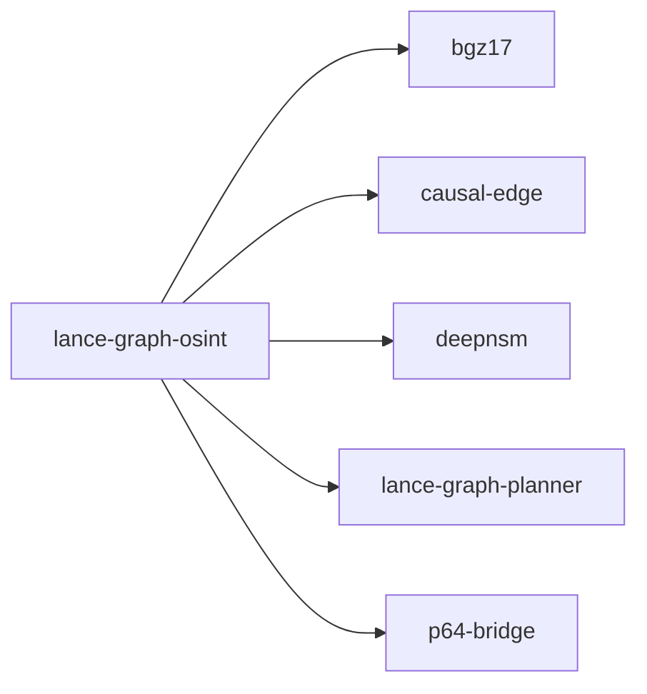

# lance-graph-osint

crate: lance-graph-osint
path: crates/lance-graph-osint
workspace: excluded
digest: a84b66526149f2f8
evidence legend: ../index.md#evidence-legend

Generated; the code is the truth. See ../index.md.

## Depends on

- dep bgz17 normal — crates/lance-graph-osint/Cargo.toml:15 CONFIRMED
- dep causal-edge normal — crates/lance-graph-osint/Cargo.toml:14 CONFIRMED
- dep deepnsm normal — crates/lance-graph-osint/Cargo.toml:17 CONFIRMED
- dep lance-graph-arm-discovery dev — crates/lance-graph-osint/Cargo.toml:46 CONFIRMED
- dep lance-graph-planner normal — crates/lance-graph-osint/Cargo.toml:11 CONFIRMED
- dep p64-bridge normal — crates/lance-graph-osint/Cargo.toml:16 CONFIRMED
- dep ndarray normal — crates/lance-graph-osint/Cargo.toml:20 CONFIRMED
- dep serde normal — crates/lance-graph-osint/Cargo.toml:32 CONFIRMED
- dep serde_json normal — crates/lance-graph-osint/Cargo.toml:33 CONFIRMED
- dep spider normal optional — crates/lance-graph-osint/Cargo.toml:28 CONFIRMED
- dep tokio normal optional — crates/lance-graph-osint/Cargo.toml:29 CONFIRMED
- dep ureq normal — crates/lance-graph-osint/Cargo.toml:23 CONFIRMED
- dep webpki-roots normal — crates/lance-graph-osint/Cargo.toml:24 CONFIRMED

## Depended on by

## Public items

- mod crawl [pub] cfg=feature="spider-crawl" — crates/lance-graph-osint/src/crawler.rs:16 CONFIRMED
- struct CrawlResult [pub] cfg=feature="spider-crawl" — crates/lance-graph-osint/src/crawler.rs:25 CONFIRMED
- fn crawl_query [pub] cfg=feature="spider-crawl" — crates/lance-graph-osint/src/crawler.rs:45 CONFIRMED
- fn batch_crawl [pub] cfg=feature="spider-crawl" — crates/lance-graph-osint/src/crawler.rs:211 CONFIRMED
- mod crawl [pub] cfg=not(feature="spider-crawl") — crates/lance-graph-osint/src/crawler.rs:224 CONFIRMED
- fn crawl_query [pub] cfg=not(feature="spider-crawl") — crates/lance-graph-osint/src/crawler.rs:226 CONFIRMED
- struct Triplet [pub] — crates/lance-graph-osint/src/extractor.rs:12 CONFIRMED
- fn Triplet::new [pub] — crates/lance-graph-osint/src/extractor.rs:21 CONFIRMED
- fn Triplet::with_truth [pub] — crates/lance-graph-osint/src/extractor.rs:31 CONFIRMED
- fn Triplet::to_string_repr [pub] — crates/lance-graph-osint/src/extractor.rs:41 CONFIRMED
- fn extract_triplets [pub] — crates/lance-graph-osint/src/extractor.rs:47 CONFIRMED
- fn refine_triplets [pub] — crates/lance-graph-osint/src/extractor.rs:112 CONFIRMED
- mod reader [pub] — crates/lance-graph-osint/src/lib.rs:16 CONFIRMED
- mod extractor [pub] — crates/lance-graph-osint/src/lib.rs:17 CONFIRMED
- mod pipeline [pub] — crates/lance-graph-osint/src/lib.rs:18 CONFIRMED
- mod crawler [pub] — crates/lance-graph-osint/src/lib.rs:19 CONFIRMED
- struct OsintConfig [pub] — crates/lance-graph-osint/src/pipeline.rs:13 CONFIRMED
- struct OsintPipeline [pub] — crates/lance-graph-osint/src/pipeline.rs:25 CONFIRMED
- fn OsintPipeline::new [pub] — crates/lance-graph-osint/src/pipeline.rs:33 CONFIRMED
- fn OsintPipeline::ingest_url [pub] — crates/lance-graph-osint/src/pipeline.rs:43 CONFIRMED
- fn OsintPipeline::ingest_text [pub] — crates/lance-graph-osint/src/pipeline.rs:82 CONFIRMED
- fn OsintPipeline::to_palette_layers [pub] — crates/lance-graph-osint/src/pipeline.rs:91 CONFIRMED
- fn OsintPipeline::search [pub] — crates/lance-graph-osint/src/pipeline.rs:99 CONFIRMED
- fn OsintPipeline::stats [pub] — crates/lance-graph-osint/src/pipeline.rs:118 CONFIRMED
- struct IngestResult [pub] — crates/lance-graph-osint/src/pipeline.rs:128 CONFIRMED
- struct PipelineStats [pub] — crates/lance-graph-osint/src/pipeline.rs:136 CONFIRMED
- struct SearchResult [pub] — crates/lance-graph-osint/src/reader.rs:32 CONFIRMED
- fn google_search [pub] — crates/lance-graph-osint/src/reader.rs:45 CONFIRMED
- fn search_and_embed [pub] — crates/lance-graph-osint/src/reader.rs:69 CONFIRMED
- fn urlencoding_pub [pub] — crates/lance-graph-osint/src/reader.rs:160 CONFIRMED
- struct EmbeddedParagraph [pub] — crates/lance-graph-osint/src/reader.rs:172 CONFIRMED
- fn fetch_and_embed [pub] — crates/lance-graph-osint/src/reader.rs:188 CONFIRMED
- fn embed_text [pub] — crates/lance-graph-osint/src/reader.rs:225 CONFIRMED
- enum ReaderError [pub] — crates/lance-graph-osint/src/reader.rs:481 CONFIRMED

## Imports from in-scope crates

### lance-graph-planner
- use lance_graph_planner::cache::triple_model::Truth — crates/lance-graph-osint/src/extractor.rs:8 CONFIRMED
- use lance_graph_planner::cache::convergence — crates/lance-graph-osint/src/pipeline.rs:6 CONFIRMED
- use lance_graph_planner::cache::triple_model::Truth — crates/lance-graph-osint/src/pipeline.rs:7 CONFIRMED

## Calls

CALL_GRAPH=ARTIFACT_MISSING
- calls ARTIFACT_MISSING — no ruff_charon artifact for this crate UNKNOWN

## Architecture

- none

Generated from Cargo manifests — extracted relationships only.

