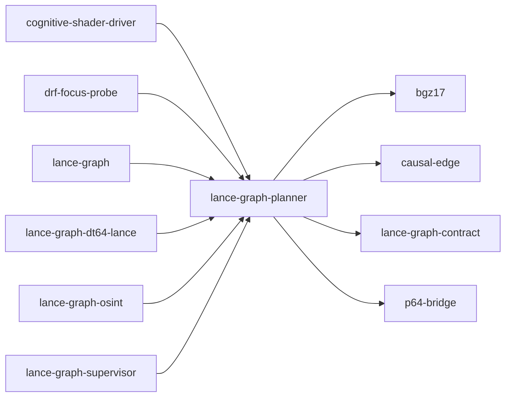

# lance-graph-planner

crate: lance-graph-planner
path: crates/lance-graph-planner
workspace: member
digest: b9f361d61ff779ad
evidence legend: ../index.md#evidence-legend

Generated; the code is the truth. See ../index.md.

## Depends on

- dep bgz17 normal — crates/lance-graph-planner/Cargo.toml:36 CONFIRMED
- dep causal-edge normal — crates/lance-graph-planner/Cargo.toml:27 CONFIRMED
- dep cognitive-shader-driver dev — crates/lance-graph-planner/Cargo.toml:78 CONFIRMED
- dep jc dev — crates/lance-graph-planner/Cargo.toml:96 CONFIRMED
- dep lance-graph-contract normal — crates/lance-graph-planner/Cargo.toml:40 CONFIRMED
- dep p64-bridge normal — crates/lance-graph-planner/Cargo.toml:33 CONFIRMED
- dep axum normal optional — crates/lance-graph-planner/Cargo.toml:43 CONFIRMED
- dep ndarray normal — crates/lance-graph-planner/Cargo.toml:24 CONFIRMED
- dep p64 normal — crates/lance-graph-planner/Cargo.toml:30 CONFIRMED
- dep serde normal — crates/lance-graph-planner/Cargo.toml:10 CONFIRMED
- dep serde_json normal — crates/lance-graph-planner/Cargo.toml:11 CONFIRMED
- dep serde_yml normal — crates/lance-graph-planner/Cargo.toml:12 CONFIRMED
- dep thiserror normal — crates/lance-graph-planner/Cargo.toml:15 CONFIRMED
- dep tokio dev — crates/lance-graph-planner/Cargo.toml:60 CONFIRMED
- dep tokio normal — crates/lance-graph-planner/Cargo.toml:18 CONFIRMED
- dep tracing normal — crates/lance-graph-planner/Cargo.toml:21 CONFIRMED

## Depended on by

- rdep cognitive-shader-driver normal optional — crates/cognitive-shader-driver/Cargo.toml:248 CONFIRMED
- rdep drf-focus-probe dev — crates/drf-focus-probe/Cargo.toml:26 CONFIRMED
- rdep drf-focus-probe normal optional — crates/drf-focus-probe/Cargo.toml:19 CONFIRMED
- rdep lance-graph dev — crates/lance-graph/Cargo.toml:175 CONFIRMED
- rdep lance-graph normal optional — crates/lance-graph/Cargo.toml:92 CONFIRMED
- rdep lance-graph-codegraph dev — crates/lance-graph-codegraph/Cargo.toml:22 CONFIRMED
- rdep lance-graph-dt64-lance normal — crates/lance-graph-dt64-lance/Cargo.toml:28 CONFIRMED
- rdep lance-graph-osint normal — crates/lance-graph-osint/Cargo.toml:11 CONFIRMED
- rdep lance-graph-supervisor normal optional — crates/lance-graph-supervisor/Cargo.toml:17 CONFIRMED

## Public items

- struct AdjacencyBatch [pub] — crates/lance-graph-planner/src/adjacency/batch.rs:37 CONFIRMED
- fn AdjacencyBatch<'a>::new [pub] — crates/lance-graph-planner/src/adjacency/batch.rs:48 CONFIRMED
- fn AdjacencyBatch<'a>::targets_for [pub] — crates/lance-graph-planner/src/adjacency/batch.rs:57 CONFIRMED
- fn AdjacencyBatch<'a>::edge_ids_for [pub] — crates/lance-graph-planner/src/adjacency/batch.rs:66 CONFIRMED
- fn AdjacencyBatch<'a>::total_targets [pub] — crates/lance-graph-planner/src/adjacency/batch.rs:75 CONFIRMED
- fn AdjacencyBatch<'a>::num_sources [pub] — crates/lance-graph-planner/src/adjacency/batch.rs:85 CONFIRMED
- fn AdjacencyBatch<'a>::is_empty [pub] — crates/lance-graph-planner/src/adjacency/batch.rs:92 CONFIRMED
- fn AdjacencyBatch<'a>::intersect [pub] — crates/lance-graph-planner/src/adjacency/batch.rs:106 CONFIRMED
- struct IntersectionResult [pub] — crates/lance-graph-planner/src/adjacency/batch.rs:145 CONFIRMED
- fn IntersectionResult::len [pub] — crates/lance-graph-planner/src/adjacency/batch.rs:156 CONFIRMED
- fn IntersectionResult::is_empty [pub] — crates/lance-graph-planner/src/adjacency/batch.rs:161 CONFIRMED
- struct AdjacencyStore [pub] — crates/lance-graph-planner/src/adjacency/csr.rs:13 CONFIRMED
- fn AdjacencyStore::new [pub] — crates/lance-graph-planner/src/adjacency/csr.rs:45 CONFIRMED
- fn AdjacencyStore::adjacent [pub] — crates/lance-graph-planner/src/adjacency/csr.rs:62 CONFIRMED
- fn AdjacencyStore::adjacent_incoming [pub] — crates/lance-graph-planner/src/adjacency/csr.rs:70 CONFIRMED
- fn AdjacencyStore::edge_ids [pub] — crates/lance-graph-planner/src/adjacency/csr.rs:78 CONFIRMED
- fn AdjacencyStore::out_degree [pub] — crates/lance-graph-planner/src/adjacency/csr.rs:86 CONFIRMED
- fn AdjacencyStore::in_degree [pub] — crates/lance-graph-planner/src/adjacency/csr.rs:92 CONFIRMED
- fn AdjacencyStore::batch_adjacent [pub] — crates/lance-graph-planner/src/adjacency/csr.rs:107 CONFIRMED
- fn AdjacencyStore::from_edges [pub] — crates/lance-graph-planner/src/adjacency/csr.rs:112 CONFIRMED
- struct AdjacentDistanceResult [pub] — crates/lance-graph-planner/src/adjacency/distance.rs:13 CONFIRMED
- fn adjacent_fingerprint_distance [pub] — crates/lance-graph-planner/src/adjacency/distance.rs:24 CONFIRMED
- mod batch [pub] — crates/lance-graph-planner/src/adjacency/mod.rs:23 CONFIRMED
- mod csr [pub] — crates/lance-graph-planner/src/adjacency/mod.rs:24 CONFIRMED
- mod distance [pub] — crates/lance-graph-planner/src/adjacency/mod.rs:25 CONFIRMED
- mod propagate [pub] — crates/lance-graph-planner/src/adjacency/mod.rs:26 CONFIRMED
- mod properties [pub] — crates/lance-graph-planner/src/adjacency/mod.rs:27 CONFIRMED
- fn adjacent_truth_propagate [pub] — crates/lance-graph-planner/src/adjacency/propagate.rs:19 CONFIRMED
- struct EdgeProperties [pub] — crates/lance-graph-planner/src/adjacency/properties.rs:10 CONFIRMED
- fn EdgeProperties::new [pub] — crates/lance-graph-planner/src/adjacency/properties.rs:24 CONFIRMED
- fn EdgeProperties::with_capacity [pub] — crates/lance-graph-planner/src/adjacency/properties.rs:34 CONFIRMED
- fn EdgeProperties::with_nars_truth [pub] — crates/lance-graph-planner/src/adjacency/properties.rs:45 CONFIRMED
- fn EdgeProperties::truth_value [pub] — crates/lance-graph-planner/src/adjacency/properties.rs:54 CONFIRMED
- fn EdgeProperties::get_float [pub] — crates/lance-graph-planner/src/adjacency/properties.rs:61 CONFIRMED
- fn EdgeProperties::get_fingerprint [pub] — crates/lance-graph-planner/src/adjacency/properties.rs:69 CONFIRMED
- struct Planner [pub] — crates/lance-graph-planner/src/api.rs:89 CONFIRMED
- fn Planner::new [pub] — crates/lance-graph-planner/src/api.rs:95 CONFIRMED
- fn Planner::with_strategies [pub] — crates/lance-graph-planner/src/api.rs:106 CONFIRMED
- fn Planner::with_resonance [pub] — crates/lance-graph-planner/src/api.rs:115 CONFIRMED
- fn Planner::plan [pub] — crates/lance-graph-planner/src/api.rs:122 CONFIRMED
- fn Planner::plan_with_style [pub] — crates/lance-graph-planner/src/api.rs:130 CONFIRMED
- fn Planner::plan_assessed [pub] — crates/lance-graph-planner/src/api.rs:201 CONFIRMED
- fn Planner::set_selector [pub] — crates/lance-graph-planner/src/api.rs:210 CONFIRMED
- fn Planner::register_strategy [pub] — crates/lance-graph-planner/src/api.rs:215 CONFIRMED
- fn Planner::strategy_names [pub] — crates/lance-graph-planner/src/api.rs:220 CONFIRMED
- fn Planner::gate_check [pub] — crates/lance-graph-planner/src/api.rs:229 CONFIRMED
- enum QueryLanguage [pub] — crates/lance-graph-planner/src/api.rs:250 CONFIRMED
- fn QueryLanguage::detect [pub] — crates/lance-graph-planner/src/api.rs:272 CONFIRMED
- fn QueryLanguage::preferred_parser [pub] — crates/lance-graph-planner/src/api.rs:327 CONFIRMED
- struct PolyglotResult [pub] — crates/lance-graph-planner/src/api.rs:351 CONFIRMED
- fn Planner::plan_polyglot [pub] — crates/lance-graph-planner/src/api.rs:381 CONFIRMED
- fn Planner::plan_polyglot_with_lang [pub] — crates/lance-graph-planner/src/api.rs:390 CONFIRMED
- fn Planner::plan_batch [pub] — crates/lance-graph-planner/src/api.rs:406 CONFIRMED
- struct CamSearch [pub] — crates/lance-graph-planner/src/api.rs:433 CONFIRMED
- fn CamSearch::new [pub] — crates/lance-graph-planner/src/api.rs:442 CONFIRMED
- fn CamSearch::prepare_query [pub] — crates/lance-graph-planner/src/api.rs:453 CONFIRMED
- fn CamSearch::top_k [pub] — crates/lance-graph-planner/src/api.rs:475 CONFIRMED
- fn CamSearch::encode [pub] — crates/lance-graph-planner/src/api.rs:497 CONFIRMED
- fn CamSearch::decode [pub] — crates/lance-graph-planner/src/api.rs:527 CONFIRMED
- fn CamSearch::stats [pub] — crates/lance-graph-planner/src/api.rs:536 CONFIRMED
- struct CamStats [pub] — crates/lance-graph-planner/src/api.rs:559 CONFIRMED
- struct CastId [pub] — crates/lance-graph-planner/src/batch_writer.rs:90 CONFIRMED
- struct BatchWriter [pub] — crates/lance-graph-planner/src/batch_writer.rs:95 CONFIRMED
- fn BatchWriter
::new [pub] — crates/lance-graph-planner/src/batch_writer.rs:117 CONFIRMED
- fn BatchWriter
::cast [pub] — crates/lance-graph-planner/src/batch_writer.rs:132 CONFIRMED
- fn BatchWriter
::casts [pub] — crates/lance-graph-planner/src/batch_writer.rs:142 CONFIRMED
- fn BatchWriter
::intent_moves [pub] — crates/lance-graph-planner/src/batch_writer.rs:148 CONFIRMED
- fn BatchWriter
::on_behalf_of [pub] — crates/lance-graph-planner/src/batch_writer.rs:156 CONFIRMED
- fn BatchWriter
::resolve_owner [pub] — crates/lance-graph-planner/src/batch_writer.rs:161 CONFIRMED
- fn BatchWriter
::drain_pending_payloads [pub] — crates/lance-graph-planner/src/batch_writer.rs:179 CONFIRMED
- enum Phase [pub] — crates/lance-graph-planner/src/cache/candidate_pool.rs:11 CONFIRMED
- struct HeadAddress [pub] — crates/lance-graph-planner/src/cache/candidate_pool.rs:22 CONFIRMED
- struct Candidate [pub] — crates/lance-graph-planner/src/cache/candidate_pool.rs:29 CONFIRMED
- struct CandidatePool [pub] — crates/lance-graph-planner/src/cache/candidate_pool.rs:39 CONFIRMED
- fn CandidatePool::new [pub] — crates/lance-graph-planner/src/cache/candidate_pool.rs:48 CONFIRMED
- fn CandidatePool::add [pub] — crates/lance-graph-planner/src/cache/candidate_pool.rs:58 CONFIRMED
- fn CandidatePool::best [pub] — crates/lance-graph-planner/src/cache/candidate_pool.rs:66 CONFIRMED
- fn CandidatePool::emit [pub] — crates/lance-graph-planner/src/cache/candidate_pool.rs:71 CONFIRMED
- fn CandidatePool::update_phase [pub] — crates/lance-graph-planner/src/cache/candidate_pool.rs:87 CONFIRMED
- fn CandidatePool::phase [pub] — crates/lance-graph-planner/src/cache/candidate_pool.rs:103 CONFIRMED
- fn CandidatePool::is_done [pub] — crates/lance-graph-planner/src/cache/candidate_pool.rs:106 CONFIRMED
- fn CandidatePool::already_said [pub] — crates/lance-graph-planner/src/cache/candidate_pool.rs:109 CONFIRMED
- fn CandidatePool::count [pub] — crates/lance-graph-planner/src/cache/candidate_pool.rs:112 CONFIRMED
- struct PlaneDistance [pub] — crates/lance-graph-planner/src/cache/convergence.rs:41 CONFIRMED
- fn PlaneDistance::build [pub] — crates/lance-graph-planner/src/cache/convergence.rs:47 CONFIRMED
- fn PlaneDistance::spo_distance [pub] — crates/lance-graph-planner/src/cache/convergence.rs:55 CONFIRMED
- fn PlaneDistance::subject_distance [pub] — crates/lance-graph-planner/src/cache/convergence.rs:62 CONFIRMED
- fn PlaneDistance::predicate_distance [pub] — crates/lance-graph-planner/src/cache/convergence.rs:68 CONFIRMED
- fn PlaneDistance::object_distance [pub] — crates/lance-graph-planner/src/cache/convergence.rs:74 CONFIRMED
- fn triplet_to_headprint [pub] — crates/lance-graph-planner/src/cache/convergence.rs:83 CONFIRMED
- fn headprint_to_spo [pub] — crates/lance-graph-planner/src/cache/convergence.rs:104 CONFIRMED
- fn triplets_to_palette_layers [pub] — crates/lance-graph-planner/src/cache/convergence.rs:140 CONFIRMED
- fn run_convergence [pub] — crates/lance-graph-planner/src/cache/convergence.rs:223 CONFIRMED
- fn episodes_to_palette_layers [pub] — crates/lance-graph-planner/src/cache/convergence.rs:235 CONFIRMED
- fn bundle_into [pub] — crates/lance-graph-planner/src/cache/kv_bundle.rs:19 CONFIRMED
- fn unbundle_from [pub] — crates/lance-graph-planner/src/cache/kv_bundle.rs:55 CONFIRMED
- struct AttentionMatrix [pub] — crates/lance-graph-planner/src/cache/kv_bundle.rs:65 CONFIRMED
- fn AttentionMatrix::new_hip [pub] — crates/lance-graph-planner/src/cache/kv_bundle.rs:77 CONFIRMED
- fn AttentionMatrix::new_twig [pub] — crates/lance-graph-planner/src/cache/kv_bundle.rs:86 CONFIRMED
- fn AttentionMatrix::get [pub] — crates/lance-graph-planner/src/cache/kv_bundle.rs:96 CONFIRMED
- fn AttentionMatrix::set [pub] — crates/lance-graph-planner/src/cache/kv_bundle.rs:106 CONFIRMED
- fn AttentionMatrix::surprise [pub] — crates/lance-graph-planner/src/cache/kv_bundle.rs:120 CONFIRMED
- fn AttentionMatrix::row_divergence [pub] — crates/lance-graph-planner/src/cache/kv_bundle.rs:126 CONFIRMED
- struct Tension [pub] — crates/lance-graph-planner/src/cache/lane_eval.rs:22 CONFIRMED
- fn Tension::analytical [pub] — crates/lance-graph-planner/src/cache/lane_eval.rs:33 CONFIRMED
- fn Tension::creative [pub] — crates/lance-graph-planner/src/cache/lane_eval.rs:44 CONFIRMED
- fn Tension::focused [pub] — crates/lance-graph-planner/src/cache/lane_eval.rs:55 CONFIRMED
- fn Tension::integrative [pub] — crates/lance-graph-planner/src/cache/lane_eval.rs:66 CONFIRMED
- fn Tension::signal_threshold [pub] — crates/lance-graph-planner/src/cache/lane_eval.rs:79 CONFIRMED
- fn Tension::from_dk [pub] — crates/lance-graph-planner/src/cache/lane_eval.rs:84 CONFIRMED
- struct LaneEvaluator [pub] — crates/lance-graph-planner/src/cache/lane_eval.rs:95 CONFIRMED
- fn LaneEvaluator::new [pub] — crates/lance-graph-planner/src/cache/lane_eval.rs:100 CONFIRMED
- fn LaneEvaluator::evaluate [pub] — crates/lance-graph-planner/src/cache/lane_eval.rs:106 CONFIRMED
- fn LaneEvaluator::evaluate_triple [pub] — crates/lance-graph-planner/src/cache/lane_eval.rs:148 CONFIRMED
- mod candidate_pool [pub] — crates/lance-graph-planner/src/cache/mod.rs:8 CONFIRMED
- mod convergence [pub] — crates/lance-graph-planner/src/cache/mod.rs:9 CONFIRMED
- mod kv_bundle [pub] — crates/lance-graph-planner/src/cache/mod.rs:10 CONFIRMED
- mod lane_eval [pub] — crates/lance-graph-planner/src/cache/mod.rs:11 CONFIRMED
- mod nars_engine [pub] — crates/lance-graph-planner/src/cache/mod.rs:12 CONFIRMED
- mod triple_model [pub] — crates/lance-graph-planner/src/cache/mod.rs:17 CONFIRMED
- struct SpoHead [pub] — crates/lance-graph-planner/src/cache/nars_engine.rs:29 CONFIRMED
- fn SpoHead::zero [pub] — crates/lance-graph-planner/src/cache/nars_engine.rs:41 CONFIRMED
- fn SpoHead::frequency [pub] — crates/lance-graph-planner/src/cache/nars_engine.rs:54 CONFIRMED
- fn SpoHead::confidence [pub] — crates/lance-graph-planner/src/cache/nars_engine.rs:57 CONFIRMED
- fn SpoHead::truth [pub] — crates/lance-graph-planner/src/cache/nars_engine.rs:60 CONFIRMED
- fn SpoHead::expectation [pub] — crates/lance-graph-planner/src/cache/nars_engine.rs:63 CONFIRMED
- fn SpoHead::set_truth [pub] — crates/lance-graph-planner/src/cache/nars_engine.rs:67 CONFIRMED
- fn SpoHead::s_active [pub] — crates/lance-graph-planner/src/cache/nars_engine.rs:73 CONFIRMED
- fn SpoHead::p_active [pub] — crates/lance-graph-planner/src/cache/nars_engine.rs:76 CONFIRMED
- fn SpoHead::o_active [pub] — crates/lance-graph-planner/src/cache/nars_engine.rs:79 CONFIRMED
- const MASK_NONE [pub] — crates/lance-graph-planner/src/cache/nars_engine.rs:86 CONFIRMED
- const MASK_S [pub] — crates/lance-graph-planner/src/cache/nars_engine.rs:87 CONFIRMED
- const MASK_P [pub] — crates/lance-graph-planner/src/cache/nars_engine.rs:88 CONFIRMED
- const MASK_O [pub] — crates/lance-graph-planner/src/cache/nars_engine.rs:89 CONFIRMED
- const MASK_SP [pub] — crates/lance-graph-planner/src/cache/nars_engine.rs:90 CONFIRMED
- const MASK_SO [pub] — crates/lance-graph-planner/src/cache/nars_engine.rs:91 CONFIRMED
- const MASK_PO [pub] — crates/lance-graph-planner/src/cache/nars_engine.rs:92 CONFIRMED
- const MASK_SPO [pub] — crates/lance-graph-planner/src/cache/nars_engine.rs:93 CONFIRMED
- const ALL_MASKS [pub] — crates/lance-graph-planner/src/cache/nars_engine.rs:96 CONFIRMED
- struct SpoDistances [pub] — crates/lance-graph-planner/src/cache/nars_engine.rs:104 CONFIRMED
- fn SpoDistances::new_zero [pub] — crates/lance-graph-planner/src/cache/nars_engine.rs:111 CONFIRMED
- fn SpoDistances::s_dist [pub] — crates/lance-graph-planner/src/cache/nars_engine.rs:121 CONFIRMED
- fn SpoDistances::p_dist [pub] — crates/lance-graph-planner/src/cache/nars_engine.rs:125 CONFIRMED
- fn SpoDistances::o_dist [pub] — crates/lance-graph-planner/src/cache/nars_engine.rs:129 CONFIRMED
- fn SpoDistances::causal_distance [pub] — crates/lance-graph-planner/src/cache/nars_engine.rs:135 CONFIRMED
- fn SpoDistances::all_projections [pub] — crates/lance-graph-planner/src/cache/nars_engine.rs:150 CONFIRMED
- enum Inference [pub] — crates/lance-graph-planner/src/cache/nars_engine.rs:163 CONFIRMED
- fn nars_infer [pub] — crates/lance-graph-planner/src/cache/nars_engine.rs:188 CONFIRMED
- struct StyleVector [pub] — crates/lance-graph-planner/src/cache/nars_engine.rs:254 CONFIRMED
- fn analytical_style [pub] — crates/lance-graph-planner/src/cache/nars_engine.rs:260 CONFIRMED
- fn creative_style [pub] — crates/lance-graph-planner/src/cache/nars_engine.rs:269 CONFIRMED
- fn empathetic_style [pub] — crates/lance-graph-planner/src/cache/nars_engine.rs:277 CONFIRMED
- fn focused_style [pub] — crates/lance-graph-planner/src/cache/nars_engine.rs:285 CONFIRMED
- fn metacognitive_style [pub] — crates/lance-graph-planner/src/cache/nars_engine.rs:293 CONFIRMED
- fn style_vector_for [pub] — crates/lance-graph-planner/src/cache/nars_engine.rs:306 CONFIRMED
- fn intervention_style [pub] — crates/lance-graph-planner/src/cache/nars_engine.rs:333 CONFIRMED
- fn counterfactual_style [pub] — crates/lance-graph-planner/src/cache/nars_engine.rs:357 CONFIRMED
- fn inference_to_pearl_mask [pub] — crates/lance-graph-planner/src/cache/nars_engine.rs:382 CONFIRMED
- fn inference_to_style [pub] — crates/lance-graph-planner/src/cache/nars_engine.rs:403 CONFIRMED
- fn style_score [pub] — crates/lance-graph-planner/src/cache/nars_engine.rs:414 CONFIRMED
- struct NarsEngine [pub] — crates/lance-graph-planner/src/cache/nars_engine.rs:436 CONFIRMED
- fn NarsEngine::new [pub] — crates/lance-graph-planner/src/cache/nars_engine.rs:449 CONFIRMED
- fn NarsEngine::with_c_levels [pub] — crates/lance-graph-planner/src/cache/nars_engine.rs:468 CONFIRMED
- fn NarsEngine::revise_fast [pub] — crates/lance-graph-planner/src/cache/nars_engine.rs:510 CONFIRMED
- fn NarsEngine::deduce_fast [pub] — crates/lance-graph-planner/src/cache/nars_engine.rs:529 CONFIRMED
- fn NarsEngine::to_causal_edge [pub] — crates/lance-graph-planner/src/cache/nars_engine.rs:541 CONFIRMED
- fn NarsEngine::from_causal_edge [pub] — crates/lance-graph-planner/src/cache/nars_engine.rs:585 CONFIRMED
- fn NarsEngine::forward_edge [pub] — crates/lance-graph-planner/src/cache/nars_engine.rs:601 CONFIRMED
- fn NarsEngine::on_emit [pub] — crates/lance-graph-planner/src/cache/nars_engine.rs:613 CONFIRMED
- fn NarsEngine::on_response [pub] — crates/lance-graph-planner/src/cache/nars_engine.rs:623 CONFIRMED
- fn NarsEngine::detect_contradiction [pub] — crates/lance-graph-planner/src/cache/nars_engine.rs:630 CONFIRMED
- fn NarsEngine::mutual_entailment [pub] — crates/lance-graph-planner/src/cache/nars_engine.rs:642 CONFIRMED
- fn NarsEngine::combinatorial_entailment [pub] — crates/lance-graph-planner/src/cache/nars_engine.rs:652 CONFIRMED
- fn NarsEngine::skepticism [pub] — crates/lance-graph-planner/src/cache/nars_engine.rs:663 CONFIRMED
- fn NarsEngine::should_stop [pub] — crates/lance-graph-planner/src/cache/nars_engine.rs:668 CONFIRMED
- fn NarsEngine::score [pub] — crates/lance-graph-planner/src/cache/nars_engine.rs:683 CONFIRMED
- struct Plasticity [pub] — crates/lance-graph-planner/src/cache/triple_model.rs:14 CONFIRMED
- const Plasticity::ALL_HOT [pub] — crates/lance-graph-planner/src/cache/triple_model.rs:19 CONFIRMED
- const Plasticity::ALL_FROZEN [pub] — crates/lance-graph-planner/src/cache/triple_model.rs:20 CONFIRMED
- fn Plasticity::s_hot [pub] — crates/lance-graph-planner/src/cache/triple_model.rs:21 CONFIRMED
- fn Plasticity::p_hot [pub] — crates/lance-graph-planner/src/cache/triple_model.rs:24 CONFIRMED
- fn Plasticity::o_hot [pub] — crates/lance-graph-planner/src/cache/triple_model.rs:27 CONFIRMED
- fn Plasticity::freeze_if_confident [pub] — crates/lance-graph-planner/src/cache/triple_model.rs:30 CONFIRMED
- fn truth_revision [pub] — crates/lance-graph-planner/src/cache/triple_model.rs:46 CONFIRMED
- fn truth_unknown [pub] — crates/lance-graph-planner/src/cache/triple_model.rs:51 CONFIRMED
- enum DkPosition [pub] — crates/lance-graph-planner/src/cache/triple_model.rs:57 CONFIRMED
- struct ModelState [pub] — crates/lance-graph-planner/src/cache/triple_model.rs:65 CONFIRMED
- fn ModelState::new [pub] — crates/lance-graph-planner/src/cache/triple_model.rs:79 CONFIRMED
- fn ModelState::update_head [pub] — crates/lance-graph-planner/src/cache/triple_model.rs:89 CONFIRMED
- struct TripleModel [pub] — crates/lance-graph-planner/src/cache/triple_model.rs:104 CONFIRMED
- fn TripleModel::new [pub] — crates/lance-graph-planner/src/cache/triple_model.rs:117 CONFIRMED
- fn TripleModel::on_self_output [pub] — crates/lance-graph-planner/src/cache/triple_model.rs:126 CONFIRMED
- fn TripleModel::on_user_input [pub] — crates/lance-graph-planner/src/cache/triple_model.rs:135 CONFIRMED
- fn TripleModel::free_energy [pub] — crates/lance-graph-planner/src/cache/triple_model.rs:147 CONFIRMED
- fn TripleModel::alignment [pub] — crates/lance-graph-planner/src/cache/triple_model.rs:152 CONFIRMED
- fn TripleModel::topic_shift [pub] — crates/lance-graph-planner/src/cache/triple_model.rs:162 CONFIRMED
- type PredicateRow [pub] — crates/lance-graph-planner/src/chain_admission.rs:26 CONFIRMED
- type Palette [pub] — crates/lance-graph-planner/src/chain_admission.rs:29 CONFIRMED
- const PALETTES [pub] — crates/lance-graph-planner/src/chain_admission.rs:36 CONFIRMED
- const DISMECH_CLASSID [pub] — crates/lance-graph-planner/src/chain_admission.rs:40 CONFIRMED
- truncated (1037 total), see symbols.tsv

## Imports from in-scope crates

### causal-edge
- use causal_edge::tables::NarsTables — crates/lance-graph-planner/src/cache/nars_engine.rs:19 CONFIRMED
- use causal_edge::tables::pack_truth — crates/lance-graph-planner/src/cache/nars_engine.rs:19 CONFIRMED
- use causal_edge::tables::unpack_c — crates/lance-graph-planner/src/cache/nars_engine.rs:19 CONFIRMED
- use causal_edge::tables::unpack_f — crates/lance-graph-planner/src/cache/nars_engine.rs:19 CONFIRMED
- pub-use causal_edge::CausalEdge64 — crates/lance-graph-planner/src/cache/nars_engine.rs:20 CONFIRMED
- pub-use causal_edge::CausalMask — crates/lance-graph-planner/src/cache/nars_engine.rs:21 CONFIRMED
- pub-use causal_edge::PlasticityState — crates/lance-graph-planner/src/cache/nars_engine.rs:22 CONFIRMED
- use causal_edge::CausalEdge64 cfg=test — crates/lance-graph-planner/src/cache/stage26_v3_parity.rs:63 CONFIRMED
- use causal_edge::CausalEdgeV3 cfg=test — crates/lance-graph-planner/src/cache/stage26_v3_parity.rs:63 CONFIRMED
- use causal_edge::IsaFault cfg=test — crates/lance-graph-planner/src/cache/stage26_v3_parity.rs:63 CONFIRMED
- use causal_edge::tables::NarsTables cfg=test — crates/lance-graph-planner/src/chain_admission.rs:170 CONFIRMED
- use causal_edge::edge::InferenceType — crates/lance-graph-planner/src/chain_counterfactual.rs:46 CONFIRMED
- use causal_edge::tables::NarsTables — crates/lance-graph-planner/src/chain_counterfactual.rs:47 CONFIRMED
- use causal_edge::CausalEdge64 — crates/lance-graph-planner/src/chain_counterfactual.rs:48 CONFIRMED
- use causal_edge::CausalMask cfg=test — crates/lance-graph-planner/src/chain_counterfactual.rs:274 CONFIRMED
- use causal_edge::PlasticityState cfg=test — crates/lance-graph-planner/src/chain_counterfactual.rs:274 CONFIRMED
- use causal_edge::tables::NarsTables — crates/lance-graph-planner/src/chain_replay.rs:45 CONFIRMED
- use causal_edge::tables::unpack_c — crates/lance-graph-planner/src/chain_replay.rs:45 CONFIRMED
- use causal_edge::tables::unpack_f — crates/lance-graph-planner/src/chain_replay.rs:45 CONFIRMED
- use causal_edge::CausalEdge64 — crates/lance-graph-planner/src/chain_replay.rs:46 CONFIRMED
- use causal_edge::edge::InferenceType cfg=test — crates/lance-graph-planner/src/chain_replay.rs:360 CONFIRMED
- use causal_edge::CausalMask cfg=test — crates/lance-graph-planner/src/chain_replay.rs:361 CONFIRMED
- use causal_edge::PlasticityState cfg=test — crates/lance-graph-planner/src/chain_replay.rs:361 CONFIRMED
- use causal_edge::edge::CausalEdge64 — crates/lance-graph-planner/src/nars/mediator.rs:24 CONFIRMED
- use causal_edge::edge::InferenceType cfg=test — crates/lance-graph-planner/src/nars/mediator.rs:142 CONFIRMED
- use causal_edge::CausalMask cfg=test — crates/lance-graph-planner/src/nars/mediator.rs:143 CONFIRMED
- use causal_edge::PlasticityState cfg=test — crates/lance-graph-planner/src/nars/mediator.rs:143 CONFIRMED
- use causal_edge::edge::CausalEdge64 — crates/lance-graph-planner/src/nars/scent.rs:42 CONFIRMED
- use causal_edge::edge::InferenceType cfg=test — crates/lance-graph-planner/src/nars/scent.rs:217 CONFIRMED
- use causal_edge::CausalMask cfg=test — crates/lance-graph-planner/src/nars/scent.rs:218 CONFIRMED
- use causal_edge::PlasticityState cfg=test — crates/lance-graph-planner/src/nars/scent.rs:218 CONFIRMED
- use causal_edge::edge::CausalEdge64 cfg=test — crates/lance-graph-planner/src/nars/scent_learn.rs:381 CONFIRMED
- use causal_edge::edge::InferenceType cfg=test — crates/lance-graph-planner/src/nars/scent_learn.rs:381 CONFIRMED
- use causal_edge::CausalMask cfg=test — crates/lance-graph-planner/src/nars/scent_learn.rs:382 CONFIRMED
- use causal_edge::PlasticityState cfg=test — crates/lance-graph-planner/src/nars/scent_learn.rs:382 CONFIRMED
- use causal_edge::edge::CausalEdge64 cfg=test — crates/lance-graph-planner/src/nars/warrant.rs:352 CONFIRMED
- use causal_edge::edge::InferenceType cfg=test — crates/lance-graph-planner/src/nars/warrant.rs:352 CONFIRMED
- use causal_edge::CausalMask cfg=test — crates/lance-graph-planner/src/nars/warrant.rs:353 CONFIRMED
- use causal_edge::PlasticityState cfg=test — crates/lance-graph-planner/src/nars/warrant.rs:353 CONFIRMED
- use causal_edge::CausalEdge64 — crates/lance-graph-planner/src/pearl.rs:47 CONFIRMED
- use causal_edge::CausalMask — crates/lance-graph-planner/src/pearl.rs:47 CONFIRMED
- use causal_edge::edge::InferenceType cfg=test — crates/lance-graph-planner/src/pearl.rs:521 CONFIRMED
- use causal_edge::layout::EPISTEMIC_MASK cfg=test — crates/lance-graph-planner/src/pearl.rs:522 CONFIRMED
- use causal_edge::tables::NarsTables cfg=test — crates/lance-graph-planner/src/pearl.rs:523 CONFIRMED
- use causal_edge::PlasticityState cfg=test — crates/lance-graph-planner/src/pearl.rs:524 CONFIRMED
### jc
- use jc::stats::binary_association cfg=test — crates/lance-graph-planner/src/cache/stage26_v3_parity.rs:356 CONFIRMED
- use jc::reliability::spearman cfg=test — crates/lance-graph-planner/src/strategy/stage25_census.rs:364 CONFIRMED
- use jc::stats::binary_association cfg=test — crates/lance-graph-planner/src/strategy/stage25_census.rs:365 CONFIRMED
- use jc::stats::cohen_kappa cfg=test — crates/lance-graph-planner/src/strategy/stage25_census.rs:365 CONFIRMED
- use jc::stats::eta_squared cfg=test — crates/lance-graph-planner/src/strategy/stage25_census.rs:365 CONFIRMED
- use jc::stats::multiple_r_squared cfg=test — crates/lance-graph-planner/src/strategy/stage25_census.rs:365 CONFIRMED
### lance-graph-contract
- use lance_graph_contract::collapse_gate::MailboxId — crates/lance-graph-planner/src/batch_writer.rs:81 CONFIRMED
- use lance_graph_contract::kanban::KanbanMove — crates/lance-graph-planner/src/batch_writer.rs:82 CONFIRMED
- use lance_graph_contract::dismech_evidence::DISMECH_CONCEPT_ID — crates/lance-graph-planner/src/chain_admission.rs:21 CONFIRMED
- use lance_graph_contract::dismech_evidence::dismech_predicate — crates/lance-graph-planner/src/chain_admission.rs:21 CONFIRMED
- use lance_graph_contract::collapse_gate::MailboxId — crates/lance-graph-planner/src/chain_counterfactual.rs:49 CONFIRMED
- use lance_graph_contract::counterfactual::EpisodicEdge — crates/lance-graph-planner/src/chain_counterfactual.rs:50 CONFIRMED
- use lance_graph_contract::collapse_gate::MailboxId — crates/lance-graph-planner/src/chain_replay.rs:49 CONFIRMED
- use lance_graph_contract::dismech_evidence::Supports — crates/lance-graph-planner/src/dismech_candidates.rs:69 CONFIRMED
- use lance_graph_contract::revision::EvidenceMask — crates/lance-graph-planner/src/dismech_candidates.rs:70 CONFIRMED
- use lance_graph_contract::kanban::KanbanMove — crates/lance-graph-planner/src/elevation/cycle.rs:35 CONFIRMED
- use lance_graph_contract::kanban::LIBET_COMMIT_WINDOW_US — crates/lance-graph-planner/src/elevation/cycle.rs:35 CONFIRMED
- use lance_graph_contract::collapse_gate::MailboxId cfg=test — crates/lance-graph-planner/src/elevation/cycle.rs:158 CONFIRMED
- use lance_graph_contract::kanban::ExecTarget cfg=test — crates/lance-graph-planner/src/elevation/cycle.rs:159 CONFIRMED
- use lance_graph_contract::kanban::KanbanColumn cfg=test — crates/lance-graph-planner/src/elevation/cycle.rs:159 CONFIRMED
- use lance_graph_contract::scheduler::DatasetVersion cfg=test — crates/lance-graph-planner/src/elevation/cycle.rs:160 CONFIRMED
- use lance_graph_contract::scheduler::NextPhaseScheduler cfg=test — crates/lance-graph-planner/src/elevation/cycle.rs:160 CONFIRMED
- use lance_graph_contract::scheduler::VersionScheduler cfg=test — crates/lance-graph-planner/src/elevation/cycle.rs:160 CONFIRMED
- use lance_graph_contract::soa_view::MailboxSoaView cfg=test — crates/lance-graph-planner/src/elevation/cycle.rs:161 CONFIRMED
- use lance_graph_contract::cognitive_shader::RungLevel — crates/lance-graph-planner/src/elevation/mod.rs:25 CONFIRMED
- pub-use lance_graph_contract::escalation::Archetype — crates/lance-graph-planner/src/mul/escalation.rs:11 CONFIRMED
- pub-use lance_graph_contract::escalation::Checklist — crates/lance-graph-planner/src/mul/escalation.rs:11 CONFIRMED
- pub-use lance_graph_contract::escalation::ChecklistItem — crates/lance-graph-planner/src/mul/escalation.rs:11 CONFIRMED
- pub-use lance_graph_contract::escalation::fanout_width — crates/lance-graph-planner/src/mul/escalation.rs:11 CONFIRMED
- pub-use lance_graph_contract::escalation::is_split — crates/lance-graph-planner/src/mul/escalation.rs:11 CONFIRMED
- pub-use lance_graph_contract::escalation::noise_tolerance — crates/lance-graph-planner/src/mul/escalation.rs:11 CONFIRMED
- pub-use lance_graph_contract::escalation::rung_delta — crates/lance-graph-planner/src/mul/escalation.rs:11 CONFIRMED
- pub-use lance_graph_contract::escalation::CollapseHint — crates/lance-graph-planner/src/mul/escalation.rs:12 CONFIRMED
- pub-use lance_graph_contract::escalation::CouncilVerdict — crates/lance-graph-planner/src/mul/escalation.rs:12 CONFIRMED
- pub-use lance_graph_contract::escalation::Epiphany — crates/lance-graph-planner/src/mul/escalation.rs:12 CONFIRMED
- pub-use lance_graph_contract::escalation::EpiphanyDetector — crates/lance-graph-planner/src/mul/escalation.rs:12 CONFIRMED
- pub-use lance_graph_contract::escalation::GateKind — crates/lance-graph-planner/src/mul/escalation.rs:12 CONFIRMED
- pub-use lance_graph_contract::escalation::GhostEcho — crates/lance-graph-planner/src/mul/escalation.rs:12 CONFIRMED
- pub-use lance_graph_contract::escalation::InnerCouncil — crates/lance-graph-planner/src/mul/escalation.rs:12 CONFIRMED
- pub-use lance_graph_contract::escalation::WisdomMarker — crates/lance-graph-planner/src/mul/escalation.rs:13 CONFIRMED
- use lance_graph_contract::awareness_facet::SpoFacet — crates/lance-graph-planner/src/nars/facet_fold.rs:37 CONFIRMED
- use lance_graph_contract::escalation::GhostEcho — crates/lance-graph-planner/src/nars/ghost_prior.rs:59 CONFIRMED
- use lance_graph_contract::escalation::WisdomMarker — crates/lance-graph-planner/src/nars/ghost_prior.rs:59 CONFIRMED
- use lance_graph_contract::escalation::GhostEcho — crates/lance-graph-planner/src/nars/ghost_prior.rs:316 CONFIRMED
- use lance_graph_contract::mul::FlowState — crates/lance-graph-planner/src/nars/insight.rs:21 CONFIRMED
- use lance_graph_contract::sensorium::GraphSignals — crates/lance-graph-planner/src/nars/insight.rs:22 CONFIRMED
- use lance_graph_contract::thought_atoms::normalized_entropy — crates/lance-graph-planner/src/nars/insight.rs:23 CONFIRMED
- use lance_graph_contract::epistemic_state5::Epi5ReadError — crates/lance-graph-planner/src/nars/mediator.rs:25 CONFIRMED
- use lance_graph_contract::band_reading::EdgeProvenance cfg=test — crates/lance-graph-planner/src/nars/mediator.rs:144 CONFIRMED
- use lance_graph_contract::class_view::ClassId cfg=test — crates/lance-graph-planner/src/nars/mediator.rs:145 CONFIRMED
- use lance_graph_contract::epistemic_state5::Certification3 cfg=test — crates/lance-graph-planner/src/nars/mediator.rs:147 CONFIRMED
- use lance_graph_contract::epistemic_state5::Epi5Declarations cfg=test — crates/lance-graph-planner/src/nars/mediator.rs:147 CONFIRMED
- use lance_graph_contract::epistemic_state5::Epi5Gen cfg=test — crates/lance-graph-planner/src/nars/mediator.rs:147 CONFIRMED
- use lance_graph_contract::epistemic_state5::Epi5Reading cfg=test — crates/lance-graph-planner/src/nars/mediator.rs:147 CONFIRMED
- use lance_graph_contract::epistemic_state5::EpistemicState5 cfg=test — crates/lance-graph-planner/src/nars/mediator.rs:147 CONFIRMED
- truncated at 100, see imports.tsv

## Calls

CALL_GRAPH=ARTIFACT_MISSING
- calls ARTIFACT_MISSING — no ruff_charon artifact for this crate UNKNOWN

## Architecture

- arch LaneBinding checked-by LaneBinding::check [CONFIRMED] validation=OK — crates/lance-graph-dt64/src/lane.rs:307 CONFIRMED

Generated from Cargo manifests — extracted relationships only.

