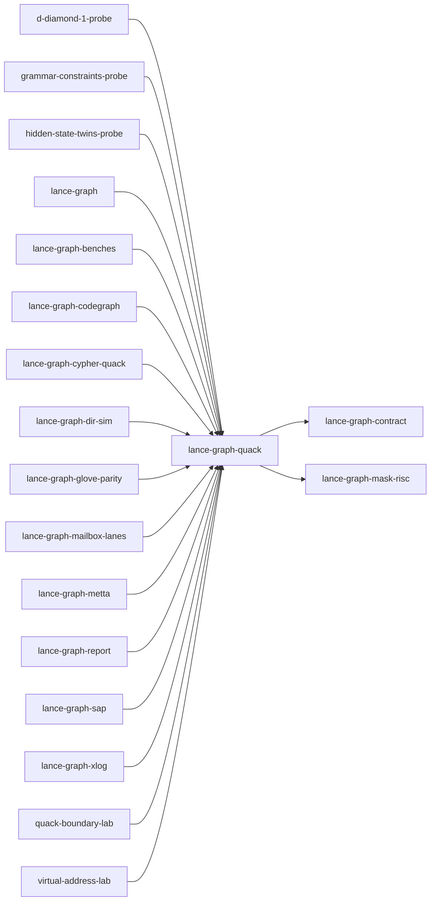

# lance-graph-quack

crate: lance-graph-quack
path: crates/lance-graph-quack
workspace: member
digest: a4d3ab92813e924f
evidence legend: ../index.md#evidence-legend

Generated; the code is the truth. See ../index.md.

## Depends on

- dep causal-edge dev — crates/lance-graph-quack/Cargo.toml:27 CONFIRMED
- dep deepnsm-v2 dev — crates/lance-graph-quack/Cargo.toml:30 CONFIRMED
- dep lance-graph-arm-discovery dev — crates/lance-graph-quack/Cargo.toml:23 CONFIRMED
- dep lance-graph-contract normal — crates/lance-graph-quack/Cargo.toml:18 CONFIRMED
- dep lance-graph-mask-risc normal — crates/lance-graph-quack/Cargo.toml:13 CONFIRMED

## Depended on by

- rdep d-diamond-1-probe normal — crates/d-diamond-1-probe/Cargo.toml:17 CONFIRMED
- rdep drf-focus-probe dev — crates/drf-focus-probe/Cargo.toml:31 CONFIRMED
- rdep grammar-constraints-probe normal — crates/grammar-constraints-probe/Cargo.toml:20 CONFIRMED
- rdep hidden-state-twins-probe normal — crates/hidden-state-twins-probe/Cargo.toml:20 CONFIRMED
- rdep jc dev — crates/jc/Cargo.toml:43 CONFIRMED
- rdep lance-graph normal — crates/lance-graph/Cargo.toml:57 CONFIRMED
- rdep lance-graph-benches normal — crates/lance-graph-benches/Cargo.toml:25 CONFIRMED
- rdep lance-graph-codegraph normal — crates/lance-graph-codegraph/Cargo.toml:14 CONFIRMED
- rdep lance-graph-cypher-quack normal — crates/lance-graph-cypher-quack/Cargo.toml:16 CONFIRMED
- rdep lance-graph-dir-sim normal — crates/lance-graph-dir-sim/Cargo.toml:32 CONFIRMED
- rdep lance-graph-glove-parity normal — crates/lance-graph-glove-parity/Cargo.toml:16 CONFIRMED
- rdep lance-graph-mailbox-lanes normal — crates/lance-graph-mailbox-lanes/Cargo.toml:14 CONFIRMED
- rdep lance-graph-metta normal — crates/lance-graph-metta/Cargo.toml:16 CONFIRMED
- rdep lance-graph-r2il dev — crates/lance-graph-r2il/Cargo.toml:36 CONFIRMED
- rdep lance-graph-report normal — crates/lance-graph-report/Cargo.toml:14 CONFIRMED
- rdep lance-graph-sap normal — crates/lance-graph-sap/Cargo.toml:13 CONFIRMED
- rdep lance-graph-xlog normal — crates/lance-graph-xlog/Cargo.toml:10 CONFIRMED
- rdep quack-boundary-lab normal — crates/quack-boundary-lab/Cargo.toml:12 CONFIRMED
- rdep r2il-mask-abi-probe dev — crates/r2il-mask-abi-probe/Cargo.toml:21 CONFIRMED
- rdep virtual-address-lab normal — crates/virtual-address-lab/Cargo.toml:12 CONFIRMED

## Public items

- struct TableId [pub] — crates/lance-graph-quack/src/bind.rs:63 CONFIRMED
- enum FieldKind [pub] — crates/lance-graph-quack/src/bind.rs:67 CONFIRMED
- struct BoundField [pub] — crates/lance-graph-quack/src/bind.rs:77 CONFIRMED
- trait Binder [pub] — crates/lance-graph-quack/src/bind.rs:92 CONFIRMED
- enum Literal [pub] — crates/lance-graph-quack/src/bind.rs:107 CONFIRMED
- enum Op [pub] — crates/lance-graph-quack/src/bind.rs:137 CONFIRMED
- struct Predicate [pub] — crates/lance-graph-quack/src/bind.rs:146 CONFIRMED
- struct FieldRef [pub] — crates/lance-graph-quack/src/bind.rs:157 CONFIRMED
- fn FieldRef::new [pub] — crates/lance-graph-quack/src/bind.rs:164 CONFIRMED
- fn FieldRef::eq [pub] — crates/lance-graph-quack/src/bind.rs:168 CONFIRMED
- fn FieldRef::ne [pub] — crates/lance-graph-quack/src/bind.rs:172 CONFIRMED
- struct Draft [pub] — crates/lance-graph-quack/src/bind.rs:195 CONFIRMED
- fn table [pub] — crates/lance-graph-quack/src/bind.rs:202 CONFIRMED
- enum BindError [pub] — crates/lance-graph-quack/src/bind.rs:213 CONFIRMED
- fn Draft::where_eq [pub] — crates/lance-graph-quack/src/bind.rs:261 CONFIRMED
- fn Draft::where_ [pub] — crates/lance-graph-quack/src/bind.rs:270 CONFIRMED
- fn Draft::count [pub] — crates/lance-graph-quack/src/bind.rs:275 CONFIRMED
- fn Draft::rows [pub] — crates/lance-graph-quack/src/bind.rs:280 CONFIRMED
- fn Draft::bind [pub] — crates/lance-graph-quack/src/bind.rs:298 CONFIRMED
- trait CodeWitness [pub] — crates/lance-graph-quack/src/bind.rs:391 CONFIRMED
- struct TypedQuery [pub] — crates/lance-graph-quack/src/bind.rs:409 CONFIRMED
- fn Draft::bind_typed [pub] — crates/lance-graph-quack/src/bind.rs:426 CONFIRMED
- fn TypedQuery<W>::admit [pub] — crates/lance-graph-quack/src/bind.rs:454 CONFIRMED
- struct TableDeclaration [pub] — crates/lance-graph-quack/src/bind.rs:467 CONFIRMED
- fn create_table [pub] — crates/lance-graph-quack/src/bind.rs:473 CONFIRMED
- struct ResolvedTable [pub] — crates/lance-graph-quack/src/bind.rs:483 CONFIRMED
- enum RegisterError [pub] — crates/lance-graph-quack/src/bind.rs:492 CONFIRMED
- trait Registrar [pub] — crates/lance-graph-quack/src/bind.rs:508 CONFIRMED
- fn TableDeclaration::width [pub] — crates/lance-graph-quack/src/bind.rs:519 CONFIRMED
- fn TableDeclaration::register [pub] — crates/lance-graph-quack/src/bind.rs:528 CONFIRMED
- mod bind [pub] — crates/lance-graph-quack/src/lib.rs:169 CONFIRMED
- mod set [pub] — crates/lance-graph-quack/src/lib.rs:170 CONFIRMED
- struct Col [pub] — crates/lance-graph-quack/src/lib.rs:186 CONFIRMED
- struct Mask [pub] — crates/lance-graph-quack/src/lib.rs:192 CONFIRMED
- struct ForeignPlane [pub] — crates/lance-graph-quack/src/lib.rs:201 CONFIRMED
- struct ForeignLane [pub] — crates/lance-graph-quack/src/lib.rs:209 CONFIRMED
- enum Cmp [pub] — crates/lance-graph-quack/src/lib.rs:219 CONFIRMED
- enum PrefixLowering [pub] — crates/lance-graph-quack/src/lib.rs:306 CONFIRMED
- enum Filter [pub] — crates/lance-graph-quack/src/lib.rs:341 CONFIRMED
- fn Filter::cmp [pub] — crates/lance-graph-quack/src/lib.rs:404 CONFIRMED
- fn Filter::plane [pub] — crates/lance-graph-quack/src/lib.rs:409 CONFIRMED
- fn Filter::eq_u32_via [pub] — crates/lance-graph-quack/src/lib.rs:414 CONFIRMED
- fn Filter::semijoin [pub] — crates/lance-graph-quack/src/lib.rs:420 CONFIRMED
- fn Filter::and [pub] — crates/lance-graph-quack/src/lib.rs:425 CONFIRMED
- fn Filter::or [pub] — crates/lance-graph-quack/src/lib.rs:430 CONFIRMED
- fn Filter::negate [pub] — crates/lance-graph-quack/src/lib.rs:439 CONFIRMED
- fn Filter::in_u32 [pub] — crates/lance-graph-quack/src/lib.rs:447 CONFIRMED
- fn Filter::in_i32 [pub] — crates/lance-graph-quack/src/lib.rs:456 CONFIRMED
- fn Filter::is_not_null [pub] — crates/lance-graph-quack/src/lib.rs:469 CONFIRMED
- fn Filter::is_null [pub] — crates/lance-graph-quack/src/lib.rs:476 CONFIRMED
- fn Filter::sql_where [pub] — crates/lance-graph-quack/src/lib.rs:550 CONFIRMED
- fn Filter::and_by_skip [pub] — crates/lance-graph-quack/src/lib.rs:753 CONFIRMED
- fn Filter::prefix_u32 [pub] — crates/lance-graph-quack/src/lib.rs:811 CONFIRMED
- fn Filter::prefix_u64 [pub] — crates/lance-graph-quack/src/lib.rs:830 CONFIRMED
- fn Filter::prefix_facet [pub] — crates/lance-graph-quack/src/lib.rs:889 CONFIRMED
- fn Filter::aperture_facet [pub] — crates/lance-graph-quack/src/lib.rs:945 CONFIRMED
- fn Filter::aperture_facet_strided [pub] — crates/lance-graph-quack/src/lib.rs:981 CONFIRMED
- enum ApertureLowering [pub] — crates/lance-graph-quack/src/lib.rs:1052 CONFIRMED
- enum LowerError [pub] — crates/lance-graph-quack/src/lib.rs:1067 CONFIRMED
- enum Agg [pub] — crates/lance-graph-quack/src/lib.rs:1137 CONFIRMED
- enum GroupAddr [pub] — crates/lance-graph-quack/src/lib.rs:1245 CONFIRMED
- enum GroupAgg [pub] — crates/lance-graph-quack/src/lib.rs:1273 CONFIRMED
- fn GroupAgg::fold [pub] — crates/lance-graph-quack/src/lib.rs:1290 CONFIRMED
- struct Query [pub] — crates/lance-graph-quack/src/lib.rs:1311 CONFIRMED
- struct GroupBy [pub] — crates/lance-graph-quack/src/lib.rs:1324 CONFIRMED
- struct GroupPlan [pub] — crates/lance-graph-quack/src/lib.rs:1349 CONFIRMED
- enum GroupLowering [pub] — crates/lance-graph-quack/src/lib.rs:1365 CONFIRMED
- fn lower [pub] — crates/lance-graph-quack/src/lib.rs:1393 CONFIRMED
- fn lower_fused [pub] — crates/lance-graph-quack/src/lib.rs:1407 CONFIRMED
- fn lower_sel [pub] — crates/lance-graph-quack/src/lib.rs:1435 CONFIRMED
- fn lower_group_by [pub] — crates/lance-graph-quack/src/lib.rs:1457 CONFIRMED
- fn lower_group_by_semantic [pub] — crates/lance-graph-quack/src/lib.rs:1516 CONFIRMED
- struct AvgPlan [pub] — crates/lance-graph-quack/src/lib.rs:1560 CONFIRMED
- fn lower_avg [pub] — crates/lance-graph-quack/src/lib.rs:1572 CONFIRMED
- type SumPlan [pub] — crates/lance-graph-quack/src/lib.rs:1593 CONFIRMED
- fn lower_sum [pub] — crates/lance-graph-quack/src/lib.rs:1608 CONFIRMED
- fn sum_finish [pub] — crates/lance-graph-quack/src/lib.rs:1618 CONFIRMED
- struct GroupAvgPlan [pub] — crates/lance-graph-quack/src/lib.rs:1627 CONFIRMED
- fn lower_group_avg [pub] — crates/lance-graph-quack/src/lib.rs:1660 CONFIRMED
- fn avg_finish [pub] — crates/lance-graph-quack/src/lib.rs:1698 CONFIRMED
- enum HavingCmp [pub] — crates/lance-graph-quack/src/lib.rs:1705 CONFIRMED
- struct GroupHaving [pub] — crates/lance-graph-quack/src/lib.rs:1741 CONFIRMED
- struct GroupHavingPlan [pub] — crates/lance-graph-quack/src/lib.rs:1757 CONFIRMED
- fn lower_group_having [pub] — crates/lance-graph-quack/src/lib.rs:1775 CONFIRMED
- enum HavingFinishError [pub] — crates/lance-graph-quack/src/lib.rs:1808 CONFIRMED
- fn GroupHavingPlan::finish [pub] — crates/lance-graph-quack/src/lib.rs:1874 CONFIRMED
- struct GroupHavingOutput [pub] — crates/lance-graph-quack/src/lib.rs:1921 CONFIRMED
- fn normalize_group_sink [pub] — crates/lance-graph-quack/src/lib.rs:1945 CONFIRMED
- fn lower_group_by_auto [pub] — crates/lance-graph-quack/src/lib.rs:1972 CONFIRMED
- enum SetLowerError [pub] — crates/lance-graph-quack/src/set.rs:48 CONFIRMED
- enum SetLowered [pub] — crates/lance-graph-quack/src/set.rs:68 CONFIRMED
- struct SetFilter [pub] — crates/lance-graph-quack/src/set.rs:79 CONFIRMED
- fn lower_set [pub] — crates/lance-graph-quack/src/set.rs:87 CONFIRMED
- fn SetFilter::logic [pub] — crates/lance-graph-quack/src/set.rs:136 CONFIRMED
- fn SetFilter::lanes [pub] — crates/lance-graph-quack/src/set.rs:141 CONFIRMED
- fn SetFilter::planes [pub] — crates/lance-graph-quack/src/set.rs:147 CONFIRMED
- fn SetFilter::two_valued [pub] — crates/lance-graph-quack/src/set.rs:153 CONFIRMED
- fn SetFilter::where_true [pub] — crates/lance-graph-quack/src/set.rs:163 CONFIRMED

## Imports from in-scope crates

### lance-graph-contract
- use lance_graph_contract::facet::SemanticAperture — crates/lance-graph-quack/src/lib.rs:174 CONFIRMED
- use lance_graph_contract::facet::SemanticPrefix — crates/lance-graph-quack/src/lib.rs:174 CONFIRMED
- use lance_graph_contract::ordered_lane::OrderedLaneWitness — crates/lance-graph-quack/src/lib.rs:175 CONFIRMED
- use lance_graph_contract::ordered_lane::SealedFacetLane — crates/lance-graph-quack/src/lib.rs:175 CONFIRMED
- use lance_graph_contract::facet::FacetCascade cfg=test — crates/lance-graph-quack/src/lib.rs:4586 CONFIRMED
- use lance_graph_contract::ordered_lane::WitnessError cfg=test — crates/lance-graph-quack/src/lib.rs:4587 CONFIRMED
- use lance_graph_contract::facet::FacetCascade cfg=test — crates/lance-graph-quack/src/lib.rs:4901 CONFIRMED
- use lance_graph_contract::set_algebra::Cmp as SetCmp — crates/lance-graph-quack/src/set.rs:41 CONFIRMED
- use lance_graph_contract::set_algebra::Logic — crates/lance-graph-quack/src/set.rs:41 CONFIRMED
- use lance_graph_contract::set_algebra::Res — crates/lance-graph-quack/src/set.rs:41 CONFIRMED
- use lance_graph_contract::set_algebra::SetExpr — crates/lance-graph-quack/src/set.rs:41 CONFIRMED
- use lance_graph_contract::set_algebra::normalize — crates/lance-graph-quack/src/set.rs:41 CONFIRMED
- use lance_graph_contract::set_algebra::normalize_kleene — crates/lance-graph-quack/src/set.rs:41 CONFIRMED
### lance-graph-mask-risc
- use lance_graph_mask_risc::Foreign cfg=test — crates/lance-graph-quack/src/bind.rs:544 CONFIRMED
- use lance_graph_mask_risc::LaneRef cfg=test — crates/lance-graph-quack/src/bind.rs:544 CONFIRMED
- use lance_graph_mask_risc::Out cfg=test — crates/lance-graph-quack/src/bind.rs:544 CONFIRMED
- use lance_graph_mask_risc::Planes cfg=test — crates/lance-graph-quack/src/bind.rs:544 CONFIRMED
- use lance_graph_mask_risc::Scratch cfg=test — crates/lance-graph-quack/src/bind.rs:544 CONFIRMED
- use lance_graph_mask_risc::Value cfg=test — crates/lance-graph-quack/src/bind.rs:544 CONFIRMED
- use lance_graph_mask_risc::execute_into cfg=test — crates/lance-graph-quack/src/bind.rs:544 CONFIRMED
- use lance_graph_mask_risc::materialize_rows cfg=test — crates/lance-graph-quack/src/bind.rs:544 CONFIRMED
- use lance_graph_mask_risc::words_for cfg=test — crates/lance-graph-quack/src/bind.rs:544 CONFIRMED
- use lance_graph_mask_risc::BoolExpr — crates/lance-graph-quack/src/lib.rs:177 CONFIRMED
- use lance_graph_mask_risc::FuseError — crates/lance-graph-quack/src/lib.rs:177 CONFIRMED
- use lance_graph_mask_risc::GroupFold — crates/lance-graph-quack/src/lib.rs:177 CONFIRMED
- use lance_graph_mask_risc::GroupKey — crates/lance-graph-quack/src/lib.rs:177 CONFIRMED
- use lance_graph_mask_risc::MaskOp — crates/lance-graph-quack/src/lib.rs:177 CONFIRMED
- use lance_graph_mask_risc::Operand — crates/lance-graph-quack/src/lib.rs:177 CONFIRMED
- use lance_graph_mask_risc::Pred — crates/lance-graph-quack/src/lib.rs:177 CONFIRMED
- use lance_graph_mask_risc::Program — crates/lance-graph-quack/src/lib.rs:177 CONFIRMED
- use lance_graph_mask_risc::SelFold — crates/lance-graph-quack/src/lib.rs:177 CONFIRMED
- use lance_graph_mask_risc::fuse — crates/lance-graph-quack/src/lib.rs:177 CONFIRMED
- use lance_graph_mask_risc::MAX_SCRATCH_SLOTS — crates/lance-graph-quack/src/lib.rs:178 CONFIRMED
- use lance_graph_mask_risc::Terminal — crates/lance-graph-quack/src/lib.rs:178 CONFIRMED
- use lance_graph_mask_risc::Foreign cfg=test — crates/lance-graph-quack/src/lib.rs:2564 CONFIRMED
- use lance_graph_mask_risc::LaneRef cfg=test — crates/lance-graph-quack/src/lib.rs:2564 CONFIRMED
- use lance_graph_mask_risc::Out cfg=test — crates/lance-graph-quack/src/lib.rs:2564 CONFIRMED
- use lance_graph_mask_risc::execute_into cfg=test — crates/lance-graph-quack/src/lib.rs:2564 CONFIRMED
- use lance_graph_mask_risc::materialize_rows cfg=test — crates/lance-graph-quack/src/lib.rs:2564 CONFIRMED
- use lance_graph_mask_risc::reference_execute cfg=test — crates/lance-graph-quack/src/lib.rs:2564 CONFIRMED
- use lance_graph_mask_risc::words_for cfg=test — crates/lance-graph-quack/src/lib.rs:2564 CONFIRMED
- use lance_graph_mask_risc::Planes cfg=test — crates/lance-graph-quack/src/lib.rs:2565 CONFIRMED
- use lance_graph_mask_risc::Scratch cfg=test — crates/lance-graph-quack/src/lib.rs:2565 CONFIRMED
- use lance_graph_mask_risc::Value cfg=test — crates/lance-graph-quack/src/lib.rs:2565 CONFIRMED
- use lance_graph_mask_risc::Foreign cfg=test — crates/lance-graph-quack/src/lib.rs:4589 CONFIRMED
- use lance_graph_mask_risc::LaneRef cfg=test — crates/lance-graph-quack/src/lib.rs:4589 CONFIRMED
- use lance_graph_mask_risc::Out cfg=test — crates/lance-graph-quack/src/lib.rs:4589 CONFIRMED
- use lance_graph_mask_risc::Planes cfg=test — crates/lance-graph-quack/src/lib.rs:4589 CONFIRMED
- use lance_graph_mask_risc::Scratch cfg=test — crates/lance-graph-quack/src/lib.rs:4589 CONFIRMED
- use lance_graph_mask_risc::Value cfg=test — crates/lance-graph-quack/src/lib.rs:4589 CONFIRMED
- use lance_graph_mask_risc::execute_into cfg=test — crates/lance-graph-quack/src/lib.rs:4589 CONFIRMED
- use lance_graph_mask_risc::materialize_rows cfg=test — crates/lance-graph-quack/src/lib.rs:4589 CONFIRMED
- use lance_graph_mask_risc::words_for cfg=test — crates/lance-graph-quack/src/lib.rs:4589 CONFIRMED
- use lance_graph_mask_risc::Foreign cfg=test — crates/lance-graph-quack/src/lib.rs:4903 CONFIRMED
- use lance_graph_mask_risc::LaneRef cfg=test — crates/lance-graph-quack/src/lib.rs:4903 CONFIRMED
- use lance_graph_mask_risc::Out cfg=test — crates/lance-graph-quack/src/lib.rs:4903 CONFIRMED
- use lance_graph_mask_risc::Planes cfg=test — crates/lance-graph-quack/src/lib.rs:4903 CONFIRMED
- use lance_graph_mask_risc::Scratch cfg=test — crates/lance-graph-quack/src/lib.rs:4903 CONFIRMED
- use lance_graph_mask_risc::execute_into cfg=test — crates/lance-graph-quack/src/lib.rs:4903 CONFIRMED
- use lance_graph_mask_risc::materialize_rows cfg=test — crates/lance-graph-quack/src/lib.rs:4903 CONFIRMED
- use lance_graph_mask_risc::words_for cfg=test — crates/lance-graph-quack/src/lib.rs:4903 CONFIRMED
- use lance_graph_mask_risc::StridedRef cfg=test — crates/lance-graph-quack/src/lib.rs:4904 CONFIRMED
- use lance_graph_mask_risc::Value cfg=test — crates/lance-graph-quack/src/lib.rs:4904 CONFIRMED
- use lance_graph_mask_risc::Foreign cfg=test — crates/lance-graph-quack/src/lib.rs:5181 CONFIRMED
- use lance_graph_mask_risc::LaneRef cfg=test — crates/lance-graph-quack/src/lib.rs:5181 CONFIRMED
- use lance_graph_mask_risc::Out cfg=test — crates/lance-graph-quack/src/lib.rs:5181 CONFIRMED
- use lance_graph_mask_risc::Planes cfg=test — crates/lance-graph-quack/src/lib.rs:5181 CONFIRMED
- use lance_graph_mask_risc::Scratch cfg=test — crates/lance-graph-quack/src/lib.rs:5181 CONFIRMED
- use lance_graph_mask_risc::execute_into cfg=test — crates/lance-graph-quack/src/lib.rs:5181 CONFIRMED
- use lance_graph_mask_risc::materialize_rows cfg=test — crates/lance-graph-quack/src/lib.rs:5181 CONFIRMED
- use lance_graph_mask_risc::words_for cfg=test — crates/lance-graph-quack/src/lib.rs:5181 CONFIRMED
- use lance_graph_mask_risc::StridedRef cfg=test — crates/lance-graph-quack/src/lib.rs:5182 CONFIRMED
- use lance_graph_mask_risc::Foreign cfg=test — crates/lance-graph-quack/src/lib.rs:5258 CONFIRMED
- use lance_graph_mask_risc::LaneRef cfg=test — crates/lance-graph-quack/src/lib.rs:5258 CONFIRMED
- use lance_graph_mask_risc::Lowering cfg=test — crates/lance-graph-quack/src/lib.rs:5258 CONFIRMED
- use lance_graph_mask_risc::Out cfg=test — crates/lance-graph-quack/src/lib.rs:5258 CONFIRMED
- use lance_graph_mask_risc::Planes cfg=test — crates/lance-graph-quack/src/lib.rs:5258 CONFIRMED
- use lance_graph_mask_risc::Scratch cfg=test — crates/lance-graph-quack/src/lib.rs:5258 CONFIRMED
- use lance_graph_mask_risc::Value cfg=test — crates/lance-graph-quack/src/lib.rs:5258 CONFIRMED
- use lance_graph_mask_risc::execute_into cfg=test — crates/lance-graph-quack/src/lib.rs:5258 CONFIRMED
- use lance_graph_mask_risc::words_for cfg=test — crates/lance-graph-quack/src/lib.rs:5258 CONFIRMED

## Calls

CALL_GRAPH=ARTIFACT_MISSING
- calls ARTIFACT_MISSING — no ruff_charon artifact for this crate UNKNOWN

## Architecture

- arch Quack filter-needs-admission Filter::Semijoin [CONFIRMED] validation=OK — crates/lance-graph-quack/src/lib.rs:388 CONFIRMED
- arch Quack reads-population-via Binder::live [CONFIRMED] validation=OK — crates/lance-graph-quack/src/bind.rs:96 CONFIRMED

Generated from Cargo manifests — extracted relationships only.

