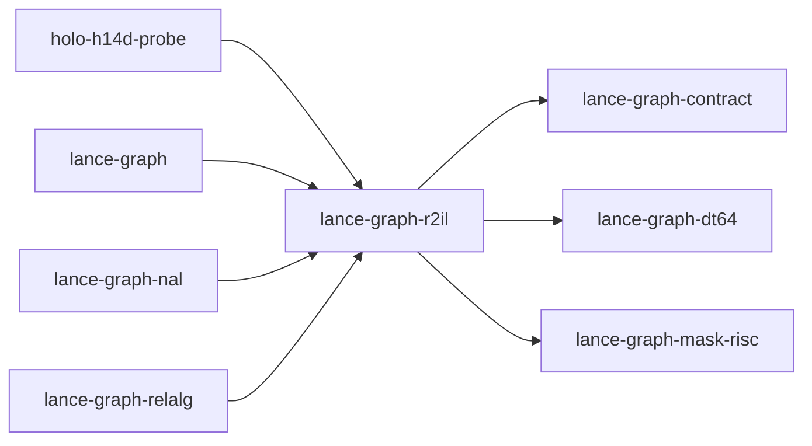

# lance-graph-r2il

crate: lance-graph-r2il
path: crates/lance-graph-r2il
workspace: member
digest: 69be64b232e5033d
evidence legend: ../index.md#evidence-legend

Generated; the code is the truth. See ../index.md.

## Depends on

- dep lance-graph-contract normal — crates/lance-graph-r2il/Cargo.toml:30 CONFIRMED
- dep lance-graph-dt64 normal — crates/lance-graph-r2il/Cargo.toml:29 CONFIRMED
- dep lance-graph-mask-risc normal — crates/lance-graph-r2il/Cargo.toml:19 CONFIRMED
- dep lance-graph-quack dev — crates/lance-graph-r2il/Cargo.toml:36 CONFIRMED
- dep ogar-loco normal — crates/lance-graph-r2il/Cargo.toml:25 CONFIRMED
- dep ogar-r2il normal — crates/lance-graph-r2il/Cargo.toml:26 CONFIRMED

## Depended on by

- rdep holo-h14d-probe normal — crates/holo-h14d-probe/Cargo.toml:18 CONFIRMED
- rdep lance-graph normal — crates/lance-graph/Cargo.toml:58 CONFIRMED
- rdep lance-graph-nal normal — crates/lance-graph-nal/Cargo.toml:19 CONFIRMED
- rdep lance-graph-onnx dev — crates/lance-graph-onnx/Cargo.toml:18 CONFIRMED
- rdep lance-graph-relalg normal — crates/lance-graph-relalg/Cargo.toml:17 CONFIRMED
- rdep r2il-mask-abi-probe dev — crates/r2il-mask-abi-probe/Cargo.toml:24 CONFIRMED

## Public items

- const EXECUTABLE [pub] — crates/lance-graph-r2il/src/binding.rs:100 CONFIRMED
- const LANE_COMPARES [pub(crate)] — crates/lance-graph-r2il/src/binding.rs:106 CONFIRMED
- struct FieldLanes [pub] — crates/lance-graph-r2il/src/binding.rs:113 CONFIRMED
- struct R2ilLens [pub] — crates/lance-graph-r2il/src/binding.rs:119 CONFIRMED
- struct ExecPermit [pub] — crates/lance-graph-r2il/src/binding.rs:128 CONFIRMED
- struct Resolution [pub] — crates/lance-graph-r2il/src/binding.rs:135 CONFIRMED
- struct Step [pub] — crates/lance-graph-r2il/src/binding.rs:145 CONFIRMED
- struct Prepared [pub] — crates/lance-graph-r2il/src/binding.rs:165 CONFIRMED
- fn Prepared::method [pub] — crates/lance-graph-r2il/src/binding.rs:179 CONFIRMED
- fn Prepared::lens [pub] — crates/lance-graph-r2il/src/binding.rs:184 CONFIRMED
- fn Prepared::route [pub] — crates/lance-graph-r2il/src/binding.rs:189 CONFIRMED
- fn Prepared::guards [pub] — crates/lance-graph-r2il/src/binding.rs:194 CONFIRMED
- fn Prepared::steps [pub] — crates/lance-graph-r2il/src/binding.rs:199 CONFIRMED
- fn Prepared::plan_id [pub] — crates/lance-graph-r2il/src/binding.rs:204 CONFIRMED
- struct Executed [pub] — crates/lance-graph-r2il/src/binding.rs:214 CONFIRMED
- struct Receipt [pub] — crates/lance-graph-r2il/src/binding.rs:223 CONFIRMED
- enum ExecRefusal [pub] — crates/lance-graph-r2il/src/binding.rs:236 CONFIRMED
- fn prepare [pub] — crates/lance-graph-r2il/src/binding.rs:321 CONFIRMED
- fn run [pub] — crates/lance-graph-r2il/src/binding.rs:377 CONFIRMED
- fn call_step [pub(crate)] — crates/lance-graph-r2il/src/binding.rs:462 CONFIRMED
- fn check_route [pub(crate)] — crates/lance-graph-r2il/src/binding.rs:483 CONFIRMED
- fn lane [pub(crate)] — crates/lance-graph-r2il/src/binding.rs:632 CONFIRMED
- fn check_compare [pub(crate)] — crates/lance-graph-r2il/src/binding.rs:661 CONFIRMED
- const MAX_NATIVE_OUTPUTS [pub] — crates/lance-graph-r2il/src/binding_native.rs:61 CONFIRMED
- struct NativePlan [pub] — crates/lance-graph-r2il/src/binding_native.rs:102 CONFIRMED
- fn NativePlan::plan_id [pub] — crates/lance-graph-r2il/src/binding_native.rs:117 CONFIRMED
- fn NativePlan::method [pub] — crates/lance-graph-r2il/src/binding_native.rs:122 CONFIRMED
- fn NativePlan::route [pub] — crates/lance-graph-r2il/src/binding_native.rs:127 CONFIRMED
- fn NativePlan::program_count [pub] — crates/lance-graph-r2il/src/binding_native.rs:132 CONFIRMED
- fn NativePlan::program_effects [pub] — crates/lance-graph-r2il/src/binding_native.rs:138 CONFIRMED
- fn NativePlan::outputs [pub] — crates/lance-graph-r2il/src/binding_native.rs:143 CONFIRMED
- fn NativePlan::intermediates [pub] — crates/lance-graph-r2il/src/binding_native.rs:149 CONFIRMED
- fn NativePlan::scratch_words [pub] — crates/lance-graph-r2il/src/binding_native.rs:154 CONFIRMED
- struct NativeScratch [pub] — crates/lance-graph-r2il/src/binding_native.rs:162 CONFIRMED
- fn NativeScratch::for_plan [pub] — crates/lance-graph-r2il/src/binding_native.rs:168 CONFIRMED
- struct NativeReceipt [pub] — crates/lance-graph-r2il/src/binding_native.rs:178 CONFIRMED
- fn NativeReceipt::values [pub] — crates/lance-graph-r2il/src/binding_native.rs:191 CONFIRMED
- fn prepare_native [pub] — crates/lance-graph-r2il/src/binding_native.rs:203 CONFIRMED
- fn run_native [pub] — crates/lance-graph-r2il/src/binding_native.rs:351 CONFIRMED
- mod binding [pub] — crates/lance-graph-r2il/src/lib.rs:111 CONFIRMED
- mod binding_native [pub] — crates/lance-graph-r2il/src/lib.rs:112 CONFIRMED
- mod polyfill [pub] — crates/lance-graph-r2il/src/lib.rs:113 CONFIRMED
- mod procs [pub] — crates/lance-graph-r2il/src/lib.rs:114 CONFIRMED
- const LOAD [pub] — crates/lance-graph-r2il/src/lib.rs:137 CONFIRMED
- const INT_ADD [pub] — crates/lance-graph-r2il/src/lib.rs:139 CONFIRMED
- const INT_SUB [pub] — crates/lance-graph-r2il/src/lib.rs:140 CONFIRMED
- const INT_MULT [pub] — crates/lance-graph-r2il/src/lib.rs:142 CONFIRMED
- const INT_S_DIV [pub] — crates/lance-graph-r2il/src/lib.rs:145 CONFIRMED
- const INT_AND [pub] — crates/lance-graph-r2il/src/lib.rs:146 CONFIRMED
- const INT_OR [pub] — crates/lance-graph-r2il/src/lib.rs:147 CONFIRMED
- const INT_XOR [pub] — crates/lance-graph-r2il/src/lib.rs:151 CONFIRMED
- const INT_NOT [pub] — crates/lance-graph-r2il/src/lib.rs:154 CONFIRMED
- const INT_EQUAL [pub] — crates/lance-graph-r2il/src/lib.rs:155 CONFIRMED
- const INT_LESS [pub] — crates/lance-graph-r2il/src/lib.rs:156 CONFIRMED
- const INT_S_LESS [pub] — crates/lance-graph-r2il/src/lib.rs:157 CONFIRMED
- const INT_LESS_EQUAL [pub] — crates/lance-graph-r2il/src/lib.rs:158 CONFIRMED
- const POP_COUNT [pub] — crates/lance-graph-r2il/src/lib.rs:159 CONFIRMED
- const MAX_SLOTS [pub] — crates/lance-graph-r2il/src/lib.rs:166 CONFIRMED
- enum Addr [pub] — crates/lance-graph-r2il/src/lib.rs:173 CONFIRMED
- enum Val [pub] — crates/lance-graph-r2il/src/lib.rs:193 CONFIRMED
- enum FoldError [pub] — crates/lance-graph-r2il/src/lib.rs:213 CONFIRMED
- enum BoolMode [pub] — crates/lance-graph-r2il/src/lib.rs:282 CONFIRMED
- struct FoldDialect [pub] — crates/lance-graph-r2il/src/lib.rs:312 CONFIRMED
- fn FoldDialect<'p>::new [pub] — crates/lance-graph-r2il/src/lib.rs:389 CONFIRMED
- fn FoldDialect<'p>::with_groups [pub] — crates/lance-graph-r2il/src/lib.rs:418 CONFIRMED
- fn FoldDialect<'p>::with_keep [pub] — crates/lance-graph-r2il/src/lib.rs:430 CONFIRMED
- fn FoldDialect<'p>::with_cross_sums [pub] — crates/lance-graph-r2il/src/lib.rs:443 CONFIRMED
- fn FoldDialect<'p>::fold_cross_power_sums [pub] — crates/lance-graph-r2il/src/lib.rs:468 CONFIRMED
- fn FoldDialect<'p>::poison [pub] — crates/lance-graph-r2il/src/lib.rs:494 CONFIRMED
- fn FoldDialect<'p>::facade_passes [pub] — crates/lance-graph-r2il/src/lib.rs:500 CONFIRMED
- fn FoldDialect<'p>::programs_run [pub] — crates/lance-graph-r2il/src/lib.rs:505 CONFIRMED
- fn FoldDialect<'p>::last_program [pub] — crates/lance-graph-r2il/src/lib.rs:511 CONFIRMED
- fn FoldDialect<'p>::scratch_len [pub] — crates/lance-graph-r2il/src/lib.rs:517 CONFIRMED
- fn FoldDialect<'p>::with_mode [pub] — crates/lance-graph-r2il/src/lib.rs:523 CONFIRMED
- fn FoldDialect<'p>::mode [pub] — crates/lance-graph-r2il/src/lib.rs:529 CONFIRMED
- fn FoldDialect<'p>::call_shared [pub] — crates/lance-graph-r2il/src/lib.rs:538 CONFIRMED
- fn FoldDialect<'p>::discard_pending [pub] — crates/lance-graph-r2il/src/lib.rs:555 CONFIRMED
- fn FoldDialect<'p>::call_owned [pub] — crates/lance-graph-r2il/src/lib.rs:679 CONFIRMED
- fn FoldDialect<'p>::emit_pred [pub] — crates/lance-graph-r2il/src/lib.rs:748 CONFIRMED
- fn FoldDialect<'_>::call [pub] — crates/lance-graph-r2il/src/lib.rs:858 CONFIRMED
- const HARDCODED [pub] — crates/lance-graph-r2il/src/polyfill.rs:41 CONFIRMED
- const POLYFILL_LENS [pub] — crates/lance-graph-r2il/src/polyfill.rs:44 CONFIRMED
- struct FrozenWord [pub] — crates/lance-graph-r2il/src/polyfill.rs:48 CONFIRMED
- enum AliasLanguage [pub] — crates/lance-graph-r2il/src/polyfill.rs:64 CONFIRMED
- fn FrozenWord::name_of [pub] — crates/lance-graph-r2il/src/polyfill.rs:76 CONFIRMED
- fn FrozenWord::name_in [pub] — crates/lance-graph-r2il/src/polyfill.rs:88 CONFIRMED
- fn FrozenWord::is_alias [pub] — crates/lance-graph-r2il/src/polyfill.rs:94 CONFIRMED
- const POLYFILL [pub] — crates/lance-graph-r2il/src/polyfill.rs:116 CONFIRMED
- fn polyfill_arities [pub] — crates/lance-graph-r2il/src/polyfill.rs:175 CONFIRMED
- fn position_of [pub] — crates/lance-graph-r2il/src/polyfill.rs:181 CONFIRMED
- struct PolyfillView [pub] — crates/lance-graph-r2il/src/polyfill.rs:203 CONFIRMED
- fn PolyfillView::new [pub] — crates/lance-graph-r2il/src/polyfill.rs:211 CONFIRMED
- fn PolyfillView::language [pub] — crates/lance-graph-r2il/src/polyfill.rs:226 CONFIRMED
- struct WithPolyfill [pub] — crates/lance-graph-r2il/src/polyfill.rs:255 CONFIRMED
- fn WithPolyfill<'a,V>::new [pub] — crates/lance-graph-r2il/src/polyfill.rs:263 CONFIRMED
- type Select [pub] — crates/lance-graph-r2il/src/procs.rs:24 CONFIRMED
- fn select_lt [pub] — crates/lance-graph-r2il/src/procs.rs:64 CONFIRMED
- fn filter_lt [pub] — crates/lance-graph-r2il/src/procs.rs:79 CONFIRMED
- fn select_u32 [pub] — crates/lance-graph-r2il/src/procs.rs:95 CONFIRMED
- fn count [pub] — crates/lance-graph-r2il/src/procs.rs:117 CONFIRMED
- fn exists [pub] — crates/lance-graph-r2il/src/procs.rs:124 CONFIRMED
- fn all [pub] — crates/lance-graph-r2il/src/procs.rs:132 CONFIRMED
- fn differ [pub] — crates/lance-graph-r2il/src/procs.rs:142 CONFIRMED
- fn intersect [pub] — crates/lance-graph-r2il/src/procs.rs:159 CONFIRMED
- fn union [pub] — crates/lance-graph-r2il/src/procs.rs:177 CONFIRMED
- fn keep [pub] — crates/lance-graph-r2il/src/procs.rs:195 CONFIRMED
- fn count_and [pub] — crates/lance-graph-r2il/src/procs.rs:206 CONFIRMED
- fn sum [pub] — crates/lance-graph-r2il/src/procs.rs:218 CONFIRMED
- fn min [pub] — crates/lance-graph-r2il/src/procs.rs:228 CONFIRMED
- fn max [pub] — crates/lance-graph-r2il/src/procs.rs:237 CONFIRMED
- enum Order [pub] — crates/lance-graph-r2il/src/procs.rs:244 CONFIRMED
- fn and_cmp_i32 [pub] — crates/lance-graph-r2il/src/procs.rs:262 CONFIRMED
- fn group_sum [pub] — crates/lance-graph-r2il/src/procs.rs:292 CONFIRMED
- fn margin [pub] — crates/lance-graph-r2il/src/procs.rs:310 CONFIRMED
- fn is_null [pub] — crates/lance-graph-r2il/src/procs.rs:336 CONFIRMED
- fn is_not_null [pub] — crates/lance-graph-r2il/src/procs.rs:344 CONFIRMED
- fn and_between_i32 [pub] — crates/lance-graph-r2il/src/procs.rs:357 CONFIRMED
- fn in_u32 [pub] — crates/lance-graph-r2il/src/procs.rs:374 CONFIRMED
- fn count_valid [pub] — crates/lance-graph-r2il/src/procs.rs:406 CONFIRMED
- fn avg_parts [pub] — crates/lance-graph-r2il/src/procs.rs:423 CONFIRMED
- fn bool_or [pub] — crates/lance-graph-r2il/src/procs.rs:450 CONFIRMED
- fn bool_and [pub] — crates/lance-graph-r2il/src/procs.rs:475 CONFIRMED
- fn not_exists [pub] — crates/lance-graph-r2il/src/procs.rs:513 CONFIRMED
- fn except [pub] — crates/lance-graph-r2il/src/procs.rs:526 CONFIRMED
- fn count_distinct_sorted [pub] — crates/lance-graph-r2il/src/procs.rs:549 CONFIRMED
- fn count_union_all [pub] — crates/lance-graph-r2il/src/procs.rs:565 CONFIRMED

## Imports from in-scope crates

### lance-graph-contract
- use lance_graph_contract::class_view::ClassView — crates/lance-graph-r2il/src/binding.rs:77 CONFIRMED
- use lance_graph_contract::ogar_codebook::classid_concept — crates/lance-graph-r2il/src/binding.rs:78 CONFIRMED
- use lance_graph_contract::set_rules::Truth — crates/lance-graph-r2il/src/binding.rs:79 CONFIRMED
- use lance_graph_contract::class_view::ClassId — crates/lance-graph-r2il/src/polyfill.rs:29 CONFIRMED
- use lance_graph_contract::class_view::ClassView — crates/lance-graph-r2il/src/polyfill.rs:29 CONFIRMED
- use lance_graph_contract::ogar_codebook::classid_concept — crates/lance-graph-r2il/src/polyfill.rs:30 CONFIRMED
- use lance_graph_contract::ogar_codebook::compose_classid — crates/lance-graph-r2il/src/polyfill.rs:30 CONFIRMED
- use lance_graph_contract::ontology::DisplayTemplate — crates/lance-graph-r2il/src/polyfill.rs:31 CONFIRMED
- use lance_graph_contract::ontology::FieldRef — crates/lance-graph-r2il/src/polyfill.rs:31 CONFIRMED
### lance-graph-dt64
- use lance_graph_dt64::dr::Focus — crates/lance-graph-r2il/src/binding.rs:80 CONFIRMED
- use lance_graph_dt64::dr::FrameRevisions — crates/lance-graph-r2il/src/binding.rs:80 CONFIRMED
- use lance_graph_dt64::dr::FrameStore — crates/lance-graph-r2il/src/binding.rs:80 CONFIRMED
- use lance_graph_dt64::dr::GuardRefusal — crates/lance-graph-r2il/src/binding.rs:80 CONFIRMED
- use lance_graph_dt64::dr::Guards — crates/lance-graph-r2il/src/binding.rs:80 CONFIRMED
- use lance_graph_dt64::dr::Scope — crates/lance-graph-r2il/src/binding.rs:80 CONFIRMED
- use lance_graph_dt64::AlgebraRef — crates/lance-graph-r2il/src/binding.rs:82 CONFIRMED
- use lance_graph_dt64::Arg — crates/lance-graph-r2il/src/binding.rs:82 CONFIRMED
- use lance_graph_dt64::BindStore — crates/lance-graph-r2il/src/binding.rs:82 CONFIRMED
- use lance_graph_dt64::Effect — crates/lance-graph-r2il/src/binding.rs:82 CONFIRMED
- use lance_graph_dt64::MethodRef — crates/lance-graph-r2il/src/binding.rs:82 CONFIRMED
- use lance_graph_dt64::Refusal — crates/lance-graph-r2il/src/binding.rs:82 CONFIRMED
- use lance_graph_dt64::RouteVersion — crates/lance-graph-r2il/src/binding.rs:82 CONFIRMED
- use lance_graph_dt64::SchemaRev — crates/lance-graph-r2il/src/binding.rs:82 CONFIRMED
- use lance_graph_dt64::dr::Focus — crates/lance-graph-r2il/src/binding_native.rs:46 CONFIRMED
- use lance_graph_dt64::dr::FrameRevisions — crates/lance-graph-r2il/src/binding_native.rs:46 CONFIRMED
- use lance_graph_dt64::dr::FrameStore — crates/lance-graph-r2il/src/binding_native.rs:46 CONFIRMED
- use lance_graph_dt64::dr::Scope — crates/lance-graph-r2il/src/binding_native.rs:46 CONFIRMED
- use lance_graph_dt64::Arg — crates/lance-graph-r2il/src/binding_native.rs:47 CONFIRMED
- use lance_graph_dt64::BindStore — crates/lance-graph-r2il/src/binding_native.rs:47 CONFIRMED
- use lance_graph_dt64::MethodRef — crates/lance-graph-r2il/src/binding_native.rs:47 CONFIRMED
- use lance_graph_dt64::RouteVersion — crates/lance-graph-r2il/src/binding_native.rs:47 CONFIRMED
### lance-graph-mask-risc
- use lance_graph_mask_risc::LaneKind — crates/lance-graph-r2il/src/binding.rs:84 CONFIRMED
- use lance_graph_mask_risc::LaneRef — crates/lance-graph-r2il/src/binding.rs:84 CONFIRMED
- use lance_graph_mask_risc::Planes — crates/lance-graph-r2il/src/binding.rs:84 CONFIRMED
- use lance_graph_mask_risc::CompiledProgram — crates/lance-graph-r2il/src/binding_native.rs:49 CONFIRMED
- use lance_graph_mask_risc::Foreign — crates/lance-graph-r2il/src/binding_native.rs:49 CONFIRMED
- use lance_graph_mask_risc::Out — crates/lance-graph-r2il/src/binding_native.rs:49 CONFIRMED
- use lance_graph_mask_risc::Planes — crates/lance-graph-r2il/src/binding_native.rs:49 CONFIRMED
- use lance_graph_mask_risc::execute_compiled — crates/lance-graph-r2il/src/binding_native.rs:49 CONFIRMED
- use lance_graph_mask_risc::scratch_words_for — crates/lance-graph-r2il/src/binding_native.rs:49 CONFIRMED
- use lance_graph_mask_risc::tile_words_for — crates/lance-graph-r2il/src/binding_native.rs:49 CONFIRMED
- use lance_graph_mask_risc::Scratch — crates/lance-graph-r2il/src/binding_native.rs:50 CONFIRMED
- use lance_graph_mask_risc::Terminal — crates/lance-graph-r2il/src/binding_native.rs:50 CONFIRMED
- use lance_graph_mask_risc::Value — crates/lance-graph-r2il/src/binding_native.rs:50 CONFIRMED
- use lance_graph_mask_risc::BoolExpr — crates/lance-graph-r2il/src/lib.rs:119 CONFIRMED
- use lance_graph_mask_risc::CrossPowerSums — crates/lance-graph-r2il/src/lib.rs:119 CONFIRMED
- use lance_graph_mask_risc::Foreign — crates/lance-graph-r2il/src/lib.rs:119 CONFIRMED
- use lance_graph_mask_risc::execute_into — crates/lance-graph-r2il/src/lib.rs:119 CONFIRMED
- use lance_graph_mask_risc::fuse — crates/lance-graph-r2il/src/lib.rs:119 CONFIRMED
- use lance_graph_mask_risc::scratch_words_for — crates/lance-graph-r2il/src/lib.rs:119 CONFIRMED
- use lance_graph_mask_risc::tile_words_for — crates/lance-graph-r2il/src/lib.rs:119 CONFIRMED
- use lance_graph_mask_risc::FuseError — crates/lance-graph-r2il/src/lib.rs:120 CONFIRMED
- use lance_graph_mask_risc::GroupKey — crates/lance-graph-r2il/src/lib.rs:120 CONFIRMED
- use lance_graph_mask_risc::LaneKind — crates/lance-graph-r2il/src/lib.rs:120 CONFIRMED
- use lance_graph_mask_risc::MaskOp — crates/lance-graph-r2il/src/lib.rs:120 CONFIRMED
- use lance_graph_mask_risc::Operand — crates/lance-graph-r2il/src/lib.rs:120 CONFIRMED
- use lance_graph_mask_risc::Out — crates/lance-graph-r2il/src/lib.rs:120 CONFIRMED
- use lance_graph_mask_risc::Planes — crates/lance-graph-r2il/src/lib.rs:120 CONFIRMED
- use lance_graph_mask_risc::Pred — crates/lance-graph-r2il/src/lib.rs:120 CONFIRMED
- use lance_graph_mask_risc::Program — crates/lance-graph-r2il/src/lib.rs:120 CONFIRMED
- use lance_graph_mask_risc::Scratch — crates/lance-graph-r2il/src/lib.rs:120 CONFIRMED
- use lance_graph_mask_risc::Terminal — crates/lance-graph-r2il/src/lib.rs:120 CONFIRMED
- use lance_graph_mask_risc::Value — crates/lance-graph-r2il/src/lib.rs:121 CONFIRMED

## Calls

CALL_GRAPH=ARTIFACT_MISSING
- calls ARTIFACT_MISSING — no ruff_charon artifact for this crate UNKNOWN

## Architecture

- arch RBAC applied-to DT64 binding [GAP] validation=EXTERNAL — #1997 GAP

Generated from Cargo manifests — extracted relationships only.

