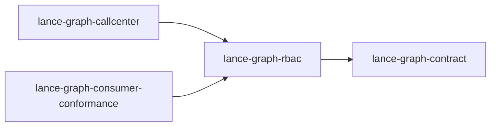

# lance-graph-rbac

crate: lance-graph-rbac
path: crates/lance-graph-rbac
workspace: member
digest: 8d5b2b6b3f4ede06
evidence legend: ../index.md#evidence-legend

Generated; the code is the truth. See ../index.md.

## Depends on

- dep lance-graph-contract normal — crates/lance-graph-rbac/Cargo.toml:8 CONFIRMED
- dep lance-graph-dt64 dev — crates/lance-graph-rbac/Cargo.toml:13 CONFIRMED

## Depended on by

- rdep lance-graph-callcenter normal — crates/lance-graph-callcenter/Cargo.toml:21 CONFIRMED
- rdep lance-graph-consumer-conformance normal — crates/lance-graph-consumer-conformance/Cargo.toml:23 CONFIRMED

## Public items

- enum AccessDecision [pub] — crates/lance-graph-rbac/src/access.rs:5 CONFIRMED
- fn AccessDecision::is_allowed [pub] — crates/lance-graph-rbac/src/access.rs:16 CONFIRMED
- fn AccessDecision::is_denied [pub] — crates/lance-graph-rbac/src/access.rs:20 CONFIRMED
- fn AccessDecision::is_escalation [pub] — crates/lance-graph-rbac/src/access.rs:24 CONFIRMED
- enum AuthProvider [pub] — crates/lance-graph-rbac/src/auth.rs:65 CONFIRMED
- fn AuthProvider::concept [pub] — crates/lance-graph-rbac/src/auth.rs:79 CONFIRMED
- fn AuthProvider::class_id [pub] — crates/lance-graph-rbac/src/auth.rs:94 CONFIRMED
- fn AuthProvider::from_class_id [pub] — crates/lance-graph-rbac/src/auth.rs:102 CONFIRMED
- fn AuthProvider::classid [pub] — crates/lance-graph-rbac/src/auth.rs:115 CONFIRMED
- fn AuthProvider::grammar [pub] — crates/lance-graph-rbac/src/auth.rs:124 CONFIRMED
- fn AuthProvider::resolve [pub] — crates/lance-graph-rbac/src/auth.rs:157 CONFIRMED
- struct ClaimGrammar [pub] — crates/lance-graph-rbac/src/auth.rs:176 CONFIRMED
- const MAX_ACT_DEPTH [pub] — crates/lance-graph-rbac/src/auth.rs:191 CONFIRMED
- enum ClaimKind [pub] — crates/lance-graph-rbac/src/auth.rs:195 CONFIRMED
- trait ClaimSet [pub] — crates/lance-graph-rbac/src/auth.rs:209 CONFIRMED
- struct Actor [pub] — crates/lance-graph-rbac/src/auth.rs:217 CONFIRMED
- fn Actor::new [pub] — crates/lance-graph-rbac/src/auth.rs:227 CONFIRMED
- enum DelegationRefused [pub] — crates/lance-graph-rbac/src/auth.rs:237 CONFIRMED
- struct ResolvedIdentity [pub] — crates/lance-graph-rbac/src/auth.rs:256 CONFIRMED
- fn ResolvedIdentity::has_role [pub] — crates/lance-graph-rbac/src/auth.rs:279 CONFIRMED
- fn ResolvedIdentity::acting_through [pub] — crates/lance-graph-rbac/src/auth.rs:291 CONFIRMED
- fn ResolvedIdentity::with_act_claim [pub] — crates/lance-graph-rbac/src/auth.rs:317 CONFIRMED
- fn ResolvedIdentity::is_delegated [pub] — crates/lance-graph-rbac/src/auth.rs:363 CONFIRMED
- fn ResolvedIdentity::acting_party [pub] — crates/lance-graph-rbac/src/auth.rs:372 CONFIRMED
- fn ResolvedIdentity::auth_classid [pub] — crates/lance-graph-rbac/src/auth.rs:379 CONFIRMED
- fn authorize [pub] — crates/lance-graph-rbac/src/authorize.rs:66 CONFIRMED
- struct ClassGrants [pub] — crates/lance-graph-rbac/src/authorize.rs:105 CONFIRMED
- fn ClassGrants::new [pub] — crates/lance-graph-rbac/src/authorize.rs:118 CONFIRMED
- fn ClassGrants::with_grant [pub] — crates/lance-graph-rbac/src/authorize.rs:124 CONFIRMED
- fn ClassGrants::with_actor [pub] — crates/lance-graph-rbac/src/authorize.rs:131 CONFIRMED
- struct ScopedDecision [pub] — crates/lance-graph-rbac/src/authorize.rs:170 CONFIRMED
- fn ScopedDecision::visible_fields [pub] — crates/lance-graph-rbac/src/authorize.rs:193 CONFIRMED
- fn authorize_scoped [pub] — crates/lance-graph-rbac/src/authorize.rs:210 CONFIRMED
- struct MembershipDecision [pub] — crates/lance-graph-rbac/src/authorize.rs:257 CONFIRMED
- fn MembershipDecision::visible_fields [pub] — crates/lance-graph-rbac/src/authorize.rs:275 CONFIRMED
- fn authorize_memberships [pub] — crates/lance-graph-rbac/src/authorize.rs:299 CONFIRMED
- mod access [pub] — crates/lance-graph-rbac/src/lib.rs:10 CONFIRMED
- mod auth [pub] — crates/lance-graph-rbac/src/lib.rs:11 CONFIRMED
- mod authorize [pub] — crates/lance-graph-rbac/src/lib.rs:12 CONFIRMED
- mod permission [pub] — crates/lance-graph-rbac/src/lib.rs:13 CONFIRMED
- mod policy [pub] — crates/lance-graph-rbac/src/lib.rs:14 CONFIRMED
- mod role [pub] — crates/lance-graph-rbac/src/lib.rs:15 CONFIRMED
- struct PermissionSpec [pub] — crates/lance-graph-rbac/src/permission.rs:24 CONFIRMED
- fn PermissionSpec::read_only [pub] — crates/lance-graph-rbac/src/permission.rs:43 CONFIRMED
- fn PermissionSpec::full [pub] — crates/lance-graph-rbac/src/permission.rs:54 CONFIRMED
- fn PermissionSpec::read_at [pub] — crates/lance-graph-rbac/src/permission.rs:69 CONFIRMED
- fn PermissionSpec::with_projection [pub] — crates/lance-graph-rbac/src/permission.rs:82 CONFIRMED
- fn PermissionSpec::projects [pub] — crates/lance-graph-rbac/src/permission.rs:90 CONFIRMED
- fn PermissionSpec::can_read_at [pub] — crates/lance-graph-rbac/src/permission.rs:95 CONFIRMED
- fn PermissionSpec::can_write [pub] — crates/lance-graph-rbac/src/permission.rs:100 CONFIRMED
- fn PermissionSpec::can_act [pub] — crates/lance-graph-rbac/src/permission.rs:105 CONFIRMED
- struct Policy [pub] — crates/lance-graph-rbac/src/policy.rs:9 CONFIRMED
- fn Policy::new [pub] — crates/lance-graph-rbac/src/policy.rs:15 CONFIRMED
- fn Policy::with_role [pub] — crates/lance-graph-rbac/src/policy.rs:22 CONFIRMED
- fn Policy::role [pub] — crates/lance-graph-rbac/src/policy.rs:27 CONFIRMED
- fn Policy::evaluate [pub] — crates/lance-graph-rbac/src/policy.rs:32 CONFIRMED
- fn smb_policy [pub] — crates/lance-graph-rbac/src/policy.rs:86 CONFIRMED
- struct Role [pub] — crates/lance-graph-rbac/src/role.rs:7 CONFIRMED
- fn Role::new [pub] — crates/lance-graph-rbac/src/role.rs:13 CONFIRMED
- fn Role::with_permission [pub] — crates/lance-graph-rbac/src/role.rs:21 CONFIRMED
- fn Role::permission_for [pub] — crates/lance-graph-rbac/src/role.rs:27 CONFIRMED
- fn Role::can_read [pub] — crates/lance-graph-rbac/src/role.rs:34 CONFIRMED
- fn Role::can_write [pub] — crates/lance-graph-rbac/src/role.rs:45 CONFIRMED
- fn Role::can_act [pub] — crates/lance-graph-rbac/src/role.rs:52 CONFIRMED
- fn accountant [pub] — crates/lance-graph-rbac/src/role.rs:65 CONFIRMED
- fn auditor [pub] — crates/lance-graph-rbac/src/role.rs:81 CONFIRMED
- fn admin [pub] — crates/lance-graph-rbac/src/role.rs:93 CONFIRMED

## Imports from in-scope crates

### lance-graph-contract
- use lance_graph_contract::class_view::FieldMask — crates/lance-graph-rbac/src/authorize.rs:46 CONFIRMED
- use lance_graph_contract::class_view::WideFieldMask — crates/lance-graph-rbac/src/authorize.rs:46 CONFIRMED
- use lance_graph_contract::rbac::ScopeSet — crates/lance-graph-rbac/src/authorize.rs:47 CONFIRMED
- use lance_graph_contract::rbac::ScopeSpec — crates/lance-graph-rbac/src/authorize.rs:47 CONFIRMED
- pub-use lance_graph_contract::rbac::ActorId — crates/lance-graph-rbac/src/authorize.rs:55 CONFIRMED
- pub-use lance_graph_contract::rbac::ClassId — crates/lance-graph-rbac/src/authorize.rs:55 CONFIRMED
- pub-use lance_graph_contract::rbac::ClassRbac — crates/lance-graph-rbac/src/authorize.rs:55 CONFIRMED
- pub-use lance_graph_contract::rbac::RoleId — crates/lance-graph-rbac/src/authorize.rs:55 CONFIRMED
- use lance_graph_contract::property::PrefetchDepth cfg=test — crates/lance-graph-rbac/src/authorize.rs:347 CONFIRMED
- use lance_graph_contract::rbac::Membership cfg=test — crates/lance-graph-rbac/src/authorize.rs:348 CONFIRMED
- use lance_graph_contract::rbac::ScopePath cfg=test — crates/lance-graph-rbac/src/authorize.rs:348 CONFIRMED
- use lance_graph_contract::ogar_codebook::compose_classid cfg=test — crates/lance-graph-rbac/src/authorize.rs:510 CONFIRMED
- use lance_graph_contract::property::PrefetchDepth cfg=test — crates/lance-graph-rbac/src/authorize.rs:511 CONFIRMED
- use lance_graph_contract::rbac::ClassGrant cfg=test — crates/lance-graph-rbac/src/authorize.rs:512 CONFIRMED
- use lance_graph_contract::rbac::Membership cfg=test — crates/lance-graph-rbac/src/authorize.rs:512 CONFIRMED
- use lance_graph_contract::rbac::OpMask cfg=test — crates/lance-graph-rbac/src/authorize.rs:512 CONFIRMED
- use lance_graph_contract::rbac::ScopePath cfg=test — crates/lance-graph-rbac/src/authorize.rs:512 CONFIRMED
- use lance_graph_contract::rbac_plug::ActorSource cfg=test — crates/lance-graph-rbac/src/authorize.rs:513 CONFIRMED
- use lance_graph_contract::rbac_plug::RbacBinding cfg=test — crates/lance-graph-rbac/src/authorize.rs:513 CONFIRMED
- use lance_graph_contract::property::PrefetchDepth cfg=test — crates/lance-graph-rbac/src/authorize.rs:647 CONFIRMED
- use lance_graph_contract::rbac::ClassGrant cfg=test — crates/lance-graph-rbac/src/authorize.rs:648 CONFIRMED
- use lance_graph_contract::rbac::OpMask cfg=test — crates/lance-graph-rbac/src/authorize.rs:648 CONFIRMED
- use lance_graph_contract::property::PrefetchDepth cfg=test — crates/lance-graph-rbac/src/authorize.rs:811 CONFIRMED
- pub-use lance_graph_contract::rbac::ClassGrant — crates/lance-graph-rbac/src/lib.rs:24 CONFIRMED
- pub-use lance_graph_contract::rbac::OpMask — crates/lance-graph-rbac/src/lib.rs:24 CONFIRMED
- pub-use lance_graph_contract::rbac::grants_permit — crates/lance-graph-rbac/src/lib.rs:24 CONFIRMED
- use lance_graph_contract::class_view::FieldMask — crates/lance-graph-rbac/src/permission.rs:3 CONFIRMED
- use lance_graph_contract::property::PrefetchDepth — crates/lance-graph-rbac/src/permission.rs:4 CONFIRMED
- pub-use lance_graph_contract::rbac::Operation — crates/lance-graph-rbac/src/policy.rs:83 CONFIRMED
- use lance_graph_contract::property::PrefetchDepth cfg=test — crates/lance-graph-rbac/src/policy.rs:97 CONFIRMED
- use lance_graph_contract::property::PrefetchDepth cfg=test — crates/lance-graph-rbac/src/role.rs:126 CONFIRMED

## Calls

CALL_GRAPH=ARTIFACT_MISSING
- calls ARTIFACT_MISSING — no ruff_charon artifact for this crate UNKNOWN

## Architecture

- arch RBAC decision-for-read authorize_scoped [CONFIRMED] validation=OK — crates/lance-graph-rbac/src/authorize.rs:210 CONFIRMED

Generated from Cargo manifests — extracted relationships only.

