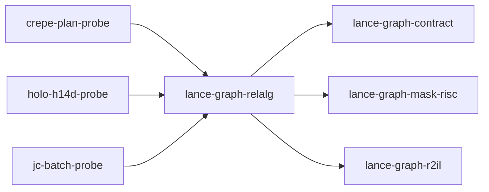

# lance-graph-relalg

crate: lance-graph-relalg
path: crates/lance-graph-relalg
workspace: excluded
digest: 3b189a34b584af66
evidence legend: ../index.md#evidence-legend

Generated; the code is the truth. See ../index.md.

## Depends on

- dep lance-graph-contract normal — crates/lance-graph-relalg/Cargo.toml:23 CONFIRMED
- dep lance-graph-mask-risc normal — crates/lance-graph-relalg/Cargo.toml:15 CONFIRMED
- dep lance-graph-r2il normal — crates/lance-graph-relalg/Cargo.toml:17 CONFIRMED
- dep ogar-loco normal — crates/lance-graph-relalg/Cargo.toml:19 CONFIRMED
- dep ogar-r2il normal — crates/lance-graph-relalg/Cargo.toml:20 CONFIRMED

## Depended on by

- rdep crepe-plan-probe normal — crates/crepe-plan-probe/Cargo.toml:20 CONFIRMED
- rdep drf-focus-probe dev — crates/drf-focus-probe/Cargo.toml:33 CONFIRMED
- rdep holo-h14d-probe normal — crates/holo-h14d-probe/Cargo.toml:16 CONFIRMED
- rdep jc-batch-probe normal — crates/jc-batch-probe/Cargo.toml:14 CONFIRMED
- rdep lance-graph-onnx dev — crates/lance-graph-onnx/Cargo.toml:19 CONFIRMED

## Public items

- enum Cmp [pub] — crates/lance-graph-relalg/src/ir.rs:17 CONFIRMED
- enum Atom [pub] — crates/lance-graph-relalg/src/ir.rs:34 CONFIRMED
- enum Rel [pub] — crates/lance-graph-relalg/src/ir.rs:47 CONFIRMED
- fn Rel::diff [pub] — crates/lance-graph-relalg/src/ir.rs:66 CONFIRMED
- fn Rel::i32 [pub] — crates/lance-graph-relalg/src/ir.rs:71 CONFIRMED
- fn Rel::eq_u32 [pub] — crates/lance-graph-relalg/src/ir.rs:76 CONFIRMED
- fn Rel::ne_u32 [pub] — crates/lance-graph-relalg/src/ir.rs:81 CONFIRMED
- fn Rel::atoms [pub] — crates/lance-graph-relalg/src/ir.rs:87 CONFIRMED
- enum Measure [pub] — crates/lance-graph-relalg/src/ir.rs:99 CONFIRMED
- struct Query [pub] — crates/lance-graph-relalg/src/ir.rs:114 CONFIRMED
- type Edge [pub] — crates/lance-graph-relalg/src/join_body.rs:14 CONFIRMED
- fn is_alpha_acyclic [pub] — crates/lance-graph-relalg/src/join_body.rs:21 CONFIRMED
- mod ir [pub] — crates/lance-graph-relalg/src/lib.rs:31 CONFIRMED
- mod join_body [pub] — crates/lance-graph-relalg/src/lib.rs:32 CONFIRMED
- mod lower [pub] — crates/lance-graph-relalg/src/lib.rs:33 CONFIRMED
- mod normalize [pub] — crates/lance-graph-relalg/src/lib.rs:34 CONFIRMED
- mod program [pub] — crates/lance-graph-relalg/src/lib.rs:35 CONFIRMED
- enum Answer [pub] — crates/lance-graph-relalg/src/lower.rs:22 CONFIRMED
- struct Run [pub] — crates/lance-graph-relalg/src/lower.rs:37 CONFIRMED
- enum RelError [pub] — crates/lance-graph-relalg/src/lower.rs:49 CONFIRMED
- fn run [pub] — crates/lance-graph-relalg/src/lower.rs:63 CONFIRMED
- fn run_with_program [pub] — crates/lance-graph-relalg/src/lower.rs:70 CONFIRMED
- fn run_as_written [pub] — crates/lance-graph-relalg/src/lower.rs:96 CONFIRMED
- fn normalize [pub] — crates/lance-graph-relalg/src/normalize.rs:23 CONFIRMED
- fn symbolic [pub] — crates/lance-graph-relalg/src/normalize.rs:40 CONFIRMED
- fn to_set [pub(crate)] — crates/lance-graph-relalg/src/normalize.rs:82 CONFIRMED
- fn from_set [pub(crate)] — crates/lance-graph-relalg/src/normalize.rs:105 CONFIRMED
- struct ProgramCost [pub] — crates/lance-graph-relalg/src/program.rs:23 CONFIRMED
- struct ProgramRun [pub] — crates/lance-graph-relalg/src/program.rs:42 CONFIRMED
- enum ProgramError [pub] — crates/lance-graph-relalg/src/program.rs:49 CONFIRMED
- fn run_program [pub] — crates/lance-graph-relalg/src/program.rs:139 CONFIRMED
- fn run_recompute [pub] — crates/lance-graph-relalg/src/program.rs:188 CONFIRMED

## Imports from in-scope crates

### lance-graph-contract
- use lance_graph_contract::set_algebra as sa — crates/lance-graph-relalg/src/normalize.rs:16 CONFIRMED
- use lance_graph_contract::set_algebra::Res — crates/lance-graph-relalg/src/normalize.rs:16 CONFIRMED
- use lance_graph_contract::set_algebra::SetExpr — crates/lance-graph-relalg/src/normalize.rs:16 CONFIRMED
- use lance_graph_contract::set_rules as sr — crates/lance-graph-relalg/src/normalize.rs:17 CONFIRMED
- use lance_graph_contract::set_rules::Semantics — crates/lance-graph-relalg/src/normalize.rs:17 CONFIRMED
- use lance_graph_contract::set_program::ProgramError as ShapeError — crates/lance-graph-relalg/src/program.rs:14 CONFIRMED
- use lance_graph_contract::set_program::SetProgram — crates/lance-graph-relalg/src/program.rs:14 CONFIRMED
### lance-graph-mask-risc
- use lance_graph_mask_risc::Foreign — crates/lance-graph-relalg/src/lower.rs:5 CONFIRMED
- use lance_graph_mask_risc::Planes — crates/lance-graph-relalg/src/lower.rs:5 CONFIRMED
- use lance_graph_mask_risc::Program — crates/lance-graph-relalg/src/lower.rs:5 CONFIRMED
- use lance_graph_mask_risc::Planes — crates/lance-graph-relalg/src/program.rs:15 CONFIRMED
- use lance_graph_mask_risc::words_for — crates/lance-graph-relalg/src/program.rs:15 CONFIRMED
### lance-graph-r2il
- use lance_graph_r2il::FoldDialect — crates/lance-graph-relalg/src/lower.rs:7 CONFIRMED
- use lance_graph_r2il::FoldError — crates/lance-graph-relalg/src/lower.rs:7 CONFIRMED
- use lance_graph_r2il::INT_AND — crates/lance-graph-relalg/src/lower.rs:7 CONFIRMED
- use lance_graph_r2il::INT_EQUAL — crates/lance-graph-relalg/src/lower.rs:7 CONFIRMED
- use lance_graph_r2il::INT_NOT — crates/lance-graph-relalg/src/lower.rs:7 CONFIRMED
- use lance_graph_r2il::INT_OR — crates/lance-graph-relalg/src/lower.rs:7 CONFIRMED
- use lance_graph_r2il::INT_S_LESS — crates/lance-graph-relalg/src/lower.rs:7 CONFIRMED
- use lance_graph_r2il::LOAD — crates/lance-graph-relalg/src/lower.rs:7 CONFIRMED
- use lance_graph_r2il::POP_COUNT — crates/lance-graph-relalg/src/lower.rs:7 CONFIRMED
- use lance_graph_r2il::Val — crates/lance-graph-relalg/src/lower.rs:7 CONFIRMED

## Calls

CALL_GRAPH=ARTIFACT_MISSING
- calls ARTIFACT_MISSING — no ruff_charon artifact for this crate UNKNOWN

## Architecture

- none

Generated from Cargo manifests — extracted relationships only.

