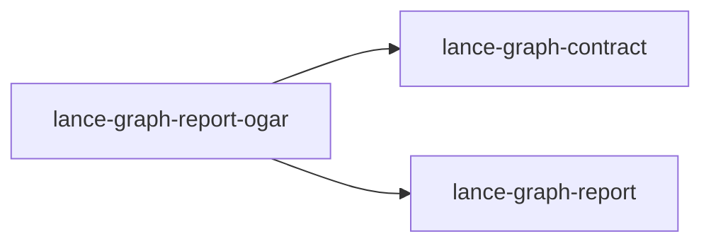

# lance-graph-report-ogar

crate: lance-graph-report-ogar
path: crates/lance-graph-report-ogar
workspace: excluded
digest: 0cdd9b813d8e04f6
evidence legend: ../index.md#evidence-legend

Generated; the code is the truth. See ../index.md.

## Depends on

- dep lance-graph-contract normal — crates/lance-graph-report-ogar/Cargo.toml:31 CONFIRMED
- dep lance-graph-report normal — crates/lance-graph-report-ogar/Cargo.toml:30 CONFIRMED
- dep ogar-doc-ir normal — crates/lance-graph-report-ogar/Cargo.toml:32 CONFIRMED
- dep ogar-render-askama normal — crates/lance-graph-report-ogar/Cargo.toml:36 CONFIRMED
- dep ogar-render-typst normal — crates/lance-graph-report-ogar/Cargo.toml:33 CONFIRMED
- dep serde_json dev — crates/lance-graph-report-ogar/Cargo.toml:39 CONFIRMED

## Depended on by

## Public items

- const REPORT_APP [pub] — crates/lance-graph-report-ogar/src/lib.rs:54 CONFIRMED
- const REPORT_OBJECT_CLASS [pub] — crates/lance-graph-report-ogar/src/lib.rs:56 CONFIRMED
- struct ReportKey [pub] — crates/lance-graph-report-ogar/src/lib.rs:61 CONFIRMED
- enum Key [pub] — crates/lance-graph-report-ogar/src/lib.rs:70 CONFIRMED
- struct Graph [pub] — crates/lance-graph-report-ogar/src/lib.rs:78 CONFIRMED
- struct Orientation [pub] — crates/lance-graph-report-ogar/src/lib.rs:111 CONFIRMED
- struct AdapterStats [pub] — crates/lance-graph-report-ogar/src/lib.rs:120 CONFIRMED
- struct ReportSource [pub] — crates/lance-graph-report-ogar/src/lib.rs:126 CONFIRMED
- fn ReportSource<'a,S>::new [pub] — crates/lance-graph-report-ogar/src/lib.rs:142 CONFIRMED
- fn ReportSource<'a,S>::publish [pub] — crates/lance-graph-report-ogar/src/lib.rs:159 CONFIRMED
- fn ReportSource<'a,S>::register_grid_view [pub] — crates/lance-graph-report-ogar/src/lib.rs:170 CONFIRMED
- fn emit_typst [pub] — crates/lance-graph-report-ogar/src/lib.rs:294 CONFIRMED

## Imports from in-scope crates

### lance-graph-contract
- use lance_graph_contract::class_view::ClassId — crates/lance-graph-report-ogar/src/lib.rs:43 CONFIRMED
- use lance_graph_contract::class_view::WideFieldMask — crates/lance-graph-report-ogar/src/lib.rs:43 CONFIRMED
- use lance_graph_contract::ontology::DisplayTemplate — crates/lance-graph-report-ogar/src/lib.rs:44 CONFIRMED
- use lance_graph_contract::selection::NamedView — crates/lance-graph-report-ogar/src/lib.rs:45 CONFIRMED
- use lance_graph_contract::selection::RailGraph — crates/lance-graph-report-ogar/src/lib.rs:45 CONFIRMED
- use lance_graph_contract::selection::ViewId — crates/lance-graph-report-ogar/src/lib.rs:45 CONFIRMED
- use lance_graph_contract::selection::ViewRegistry — crates/lance-graph-report-ogar/src/lib.rs:45 CONFIRMED
### lance-graph-report
- use lance_graph_report::render::Terminal — crates/lance-graph-report-ogar/src/lib.rs:46 CONFIRMED
- use lance_graph_report::CellValue — crates/lance-graph-report-ogar/src/lib.rs:47 CONFIRMED
- use lance_graph_report::CoordSpec — crates/lance-graph-report-ogar/src/lib.rs:47 CONFIRMED
- use lance_graph_report::ReportResult — crates/lance-graph-report-ogar/src/lib.rs:47 CONFIRMED

## Calls

CALL_GRAPH=ARTIFACT_MISSING
- calls ARTIFACT_MISSING — no ruff_charon artifact for this crate UNKNOWN

## Architecture

- none

Generated from Cargo manifests — extracted relationships only.

