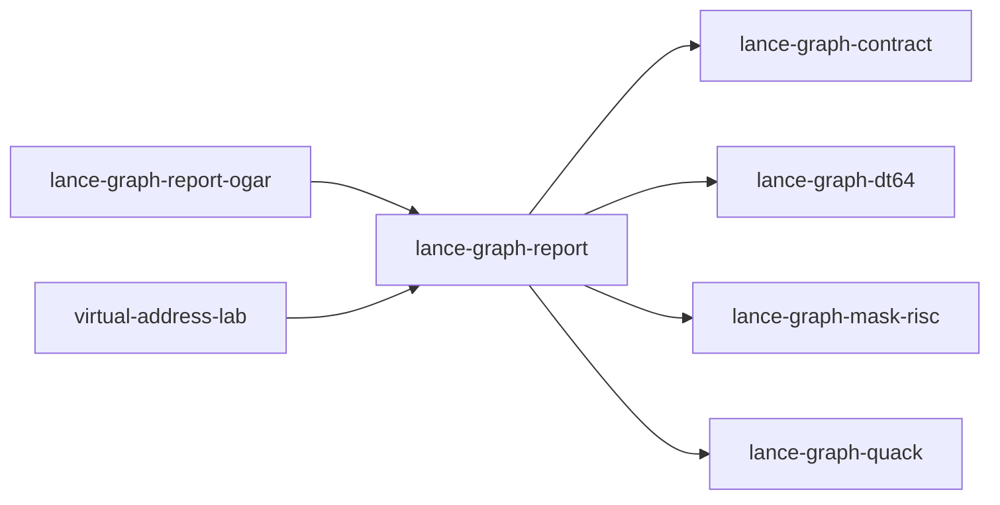

# lance-graph-report

crate: lance-graph-report
path: crates/lance-graph-report
workspace: member
digest: c6ca9fc0a8f30162
evidence legend: ../index.md#evidence-legend

Generated; the code is the truth. See ../index.md.

## Depends on

- dep lance-graph-contract normal — crates/lance-graph-report/Cargo.toml:17 CONFIRMED
- dep lance-graph-dt64 normal — crates/lance-graph-report/Cargo.toml:20 CONFIRMED
- dep lance-graph-mask-risc normal — crates/lance-graph-report/Cargo.toml:15 CONFIRMED
- dep lance-graph-quack normal — crates/lance-graph-report/Cargo.toml:14 CONFIRMED

## Depended on by

- rdep lance-graph-lane-fold dev — crates/lance-graph-lane-fold/Cargo.toml:11 CONFIRMED
- rdep lance-graph-report-ogar normal — crates/lance-graph-report-ogar/Cargo.toml:30 CONFIRMED
- rdep virtual-address-lab normal — crates/virtual-address-lab/Cargo.toml:14 CONFIRMED

## Public items

- enum LaneData [pub] — crates/lance-graph-report/src/batch.rs:26 CONFIRMED
- struct Column [pub] — crates/lance-graph-report/src/batch.rs:65 CONFIRMED
- fn Column::value [pub] — crates/lance-graph-report/src/batch.rs:77 CONFIRMED
- fn Column::coordinate [pub] — crates/lance-graph-report/src/batch.rs:86 CONFIRMED
- enum BatchError [pub] — crates/lance-graph-report/src/batch.rs:97 CONFIRMED
- const MAX_COLUMNS [pub] — crates/lance-graph-report/src/batch.rs:119 CONFIRMED
- struct AbiBatch [pub] — crates/lance-graph-report/src/batch.rs:126 CONFIRMED
- fn AbiBatch::new [pub] — crates/lance-graph-report/src/batch.rs:136 CONFIRMED
- fn AbiBatch::with_column [pub] — crates/lance-graph-report/src/batch.rs:154 CONFIRMED
- fn AbiBatch::with_mask [pub] — crates/lance-graph-report/src/batch.rs:178 CONFIRMED
- fn AbiBatch::source [pub] — crates/lance-graph-report/src/batch.rs:194 CONFIRMED
- fn AbiBatch::generation [pub] — crates/lance-graph-report/src/batch.rs:200 CONFIRMED
- fn AbiBatch::n_rows [pub] — crates/lance-graph-report/src/batch.rs:205 CONFIRMED
- fn AbiBatch::columns [pub] — crates/lance-graph-report/src/batch.rs:210 CONFIRMED
- fn AbiBatch::column [pub] — crates/lance-graph-report/src/batch.rs:215 CONFIRMED
- fn AbiBatch::plane_of [pub] — crates/lance-graph-report/src/batch.rs:226 CONFIRMED
- fn AbiBatch::resolve_plane [pub(crate)] — crates/lance-graph-report/src/batch.rs:233 CONFIRMED
- fn AbiBatch::mask_positions [pub(crate)] — crates/lance-graph-report/src/batch.rs:245 CONFIRMED
- fn AbiBatch::views [pub(crate)] — crates/lance-graph-report/src/batch.rs:254 CONFIRMED
- fn AbiBatch::lane_addr [pub] — crates/lance-graph-report/src/batch.rs:263 CONFIRMED
- fn AbiBatch::refs [pub] — crates/lance-graph-report/src/batch.rs:268 CONFIRMED
- enum BoundFold [pub] — crates/lance-graph-report/src/bound_sel.rs:34 CONFIRMED
- enum BoundSelRefusal [pub] — crates/lance-graph-report/src/bound_sel.rs:43 CONFIRMED
- fn fold_bound_selection [pub] — crates/lance-graph-report/src/bound_sel.rs:57 CONFIRMED
- struct BoundaryCounters [pub] — crates/lance-graph-report/src/boundary.rs:41 CONFIRMED
- fn BoundaryCounters::get [pub] — crates/lance-graph-report/src/boundary.rs:60 CONFIRMED
- struct MemKv [pub] — crates/lance-graph-report/src/boundary.rs:67 CONFIRMED
- fn MemKv::persist [pub] — crates/lance-graph-report/src/boundary.rs:91 CONFIRMED
- fn MemKv::text [pub] — crates/lance-graph-report/src/boundary.rs:96 CONFIRMED
- struct Destination [pub] — crates/lance-graph-report/src/boundary.rs:129 CONFIRMED
- fn Destination::space [pub] — crates/lance-graph-report/src/boundary.rs:136 CONFIRMED
- fn Destination::ordinal [pub] — crates/lance-graph-report/src/boundary.rs:141 CONFIRMED
- struct CamLabels [pub] — crates/lance-graph-report/src/boundary.rs:148 CONFIRMED
- fn CamLabels::intern [pub] — crates/lance-graph-report/src/boundary.rs:163 CONFIRMED
- fn CamLabels::canonicalize [pub] — crates/lance-graph-report/src/boundary.rs:180 CONFIRMED
- fn CamLabels::ordinal [pub] — crates/lance-graph-report/src/boundary.rs:191 CONFIRMED
- fn CamLabels::destination [pub] — crates/lance-graph-report/src/boundary.rs:202 CONFIRMED
- fn CamLabels::destination_of [pub] — crates/lance-graph-report/src/boundary.rs:211 CONFIRMED
- fn CamLabels::domain [pub] — crates/lance-graph-report/src/boundary.rs:219 CONFIRMED
- fn CamLabels::resolve [pub] — crates/lance-graph-report/src/boundary.rs:226 CONFIRMED
- fn CamLabels::rename [pub] — crates/lance-graph-report/src/boundary.rs:234 CONFIRMED
- struct Catalog [pub] — crates/lance-graph-report/src/boundary.rs:252 CONFIRMED
- fn Catalog::with [pub] — crates/lance-graph-report/src/boundary.rs:258 CONFIRMED
- fn Catalog::field [pub] — crates/lance-graph-report/src/boundary.rs:264 CONFIRMED
- fn Catalog::name [pub] — crates/lance-graph-report/src/boundary.rs:272 CONFIRMED
- struct PlannerPolicy [pub] — crates/lance-graph-report/src/exec.rs:89 CONFIRMED
- enum Provider [pub] — crates/lance-graph-report/src/exec.rs:114 CONFIRMED
- struct DimPlan [pub] — crates/lance-graph-report/src/exec.rs:136 CONFIRMED
- enum SelectionCarrier [pub] — crates/lance-graph-report/src/exec.rs:147 CONFIRMED
- enum Accumulator [pub] — crates/lance-graph-report/src/exec.rs:159 CONFIRMED
- struct PhysicalPlan [pub] — crates/lance-graph-report/src/exec.rs:176 CONFIRMED
- struct ExecStats [pub] — crates/lance-graph-report/src/exec.rs:205 CONFIRMED
- fn ReportPlan::explain [pub] — crates/lance-graph-report/src/exec.rs:458 CONFIRMED
- fn ReportPlan::execute [pub] — crates/lance-graph-report/src/exec.rs:554 CONFIRMED
- struct FieldId [pub] — crates/lance-graph-report/src/ids.rs:11 CONFIRMED
- struct MaskId [pub] — crates/lance-graph-report/src/ids.rs:15 CONFIRMED
- const MaskId::ALPHA [pub] — crates/lance-graph-report/src/ids.rs:19 CONFIRMED
- struct SourceId [pub] — crates/lance-graph-report/src/ids.rs:24 CONFIRMED
- const RELATION_MAP [pub] — crates/lance-graph-report/src/lane_source.rs:49 CONFIRMED
- enum PublishRefusal [pub] — crates/lance-graph-report/src/lane_source.rs:53 CONFIRMED
- struct AbiLanes [pub] — crates/lance-graph-report/src/lane_source.rs:62 CONFIRMED
- fn AbiLanes<'c>::unwitnessed [pub(crate)] cfg=test — crates/lance-graph-report/src/lane_source.rs:74 CONFIRMED
- fn AbiLanes<'c>::frames [pub] — crates/lance-graph-report/src/lane_source.rs:88 CONFIRMED
- fn AbiLanes<'c>::seal [pub] — crates/lance-graph-report/src/lane_source.rs:93 CONFIRMED
- fn AbiLanes<'c>::space [pub] — crates/lance-graph-report/src/lane_source.rs:98 CONFIRMED
- fn AbiLanes<'c>::batch [pub] — crates/lance-graph-report/src/lane_source.rs:103 CONFIRMED
- fn AbiLanes<'c>::publish [pub] — crates/lance-graph-report/src/lane_source.rs:109 CONFIRMED
- mod batch [pub] — crates/lance-graph-report/src/lib.rs:53 CONFIRMED
- mod bound_sel [pub] — crates/lance-graph-report/src/lib.rs:54 CONFIRMED
- mod boundary [pub] — crates/lance-graph-report/src/lib.rs:55 CONFIRMED
- mod exec [pub] — crates/lance-graph-report/src/lib.rs:56 CONFIRMED
- mod explain [pub] — crates/lance-graph-report/src/lib.rs:57 CONFIRMED
- mod ids [pub] — crates/lance-graph-report/src/lib.rs:58 CONFIRMED
- mod lane_source [pub] — crates/lance-graph-report/src/lib.rs:59 CONFIRMED
- mod plan [pub] — crates/lance-graph-report/src/lib.rs:60 CONFIRMED
- mod render [pub] — crates/lance-graph-report/src/lib.rs:61 CONFIRMED
- mod result [pub] — crates/lance-graph-report/src/lib.rs:62 CONFIRMED
- mod selection [pub] — crates/lance-graph-report/src/lib.rs:63 CONFIRMED
- enum ReportError [pub] — crates/lance-graph-report/src/lib.rs:83 CONFIRMED
- enum AxisRole [pub] — crates/lance-graph-report/src/plan.rs:22 CONFIRMED
- enum CoordSpec [pub] — crates/lance-graph-report/src/plan.rs:50 CONFIRMED
- fn CoordSpec::field [pub] — crates/lance-graph-report/src/plan.rs:76 CONFIRMED
- fn CoordSpec::member_mask [pub] — crates/lance-graph-report/src/plan.rs:85 CONFIRMED
- struct AxisSpec [pub] — crates/lance-graph-report/src/plan.rs:101 CONFIRMED
- enum MeasureKind [pub] — crates/lance-graph-report/src/plan.rs:116 CONFIRMED
- enum FoldState [pub] — crates/lance-graph-report/src/plan.rs:133 CONFIRMED
- fn FoldState::identity [pub] — crates/lance-graph-report/src/plan.rs:147 CONFIRMED
- fn FoldState::merge [pub] — crates/lance-graph-report/src/plan.rs:157 CONFIRMED
- enum CellValue [pub] — crates/lance-graph-report/src/plan.rs:192 CONFIRMED
- struct Measure [pub] — crates/lance-graph-report/src/plan.rs:204 CONFIRMED
- fn Measure::count [pub] — crates/lance-graph-report/src/plan.rs:213 CONFIRMED
- fn Measure::of [pub] — crates/lance-graph-report/src/plan.rs:221 CONFIRMED
- fn Measure::op_name [pub] — crates/lance-graph-report/src/plan.rs:229 CONFIRMED
- fn Measure::folds [pub] — crates/lance-graph-report/src/plan.rs:241 CONFIRMED
- fn Measure::finalize [pub] — crates/lance-graph-report/src/plan.rs:255 CONFIRMED
- struct TopK [pub] — crates/lance-graph-report/src/plan.rs:273 CONFIRMED
- struct SourceRef [pub] — crates/lance-graph-report/src/plan.rs:284 CONFIRMED
- struct ReportPlan [pub] — crates/lance-graph-report/src/plan.rs:295 CONFIRMED
- struct PhysicalKey [pub] — crates/lance-graph-report/src/plan.rs:313 CONFIRMED
- fn ReportPlan::over [pub] — crates/lance-graph-report/src/plan.rs:327 CONFIRMED
- fn ReportPlan::filter [pub] — crates/lance-graph-report/src/plan.rs:338 CONFIRMED
- fn ReportPlan::axis [pub] — crates/lance-graph-report/src/plan.rs:345 CONFIRMED
- fn ReportPlan::without_axis [pub] — crates/lance-graph-report/src/plan.rs:354 CONFIRMED
- fn ReportPlan::view [pub] — crates/lance-graph-report/src/plan.rs:362 CONFIRMED
- fn ReportPlan::measure [pub] — crates/lance-graph-report/src/plan.rs:386 CONFIRMED
- fn ReportPlan::top_k [pub] — crates/lance-graph-report/src/plan.rs:392 CONFIRMED
- fn ReportPlan::pivot [pub] — crates/lance-graph-report/src/plan.rs:399 CONFIRMED
- fn ReportPlan::rotate [pub] — crates/lance-graph-report/src/plan.rs:411 CONFIRMED
- fn ReportPlan::axes_in [pub] — crates/lance-graph-report/src/plan.rs:423 CONFIRMED
- fn ReportPlan::physical_key [pub] — crates/lance-graph-report/src/plan.rs:432 CONFIRMED
- struct Grid [pub] — crates/lance-graph-report/src/render.rs:39 CONFIRMED
- struct GridRow [pub] — crates/lance-graph-report/src/render.rs:55 CONFIRMED
- struct RenderStats [pub] — crates/lance-graph-report/src/render.rs:68 CONFIRMED
- struct Terminal [pub] — crates/lance-graph-report/src/render.rs:76 CONFIRMED
- fn Terminal<'_>::grid [pub] — crates/lance-graph-report/src/render.rs:162 CONFIRMED
- fn Terminal<'_>::json [pub] — crates/lance-graph-report/src/render.rs:212 CONFIRMED
- fn Terminal<'_>::csv [pub] — crates/lance-graph-report/src/render.rs:270 CONFIRMED
- fn Terminal<'_>::detail_csv [pub] — crates/lance-graph-report/src/render.rs:300 CONFIRMED
- struct DimMeta [pub] — crates/lance-graph-report/src/result.rs:35 CONFIRMED
- enum Layout [pub(crate)] — crates/lance-graph-report/src/result.rs:46 CONFIRMED
- struct CellSpace [pub] — crates/lance-graph-report/src/result.rs:60 CONFIRMED
- enum CellState [pub] — crates/lance-graph-report/src/result.rs:72 CONFIRMED
- fn CellSpace::key [pub] — crates/lance-graph-report/src/result.rs:83 CONFIRMED
- fn CellSpace::dims [pub] — crates/lance-graph-report/src/result.rs:88 CONFIRMED
- fn CellSpace::stored_cells [pub] — crates/lance-graph-report/src/result.rs:93 CONFIRMED
- fn CellSpace::is_sparse [pub] — crates/lance-graph-report/src/result.rs:98 CONFIRMED
- fn CellSpace::payload_addr [pub] — crates/lance-graph-report/src/result.rs:104 CONFIRMED
- fn CellSpace::accumulator_bytes [pub] — crates/lance-graph-report/src/result.rs:109 CONFIRMED
- fn CellSpace::state [pub] — crates/lance-graph-report/src/result.rs:130 CONFIRMED
- fn CellSpace::merged [pub] — crates/lance-graph-report/src/result.rs:149 CONFIRMED
- struct View [pub] — crates/lance-graph-report/src/result.rs:217 CONFIRMED
- struct ReportResult [pub] — crates/lance-graph-report/src/result.rs:231 CONFIRMED
- enum ReportShape [pub] — crates/lance-graph-report/src/result.rs:238 CONFIRMED
- fn ReportResult::new [pub(crate)] — crates/lance-graph-report/src/result.rs:248 CONFIRMED
- fn ReportResult::space [pub] — crates/lance-graph-report/src/result.rs:262 CONFIRMED
- fn ReportResult::view [pub] — crates/lance-graph-report/src/result.rs:267 CONFIRMED
- fn ReportResult::shape [pub] — crates/lance-graph-report/src/result.rs:272 CONFIRMED
- fn ReportResult::measures [pub] — crates/lance-graph-report/src/result.rs:281 CONFIRMED
- fn ReportResult::reinterpret [pub] — crates/lance-graph-report/src/result.rs:288 CONFIRMED
- fn ReportResult::rotate [pub] — crates/lance-graph-report/src/result.rs:321 CONFIRMED
- fn ReportResult::with_roles [pub] — crates/lance-graph-report/src/result.rs:332 CONFIRMED
- fn ReportResult::order_rows_by [pub] — crates/lance-graph-report/src/result.rs:359 CONFIRMED
- fn ReportResult::row_keys [pub] — crates/lance-graph-report/src/result.rs:417 CONFIRMED
- fn ReportResult::column_keys [pub] — crates/lance-graph-report/src/result.rs:426 CONFIRMED
- fn ReportResult::page_keys [pub] — crates/lance-graph-report/src/result.rs:431 CONFIRMED
- fn ReportResult::value [pub] — crates/lance-graph-report/src/result.rs:451 CONFIRMED
- fn ReportResult::row_total [pub] — crates/lance-graph-report/src/result.rs:457 CONFIRMED
- fn ReportResult::column_total [pub] — crates/lance-graph-report/src/result.rs:462 CONFIRMED
- fn ReportResult::grand_total [pub] — crates/lance-graph-report/src/result.rs:467 CONFIRMED
- fn ReportResult::share_of_total [pub] — crates/lance-graph-report/src/result.rs:474 CONFIRMED
- fn ReportResult::share_of_row [pub] — crates/lance-graph-report/src/result.rs:488 CONFIRMED
- fn ReportResult::share_of_column [pub] — crates/lance-graph-report/src/result.rs:496 CONFIRMED
- struct RowRange [pub] — crates/lance-graph-report/src/selection.rs:22 CONFIRMED
- enum Scalar [pub] — crates/lance-graph-report/src/selection.rs:33 CONFIRMED
- enum CmpOp [pub] — crates/lance-graph-report/src/selection.rs:42 CONFIRMED
- enum PredicatePlan [pub] — crates/lance-graph-report/src/selection.rs:59 CONFIRMED
- enum Selection [pub] — crates/lance-graph-report/src/selection.rs:81 CONFIRMED
- fn Selection::and [pub] — crates/lance-graph-report/src/selection.rs:101 CONFIRMED
- fn Selection::or [pub] — crates/lance-graph-report/src/selection.rs:109 CONFIRMED
- fn Selection::and_not [pub] — crates/lance-graph-report/src/selection.rs:114 CONFIRMED
- fn Selection::cmp [pub] — crates/lance-graph-report/src/selection.rs:119 CONFIRMED
- fn Selection::is_in [pub] — crates/lance-graph-report/src/selection.rs:124 CONFIRMED
- fn Selection::split_range [pub(crate)] — crates/lance-graph-report/src/selection.rs:137 CONFIRMED
- fn Selection::lower [pub(crate)] — crates/lance-graph-report/src/selection.rs:165 CONFIRMED

## Imports from in-scope crates

### lance-graph-contract
- use lance_graph_contract::class_view::ClassView — crates/lance-graph-report/src/bound_sel.rs:27 CONFIRMED
- use lance_graph_contract::content_store::ContentId — crates/lance-graph-report/src/boundary.rs:35 CONFIRMED
- use lance_graph_contract::content_store::ContentSink — crates/lance-graph-report/src/boundary.rs:35 CONFIRMED
- use lance_graph_contract::content_store::ContentStore — crates/lance-graph-report/src/boundary.rs:35 CONFIRMED
- use lance_graph_contract::ontology::FieldRef — crates/lance-graph-report/src/lane_source.rs:37 CONFIRMED
- use lance_graph_contract::class_view::ClassId cfg=test — crates/lance-graph-report/src/lane_source/tests.rs:10 CONFIRMED
- use lance_graph_contract::class_view::ClassView cfg=test — crates/lance-graph-report/src/lane_source/tests.rs:10 CONFIRMED
- use lance_graph_contract::class_view::WideFieldMask cfg=test — crates/lance-graph-report/src/lane_source/tests.rs:10 CONFIRMED
- use lance_graph_contract::ogar_codebook::compose_classid cfg=test — crates/lance-graph-report/src/lane_source/tests.rs:11 CONFIRMED
- use lance_graph_contract::ontology::DisplayTemplate cfg=test — crates/lance-graph-report/src/lane_source/tests.rs:12 CONFIRMED
- use lance_graph_contract::ontology::FieldRef cfg=test — crates/lance-graph-report/src/lane_source/tests.rs:12 CONFIRMED
- use lance_graph_contract::set_rules::Population cfg=test — crates/lance-graph-report/src/lane_source/tests.rs:13 CONFIRMED
- use lance_graph_contract::set_rules::Truth cfg=test — crates/lance-graph-report/src/lane_source/tests.rs:13 CONFIRMED
- use lance_graph_contract::algebra_law::AlgebraDescriptor — crates/lance-graph-report/src/plan.rs:18 CONFIRMED
- use lance_graph_contract::algebra_law::AlgebraLaw — crates/lance-graph-report/src/plan.rs:18 CONFIRMED
- use lance_graph_contract::algebra_law::IdentityKind — crates/lance-graph-report/src/plan.rs:18 CONFIRMED
- use lance_graph_contract::content_store::ContentId — crates/lance-graph-report/src/render.rs:24 CONFIRMED
### lance-graph-dt64
- use lance_graph_dt64::dr::FrameStore — crates/lance-graph-report/src/bound_sel.rs:28 CONFIRMED
- use lance_graph_dt64::BindStore — crates/lance-graph-report/src/bound_sel.rs:29 CONFIRMED
- use lance_graph_dt64::LaneBinding — crates/lance-graph-report/src/bound_sel.rs:29 CONFIRMED
- use lance_graph_dt64::LaneRefusal — crates/lance-graph-report/src/bound_sel.rs:29 CONFIRMED
- use lance_graph_dt64::SelectionSource — crates/lance-graph-report/src/bound_sel.rs:29 CONFIRMED
- use lance_graph_dt64::dr::Frame — crates/lance-graph-report/src/lane_source.rs:38 CONFIRMED
- use lance_graph_dt64::dr::FrameRevisions — crates/lance-graph-report/src/lane_source.rs:38 CONFIRMED
- use lance_graph_dt64::dr::FrameStore — crates/lance-graph-report/src/lane_source.rs:38 CONFIRMED
- use lance_graph_dt64::dr::Scope — crates/lance-graph-report/src/lane_source.rs:38 CONFIRMED
- use lance_graph_dt64::CoordSpace — crates/lance-graph-report/src/lane_source.rs:39 CONFIRMED
- use lance_graph_dt64::LaneAddr — crates/lance-graph-report/src/lane_source.rs:39 CONFIRMED
- use lance_graph_dt64::LaneSource — crates/lance-graph-report/src/lane_source.rs:39 CONFIRMED
- use lance_graph_dt64::SchemaRev — crates/lance-graph-report/src/lane_source.rs:39 CONFIRMED
- use lance_graph_dt64::dr::FrameRefusal cfg=test — crates/lance-graph-report/src/lane_source/tests.rs:14 CONFIRMED
- use lance_graph_dt64::dr::Scope cfg=test — crates/lance-graph-report/src/lane_source/tests.rs:14 CONFIRMED
- use lance_graph_dt64::BindStore cfg=test — crates/lance-graph-report/src/lane_source/tests.rs:16 CONFIRMED
- use lance_graph_dt64::ClassSchema cfg=test — crates/lance-graph-report/src/lane_source/tests.rs:16 CONFIRMED
- use lance_graph_dt64::CoordSpace cfg=test — crates/lance-graph-report/src/lane_source/tests.rs:16 CONFIRMED
- use lance_graph_dt64::Extent cfg=test — crates/lance-graph-report/src/lane_source/tests.rs:16 CONFIRMED
- use lance_graph_dt64::LaneBinding cfg=test — crates/lance-graph-report/src/lane_source/tests.rs:16 CONFIRMED
- use lance_graph_dt64::LaneRefusal cfg=test — crates/lance-graph-report/src/lane_source/tests.rs:16 CONFIRMED
- use lance_graph_dt64::LaneRequest cfg=test — crates/lance-graph-report/src/lane_source/tests.rs:16 CONFIRMED
- use lance_graph_dt64::MethodBinding cfg=test — crates/lance-graph-report/src/lane_source/tests.rs:17 CONFIRMED
- use lance_graph_dt64::MethodId cfg=test — crates/lance-graph-report/src/lane_source/tests.rs:17 CONFIRMED
- use lance_graph_dt64::RouteAt cfg=test — crates/lance-graph-report/src/lane_source/tests.rs:17 CONFIRMED
- use lance_graph_dt64::SchemaRev cfg=test — crates/lance-graph-report/src/lane_source/tests.rs:17 CONFIRMED
- use lance_graph_dt64::SigRev cfg=test — crates/lance-graph-report/src/lane_source/tests.rs:17 CONFIRMED
- use lance_graph_dt64::ValueDemand cfg=test — crates/lance-graph-report/src/lane_source/tests.rs:17 CONFIRMED
### lance-graph-mask-risc
- use lance_graph_mask_risc::LaneRef — crates/lance-graph-report/src/batch.rs:19 CONFIRMED
- use lance_graph_mask_risc::words_for — crates/lance-graph-report/src/batch.rs:19 CONFIRMED
- use lance_graph_mask_risc::ExecError — crates/lance-graph-report/src/bound_sel.rs:30 CONFIRMED
- use lance_graph_mask_risc::LaneRef — crates/lance-graph-report/src/bound_sel.rs:30 CONFIRMED
- use lance_graph_mask_risc::Planes — crates/lance-graph-report/src/bound_sel.rs:30 CONFIRMED
- use lance_graph_mask_risc::SelFold — crates/lance-graph-report/src/bound_sel.rs:30 CONFIRMED
- use lance_graph_mask_risc::Value — crates/lance-graph-report/src/bound_sel.rs:30 CONFIRMED
- use lance_graph_mask_risc::execute_sel — crates/lance-graph-report/src/bound_sel.rs:30 CONFIRMED
- use lance_graph_mask_risc::Foreign — crates/lance-graph-report/src/exec.rs:75 CONFIRMED
- use lance_graph_mask_risc::Out — crates/lance-graph-report/src/exec.rs:75 CONFIRMED
- use lance_graph_mask_risc::Planes — crates/lance-graph-report/src/exec.rs:75 CONFIRMED
- use lance_graph_mask_risc::Program — crates/lance-graph-report/src/exec.rs:75 CONFIRMED
- use lance_graph_mask_risc::execute_extent — crates/lance-graph-report/src/exec.rs:75 CONFIRMED
- use lance_graph_mask_risc::scratch_words_for — crates/lance-graph-report/src/exec.rs:75 CONFIRMED
- use lance_graph_mask_risc::tile_words_for — crates/lance-graph-report/src/exec.rs:75 CONFIRMED
- use lance_graph_mask_risc::words_for — crates/lance-graph-report/src/exec.rs:75 CONFIRMED
- use lance_graph_mask_risc::Scratch — crates/lance-graph-report/src/exec.rs:76 CONFIRMED
- use lance_graph_mask_risc::Value — crates/lance-graph-report/src/exec.rs:76 CONFIRMED
- use lance_graph_mask_risc::LaneRef — crates/lance-graph-report/src/lane_source.rs:40 CONFIRMED
- use lance_graph_mask_risc::Foreign cfg=test — crates/lance-graph-report/src/lane_source/tests.rs:19 CONFIRMED
- use lance_graph_mask_risc::LaneRef cfg=test — crates/lance-graph-report/src/lane_source/tests.rs:19 CONFIRMED
- use lance_graph_mask_risc::Out cfg=test — crates/lance-graph-report/src/lane_source/tests.rs:19 CONFIRMED
- use lance_graph_mask_risc::Planes cfg=test — crates/lance-graph-report/src/lane_source/tests.rs:19 CONFIRMED
- use lance_graph_mask_risc::Scratch cfg=test — crates/lance-graph-report/src/lane_source/tests.rs:19 CONFIRMED
- use lance_graph_mask_risc::Value cfg=test — crates/lance-graph-report/src/lane_source/tests.rs:19 CONFIRMED
- use lance_graph_mask_risc::execute_into cfg=test — crates/lance-graph-report/src/lane_source/tests.rs:19 CONFIRMED
- use lance_graph_mask_risc::ExecError — crates/lance-graph-report/src/lib.rs:77 CONFIRMED
- use lance_graph_mask_risc::Foreign — crates/lance-graph-report/src/render.rs:26 CONFIRMED
- use lance_graph_mask_risc::Out — crates/lance-graph-report/src/render.rs:26 CONFIRMED
- use lance_graph_mask_risc::Planes — crates/lance-graph-report/src/render.rs:26 CONFIRMED
- use lance_graph_mask_risc::Scratch — crates/lance-graph-report/src/render.rs:26 CONFIRMED
- use lance_graph_mask_risc::execute_into — crates/lance-graph-report/src/render.rs:26 CONFIRMED
- use lance_graph_mask_risc::materialize_rows — crates/lance-graph-report/src/render.rs:26 CONFIRMED
- use lance_graph_mask_risc::words_for — crates/lance-graph-report/src/render.rs:26 CONFIRMED
### lance-graph-quack
- use lance_graph_quack::Agg — crates/lance-graph-report/src/exec.rs:78 CONFIRMED
- use lance_graph_quack::Cmp — crates/lance-graph-report/src/exec.rs:78 CONFIRMED
- use lance_graph_quack::Col — crates/lance-graph-report/src/exec.rs:78 CONFIRMED
- use lance_graph_quack::Filter — crates/lance-graph-report/src/exec.rs:78 CONFIRMED
- use lance_graph_quack::GroupAddr — crates/lance-graph-report/src/exec.rs:78 CONFIRMED
- use lance_graph_quack::GroupAgg — crates/lance-graph-report/src/exec.rs:78 CONFIRMED
- use lance_graph_quack::Mask — crates/lance-graph-report/src/exec.rs:78 CONFIRMED
- use lance_graph_quack::Query — crates/lance-graph-report/src/exec.rs:78 CONFIRMED
- use lance_graph_quack::lower — crates/lance-graph-report/src/exec.rs:78 CONFIRMED
- use lance_graph_quack::Agg cfg=test — crates/lance-graph-report/src/lane_source/tests.rs:20 CONFIRMED
- use lance_graph_quack::Cmp cfg=test — crates/lance-graph-report/src/lane_source/tests.rs:20 CONFIRMED
- use lance_graph_quack::Col cfg=test — crates/lance-graph-report/src/lane_source/tests.rs:20 CONFIRMED
- use lance_graph_quack::Filter cfg=test — crates/lance-graph-report/src/lane_source/tests.rs:20 CONFIRMED
- use lance_graph_quack::Query cfg=test — crates/lance-graph-report/src/lane_source/tests.rs:20 CONFIRMED
- use lance_graph_quack::lower cfg=test — crates/lance-graph-report/src/lane_source/tests.rs:20 CONFIRMED
- use lance_graph_quack::LowerError — crates/lance-graph-report/src/lib.rs:78 CONFIRMED
- use lance_graph_quack::Agg — crates/lance-graph-report/src/render.rs:28 CONFIRMED
- use lance_graph_quack::Query — crates/lance-graph-report/src/render.rs:28 CONFIRMED
- use lance_graph_quack::lower — crates/lance-graph-report/src/render.rs:28 CONFIRMED
- use lance_graph_quack::Cmp — crates/lance-graph-report/src/selection.rs:14 CONFIRMED
- use lance_graph_quack::Col — crates/lance-graph-report/src/selection.rs:14 CONFIRMED
- truncated at 100, see imports.tsv

## Calls

CALL_GRAPH=ARTIFACT_MISSING
- calls ARTIFACT_MISSING — no ruff_charon artifact for this crate UNKNOWN

## Architecture

- arch LaneSource implemented-by lance-graph-report::AbiLanes [CONFIRMED] validation=OK — crates/lance-graph-report/src/lane_source.rs:143 CONFIRMED

Generated from Cargo manifests — extracted relationships only.

