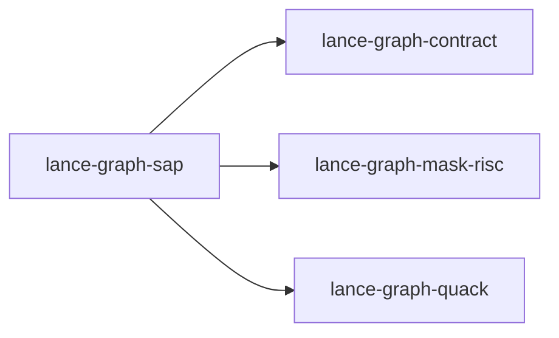

# lance-graph-sap

crate: lance-graph-sap
path: crates/lance-graph-sap
workspace: excluded
digest: 0c4512de6747d3d7
evidence legend: ../index.md#evidence-legend

Generated; the code is the truth. See ../index.md.

## Depends on

- dep lance-graph-contract normal — crates/lance-graph-sap/Cargo.toml:11 CONFIRMED
- dep lance-graph-mask-risc normal — crates/lance-graph-sap/Cargo.toml:12 CONFIRMED
- dep lance-graph-quack normal — crates/lance-graph-sap/Cargo.toml:13 CONFIRMED
- dep hmac normal — crates/lance-graph-sap/Cargo.toml:14 CONFIRMED
- dep sha2 normal — crates/lance-graph-sap/Cargo.toml:15 CONFIRMED

## Depended on by

- rdep lance-graph-glove-parity dev — crates/lance-graph-glove-parity/Cargo.toml:23 CONFIRMED

## Public items

- const EMPLOYEE [pub] — crates/lance-graph-sap/src/bind.rs:6 CONFIRMED
- const WORK_DATE [pub] — crates/lance-graph-sap/src/bind.rs:7 CONFIRMED
- const HOURS [pub] — crates/lance-graph-sap/src/bind.rs:8 CONFIRMED
- const ACTIVITY [pub] — crates/lance-graph-sap/src/bind.rs:9 CONFIRMED
- const BILLING [pub] — crates/lance-graph-sap/src/bind.rs:10 CONFIRMED
- const WORK_DAY [pub] — crates/lance-graph-sap/src/bind.rs:12 CONFIRMED
- const BILLABLE [pub] — crates/lance-graph-sap/src/bind.rs:15 CONFIRMED
- const LANE_COUNT [pub] — crates/lance-graph-sap/src/bind.rs:17 CONFIRMED
- const BILLING_VALUES [pub] — crates/lance-graph-sap/src/bind.rs:21 CONFIRMED
- const OPTIONAL_CODE_FIELDS [pub] — crates/lance-graph-sap/src/bind.rs:30 CONFIRMED
- fn validity_mask [pub] — crates/lance-graph-sap/src/bind.rs:34 CONFIRMED
- const BILLABLE_UNKNOWN [pub] — crates/lance-graph-sap/src/bind.rs:43 CONFIRMED
- fn billable_code [pub] — crates/lance-graph-sap/src/bind.rs:47 CONFIRMED
- struct BindError [pub] — crates/lance-graph-sap/src/bind.rs:55 CONFIRMED
- struct CatsBatch [pub] — crates/lance-graph-sap/src/bind.rs:84 CONFIRMED
- fn CatsBatch::bind [pub] — crates/lance-graph-sap/src/bind.rs:99 CONFIRMED
- fn CatsBatch::len [pub] — crates/lance-graph-sap/src/bind.rs:233 CONFIRMED
- fn CatsBatch::is_empty [pub] — crates/lance-graph-sap/src/bind.rs:236 CONFIRMED
- fn CatsBatch::scale [pub] — crates/lance-graph-sap/src/bind.rs:239 CONFIRMED
- fn CatsBatch::masks [pub] — crates/lance-graph-sap/src/bind.rs:244 CONFIRMED
- fn CatsBatch::lanes [pub] — crates/lance-graph-sap/src/bind.rs:249 CONFIRMED
- fn CatsBatch::activity_groups [pub] — crates/lance-graph-sap/src/bind.rs:254 CONFIRMED
- fn CatsBatch::activity_label [pub] — crates/lance-graph-sap/src/bind.rs:257 CONFIRMED
- fn CatsBatch::dictionary_code [pub] — crates/lance-graph-sap/src/bind.rs:266 CONFIRMED
- fn CatsBatch::edge_value [pub] — crates/lance-graph-sap/src/bind.rs:279 CONFIRMED
- fn numc [pub] — crates/lance-graph-sap/src/bind.rs:312 CONFIRMED
- fn format_decimal [pub(crate)] — crates/lance-graph-sap/src/bind.rs:343 CONFIRMED
- fn utc [pub] — crates/lance-graph-sap/src/bind.rs:359 CONFIRMED
- const TABLE [pub] — crates/lance-graph-sap/src/binder.rs:28 CONFIRMED
- const LIVE [pub] — crates/lance-graph-sap/src/binder.rs:30 CONFIRMED
- const WORK_DAY_FIELD [pub] — crates/lance-graph-sap/src/binder.rs:32 CONFIRMED
- const BILLABLE_FIELD [pub] — crates/lance-graph-sap/src/binder.rs:34 CONFIRMED
- fn live_words [pub] — crates/lance-graph-sap/src/binder.rs:39 CONFIRMED
- struct CatsBinder [pub] — crates/lance-graph-sap/src/binder.rs:50 CONFIRMED
- fn CatsBinder<'a>::new [pub] — crates/lance-graph-sap/src/binder.rs:56 CONFIRMED
- const HASH_ORDINALS [pub] — crates/lance-graph-sap/src/edge.rs:10 CONFIRMED
- const BAPI_ORDINALS [pub] — crates/lance-graph-sap/src/edge.rs:18 CONFIRMED
- const BAPI_PARAMETERS [pub] — crates/lance-graph-sap/src/edge.rs:21 CONFIRMED
- enum HashProfile [pub] — crates/lance-graph-sap/src/edge.rs:33 CONFIRMED
- fn ordered_hash_projection [pub] — crates/lance-graph-sap/src/edge.rs:44 CONFIRMED
- fn hash_projection [pub] — crates/lance-graph-sap/src/edge.rs:105 CONFIRMED
- fn csharp_fields [pub] — crates/lance-graph-sap/src/edge.rs:117 CONFIRMED
- struct ActivityTotal [pub] — crates/lance-graph-sap/src/edge.rs:129 CONFIRMED
- fn activity_totals [pub] — crates/lance-graph-sap/src/edge.rs:134 CONFIRMED
- struct BapiCatsInsert [pub] — crates/lance-graph-sap/src/edge.rs:157 CONFIRMED
- const BAPI_FUNCTION [pub] — crates/lance-graph-sap/src/edge.rs:167 CONFIRMED
- fn bapi_sink [pub] — crates/lance-graph-sap/src/edge.rs:171 CONFIRMED
- mod bind [pub] — crates/lance-graph-sap/src/lib.rs:3 CONFIRMED
- mod binder [pub] — crates/lance-graph-sap/src/lib.rs:4 CONFIRMED
- mod edge [pub] — crates/lance-graph-sap/src/lib.rs:5 CONFIRMED
- mod query [pub] — crates/lance-graph-sap/src/lib.rs:6 CONFIRMED
- mod schema [pub] — crates/lance-graph-sap/src/lib.rs:7 CONFIRMED
- struct CatsQuery [pub] — crates/lance-graph-sap/src/query.rs:10 CONFIRMED
- fn CatsQuery<'a>::prepare [pub] — crates/lance-graph-sap/src/query.rs:21 CONFIRMED
- fn CatsQuery<'a>::groups [pub] — crates/lance-graph-sap/src/query.rs:63 CONFIRMED
- fn CatsQuery<'a>::plan [pub] — crates/lance-graph-sap/src/query.rs:66 CONFIRMED
- fn CatsQuery<'a>::scratch_words [pub] — crates/lance-graph-sap/src/query.rs:70 CONFIRMED
- fn CatsQuery<'a>::execute_into [pub] — crates/lance-graph-sap/src/query.rs:76 CONFIRMED
- fn CatsQuery<'a>::select_into [pub] — crates/lance-graph-sap/src/query.rs:102 CONFIRMED
- const FIELD_COUNT [pub] — crates/lance-graph-sap/src/schema.rs:9 CONFIRMED
- struct FieldDescriptor [pub] — crates/lance-graph-sap/src/schema.rs:12 CONFIRMED
- const FIELDS [pub] — crates/lance-graph-sap/src/schema.rs:23 CONFIRMED
- struct CatsSchema [pub] — crates/lance-graph-sap/src/schema.rs:258 CONFIRMED
- fn CatsSchema::realize_projection [pub] — crates/lance-graph-sap/src/schema.rs:267 CONFIRMED
- fn CatsSchema::new [pub] — crates/lance-graph-sap/src/schema.rs:278 CONFIRMED
- fn CatsSchema::resolve [pub] — crates/lance-graph-sap/src/schema.rs:294 CONFIRMED

## Imports from in-scope crates

### lance-graph-contract
- use lance_graph_contract::class_view::ClassId — crates/lance-graph-sap/src/schema.rs:4 CONFIRMED
- use lance_graph_contract::class_view::ClassView — crates/lance-graph-sap/src/schema.rs:4 CONFIRMED
- use lance_graph_contract::class_view::WideFieldMask — crates/lance-graph-sap/src/schema.rs:4 CONFIRMED
- use lance_graph_contract::ontology::DisplayTemplate — crates/lance-graph-sap/src/schema.rs:5 CONFIRMED
- use lance_graph_contract::ontology::FieldRef — crates/lance-graph-sap/src/schema.rs:5 CONFIRMED
### lance-graph-mask-risc
- use lance_graph_mask_risc::LaneRef — crates/lance-graph-sap/src/bind.rs:4 CONFIRMED
- use lance_graph_mask_risc::LaneKind — crates/lance-graph-sap/src/binder.rs:23 CONFIRMED
- use lance_graph_mask_risc::ExecError — crates/lance-graph-sap/src/query.rs:5 CONFIRMED
- use lance_graph_mask_risc::Foreign — crates/lance-graph-sap/src/query.rs:5 CONFIRMED
- use lance_graph_mask_risc::Out — crates/lance-graph-sap/src/query.rs:5 CONFIRMED
- use lance_graph_mask_risc::Planes — crates/lance-graph-sap/src/query.rs:5 CONFIRMED
- use lance_graph_mask_risc::Program — crates/lance-graph-sap/src/query.rs:5 CONFIRMED
- use lance_graph_mask_risc::Scratch — crates/lance-graph-sap/src/query.rs:5 CONFIRMED
- use lance_graph_mask_risc::Value — crates/lance-graph-sap/src/query.rs:5 CONFIRMED
- use lance_graph_mask_risc::execute_into — crates/lance-graph-sap/src/query.rs:5 CONFIRMED
- use lance_graph_mask_risc::LaneKind — crates/lance-graph-sap/src/schema.rs:6 CONFIRMED
### lance-graph-quack
- use lance_graph_quack::bind::Binder — crates/lance-graph-sap/src/binder.rs:24 CONFIRMED
- use lance_graph_quack::bind::BoundField — crates/lance-graph-sap/src/binder.rs:24 CONFIRMED
- use lance_graph_quack::bind::FieldKind — crates/lance-graph-sap/src/binder.rs:24 CONFIRMED
- use lance_graph_quack::bind::TableId — crates/lance-graph-sap/src/binder.rs:24 CONFIRMED
- use lance_graph_quack::Col — crates/lance-graph-sap/src/binder.rs:25 CONFIRMED
- use lance_graph_quack::Mask — crates/lance-graph-sap/src/binder.rs:25 CONFIRMED
- use lance_graph_quack::Agg — crates/lance-graph-sap/src/query.rs:7 CONFIRMED
- use lance_graph_quack::Cmp — crates/lance-graph-sap/src/query.rs:7 CONFIRMED
- use lance_graph_quack::Col — crates/lance-graph-sap/src/query.rs:7 CONFIRMED
- use lance_graph_quack::Filter — crates/lance-graph-sap/src/query.rs:7 CONFIRMED
- use lance_graph_quack::Query — crates/lance-graph-sap/src/query.rs:7 CONFIRMED
- use lance_graph_quack::lower — crates/lance-graph-sap/src/query.rs:7 CONFIRMED
- use lance_graph_quack::Col — crates/lance-graph-sap/src/schema.rs:7 CONFIRMED

## Calls

CALL_GRAPH=ARTIFACT_MISSING
- calls ARTIFACT_MISSING — no ruff_charon artifact for this crate UNKNOWN

## Architecture

- none

Generated from Cargo manifests — extracted relationships only.

