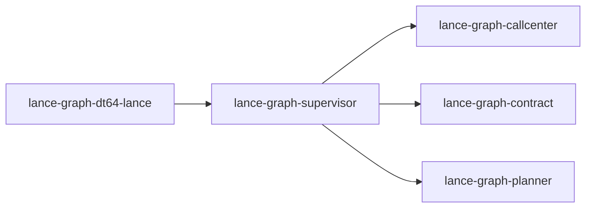

# lance-graph-supervisor

crate: lance-graph-supervisor
path: crates/lance-graph-supervisor
workspace: member
digest: 80a9ee7418964943
evidence legend: ../index.md#evidence-legend

Generated; the code is the truth. See ../index.md.

## Depends on

- dep cognitive-shader-driver dev — crates/lance-graph-supervisor/Cargo.toml:61 CONFIRMED
- dep jc dev — crates/lance-graph-supervisor/Cargo.toml:65 CONFIRMED
- dep lance-graph-callcenter normal — crates/lance-graph-supervisor/Cargo.toml:13 CONFIRMED
- dep lance-graph-contract normal — crates/lance-graph-supervisor/Cargo.toml:14 CONFIRMED
- dep lance-graph-planner normal optional — crates/lance-graph-supervisor/Cargo.toml:17 CONFIRMED
- dep ractor normal optional — crates/lance-graph-supervisor/Cargo.toml:33 CONFIRMED
- dep static_assertions dev — crates/lance-graph-supervisor/Cargo.toml:55 CONFIRMED
- dep static_assertions normal optional — crates/lance-graph-supervisor/Cargo.toml:34 CONFIRMED
- dep thiserror normal — crates/lance-graph-supervisor/Cargo.toml:18 CONFIRMED
- dep tokio dev — crates/lance-graph-supervisor/Cargo.toml:54 CONFIRMED
- dep tokio normal optional — crates/lance-graph-supervisor/Cargo.toml:39 CONFIRMED
- dep tracing normal — crates/lance-graph-supervisor/Cargo.toml:19 CONFIRMED

## Depended on by

- rdep drf-focus-probe dev — crates/drf-focus-probe/Cargo.toml:25 CONFIRMED
- rdep lance-graph-dt64-lance normal — crates/lance-graph-dt64-lance/Cargo.toml:29 CONFIRMED

## Public items

- const MEDCARE_G [pub] cfg=feature="supervisor" — crates/lance-graph-supervisor/src/actors/medcare_actor.rs:33 CONFIRMED
- const MEDCARE_VERSION [pub] cfg=feature="supervisor" — crates/lance-graph-supervisor/src/actors/medcare_actor.rs:35 CONFIRMED
- struct MedcareState [pub] cfg=feature="supervisor" — crates/lance-graph-supervisor/src/actors/medcare_actor.rs:39 CONFIRMED
- struct MedcareConsumerActor [pub] cfg=feature="supervisor" — crates/lance-graph-supervisor/src/actors/medcare_actor.rs:51 CONFIRMED
- fn medcare_health [pub] cfg=feature="supervisor" — crates/lance-graph-supervisor/src/actors/medcare_actor.rs:154 CONFIRMED
- mod medcare_actor [pub] cfg=feature="supervisor" — crates/lance-graph-supervisor/src/actors/mod.rs:21 CONFIRMED
- enum ConsumerEnvelope [pub] — crates/lance-graph-supervisor/src/consumer_msg.rs:20 CONFIRMED
- enum ConsumerReply [pub] — crates/lance-graph-supervisor/src/consumer_msg.rs:40 CONFIRMED
- struct DispatchRequest [pub] — crates/lance-graph-supervisor/src/consumer_msg.rs:57 CONFIRMED
- struct IngestRequest [pub] — crates/lance-graph-supervisor/src/consumer_msg.rs:63 CONFIRMED
- struct QualiaRequest [pub] — crates/lance-graph-supervisor/src/consumer_msg.rs:69 CONFIRMED
- struct StylesRequest [pub] — crates/lance-graph-supervisor/src/consumer_msg.rs:75 CONFIRMED
- struct TensorsRequest [pub] — crates/lance-graph-supervisor/src/consumer_msg.rs:82 CONFIRMED
- struct CalibrateRequest [pub] — crates/lance-graph-supervisor/src/consumer_msg.rs:88 CONFIRMED
- struct ProbeRequest [pub] — crates/lance-graph-supervisor/src/consumer_msg.rs:94 CONFIRMED
- struct CrystalResponse [pub] — crates/lance-graph-supervisor/src/consumer_msg.rs:101 CONFIRMED
- struct IngestAck [pub] — crates/lance-graph-supervisor/src/consumer_msg.rs:107 CONFIRMED
- struct HealthStatus [pub] — crates/lance-graph-supervisor/src/consumer_msg.rs:113 CONFIRMED
- fn HealthStatus::healthy [pub] — crates/lance-graph-supervisor/src/consumer_msg.rs:119 CONFIRMED
- fn HealthStatus::unhealthy [pub] — crates/lance-graph-supervisor/src/consumer_msg.rs:126 CONFIRMED
- struct Qualia17DResponse [pub] — crates/lance-graph-supervisor/src/consumer_msg.rs:135 CONFIRMED
- struct StyleList [pub] — crates/lance-graph-supervisor/src/consumer_msg.rs:140 CONFIRMED
- struct TensorsResponse [pub] — crates/lance-graph-supervisor/src/consumer_msg.rs:146 CONFIRMED
- struct CalibrateResponse [pub] — crates/lance-graph-supervisor/src/consumer_msg.rs:152 CONFIRMED
- struct ProbeResponse [pub] — crates/lance-graph-supervisor/src/consumer_msg.rs:158 CONFIRMED
- struct SealedTransition [pub] cfg=feature="cycle-driver" — crates/lance-graph-supervisor/src/cycle_driver.rs:114 CONFIRMED
- struct SealedCycle [pub] cfg=feature="cycle-driver" — crates/lance-graph-supervisor/src/cycle_driver.rs:129 CONFIRMED
- struct SealFailure [pub] cfg=feature="cycle-driver" — crates/lance-graph-supervisor/src/cycle_driver.rs:199 CONFIRMED
- enum SealRecovery [pub] cfg=feature="cycle-driver" — crates/lance-graph-supervisor/src/cycle_driver.rs:218 CONFIRMED
- fn SealFailure::recovery [pub] cfg=feature="cycle-driver" — crates/lance-graph-supervisor/src/cycle_driver.rs:237 CONFIRMED
- struct AppliedCycle [pub] cfg=feature="cycle-driver" — crates/lance-graph-supervisor/src/cycle_driver.rs:254 CONFIRMED
- struct HeldIntent [pub] cfg=feature="cycle-driver" — crates/lance-graph-supervisor/src/cycle_driver.rs:290 CONFIRMED
- struct CollectedCasts [pub] cfg=feature="cycle-driver" — crates/lance-graph-supervisor/src/cycle_driver.rs:300 CONFIRMED
- trait MailboxFleet [pub] cfg=feature="cycle-driver" — crates/lance-graph-supervisor/src/cycle_driver.rs:316 CONFIRMED
- fn collect_casts [pub] cfg=feature="cycle-driver" — crates/lance-graph-supervisor/src/cycle_driver.rs:357 CONFIRMED
- fn restage_held [pub] cfg=feature="cycle-driver" — crates/lance-graph-supervisor/src/cycle_driver.rs:404 CONFIRMED
- fn seal_cycle [pub] cfg=feature="cycle-driver" — crates/lance-graph-supervisor/src/cycle_driver.rs:434 CONFIRMED
- fn apply_sealed_transitions [pub] cfg=feature="cycle-driver" — crates/lance-graph-supervisor/src/cycle_driver.rs:509 CONFIRMED
- struct CycleOutcome [pub] cfg=feature="cycle-driver" — crates/lance-graph-supervisor/src/cycle_driver.rs:584 CONFIRMED
- enum CycleError [pub] cfg=feature="cycle-driver" — crates/lance-graph-supervisor/src/cycle_driver.rs:595 CONFIRMED
- fn run_cycle [pub] cfg=feature="cycle-driver" — crates/lance-graph-supervisor/src/cycle_driver.rs:658 CONFIRMED
- struct CognitiveWorkOutcome [pub] cfg=feature="cycle-driver" — crates/lance-graph-supervisor/src/cycle_driver.rs:689 CONFIRMED
- fn run_cognitive_work [pub] cfg=feature="cycle-driver" — crates/lance-graph-supervisor/src/cycle_driver.rs:769 CONFIRMED
- fn run_cognitive_work_over [pub] cfg=feature="cycle-driver" — crates/lance-graph-supervisor/src/cycle_driver.rs:791 CONFIRMED
- fn shade_owner [pub] cfg=feature="cycle-driver" — crates/lance-graph-supervisor/src/cycle_driver.rs:829 CONFIRMED
- fn run_cognitive_work_gated [pub] cfg=feature="cycle-driver" — crates/lance-graph-supervisor/src/cycle_driver.rs:858 CONFIRMED
- fn run_cognitive_work_gated_over [pub] cfg=feature="cycle-driver" — crates/lance-graph-supervisor/src/cycle_driver.rs:876 CONFIRMED
- struct FleetRecovery [pub] cfg=feature="cycle-driver" — crates/lance-graph-supervisor/src/cycle_driver.rs:894 CONFIRMED
- fn FleetRecovery::checkpoint_bound [pub] cfg=feature="cycle-driver" — crates/lance-graph-supervisor/src/cycle_driver.rs:924 CONFIRMED
- fn recover_fleet [pub] cfg=feature="cycle-driver" — crates/lance-graph-supervisor/src/cycle_driver.rs:969 CONFIRMED
- struct DurableMark [pub] cfg=feature="cycle-driver" — crates/lance-graph-supervisor/src/cycle_writer.rs:69 CONFIRMED
- enum WriterStop [pub] cfg=feature="cycle-driver" — crates/lance-graph-supervisor/src/cycle_writer.rs:81 CONFIRMED
- enum SealError [pub] cfg=feature="cycle-driver" — crates/lance-graph-supervisor/src/cycle_writer.rs:90 CONFIRMED
- enum SubmitError [pub] cfg=feature="cycle-driver" — crates/lance-graph-supervisor/src/cycle_writer.rs:115 CONFIRMED
- struct SealTicket [pub] cfg=feature="cycle-driver" — crates/lance-graph-supervisor/src/cycle_writer.rs:136 CONFIRMED
- fn SealTicket::sealed [pub] cfg=feature="cycle-driver" — crates/lance-graph-supervisor/src/cycle_writer.rs:143 CONFIRMED
- fn SealTicket::wait [pub] cfg=feature="cycle-driver" — crates/lance-graph-supervisor/src/cycle_writer.rs:151 CONFIRMED
- fn SealTicket::try_sealed [pub] cfg=feature="cycle-driver" — crates/lance-graph-supervisor/src/cycle_writer.rs:157 CONFIRMED
- struct CycleWriterHandle [pub] cfg=feature="cycle-driver" — crates/lance-graph-supervisor/src/cycle_writer.rs:168 CONFIRMED
- fn CycleWriterHandle::try_submit [pub] cfg=feature="cycle-driver" — crates/lance-graph-supervisor/src/cycle_writer.rs:176 CONFIRMED
- fn CycleWriterHandle::submit [pub] cfg=feature="cycle-driver" — crates/lance-graph-supervisor/src/cycle_writer.rs:201 CONFIRMED
- fn CycleWriterHandle::durable [pub] cfg=feature="cycle-driver" — crates/lance-graph-supervisor/src/cycle_writer.rs:226 CONFIRMED
- fn CycleWriterHandle::wait_durable [pub] cfg=feature="cycle-driver" — crates/lance-graph-supervisor/src/cycle_writer.rs:233 CONFIRMED
- struct CycleWriter [pub] cfg=feature="cycle-driver" — crates/lance-graph-supervisor/src/cycle_writer.rs:256 CONFIRMED
- struct WriterExit [pub] cfg=feature="cycle-driver" — crates/lance-graph-supervisor/src/cycle_writer.rs:266 CONFIRMED
- fn cycle_writer [pub] cfg=feature="cycle-driver" — crates/lance-graph-supervisor/src/cycle_writer.rs:274 CONFIRMED
- fn CycleWriter<S>::run [pub] cfg=feature="cycle-driver" — crates/lance-graph-supervisor/src/cycle_writer.rs:302 CONFIRMED
- enum SupervisorErr [pub] — crates/lance-graph-supervisor/src/error.rs:7 CONFIRMED
- struct PhaseCensus [pub] cfg=feature="supervisor" — crates/lance-graph-supervisor/src/kanban_actor.rs:57 CONFIRMED
- fn PhaseCensus::observe [pub] cfg=feature="supervisor" — crates/lance-graph-supervisor/src/kanban_actor.rs:90 CONFIRMED
- fn PhaseCensus::record [pub] cfg=feature="supervisor" — crates/lance-graph-supervisor/src/kanban_actor.rs:103 CONFIRMED
- fn PhaseCensus::count [pub] cfg=feature="supervisor" — crates/lance-graph-supervisor/src/kanban_actor.rs:109 CONFIRMED
- fn PhaseCensus::total [pub] cfg=feature="supervisor" — crates/lance-graph-supervisor/src/kanban_actor.rs:115 CONFIRMED
- fn PhaseCensus::absorbing [pub] cfg=feature="supervisor" — crates/lance-graph-supervisor/src/kanban_actor.rs:122 CONFIRMED
- fn PhaseCensus::at_rest [pub] cfg=feature="supervisor" — crates/lance-graph-supervisor/src/kanban_actor.rs:137 CONFIRMED
- fn mul_target [pub] cfg=feature="supervisor" — crates/lance-graph-supervisor/src/kanban_actor.rs:149 CONFIRMED
- fn parse_kanban_step [pub] cfg=feature="supervisor" — crates/lance-graph-supervisor/src/kanban_actor.rs:163 CONFIRMED
- mod consumer_msg [pub] — crates/lance-graph-supervisor/src/lib.rs:39 CONFIRMED
- mod error [pub] — crates/lance-graph-supervisor/src/lib.rs:40 CONFIRMED
- mod lifecycle_audit [pub] — crates/lance-graph-supervisor/src/lib.rs:41 CONFIRMED
- mod cycle_driver [pub] cfg=feature="cycle-driver" — crates/lance-graph-supervisor/src/lib.rs:53 CONFIRMED
- mod cycle_writer [pub] cfg=feature="cycle-driver" — crates/lance-graph-supervisor/src/lib.rs:59 CONFIRMED
- mod supervisor [pub] cfg=feature="supervisor" — crates/lance-graph-supervisor/src/lib.rs:74 CONFIRMED
- mod actors [pub] cfg=feature="supervisor" — crates/lance-graph-supervisor/src/lib.rs:77 CONFIRMED
- mod kanban_actor [pub] cfg=feature="supervisor" — crates/lance-graph-supervisor/src/lib.rs:85 CONFIRMED
- enum LifecycleEventType [pub] — crates/lance-graph-supervisor/src/lifecycle_audit.rs:38 CONFIRMED
- fn LifecycleEventType::as_u8 [pub] — crates/lance-graph-supervisor/src/lifecycle_audit.rs:48 CONFIRMED
- struct LifecycleAuditEvent [pub] — crates/lance-graph-supervisor/src/lifecycle_audit.rs:57 CONFIRMED
- fn LifecycleAuditEvent::canonical_bytes [pub] — crates/lance-graph-supervisor/src/lifecycle_audit.rs:72 CONFIRMED
- trait LifecycleAuditSink [pub] — crates/lance-graph-supervisor/src/lifecycle_audit.rs:83 CONFIRMED
- struct NoopLifecycleSink [pub] — crates/lance-graph-supervisor/src/lifecycle_audit.rs:90 CONFIRMED
- const DEFAULT_MAILBOX_CAPACITY [pub] cfg=feature="supervisor" — crates/lance-graph-supervisor/src/supervisor.rs:23 CONFIRMED
- struct ModuleEntry [pub] cfg=feature="supervisor" — crates/lance-graph-supervisor/src/supervisor.rs:39 CONFIRMED
- struct ConsumerSlot [pub] cfg=feature="supervisor" — crates/lance-graph-supervisor/src/supervisor.rs:49 CONFIRMED
- fn ConsumerSlot::backoff_delay [pub] cfg=feature="supervisor" — crates/lance-graph-supervisor/src/supervisor.rs:60 CONFIRMED
- enum SupervisorMsg [pub] cfg=feature="supervisor" — crates/lance-graph-supervisor/src/supervisor.rs:76 CONFIRMED
- struct ChildSummary [pub] cfg=feature="supervisor" — crates/lance-graph-supervisor/src/supervisor.rs:104 CONFIRMED
- struct SupervisorHealthSummary [pub] cfg=feature="supervisor" — crates/lance-graph-supervisor/src/supervisor.rs:112 CONFIRMED
- struct SupervisorState [pub] cfg=feature="supervisor" — crates/lance-graph-supervisor/src/supervisor.rs:118 CONFIRMED
- struct CallcenterSupervisor [pub] cfg=feature="supervisor" — crates/lance-graph-supervisor/src/supervisor.rs:143 CONFIRMED
- fn CallcenterSupervisor::new [pub] cfg=feature="supervisor" — crates/lance-graph-supervisor/src/supervisor.rs:149 CONFIRMED
- struct StubConsumerActor [pub] cfg=feature="supervisor" — crates/lance-graph-supervisor/src/supervisor.rs:421 CONFIRMED
- struct StubConsumerState [pub] cfg=feature="supervisor" — crates/lance-graph-supervisor/src/supervisor.rs:425 CONFIRMED

## Imports from in-scope crates

### lance-graph-contract
- use lance_graph_contract::collapse_gate::MailboxId cfg=feature="cycle-driver" — crates/lance-graph-supervisor/src/cycle_driver.rs:94 CONFIRMED
- use lance_graph_contract::kanban::ExecTarget cfg=feature="cycle-driver" — crates/lance-graph-supervisor/src/cycle_driver.rs:95 CONFIRMED
- use lance_graph_contract::kanban::KanbanColumn cfg=feature="cycle-driver" — crates/lance-graph-supervisor/src/cycle_driver.rs:95 CONFIRMED
- use lance_graph_contract::kanban::KanbanMove cfg=feature="cycle-driver" — crates/lance-graph-supervisor/src/cycle_driver.rs:95 CONFIRMED
- use lance_graph_contract::mul::i4_eval::gate_decision_i4 cfg=feature="cycle-driver" — crates/lance-graph-supervisor/src/cycle_driver.rs:96 CONFIRMED
- use lance_graph_contract::scheduler::DatasetVersion cfg=feature="cycle-driver" — crates/lance-graph-supervisor/src/cycle_driver.rs:97 CONFIRMED
- use lance_graph_contract::soa_view::MailboxSoaOwner cfg=feature="cycle-driver" — crates/lance-graph-supervisor/src/cycle_driver.rs:98 CONFIRMED
- use lance_graph_contract::soa_view::MailboxSoaView cfg=feature="cycle-driver" — crates/lance-graph-supervisor/src/cycle_driver.rs:98 CONFIRMED
- use lance_graph_contract::QualiaI4_16D cfg=feature="cycle-driver" — crates/lance-graph-supervisor/src/cycle_driver.rs:99 CONFIRMED
- use lance_graph_contract::kanban::ExecTarget cfg=all(feature="cycle-driver", test) — crates/lance-graph-supervisor/src/cycle_driver.rs:1041 CONFIRMED
- use lance_graph_contract::kanban::KanbanColumn cfg=all(feature="cycle-driver", test) — crates/lance-graph-supervisor/src/cycle_driver.rs:1041 CONFIRMED
- use lance_graph_contract::soa_view::MailboxSoaView cfg=all(feature="cycle-driver", test) — crates/lance-graph-supervisor/src/cycle_driver.rs:1042 CONFIRMED
- use lance_graph_contract::scheduler::DatasetVersion cfg=feature="cycle-driver" — crates/lance-graph-supervisor/src/cycle_writer.rs:61 CONFIRMED
- use lance_graph_contract::kanban::KanbanColumn cfg=feature="supervisor" — crates/lance-graph-supervisor/src/kanban_actor.rs:38 CONFIRMED
- use lance_graph_contract::mul::i4_eval::gate_decision_i4 cfg=feature="supervisor" — crates/lance-graph-supervisor/src/kanban_actor.rs:39 CONFIRMED
- use lance_graph_contract::soa_view::MailboxSoaView cfg=feature="supervisor" — crates/lance-graph-supervisor/src/kanban_actor.rs:40 CONFIRMED
- use lance_graph_contract::QualiaI4_16D cfg=feature="supervisor" — crates/lance-graph-supervisor/src/kanban_actor.rs:41 CONFIRMED
- use lance_graph_contract::collapse_gate::MailboxId cfg=all(feature="supervisor", test) — crates/lance-graph-supervisor/src/kanban_actor.rs:190 CONFIRMED
### lance-graph-planner
- use lance_graph_planner::batch_writer::BatchWriter cfg=feature="cycle-driver" — crates/lance-graph-supervisor/src/cycle_driver.rs:101 CONFIRMED
- use lance_graph_planner::owner_adapter::emit_bootstrap_intent cfg=feature="cycle-driver" — crates/lance-graph-supervisor/src/cycle_driver.rs:102 CONFIRMED
- use lance_graph_planner::persist_sink::CommitError cfg=feature="cycle-driver" — crates/lance-graph-supervisor/src/cycle_driver.rs:104 CONFIRMED
- use lance_graph_planner::persist_sink::CommitOutcome cfg=feature="cycle-driver" — crates/lance-graph-supervisor/src/cycle_driver.rs:104 CONFIRMED
- use lance_graph_planner::persist_sink::CycleFrame cfg=feature="cycle-driver" — crates/lance-graph-supervisor/src/cycle_driver.rs:104 CONFIRMED
- use lance_graph_planner::persist_sink::CycleId cfg=feature="cycle-driver" — crates/lance-graph-supervisor/src/cycle_driver.rs:104 CONFIRMED
- use lance_graph_planner::persist_sink::LandedSlot cfg=feature="cycle-driver" — crates/lance-graph-supervisor/src/cycle_driver.rs:104 CONFIRMED
- use lance_graph_planner::persist_sink::persist_cycle cfg=feature="cycle-driver" — crates/lance-graph-supervisor/src/cycle_driver.rs:104 CONFIRMED
- use lance_graph_planner::persist_sink::recover_and_apply cfg=feature="cycle-driver" — crates/lance-graph-supervisor/src/cycle_driver.rs:104 CONFIRMED
- use lance_graph_planner::persist_sink::PersistError cfg=feature="cycle-driver" — crates/lance-graph-supervisor/src/cycle_driver.rs:105 CONFIRMED
- use lance_graph_planner::persist_sink::SweepSlot cfg=feature="cycle-driver" — crates/lance-graph-supervisor/src/cycle_driver.rs:105 CONFIRMED
- use lance_graph_planner::persist_sink::WalSink cfg=feature="cycle-driver" — crates/lance-graph-supervisor/src/cycle_driver.rs:105 CONFIRMED
- use lance_graph_planner::traits::StrategyOutcome cfg=feature="cycle-driver" — crates/lance-graph-supervisor/src/cycle_driver.rs:107 CONFIRMED
- use lance_graph_planner::persist_sink::CommitError cfg=all(feature="cycle-driver", test) — crates/lance-graph-supervisor/src/cycle_driver.rs:1044 CONFIRMED
- use lance_graph_planner::persist_sink::CommitOutcome cfg=all(feature="cycle-driver", test) — crates/lance-graph-supervisor/src/cycle_driver.rs:1044 CONFIRMED
- use lance_graph_planner::persist_sink::DetachedCycleBatch cfg=all(feature="cycle-driver", test) — crates/lance-graph-supervisor/src/cycle_driver.rs:1044 CONFIRMED
- use lance_graph_planner::persist_sink::FrameMeta cfg=all(feature="cycle-driver", test) — crates/lance-graph-supervisor/src/cycle_driver.rs:1044 CONFIRMED
- use lance_graph_planner::persist_sink::LandedSlot cfg=all(feature="cycle-driver", test) — crates/lance-graph-supervisor/src/cycle_driver.rs:1044 CONFIRMED
- use lance_graph_planner::persist_sink::WriteFailed cfg=all(feature="cycle-driver", test) — crates/lance-graph-supervisor/src/cycle_driver.rs:1044 CONFIRMED
- use lance_graph_planner::persist_sink::CommitOutcome cfg=feature="cycle-driver" — crates/lance-graph-supervisor/src/cycle_writer.rs:62 CONFIRMED
- use lance_graph_planner::persist_sink::CycleFrame cfg=feature="cycle-driver" — crates/lance-graph-supervisor/src/cycle_writer.rs:62 CONFIRMED
- use lance_graph_planner::persist_sink::CycleId cfg=feature="cycle-driver" — crates/lance-graph-supervisor/src/cycle_writer.rs:62 CONFIRMED
- use lance_graph_planner::persist_sink::SweepSlot cfg=feature="cycle-driver" — crates/lance-graph-supervisor/src/cycle_writer.rs:62 CONFIRMED
- use lance_graph_planner::persist_sink::WalSink cfg=feature="cycle-driver" — crates/lance-graph-supervisor/src/cycle_writer.rs:62 CONFIRMED
- use lance_graph_planner::persist_sink::CommitError cfg=all(feature="cycle-driver", test) — crates/lance-graph-supervisor/src/cycle_writer.rs:367 CONFIRMED
- use lance_graph_planner::persist_sink::DetachedCycleBatch cfg=all(feature="cycle-driver", test) — crates/lance-graph-supervisor/src/cycle_writer.rs:367 CONFIRMED
- use lance_graph_planner::persist_sink::FrameMeta cfg=all(feature="cycle-driver", test) — crates/lance-graph-supervisor/src/cycle_writer.rs:367 CONFIRMED
- use lance_graph_planner::persist_sink::LandedSlot cfg=all(feature="cycle-driver", test) — crates/lance-graph-supervisor/src/cycle_writer.rs:367 CONFIRMED
- use lance_graph_planner::persist_sink::WriteFailed cfg=all(feature="cycle-driver", test) — crates/lance-graph-supervisor/src/cycle_writer.rs:367 CONFIRMED

## Calls

CALL_GRAPH=ARTIFACT_MISSING
- calls ARTIFACT_MISSING — no ruff_charon artifact for this crate UNKNOWN

## Architecture

- none

Generated from Cargo manifests — extracted relationships only.

