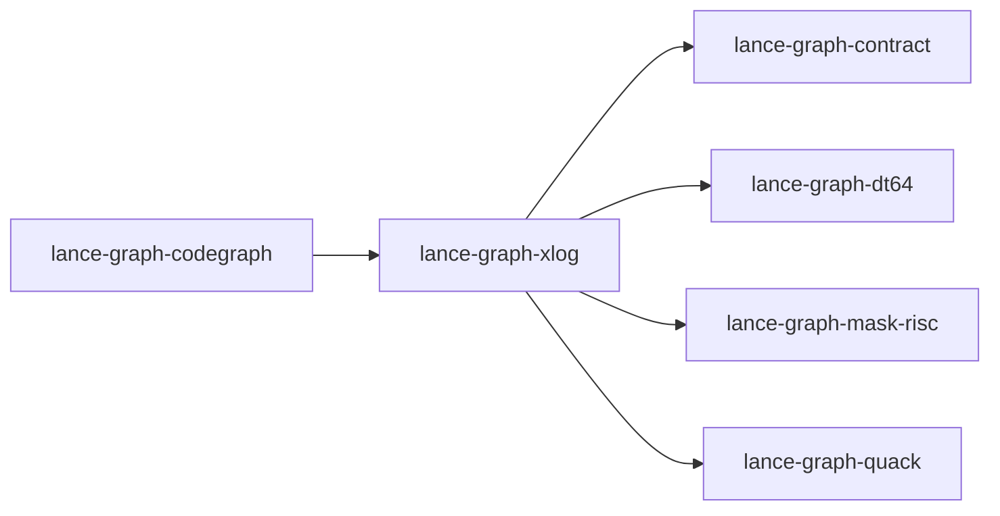

# lance-graph-xlog

crate: lance-graph-xlog
path: crates/lance-graph-xlog
workspace: member
digest: c47438e0a61660db
evidence legend: ../index.md#evidence-legend

Generated; the code is the truth. See ../index.md.

## Depends on

- dep lance-graph-contract normal — crates/lance-graph-xlog/Cargo.toml:14 CONFIRMED
- dep lance-graph-dt64 normal — crates/lance-graph-xlog/Cargo.toml:13 CONFIRMED
- dep lance-graph-mask-risc normal — crates/lance-graph-xlog/Cargo.toml:11 CONFIRMED
- dep lance-graph-onnx dev — crates/lance-graph-xlog/Cargo.toml:21 CONFIRMED
- dep lance-graph-quack normal — crates/lance-graph-xlog/Cargo.toml:10 CONFIRMED
- dep ndarray normal — crates/lance-graph-xlog/Cargo.toml:17 CONFIRMED

## Depended on by

- rdep lance-graph-codegraph normal — crates/lance-graph-codegraph/Cargo.toml:12 CONFIRMED

## Public items

- type RelId [pub] — crates/lance-graph-xlog/src/cube.rs:51 CONFIRMED
- struct View [pub] — crates/lance-graph-xlog/src/cube.rs:55 CONFIRMED
- enum EdgeOp [pub] — crates/lance-graph-xlog/src/cube.rs:62 CONFIRMED
- struct StagedEdges [pub] — crates/lance-graph-xlog/src/cube.rs:73 CONFIRMED
- fn StagedEdges::len [pub] — crates/lance-graph-xlog/src/cube.rs:84 CONFIRMED
- fn StagedEdges::is_empty [pub] — crates/lance-graph-xlog/src/cube.rs:89 CONFIRMED
- enum CubeRefusal [pub] — crates/lance-graph-xlog/src/cube.rs:119 CONFIRMED
- struct CubeStats [pub] — crates/lance-graph-xlog/src/cube.rs:162 CONFIRMED
- struct Closure [pub] — crates/lance-graph-xlog/src/cube.rs:174 CONFIRMED
- fn Closure::rows [pub] — crates/lance-graph-xlog/src/cube.rs:180 CONFIRMED
- fn Closure::contains [pub] — crates/lance-graph-xlog/src/cube.rs:185 CONFIRMED
- struct ClosureStats [pub] — crates/lance-graph-xlog/src/cube.rs:194 CONFIRMED
- struct Cube [pub] — crates/lance-graph-xlog/src/cube.rs:224 CONFIRMED
- fn Cube::new [pub] — crates/lance-graph-xlog/src/cube.rs:250 CONFIRMED
- fn Cube::new_tiled [pub] — crates/lance-graph-xlog/src/cube.rs:290 CONFIRMED
- fn Cube::add_relation [pub] — crates/lance-graph-xlog/src/cube.rs:328 CONFIRMED
- fn Cube::stats [pub] — crates/lance-graph-xlog/src/cube.rs:347 CONFIRMED
- fn Cube::scan [pub] — crates/lance-graph-xlog/src/cube.rs:367 CONFIRMED
- fn Cube::bind [pub] — crates/lance-graph-xlog/src/cube.rs:376 CONFIRMED
- fn Cube::join [pub] — crates/lance-graph-xlog/src/cube.rs:403 CONFIRMED
- fn Cube::support [pub] — crates/lance-graph-xlog/src/cube.rs:642 CONFIRMED
- fn Cube::bag_count [pub] — crates/lance-graph-xlog/src/cube.rs:654 CONFIRMED
- fn Cube::closure [pub] — crates/lance-graph-xlog/src/cube.rs:669 CONFIRMED
- fn Cube::closure_wide [pub] — crates/lance-graph-xlog/src/cube.rs:719 CONFIRMED
- fn Cube::add_edge [pub] — crates/lance-graph-xlog/src/cube.rs:742 CONFIRMED
- fn Cube::retire_edge [pub] — crates/lance-graph-xlog/src/cube.rs:763 CONFIRMED
- fn Cube::delta_log [pub] — crates/lance-graph-xlog/src/cube.rs:790 CONFIRMED
- fn Cube::frame [pub] — crates/lance-graph-xlog/src/cube.rs:795 CONFIRMED
- fn Cube::delta_len [pub] — crates/lance-graph-xlog/src/cube.rs:801 CONFIRMED
- fn Cube::refresh_closure [pub] — crates/lance-graph-xlog/src/cube.rs:810 CONFIRMED
- fn Cube::refold [pub] — crates/lance-graph-xlog/src/cube.rs:829 CONFIRMED
- fn Cube::stage [pub] — crates/lance-graph-xlog/src/cube.rs:856 CONFIRMED
- fn Cube::stage_closure [pub] — crates/lance-graph-xlog/src/cube.rs:909 CONFIRMED
- fn Cube::commit [pub] — crates/lance-graph-xlog/src/cube.rs:939 CONFIRMED
- fn Cube::rebase [pub] — crates/lance-graph-xlog/src/cube.rs:979 CONFIRMED
- fn Cube::materialize_rows [pub] — crates/lance-graph-xlog/src/cube.rs:1010 CONFIRMED
- const XLOG_LENS [pub] — crates/lance-graph-xlog/src/lens.rs:33 CONFIRMED
- struct XlogWord [pub] — crates/lance-graph-xlog/src/lens.rs:37 CONFIRMED
- const XLOG_WORDS [pub] — crates/lance-graph-xlog/src/lens.rs:47 CONFIRMED
- fn position_of [pub] — crates/lance-graph-xlog/src/lens.rs:67 CONFIRMED
- fn word_of [pub] — crates/lance-graph-xlog/src/lens.rs:80 CONFIRMED
- fn declare [pub] — crates/lance-graph-xlog/src/lens.rs:104 CONFIRMED
- mod cube [pub] — crates/lance-graph-xlog/src/lib.rs:51 CONFIRMED
- mod lens [pub] — crates/lance-graph-xlog/src/lib.rs:52 CONFIRMED
- mod wide [pub] — crates/lance-graph-xlog/src/lib.rs:53 CONFIRMED
- trait MidMap [pub] — crates/lance-graph-xlog/src/lib.rs:58 CONFIRMED
- struct Bounds [pub] — crates/lance-graph-xlog/src/lib.rs:97 CONFIRMED
- enum NativeRefusal [pub] — crates/lance-graph-xlog/src/lib.rs:106 CONFIRMED
- struct Support [pub] — crates/lance-graph-xlog/src/lib.rs:119 CONFIRMED
- fn all_live [pub(crate)] — crates/lance-graph-xlog/src/lib.rs:144 CONFIRMED
- fn run_lanes [pub(crate)] — crates/lance-graph-xlog/src/lib.rs:205 CONFIRMED
- fn support [pub] — crates/lance-graph-xlog/src/lib.rs:255 CONFIRMED
- fn bag_count [pub] — crates/lance-graph-xlog/src/lib.rs:280 CONFIRMED
- struct Intake [pub] — crates/lance-graph-xlog/src/lib.rs:302 CONFIRMED
- fn Intake::new [pub] — crates/lance-graph-xlog/src/lib.rs:313 CONFIRMED
- fn Intake::map [pub] — crates/lance-graph-xlog/src/lib.rs:334 CONFIRMED
- fn Intake::support [pub] — crates/lance-graph-xlog/src/lib.rs:339 CONFIRMED
- fn Intake::bag_count [pub] — crates/lance-graph-xlog/src/lib.rs:345 CONFIRMED
- enum Word [pub] — crates/lance-graph-xlog/src/lib.rs:356 CONFIRMED
- enum BoundRefusal [pub] — crates/lance-graph-xlog/src/lib.rs:365 CONFIRMED
- fn bag_count_admitted [pub] — crates/lance-graph-xlog/src/lib.rs:384 CONFIRMED
- fn ids [pub] — crates/lance-graph-xlog/src/lib.rs:406 CONFIRMED
- fn nonzero [pub] — crates/lance-graph-xlog/src/lib.rs:415 CONFIRMED
- const BLOCK_POSITIONS [pub] — crates/lance-graph-xlog/src/wide.rs:31 CONFIRMED
- const BLOCK_WORDS [pub] — crates/lance-graph-xlog/src/wide.rs:34 CONFIRMED
- const MAX_POSITIONS [pub] — crates/lance-graph-xlog/src/wide.rs:38 CONFIRMED
- struct WideRows [pub] — crates/lance-graph-xlog/src/wide.rs:43 CONFIRMED
- fn WideRows::n [pub] — crates/lance-graph-xlog/src/wide.rs:106 CONFIRMED
- fn WideRows::blocks [pub] — crates/lance-graph-xlog/src/wide.rs:111 CONFIRMED
- fn WideRows::blocks_allocated [pub] — crates/lance-graph-xlog/src/wide.rs:116 CONFIRMED
- fn WideRows::contains [pub] — crates/lance-graph-xlog/src/wide.rs:122 CONFIRMED
- fn WideRows::row_into [pub] — crates/lance-graph-xlog/src/wide.rs:153 CONFIRMED
- struct WideStats [pub] — crates/lance-graph-xlog/src/wide.rs:206 CONFIRMED
- enum WideRefusal [pub] — crates/lance-graph-xlog/src/wide.rs:224 CONFIRMED
- fn closure_wide [pub] — crates/lance-graph-xlog/src/wide.rs:395 CONFIRMED
- struct DeltaLog [pub] — crates/lance-graph-xlog/src/wide.rs:418 CONFIRMED
- fn DeltaLog::new [pub] — crates/lance-graph-xlog/src/wide.rs:427 CONFIRMED
- fn DeltaLog::add [pub] — crates/lance-graph-xlog/src/wide.rs:440 CONFIRMED
- fn DeltaLog::retire [pub] — crates/lance-graph-xlog/src/wide.rs:445 CONFIRMED
- fn DeltaLog::len [pub] — crates/lance-graph-xlog/src/wide.rs:450 CONFIRMED
- fn DeltaLog::last_version [pub] — crates/lance-graph-xlog/src/wide.rs:455 CONFIRMED
- fn DeltaLog::is_empty [pub] — crates/lance-graph-xlog/src/wide.rs:460 CONFIRMED
- fn refold [pub] — crates/lance-graph-xlog/src/wide.rs:510 CONFIRMED
- fn refresh [pub] — crates/lance-graph-xlog/src/wide.rs:560 CONFIRMED

## Imports from in-scope crates

### lance-graph-contract
- use lance_graph_contract::ogar_codebook::HARDCODED_BEHAVIOUR — crates/lance-graph-xlog/src/lens.rs:29 CONFIRMED
- use lance_graph_contract::ogar_codebook::compose_classid — crates/lance-graph-xlog/src/lens.rs:29 CONFIRMED
- use lance_graph_contract::set_rules::Population — crates/lance-graph-xlog/src/lib.rs:41 CONFIRMED
### lance-graph-dt64
- use lance_graph_dt64::dr::Frame — crates/lance-graph-xlog/src/cube.rs:41 CONFIRMED
- use lance_graph_dt64::dr::LocalMap — crates/lance-graph-xlog/src/cube.rs:41 CONFIRMED
- use lance_graph_dt64::dr::LocateRefusal — crates/lance-graph-xlog/src/cube.rs:41 CONFIRMED
- use lance_graph_dt64::dr::MapRead — crates/lance-graph-xlog/src/cube.rs:41 CONFIRMED
- use lance_graph_dt64::dr::MapRefusal — crates/lance-graph-xlog/src/cube.rs:41 CONFIRMED
- use lance_graph_dt64::dr::MapTable — crates/lance-graph-xlog/src/cube.rs:41 CONFIRMED
- use lance_graph_dt64::dr::TileId — crates/lance-graph-xlog/src/cube.rs:41 CONFIRMED
- use lance_graph_dt64::dr::TileMap — crates/lance-graph-xlog/src/cube.rs:41 CONFIRMED
- use lance_graph_dt64::AlgebraRef — crates/lance-graph-xlog/src/lens.rs:30 CONFIRMED
- use lance_graph_dt64::BindStore — crates/lance-graph-xlog/src/lens.rs:30 CONFIRMED
- use lance_graph_dt64::Extent — crates/lance-graph-xlog/src/lens.rs:30 CONFIRMED
- use lance_graph_dt64::Refusal — crates/lance-graph-xlog/src/lens.rs:30 CONFIRMED
- use lance_graph_dt64::SchemaRev — crates/lance-graph-xlog/src/lens.rs:30 CONFIRMED
- use lance_graph_dt64::dr::Frame — crates/lance-graph-xlog/src/lib.rs:42 CONFIRMED
- use lance_graph_dt64::dr::LocalMap — crates/lance-graph-xlog/src/lib.rs:42 CONFIRMED
- use lance_graph_dt64::dr::MapRead — crates/lance-graph-xlog/src/lib.rs:42 CONFIRMED
- use lance_graph_dt64::dr::MapRefusal — crates/lance-graph-xlog/src/lib.rs:42 CONFIRMED
- use lance_graph_dt64::dr::MapTable — crates/lance-graph-xlog/src/lib.rs:42 CONFIRMED
- use lance_graph_dt64::dr::TileId — crates/lance-graph-xlog/src/lib.rs:42 CONFIRMED
- use lance_graph_dt64::dr::TileMap — crates/lance-graph-xlog/src/lib.rs:42 CONFIRMED
- use lance_graph_dt64::AlgebraRef — crates/lance-graph-xlog/src/lib.rs:43 CONFIRMED
- use lance_graph_dt64::MethodBinding — crates/lance-graph-xlog/src/lib.rs:43 CONFIRMED
### lance-graph-mask-risc
- use lance_graph_mask_risc::LaneRef — crates/lance-graph-xlog/src/cube.rs:43 CONFIRMED
- use lance_graph_mask_risc::Out — crates/lance-graph-xlog/src/cube.rs:43 CONFIRMED
- use lance_graph_mask_risc::ExecError — crates/lance-graph-xlog/src/lib.rs:44 CONFIRMED
- use lance_graph_mask_risc::Foreign — crates/lance-graph-xlog/src/lib.rs:44 CONFIRMED
- use lance_graph_mask_risc::LaneRef — crates/lance-graph-xlog/src/lib.rs:44 CONFIRMED
- use lance_graph_mask_risc::Out — crates/lance-graph-xlog/src/lib.rs:44 CONFIRMED
- use lance_graph_mask_risc::Planes — crates/lance-graph-xlog/src/lib.rs:44 CONFIRMED
- use lance_graph_mask_risc::Scratch — crates/lance-graph-xlog/src/lib.rs:44 CONFIRMED
- use lance_graph_mask_risc::execute_into — crates/lance-graph-xlog/src/lib.rs:44 CONFIRMED
### lance-graph-quack
- use lance_graph_quack::Agg — crates/lance-graph-xlog/src/cube.rs:44 CONFIRMED
- use lance_graph_quack::Cmp — crates/lance-graph-xlog/src/cube.rs:44 CONFIRMED
- use lance_graph_quack::Col — crates/lance-graph-xlog/src/cube.rs:44 CONFIRMED
- use lance_graph_quack::Filter — crates/lance-graph-xlog/src/cube.rs:44 CONFIRMED
- use lance_graph_quack::GroupAddr — crates/lance-graph-xlog/src/cube.rs:44 CONFIRMED
- use lance_graph_quack::GroupAgg — crates/lance-graph-xlog/src/cube.rs:44 CONFIRMED
- use lance_graph_quack::Mask — crates/lance-graph-xlog/src/cube.rs:44 CONFIRMED
- use lance_graph_quack::Query — crates/lance-graph-xlog/src/cube.rs:44 CONFIRMED
- use lance_graph_quack::Agg — crates/lance-graph-xlog/src/lib.rs:46 CONFIRMED
- use lance_graph_quack::Cmp — crates/lance-graph-xlog/src/lib.rs:46 CONFIRMED
- use lance_graph_quack::Col — crates/lance-graph-xlog/src/lib.rs:46 CONFIRMED
- use lance_graph_quack::Filter — crates/lance-graph-xlog/src/lib.rs:46 CONFIRMED
- use lance_graph_quack::GroupAddr — crates/lance-graph-xlog/src/lib.rs:46 CONFIRMED
- use lance_graph_quack::GroupAgg — crates/lance-graph-xlog/src/lib.rs:46 CONFIRMED
- use lance_graph_quack::LowerError — crates/lance-graph-xlog/src/lib.rs:46 CONFIRMED
- use lance_graph_quack::Mask — crates/lance-graph-xlog/src/lib.rs:46 CONFIRMED
- use lance_graph_quack::Query — crates/lance-graph-xlog/src/lib.rs:46 CONFIRMED
- use lance_graph_quack::lower — crates/lance-graph-xlog/src/lib.rs:46 CONFIRMED

## Calls

CALL_GRAPH=ARTIFACT_MISSING
- calls ARTIFACT_MISSING — no ruff_charon artifact for this crate UNKNOWN

## Architecture

- none

Generated from Cargo manifests — extracted relationships only.

