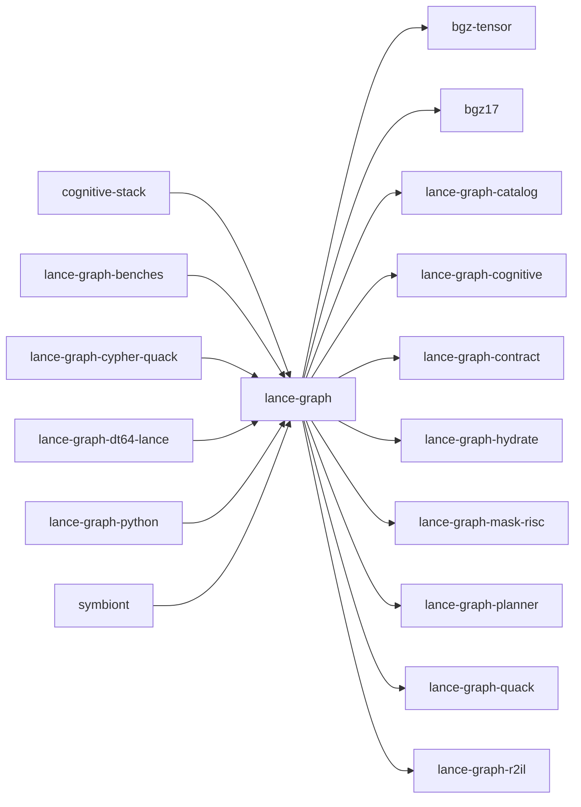

# lance-graph

crate: lance-graph
path: crates/lance-graph
workspace: member
digest: 6059946987f70d8c
evidence legend: ../index.md#evidence-legend

Generated; the code is the truth. See ../index.md.

## Depends on

- dep bgz-tensor normal optional — crates/lance-graph/Cargo.toml:104 CONFIRMED
- dep bgz17 normal optional — crates/lance-graph/Cargo.toml:101 CONFIRMED
- dep causal-edge dev — crates/lance-graph/Cargo.toml:174 CONFIRMED
- dep deepnsm dev — crates/lance-graph/Cargo.toml:162 CONFIRMED
- dep lance-graph-catalog normal — crates/lance-graph/Cargo.toml:49 CONFIRMED
- dep lance-graph-cognitive normal optional — crates/lance-graph/Cargo.toml:98 CONFIRMED
- dep lance-graph-contract dev — crates/lance-graph/Cargo.toml:163 CONFIRMED
- dep lance-graph-contract normal — crates/lance-graph/Cargo.toml:50 CONFIRMED
- dep lance-graph-hydrate normal — crates/lance-graph/Cargo.toml:25 CONFIRMED
- dep lance-graph-mask-risc normal — crates/lance-graph/Cargo.toml:56 CONFIRMED
- dep lance-graph-planner dev — crates/lance-graph/Cargo.toml:175 CONFIRMED
- dep lance-graph-planner normal optional — crates/lance-graph/Cargo.toml:92 CONFIRMED
- dep lance-graph-quack normal — crates/lance-graph/Cargo.toml:57 CONFIRMED
- dep lance-graph-r2il normal — crates/lance-graph/Cargo.toml:58 CONFIRMED
- dep arrow normal — crates/lance-graph/Cargo.toml:29 CONFIRMED
- dep arrow-array normal — crates/lance-graph/Cargo.toml:30 CONFIRMED
- dep arrow-schema normal — crates/lance-graph/Cargo.toml:31 CONFIRMED
- dep async-trait normal — crates/lance-graph/Cargo.toml:33 CONFIRMED
- dep bytes normal — crates/lance-graph/Cargo.toml:84 CONFIRMED
- dep chrono normal — crates/lance-graph/Cargo.toml:32 CONFIRMED
- dep datafusion normal — crates/lance-graph/Cargo.toml:34 CONFIRMED
- dep datafusion-common normal — crates/lance-graph/Cargo.toml:44 CONFIRMED
- dep datafusion-expr normal — crates/lance-graph/Cargo.toml:45 CONFIRMED
- dep datafusion-functions-aggregate normal — crates/lance-graph/Cargo.toml:47 CONFIRMED
- dep datafusion-sql normal — crates/lance-graph/Cargo.toml:46 CONFIRMED
- dep futures dev — crates/lance-graph/Cargo.toml:164 CONFIRMED
- dep futures normal — crates/lance-graph/Cargo.toml:48 CONFIRMED
- dep lance normal — crates/lance-graph/Cargo.toml:59 CONFIRMED
- dep lance-arrow dev — crates/lance-graph/Cargo.toml:165 CONFIRMED
- dep lance-index dev — crates/lance-graph/Cargo.toml:166 CONFIRMED
- dep lance-linalg normal — crates/lance-graph/Cargo.toml:60 CONFIRMED
- dep lance-namespace normal — crates/lance-graph/Cargo.toml:61 CONFIRMED
- dep lancedb normal optional — crates/lance-graph/Cargo.toml:74 CONFIRMED
- dep ndarray normal optional — crates/lance-graph/Cargo.toml:89 CONFIRMED
- dep nom normal — crates/lance-graph/Cargo.toml:75 CONFIRMED
- dep object_store dev — crates/lance-graph/Cargo.toml:196 CONFIRMED
- dep object_store normal — crates/lance-graph/Cargo.toml:26 CONFIRMED
- dep serde normal — crates/lance-graph/Cargo.toml:76 CONFIRMED
- dep serde_json normal — crates/lance-graph/Cargo.toml:77 CONFIRMED
- dep serde_yaml normal — crates/lance-graph/Cargo.toml:83 CONFIRMED
- dep snafu normal — crates/lance-graph/Cargo.toml:85 CONFIRMED
- dep tempfile dev — crates/lance-graph/Cargo.toml:167 CONFIRMED
- dep tokio dev — crates/lance-graph/Cargo.toml:173 CONFIRMED
- dep uuid dev — crates/lance-graph/Cargo.toml:172 CONFIRMED

## Depended on by

- rdep cognitive-stack normal — crates/cognitive-stack/Cargo.toml:47 CONFIRMED
- rdep lance-graph-benches normal — crates/lance-graph-benches/Cargo.toml:9 CONFIRMED
- rdep lance-graph-cypher-quack normal — crates/lance-graph-cypher-quack/Cargo.toml:15 CONFIRMED
- rdep lance-graph-dt64-lance normal — crates/lance-graph-dt64-lance/Cargo.toml:32 CONFIRMED
- rdep lance-graph-python normal — crates/lance-graph-python/Cargo.toml:20 CONFIRMED
- rdep symbiont normal — crates/symbiont/Cargo.toml:37 CONFIRMED

## Public items

- struct CypherQuery [pub] — crates/lance-graph/src/ast.rs:15 CONFIRMED
- fn CypherQuery::get_node_labels [pub] — crates/lance-graph/src/ast.rs:38 CONFIRMED
- fn CypherQuery::get_relationship_types [pub] — crates/lance-graph/src/ast.rs:74 CONFIRMED
- enum ReadingClause [pub] — crates/lance-graph/src/ast.rs:105 CONFIRMED
- struct MatchClause [pub] — crates/lance-graph/src/ast.rs:112 CONFIRMED
- struct UnwindClause [pub] — crates/lance-graph/src/ast.rs:119 CONFIRMED
- enum GraphPattern [pub] — crates/lance-graph/src/ast.rs:128 CONFIRMED
- struct NodePattern [pub] — crates/lance-graph/src/ast.rs:137 CONFIRMED
- struct PathPattern [pub] — crates/lance-graph/src/ast.rs:148 CONFIRMED
- struct PathSegment [pub] — crates/lance-graph/src/ast.rs:157 CONFIRMED
- struct RelationshipPattern [pub] — crates/lance-graph/src/ast.rs:166 CONFIRMED
- enum RelationshipDirection [pub] — crates/lance-graph/src/ast.rs:181 CONFIRMED
- struct LengthRange [pub] — crates/lance-graph/src/ast.rs:192 CONFIRMED
- enum PropertyValue [pub] — crates/lance-graph/src/ast.rs:201 CONFIRMED
- struct PropertyRef [pub] — crates/lance-graph/src/ast.rs:220 CONFIRMED
- struct WhereClause [pub] — crates/lance-graph/src/ast.rs:229 CONFIRMED
- enum BooleanExpression [pub] — crates/lance-graph/src/ast.rs:236 CONFIRMED
- enum DistanceMetric [pub] — crates/lance-graph/src/ast.rs:289 CONFIRMED
- enum ComparisonOperator [pub] — crates/lance-graph/src/ast.rs:303 CONFIRMED
- enum ValueExpression [pub] — crates/lance-graph/src/ast.rs:314 CONFIRMED
- enum FunctionType [pub] — crates/lance-graph/src/ast.rs:364 CONFIRMED
- fn classify_function [pub] — crates/lance-graph/src/ast.rs:374 CONFIRMED
- enum ArithmeticOperator [pub] — crates/lance-graph/src/ast.rs:385 CONFIRMED
- struct WithClause [pub] — crates/lance-graph/src/ast.rs:398 CONFIRMED
- struct ReturnClause [pub] — crates/lance-graph/src/ast.rs:409 CONFIRMED
- struct ReturnItem [pub] — crates/lance-graph/src/ast.rs:418 CONFIRMED
- struct OrderByClause [pub] — crates/lance-graph/src/ast.rs:427 CONFIRMED
- struct OrderByItem [pub] — crates/lance-graph/src/ast.rs:434 CONFIRMED
- enum SortDirection [pub] — crates/lance-graph/src/ast.rs:443 CONFIRMED
- fn NodePattern::new [pub] — crates/lance-graph/src/ast.rs:450 CONFIRMED
- fn NodePattern::with_label [pub] — crates/lance-graph/src/ast.rs:459 CONFIRMED
- fn NodePattern::with_property [pub] — crates/lance-graph/src/ast.rs:465 CONFIRMED
- fn RelationshipPattern::new [pub] — crates/lance-graph/src/ast.rs:473 CONFIRMED
- fn RelationshipPattern::with_variable [pub] — crates/lance-graph/src/ast.rs:484 CONFIRMED
- fn RelationshipPattern::with_type [pub] — crates/lance-graph/src/ast.rs:490 CONFIRMED
- fn RelationshipPattern::with_property [pub] — crates/lance-graph/src/ast.rs:496 CONFIRMED
- fn PropertyRef::new [pub] — crates/lance-graph/src/ast.rs:504 CONFIRMED
- struct IvfConfig [pub] — crates/lance-graph/src/cam_pq/ivf.rs:27 CONFIRMED
- struct CoarseCentroid [pub] — crates/lance-graph/src/cam_pq/ivf.rs:54 CONFIRMED
- struct IvfAssignment [pub] — crates/lance-graph/src/cam_pq/ivf.rs:63 CONFIRMED
- struct IvfIndex [pub] — crates/lance-graph/src/cam_pq/ivf.rs:72 CONFIRMED
- fn IvfIndex::train [pub] — crates/lance-graph/src/cam_pq/ivf.rs:87 CONFIRMED
- fn IvfIndex::assign [pub] — crates/lance-graph/src/cam_pq/ivf.rs:119 CONFIRMED
- fn IvfIndex::assign_batch [pub] — crates/lance-graph/src/cam_pq/ivf.rs:124 CONFIRMED
- fn IvfIndex::probe [pub] — crates/lance-graph/src/cam_pq/ivf.rs:129 CONFIRMED
- fn IvfIndex::expected_candidates [pub] — crates/lance-graph/src/cam_pq/ivf.rs:149 CONFIRMED
- struct IvfCamResult [pub] — crates/lance-graph/src/cam_pq/ivf.rs:176 CONFIRMED
- fn merge_partition_results [pub] — crates/lance-graph/src/cam_pq/ivf.rs:186 CONFIRMED
- fn cam_pq_cascade_template [pub] — crates/lance-graph/src/cam_pq/jitson_kernel.rs:28 CONFIRMED
- fn cam_pq_full_adc_template [pub] — crates/lance-graph/src/cam_pq/jitson_kernel.rs:129 CONFIRMED
- fn select_kernel_template [pub] — crates/lance-graph/src/cam_pq/jitson_kernel.rs:186 CONFIRMED
- mod ivf [pub] — crates/lance-graph/src/cam_pq/mod.rs:20 CONFIRMED
- mod jitson_kernel [pub] — crates/lance-graph/src/cam_pq/mod.rs:21 CONFIRMED
- mod storage [pub] — crates/lance-graph/src/cam_pq/mod.rs:22 CONFIRMED
- mod udf [pub] — crates/lance-graph/src/cam_pq/mod.rs:23 CONFIRMED
- const CAM_COLUMN [pub] — crates/lance-graph/src/cam_pq/storage.rs:34 CONFIRMED
- const CAM_SIZE [pub] — crates/lance-graph/src/cam_pq/storage.rs:37 CONFIRMED
- const CODEBOOK_TABLE [pub] — crates/lance-graph/src/cam_pq/storage.rs:40 CONFIRMED
- fn cam_vectors_schema [pub] — crates/lance-graph/src/cam_pq/storage.rs:43 CONFIRMED
- fn cam_codebook_schema [pub] — crates/lance-graph/src/cam_pq/storage.rs:51 CONFIRMED
- fn build_cam_batch [pub] — crates/lance-graph/src/cam_pq/storage.rs:70 CONFIRMED
- fn build_codebook_batch [pub] — crates/lance-graph/src/cam_pq/storage.rs:94 CONFIRMED
- fn extract_cam_fingerprints [pub] — crates/lance-graph/src/cam_pq/storage.rs:149 CONFIRMED
- fn extract_codebook [pub] — crates/lance-graph/src/cam_pq/storage.rs:168 CONFIRMED
- fn codebook_to_lance [pub] — crates/lance-graph/src/cam_pq/storage.rs:213 CONFIRMED
- struct CamStorageStats [pub] — crates/lance-graph/src/cam_pq/storage.rs:230 CONFIRMED
- fn CamStorageStats::compute [pub] — crates/lance-graph/src/cam_pq/storage.rs:238 CONFIRMED
- struct CamDistanceTables [pub] — crates/lance-graph/src/cam_pq/udf.rs:39 CONFIRMED
- fn CamDistanceTables::precompute [pub] — crates/lance-graph/src/cam_pq/udf.rs:48 CONFIRMED
- fn CamDistanceTables::distance [pub] — crates/lance-graph/src/cam_pq/udf.rs:66 CONFIRMED
- fn CamDistanceTables::distance_batch [pub] — crates/lance-graph/src/cam_pq/udf.rs:77 CONFIRMED
- fn create_cam_distance_udf [pub] — crates/lance-graph/src/cam_pq/udf.rs:246 CONFIRMED
- fn create_cam_heel_distance_udf [pub] — crates/lance-graph/src/cam_pq/udf.rs:262 CONFIRMED
- fn register_cam_udfs [pub] — crates/lance-graph/src/cam_pq/udf.rs:331 CONFIRMED
- struct CaseInsensitiveStr [pub] — crates/lance-graph/src/case_insensitive.rs:30 CONFIRMED
- fn CaseInsensitiveStr::new [pub] — crates/lance-graph/src/case_insensitive.rs:38 CONFIRMED
- fn CaseInsensitiveStr::as_str [pub] — crates/lance-graph/src/case_insensitive.rs:45 CONFIRMED
- type CaseInsensitiveMap [pub] — crates/lance-graph/src/case_insensitive.rs:86 CONFIRMED
- fn qualify_column [pub] — crates/lance-graph/src/case_insensitive.rs:106 CONFIRMED
- trait CaseInsensitiveLookup [pub] — crates/lance-graph/src/case_insensitive.rs:143 CONFIRMED
- struct GraphConfig [pub] — crates/lance-graph/src/config.rs:35 CONFIRMED
- struct NodeMapping [pub] — crates/lance-graph/src/config.rs:61 CONFIRMED
- struct RelationshipMapping [pub] — crates/lance-graph/src/config.rs:74 CONFIRMED
- fn GraphConfig::builder [pub] — crates/lance-graph/src/config.rs:102 CONFIRMED
- fn GraphConfig::get_node_mapping [pub] — crates/lance-graph/src/config.rs:110 CONFIRMED
- fn GraphConfig::get_relationship_mapping [pub] — crates/lance-graph/src/config.rs:118 CONFIRMED
- fn GraphConfig::validate [pub] — crates/lance-graph/src/config.rs:128 CONFIRMED
- struct GraphConfigBuilder [pub] — crates/lance-graph/src/config.rs:182 CONFIRMED
- fn GraphConfigBuilder::new [pub] — crates/lance-graph/src/config.rs:191 CONFIRMED
- fn GraphConfigBuilder::with_node_label [pub] — crates/lance-graph/src/config.rs:199 CONFIRMED
- fn GraphConfigBuilder::with_node_mapping [pub] — crates/lance-graph/src/config.rs:215 CONFIRMED
- fn GraphConfigBuilder::with_relationship [pub] — crates/lance-graph/src/config.rs:222 CONFIRMED
- fn GraphConfigBuilder::with_relationship_mapping [pub] — crates/lance-graph/src/config.rs:245 CONFIRMED
- fn GraphConfigBuilder::with_default_node_id_field [pub] — crates/lance-graph/src/config.rs:252 CONFIRMED
- fn GraphConfigBuilder::with_default_relationship_type_field [pub] — crates/lance-graph/src/config.rs:258 CONFIRMED
- fn GraphConfigBuilder::build [pub] — crates/lance-graph/src/config.rs:264 CONFIRMED
- fn NodeMapping::new [pub] — crates/lance-graph/src/config.rs:283 CONFIRMED
- fn NodeMapping::with_properties [pub] — crates/lance-graph/src/config.rs:293 CONFIRMED
- fn NodeMapping::with_filter [pub] — crates/lance-graph/src/config.rs:299 CONFIRMED
- fn RelationshipMapping::new [pub] — crates/lance-graph/src/config.rs:307 CONFIRMED
- fn RelationshipMapping::with_type_field [pub] — crates/lance-graph/src/config.rs:319 CONFIRMED
- fn RelationshipMapping::with_properties [pub] — crates/lance-graph/src/config.rs:325 CONFIRMED
- fn RelationshipMapping::with_filter [pub] — crates/lance-graph/src/config.rs:331 CONFIRMED
- struct CsrIndex [pub] — crates/lance-graph/src/csr_index.rs:33 CONFIRMED
- fn CsrIndex::neighbors [pub] — crates/lance-graph/src/csr_index.rs:42 CONFIRMED
- fn CsrIndex::degree [pub] — crates/lance-graph/src/csr_index.rs:53 CONFIRMED
- fn CsrIndex::num_vertices [pub] — crates/lance-graph/src/csr_index.rs:58 CONFIRMED
- fn CsrIndex::num_edges [pub] — crates/lance-graph/src/csr_index.rs:63 CONFIRMED
- fn CsrIndex::to_record_batch [pub] — crates/lance-graph/src/csr_index.rs:72 CONFIRMED
- fn CsrIndex::neighbors_to_record_batch [pub] — crates/lance-graph/src/csr_index.rs:105 CONFIRMED
- fn CsrIndex::bfs [pub] — crates/lance-graph/src/csr_index.rs:127 CONFIRMED
- fn CsrIndex::shortest_path [pub] — crates/lance-graph/src/csr_index.rs:165 CONFIRMED
- struct CsrIndexBuilder [pub] — crates/lance-graph/src/csr_index.rs:215 CONFIRMED
- fn CsrIndexBuilder::new [pub] — crates/lance-graph/src/csr_index.rs:221 CONFIRMED
- fn CsrIndexBuilder::with_num_vertices [pub] — crates/lance-graph/src/csr_index.rs:232 CONFIRMED
- fn CsrIndexBuilder::add_edge [pub] — crates/lance-graph/src/csr_index.rs:238 CONFIRMED
- fn CsrIndexBuilder::add_edges_from_batch [pub] — crates/lance-graph/src/csr_index.rs:247 CONFIRMED
- fn CsrIndexBuilder::build [pub] — crates/lance-graph/src/csr_index.rs:296 CONFIRMED
- fn CsrIndexBuilder::try_build [pub] — crates/lance-graph/src/csr_index.rs:306 CONFIRMED
- fn build_bidirectional_index [pub] — crates/lance-graph/src/csr_index.rs:370 CONFIRMED
- struct QueryAnalysis [pub] — crates/lance-graph/src/datafusion_planner/analysis.rs:15 CONFIRMED
- struct RelationshipInstance [pub] — crates/lance-graph/src/datafusion_planner/analysis.rs:28 CONFIRMED
- struct PlanningContext [pub] — crates/lance-graph/src/datafusion_planner/analysis.rs:38 CONFIRMED
- fn PlanningContext<'a>::new [pub] — crates/lance-graph/src/datafusion_planner/analysis.rs:44 CONFIRMED
- fn PlanningContext<'a>::next_relationship_instance [pub] — crates/lance-graph/src/datafusion_planner/analysis.rs:52 CONFIRMED
- fn analyze [pub] — crates/lance-graph/src/datafusion_planner/analysis.rs:73 CONFIRMED
- fn DataFusionPlanner::build_project_with_aggregates [pub(crate)] — crates/lance-graph/src/datafusion_planner/builder/aggregate_ops.rs:12 CONFIRMED
- fn DataFusionPlanner::build_filter [pub(crate)] — crates/lance-graph/src/datafusion_planner/builder/basic_ops.rs:13 CONFIRMED
- fn DataFusionPlanner::build_project [pub(crate)] — crates/lance-graph/src/datafusion_planner/builder/basic_ops.rs:28 CONFIRMED
- fn DataFusionPlanner::build_simple_project [pub(crate)] — crates/lance-graph/src/datafusion_planner/builder/basic_ops.rs:48 CONFIRMED
- fn DataFusionPlanner::build_distinct [pub(crate)] — crates/lance-graph/src/datafusion_planner/builder/basic_ops.rs:76 CONFIRMED
- fn DataFusionPlanner::build_sort [pub(crate)] — crates/lance-graph/src/datafusion_planner/builder/basic_ops.rs:89 CONFIRMED
- fn DataFusionPlanner::build_limit [pub(crate)] — crates/lance-graph/src/datafusion_planner/builder/basic_ops.rs:118 CONFIRMED
- fn DataFusionPlanner::build_offset [pub(crate)] — crates/lance-graph/src/datafusion_planner/builder/basic_ops.rs:132 CONFIRMED
- fn DataFusionPlanner::build_unwind [pub(crate)] — crates/lance-graph/src/datafusion_planner/builder/basic_ops.rs:146 CONFIRMED
- fn DataFusionPlanner::build_expand [pub(crate)] — crates/lance-graph/src/datafusion_planner/builder/expand_ops.rs:18 CONFIRMED
- fn DataFusionPlanner::build_variable_length_expand [pub(crate)] — crates/lance-graph/src/datafusion_planner/builder/expand_ops.rs:99 CONFIRMED
- fn DataFusionPlanner::build_fixed_length_path [pub(crate)] — crates/lance-graph/src/datafusion_planner/builder/expand_ops.rs:212 CONFIRMED
- fn DataFusionPlanner::build_expand_on_plan [pub(crate)] — crates/lance-graph/src/datafusion_planner/builder/expand_ops.rs:263 CONFIRMED
- fn DataFusionPlanner::extract_variables [pub(crate)] — crates/lance-graph/src/datafusion_planner/builder/helpers.rs:15 CONFIRMED
- fn DataFusionPlanner::build_join [pub(crate)] — crates/lance-graph/src/datafusion_planner/builder/join_builder.rs:19 CONFIRMED
- fn DataFusionPlanner::infer_join_keys [pub(crate)] — crates/lance-graph/src/datafusion_planner/builder/join_builder.rs:137 CONFIRMED
- fn DataFusionPlanner::build_operator [pub(crate)] — crates/lance-graph/src/datafusion_planner/builder/mod.rs:30 CONFIRMED
- fn DataFusionPlanner::get_relationship_mapping [pub(crate)] — crates/lance-graph/src/datafusion_planner/config_helpers.rs:18 CONFIRMED
- fn DataFusionPlanner::get_target_node_mapping [pub(crate)] — crates/lance-graph/src/datafusion_planner/config_helpers.rs:28 CONFIRMED
- fn DataFusionPlanner::get_catalog [pub(crate)] — crates/lance-graph/src/datafusion_planner/config_helpers.rs:92 CONFIRMED
- fn band_selectivity [pub] — crates/lance-graph/src/datafusion_planner/cost_estimation.rs:29 CONFIRMED
- fn should_use_cascade [pub] — crates/lance-graph/src/datafusion_planner/cost_estimation.rs:44 CONFIRMED
- fn full_scan_cost [pub] — crates/lance-graph/src/datafusion_planner/cost_estimation.rs:59 CONFIRMED
- fn cascade_scan_cost [pub] — crates/lance-graph/src/datafusion_planner/cost_estimation.rs:73 CONFIRMED
- fn choose_scan_strategy [pub] — crates/lance-graph/src/datafusion_planner/cost_estimation.rs:87 CONFIRMED
- enum ScanStrategy [pub] — crates/lance-graph/src/datafusion_planner/cost_estimation.rs:101 CONFIRMED
- fn to_df_boolean_expr [pub(crate)] — crates/lance-graph/src/datafusion_planner/expression.rs:34 CONFIRMED
- fn to_df_value_expr [pub(crate)] — crates/lance-graph/src/datafusion_planner/expression.rs:110 CONFIRMED
- fn contains_aggregate [pub(crate)] — crates/lance-graph/src/datafusion_planner/expression.rs:333 CONFIRMED
- fn to_cypher_column_name [pub(crate)] — crates/lance-graph/src/datafusion_planner/expression.rs:357 CONFIRMED
- struct SourceJoinParams [pub(crate)] — crates/lance-graph/src/datafusion_planner/join_ops.rs:25 CONFIRMED
- struct TargetJoinParams [pub(crate)] — crates/lance-graph/src/datafusion_planner/join_ops.rs:34 CONFIRMED
- fn DataFusionPlanner::join_source_to_relationship [pub(crate)] — crates/lance-graph/src/datafusion_planner/join_ops.rs:136 CONFIRMED
- fn DataFusionPlanner::join_relationship_to_target [pub(crate)] — crates/lance-graph/src/datafusion_planner/join_ops.rs:163 CONFIRMED
- fn DataFusionPlanner::get_source_join_key [pub(crate)] — crates/lance-graph/src/datafusion_planner/join_ops.rs:242 CONFIRMED
- fn DataFusionPlanner::get_target_join_key [pub(crate)] — crates/lance-graph/src/datafusion_planner/join_ops.rs:254 CONFIRMED
- fn DataFusionPlanner::join_relationship_to_input [pub(crate)] — crates/lance-graph/src/datafusion_planner/join_ops.rs:267 CONFIRMED
- fn DataFusionPlanner::join_target_to_builder [pub(crate)] — crates/lance-graph/src/datafusion_planner/join_ops.rs:296 CONFIRMED
- mod analysis [pub] — crates/lance-graph/src/datafusion_planner/mod.rs:17 CONFIRMED
- mod cost_estimation [pub] — crates/lance-graph/src/datafusion_planner/mod.rs:20 CONFIRMED
- mod predicate_pushdown [pub] — crates/lance-graph/src/datafusion_planner/mod.rs:23 CONFIRMED
- mod vector_ops [pub] — crates/lance-graph/src/datafusion_planner/mod.rs:26 CONFIRMED
- trait GraphPhysicalPlanner [pub] — crates/lance-graph/src/datafusion_planner/mod.rs:42 CONFIRMED
- struct DataFusionPlanner [pub] — crates/lance-graph/src/datafusion_planner/mod.rs:47 CONFIRMED
- fn DataFusionPlanner::new [pub] — crates/lance-graph/src/datafusion_planner/mod.rs:53 CONFIRMED
- fn DataFusionPlanner::with_catalog [pub] — crates/lance-graph/src/datafusion_planner/mod.rs:60 CONFIRMED
- fn DataFusionPlanner::plan_error [pub(crate)] — crates/lance-graph/src/datafusion_planner/mod.rs:68 CONFIRMED
- struct HammingPredicate [pub] — crates/lance-graph/src/datafusion_planner/predicate_pushdown.rs:31 CONFIRMED
- fn HammingPredicate::new [pub] — crates/lance-graph/src/datafusion_planner/predicate_pushdown.rs:44 CONFIRMED
- struct PushdownAnalysis [pub] — crates/lance-graph/src/datafusion_planner/predicate_pushdown.rs:70 CONFIRMED
- fn PushdownAnalysis::analyze [pub] — crates/lance-graph/src/datafusion_planner/predicate_pushdown.rs:80 CONFIRMED
- fn PushdownAnalysis::cascade_configs [pub] — crates/lance-graph/src/datafusion_planner/predicate_pushdown.rs:93 CONFIRMED
- fn PushdownAnalysis::has_cascade_pushdown [pub] — crates/lance-graph/src/datafusion_planner/predicate_pushdown.rs:103 CONFIRMED
- fn DataFusionPlanner::build_scan [pub(crate)] — crates/lance-graph/src/datafusion_planner/scan_ops.rs:22 CONFIRMED
- fn DataFusionPlanner::build_relationship_scan [pub(crate)] — crates/lance-graph/src/datafusion_planner/scan_ops.rs:123 CONFIRMED
- fn DataFusionPlanner::get_expected_varlength_columns [pub(crate)] — crates/lance-graph/src/datafusion_planner/scan_ops.rs:179 CONFIRMED
- fn DataFusionPlanner::build_qualified_relationship_scan [pub(crate)] — crates/lance-graph/src/datafusion_planner/scan_ops.rs:213 CONFIRMED
- fn DataFusionPlanner::build_qualified_target_scan [pub(crate)] — crates/lance-graph/src/datafusion_planner/scan_ops.rs:260 CONFIRMED
- fn person_schema [pub] cfg=test — crates/lance-graph/src/datafusion_planner/test_fixtures.rs:12 CONFIRMED
- fn make_catalog [pub] cfg=test — crates/lance-graph/src/datafusion_planner/test_fixtures.rs:20 CONFIRMED
- fn person_config [pub] cfg=test — crates/lance-graph/src/datafusion_planner/test_fixtures.rs:34 CONFIRMED
- fn person_knows_config [pub] cfg=test — crates/lance-graph/src/datafusion_planner/test_fixtures.rs:41 CONFIRMED
- fn person_scan [pub] cfg=test — crates/lance-graph/src/datafusion_planner/test_fixtures.rs:49 CONFIRMED
- fn create_vector_distance_udf [pub(crate)] — crates/lance-graph/src/datafusion_planner/udf.rs:170 CONFIRMED
- fn create_vector_similarity_udf [pub(crate)] — crates/lance-graph/src/datafusion_planner/udf.rs:337 CONFIRMED
- fn create_hamming_distance_udf [pub(crate)] — crates/lance-graph/src/datafusion_planner/udf.rs:633 CONFIRMED
- fn create_hamming_similarity_udf [pub(crate)] — crates/lance-graph/src/datafusion_planner/udf.rs:639 CONFIRMED
- fn extract_vectors [pub] — crates/lance-graph/src/datafusion_planner/vector_ops.rs:19 CONFIRMED
- fn extract_single_vector_from_scalar [pub] — crates/lance-graph/src/datafusion_planner/vector_ops.rs:82 CONFIRMED
- fn l2_distance [pub] — crates/lance-graph/src/datafusion_planner/vector_ops.rs:121 CONFIRMED
- fn cosine_distance [pub] — crates/lance-graph/src/datafusion_planner/vector_ops.rs:136 CONFIRMED
- fn cosine_similarity [pub] — crates/lance-graph/src/datafusion_planner/vector_ops.rs:149 CONFIRMED
- fn dot_product_distance [pub] — crates/lance-graph/src/datafusion_planner/vector_ops.rs:158 CONFIRMED
- fn dot_product_similarity [pub] — crates/lance-graph/src/datafusion_planner/vector_ops.rs:168 CONFIRMED
- truncated (1359 total), see symbols.tsv

## Imports from in-scope crates

### lance-graph-catalog
- use lance_graph_catalog::GraphSourceCatalog — crates/lance-graph/src/datafusion_planner/config_helpers.rs:13 CONFIRMED
- use lance_graph_catalog::GraphSourceCatalog — crates/lance-graph/src/datafusion_planner/join_ops.rs:20 CONFIRMED
- use lance_graph_catalog::GraphSourceCatalog — crates/lance-graph/src/datafusion_planner/mod.rs:38 CONFIRMED
- use lance_graph_catalog::GraphSourceCatalog — crates/lance-graph/src/datafusion_planner/scan_ops.rs:13 CONFIRMED
- use lance_graph_catalog::InMemoryCatalog cfg=test — crates/lance-graph/src/datafusion_planner/test_fixtures.rs:9 CONFIRMED
- use lance_graph_catalog::SimpleTableSource cfg=test — crates/lance-graph/src/datafusion_planner/test_fixtures.rs:9 CONFIRMED
- pub-use lance_graph_catalog::DirNamespace — crates/lance-graph/src/lib.rs:74 CONFIRMED
- pub-use lance_graph_catalog::GraphSourceCatalog — crates/lance-graph/src/lib.rs:74 CONFIRMED
- pub-use lance_graph_catalog::InMemoryCatalog — crates/lance-graph/src/lib.rs:74 CONFIRMED
- pub-use lance_graph_catalog::SimpleTableSource — crates/lance-graph/src/lib.rs:74 CONFIRMED
- pub-use lance_graph_catalog::CatalogError — crates/lance-graph/src/lib.rs:78 CONFIRMED
- pub-use lance_graph_catalog::CatalogInfo — crates/lance-graph/src/lib.rs:78 CONFIRMED
- pub-use lance_graph_catalog::CatalogProvider — crates/lance-graph/src/lib.rs:78 CONFIRMED
- pub-use lance_graph_catalog::CatalogResult — crates/lance-graph/src/lib.rs:78 CONFIRMED
- pub-use lance_graph_catalog::ColumnInfo — crates/lance-graph/src/lib.rs:78 CONFIRMED
- pub-use lance_graph_catalog::Connector — crates/lance-graph/src/lib.rs:78 CONFIRMED
- pub-use lance_graph_catalog::DataSourceFormat — crates/lance-graph/src/lib.rs:79 CONFIRMED
- pub-use lance_graph_catalog::SchemaInfo — crates/lance-graph/src/lib.rs:79 CONFIRMED
- pub-use lance_graph_catalog::TableInfo — crates/lance-graph/src/lib.rs:79 CONFIRMED
- pub-use lance_graph_catalog::TableReader — crates/lance-graph/src/lib.rs:79 CONFIRMED
- pub-use lance_graph_catalog::TableType — crates/lance-graph/src/lib.rs:79 CONFIRMED
- pub-use lance_graph_catalog::UnityCatalogConfig cfg=feature="unity-catalog" — crates/lance-graph/src/lib.rs:82 CONFIRMED
- pub-use lance_graph_catalog::UnityCatalogProvider cfg=feature="unity-catalog" — crates/lance-graph/src/lib.rs:82 CONFIRMED
- use lance_graph_catalog::DirNamespace — crates/lance-graph/src/query.rs:19 CONFIRMED
- use lance_graph_catalog::connector::Connector — crates/lance-graph/src/sql_catalog.rs:12 CONFIRMED
- use lance_graph_catalog::catalog_provider::CatalogError — crates/lance-graph/src/table_readers.rs:18 CONFIRMED
- use lance_graph_catalog::catalog_provider::CatalogResult — crates/lance-graph/src/table_readers.rs:18 CONFIRMED
- use lance_graph_catalog::catalog_provider::DataSourceFormat — crates/lance-graph/src/table_readers.rs:18 CONFIRMED
- use lance_graph_catalog::catalog_provider::TableInfo — crates/lance-graph/src/table_readers.rs:18 CONFIRMED
- use lance_graph_catalog::table_reader::TableReader — crates/lance-graph/src/table_readers.rs:20 CONFIRMED
### lance-graph-cognitive
- pub-use lance_graph_cognitive::world::counterfactual::BindingSubstitution cfg=feature="planner" — crates/lance-graph/src/reasoning.rs:45 CONFIRMED
- pub-use lance_graph_cognitive::world::counterfactual::multi_substitute_binding cfg=feature="planner" — crates/lance-graph/src/reasoning.rs:45 CONFIRMED
- pub-use lance_graph_cognitive::world::counterfactual::substitute_binding cfg=feature="planner" — crates/lance-graph/src/reasoning.rs:45 CONFIRMED
- pub-use lance_graph_cognitive::world::counterfactual::worlds_differ cfg=feature="planner" — crates/lance-graph/src/reasoning.rs:45 CONFIRMED
- pub-use lance_graph_cognitive::world::counterfactual::Counterfactual cfg=feature="planner" — crates/lance-graph/src/reasoning.rs:46 CONFIRMED
- pub-use lance_graph_cognitive::world::counterfactual::SubstitutedWorld cfg=feature="planner" — crates/lance-graph/src/reasoning.rs:46 CONFIRMED
### lance-graph-contract
- use lance_graph_contract::set_algebra::Cmp — crates/lance-graph/src/fold/set_lower.rs:37 CONFIRMED
- use lance_graph_contract::set_algebra::Res — crates/lance-graph/src/fold/set_lower.rs:37 CONFIRMED
- use lance_graph_contract::set_algebra::Runs — crates/lance-graph/src/fold/set_lower.rs:37 CONFIRMED
- use lance_graph_contract::set_algebra::SetExpr — crates/lance-graph/src/fold/set_lower.rs:37 CONFIRMED
- use lance_graph_contract::set_algebra::normalize — crates/lance-graph/src/fold/set_lower.rs:37 CONFIRMED
- use lance_graph_contract::episodic_basin::BasinRow — crates/lance-graph/src/graph/arigraph/episodic.rs:9 CONFIRMED
- use lance_graph_contract::soa_view::MailboxSoaView — crates/lance-graph/src/graph/arigraph/markov_soa.rs:59 CONFIRMED
- use lance_graph_contract::collapse_gate::MailboxId cfg=test — crates/lance-graph/src/graph/arigraph/markov_soa.rs:209 CONFIRMED
- use lance_graph_contract::kanban::KanbanColumn cfg=test — crates/lance-graph/src/graph/arigraph/markov_soa.rs:210 CONFIRMED
- use lance_graph_contract::doc_graph::ScoredId — crates/lance-graph/src/graph/arigraph/rrf.rs:29 CONFIRMED
- use lance_graph_contract::vsa::roles::CAM_PQ_DIM cfg=feature="with-cam-pq" — crates/lance-graph/src/graph/arigraph/witness_corpus.rs:25 CONFIRMED
- use lance_graph_contract::vsa::roles::O_SLICE_END cfg=feature="with-cam-pq" — crates/lance-graph/src/graph/arigraph/witness_corpus.rs:25 CONFIRMED
- use lance_graph_contract::vsa::roles::O_SLICE_START cfg=feature="with-cam-pq" — crates/lance-graph/src/graph/arigraph/witness_corpus.rs:25 CONFIRMED
- use lance_graph_contract::vsa::roles::P_SLICE_END cfg=feature="with-cam-pq" — crates/lance-graph/src/graph/arigraph/witness_corpus.rs:25 CONFIRMED
- use lance_graph_contract::vsa::roles::make_palette_id cfg=feature="with-cam-pq" — crates/lance-graph/src/graph/arigraph/witness_corpus.rs:25 CONFIRMED
- use lance_graph_contract::vsa::roles::make_role_key cfg=feature="with-cam-pq" — crates/lance-graph/src/graph/arigraph/witness_corpus.rs:25 CONFIRMED
- use lance_graph_contract::vsa::roles::P_SLICE_START cfg=feature="with-cam-pq" — crates/lance-graph/src/graph/arigraph/witness_corpus.rs:26 CONFIRMED
- use lance_graph_contract::vsa::roles::S_SLICE_END cfg=feature="with-cam-pq" — crates/lance-graph/src/graph/arigraph/witness_corpus.rs:26 CONFIRMED
- use lance_graph_contract::vsa::roles::S_SLICE_START cfg=feature="with-cam-pq" — crates/lance-graph/src/graph/arigraph/witness_corpus.rs:26 CONFIRMED
- use lance_graph_contract::collapse_gate::MailboxId cfg=feature="planner" — crates/lance-graph/src/graph/cycle_sink.rs:93 CONFIRMED
- use lance_graph_contract::kanban::ExecTarget cfg=feature="planner" — crates/lance-graph/src/graph/cycle_sink.rs:94 CONFIRMED
- use lance_graph_contract::kanban::KanbanColumn cfg=feature="planner" — crates/lance-graph/src/graph/cycle_sink.rs:94 CONFIRMED
- use lance_graph_contract::kanban::KanbanMove cfg=feature="planner" — crates/lance-graph/src/graph/cycle_sink.rs:94 CONFIRMED
- use lance_graph_contract::scheduler::DatasetVersion cfg=feature="planner" — crates/lance-graph/src/graph/cycle_sink.rs:95 CONFIRMED
- use lance_graph_contract::temporal_pov::VersionClock cfg=feature="planner" — crates/lance-graph/src/graph/cycle_sink.rs:96 CONFIRMED
- use lance_graph_contract::canonical_node::EdgeCodecFlavor — crates/lance-graph/src/graph/mailbox_scan.rs:46 CONFIRMED
- use lance_graph_contract::hhtl::NiblePath — crates/lance-graph/src/graph/mailbox_scan.rs:47 CONFIRMED
- use lance_graph_contract::soa_view::IdentityPlane — crates/lance-graph/src/graph/mailbox_scan.rs:48 CONFIRMED
- use lance_graph_contract::soa_view::MailboxSoaView — crates/lance-graph/src/graph/mailbox_scan.rs:48 CONFIRMED
- use lance_graph_contract::canonical_node::EdgeBlock cfg=test — crates/lance-graph/src/graph/mailbox_scan.rs:379 CONFIRMED
- use lance_graph_contract::kanban::KanbanColumn cfg=test — crates/lance-graph/src/graph/mailbox_scan.rs:380 CONFIRMED
- use lance_graph_contract::kanban::ExecTarget — crates/lance-graph/src/graph/scheduler.rs:47 CONFIRMED
- use lance_graph_contract::kanban::KanbanMove — crates/lance-graph/src/graph/scheduler.rs:47 CONFIRMED
- use lance_graph_contract::scheduler::DatasetVersion — crates/lance-graph/src/graph/scheduler.rs:48 CONFIRMED
- use lance_graph_contract::scheduler::NextPhaseScheduler — crates/lance-graph/src/graph/scheduler.rs:48 CONFIRMED
- use lance_graph_contract::scheduler::VersionScheduler — crates/lance-graph/src/graph/scheduler.rs:48 CONFIRMED
- use lance_graph_contract::soa_view::MailboxSoaView — crates/lance-graph/src/graph/scheduler.rs:49 CONFIRMED
- use lance_graph_contract::collapse_gate::MailboxId cfg=test — crates/lance-graph/src/graph/scheduler.rs:186 CONFIRMED
- use lance_graph_contract::kanban::ExecTarget cfg=test — crates/lance-graph/src/graph/scheduler.rs:187 CONFIRMED
- use lance_graph_contract::kanban::KanbanColumn cfg=test — crates/lance-graph/src/graph/scheduler.rs:187 CONFIRMED
- use lance_graph_contract::kanban::LIBET_COMMIT_WINDOW_US cfg=test — crates/lance-graph/src/graph/scheduler.rs:187 CONFIRMED
- use lance_graph_contract::grammar::FailureTicket — crates/lance-graph/src/graph/spo/builder.rs:28 CONFIRMED
- use lance_graph_contract::property::Schema — crates/lance-graph/src/graph/spo/builder.rs:29 CONFIRMED
- use lance_graph_contract::property::Schema cfg=test — crates/lance-graph/src/graph/spo/builder.rs:233 CONFIRMED
- use lance_graph_contract::ontology::Ontology cfg=test — crates/lance-graph/src/graph/spo/ontology_bridge.rs:22 CONFIRMED
- use lance_graph_contract::ontology::SchemaExpander cfg=test — crates/lance-graph/src/graph/spo/ontology_bridge.rs:22 CONFIRMED
- use lance_graph_contract::property::LinkSpec cfg=test — crates/lance-graph/src/graph/spo/ontology_bridge.rs:23 CONFIRMED
- use lance_graph_contract::property::Schema cfg=test — crates/lance-graph/src/graph/spo/ontology_bridge.rs:23 CONFIRMED
### lance-graph-mask-risc
- pub-use lance_graph_mask_risc as mask_risc — crates/lance-graph/src/fold.rs:13 CONFIRMED
- use lance_graph_mask_risc::ExecError — crates/lance-graph/src/fold/set_lower.rs:39 CONFIRMED
- use lance_graph_mask_risc::Foreign — crates/lance-graph/src/fold/set_lower.rs:39 CONFIRMED
- use lance_graph_mask_risc::MaskOp — crates/lance-graph/src/fold/set_lower.rs:39 CONFIRMED
- use lance_graph_mask_risc::Operand — crates/lance-graph/src/fold/set_lower.rs:39 CONFIRMED
- use lance_graph_mask_risc::Out — crates/lance-graph/src/fold/set_lower.rs:39 CONFIRMED
- use lance_graph_mask_risc::Planes — crates/lance-graph/src/fold/set_lower.rs:39 CONFIRMED
- use lance_graph_mask_risc::Pred — crates/lance-graph/src/fold/set_lower.rs:39 CONFIRMED
- use lance_graph_mask_risc::Program — crates/lance-graph/src/fold/set_lower.rs:39 CONFIRMED
- use lance_graph_mask_risc::execute_extent — crates/lance-graph/src/fold/set_lower.rs:39 CONFIRMED
- use lance_graph_mask_risc::words_for — crates/lance-graph/src/fold/set_lower.rs:39 CONFIRMED
- use lance_graph_mask_risc::Scratch — crates/lance-graph/src/fold/set_lower.rs:40 CONFIRMED
- use lance_graph_mask_risc::Terminal — crates/lance-graph/src/fold/set_lower.rs:40 CONFIRMED
- use lance_graph_mask_risc::Value — crates/lance-graph/src/fold/set_lower.rs:40 CONFIRMED
- use lance_graph_mask_risc::LaneRef cfg=test — crates/lance-graph/src/fold/set_lower.rs:522 CONFIRMED
### lance-graph-planner
- use lance_graph_planner::persist_sink::CommitError cfg=feature="planner" — crates/lance-graph/src/graph/cycle_sink.rs:98 CONFIRMED
### lance-graph-quack
### lance-graph-r2il
- truncated at 100, see imports.tsv

## Calls

CALL_GRAPH=ARTIFACT_MISSING
- calls ARTIFACT_MISSING — no ruff_charon artifact for this crate UNKNOWN

## Architecture

- arch Lance owns-durable-storage LanceCycleWriter [CONFIRMED] validation=OK — crates/lance-graph/src/graph/cycle_sink.rs:170 CONFIRMED

Generated from Cargo manifests — extracted relationships only.

