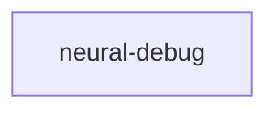

# neural-debug

crate: neural-debug
path: crates/neural-debug
workspace: member
digest: aff1b0439f67c98c
evidence legend: ../index.md#evidence-legend

Generated; the code is the truth. See ../index.md.

## Depends on

- dep regex normal — crates/neural-debug/Cargo.toml:16 CONFIRMED
- dep serde normal — crates/neural-debug/Cargo.toml:13 CONFIRMED
- dep serde_json normal — crates/neural-debug/Cargo.toml:14 CONFIRMED
- dep walkdir normal — crates/neural-debug/Cargo.toml:15 CONFIRMED

## Depended on by

- rdep jc dev — crates/jc/Cargo.toml:39 CONFIRMED

## Public items

- enum NeuronState [pub] — crates/neural-debug/src/diagnosis.rs:6 CONFIRMED
- fn NeuronState::emoji [pub] — crates/neural-debug/src/diagnosis.rs:22 CONFIRMED
- fn NeuronState::is_operational [pub] — crates/neural-debug/src/diagnosis.rs:33 CONFIRMED
- struct FunctionMeta [pub] — crates/neural-debug/src/diagnosis.rs:40 CONFIRMED
- struct ModuleDiagnosis [pub] — crates/neural-debug/src/diagnosis.rs:71 CONFIRMED
- struct RepoDiagnosis [pub] — crates/neural-debug/src/diagnosis.rs:86 CONFIRMED
- struct StackDiagnosis [pub] — crates/neural-debug/src/diagnosis.rs:98 CONFIRMED
- mod diagnosis [pub] — crates/neural-debug/src/lib.rs:9 CONFIRMED
- mod registry [pub] — crates/neural-debug/src/lib.rs:10 CONFIRMED
- mod scanner [pub] — crates/neural-debug/src/lib.rs:11 CONFIRMED
- struct CallCounter [pub] — crates/neural-debug/src/registry.rs:10 CONFIRMED
- fn CallCounter::new [pub] — crates/neural-debug/src/registry.rs:23 CONFIRMED
- fn CallCounter::record [pub] — crates/neural-debug/src/registry.rs:31 CONFIRMED
- fn CallCounter::record_nan [pub] — crates/neural-debug/src/registry.rs:36 CONFIRMED
- fn CallCounter::snapshot [pub] — crates/neural-debug/src/registry.rs:40 CONFIRMED
- struct CounterSnapshot [pub] — crates/neural-debug/src/registry.rs:50 CONFIRMED
- fn CounterSnapshot::avg_ns [pub] — crates/neural-debug/src/registry.rs:57 CONFIRMED
- struct RowStateMap [pub] — crates/neural-debug/src/registry.rs:69 CONFIRMED
- fn RowStateMap::new [pub] — crates/neural-debug/src/registry.rs:74 CONFIRMED
- fn RowStateMap::record [pub] — crates/neural-debug/src/registry.rs:80 CONFIRMED
- fn RowStateMap::snapshot [pub] — crates/neural-debug/src/registry.rs:85 CONFIRMED
- fn RowStateMap::reset [pub] — crates/neural-debug/src/registry.rs:89 CONFIRMED
- fn RowStateMap::diag [pub] — crates/neural-debug/src/registry.rs:94 CONFIRMED
- struct RuntimeDiag [pub] — crates/neural-debug/src/registry.rs:142 CONFIRMED
- struct RuntimeRegistry [pub] — crates/neural-debug/src/registry.rs:159 CONFIRMED
- fn RuntimeRegistry::new [pub] — crates/neural-debug/src/registry.rs:171 CONFIRMED
- fn RuntimeRegistry::record [pub] — crates/neural-debug/src/registry.rs:178 CONFIRMED
- fn RuntimeRegistry::record_row [pub] — crates/neural-debug/src/registry.rs:197 CONFIRMED
- fn RuntimeRegistry::snapshot [pub] — crates/neural-debug/src/registry.rs:201 CONFIRMED
- fn RuntimeRegistry::snapshot_rows [pub] — crates/neural-debug/src/registry.rs:206 CONFIRMED
- fn RuntimeRegistry::diag [pub] — crates/neural-debug/src/registry.rs:211 CONFIRMED
- fn RuntimeRegistry::reset [pub] — crates/neural-debug/src/registry.rs:215 CONFIRMED
- fn registry [pub] — crates/neural-debug/src/registry.rs:230 CONFIRMED
- struct ProbeResult [pub] — crates/neural-debug/src/registry.rs:236 CONFIRMED
- struct StrategyDiagnosis [pub] — crates/neural-debug/src/registry.rs:246 CONFIRMED
- enum Verdict [pub] — crates/neural-debug/src/registry.rs:261 CONFIRMED
- fn Verdict::emoji [pub] — crates/neural-debug/src/registry.rs:270 CONFIRMED
- struct PipelineCheckResult [pub] — crates/neural-debug/src/registry.rs:283 CONFIRMED
- struct PipelineStageResult [pub] — crates/neural-debug/src/registry.rs:291 CONFIRMED
- struct StrategyHealthMatrix [pub] — crates/neural-debug/src/registry.rs:301 CONFIRMED
- struct ImpactFix [pub] — crates/neural-debug/src/registry.rs:316 CONFIRMED
- struct ScanConfig [pub] — crates/neural-debug/src/scanner.rs:17 CONFIRMED
- fn scan_stack [pub] — crates/neural-debug/src/scanner.rs:38 CONFIRMED
- struct LegacyInferenceHit [pub] — crates/neural-debug/src/scanner.rs:347 CONFIRMED
- fn scan_legacy_inference [pub] — crates/neural-debug/src/scanner.rs:368 CONFIRMED
- fn find_legacy_inference_in_source [pub] — crates/neural-debug/src/scanner.rs:399 CONFIRMED

## Imports from in-scope crates

- none

## Calls

CALL_GRAPH=ARTIFACT_MISSING
- calls ARTIFACT_MISSING — no ruff_charon artifact for this crate UNKNOWN

## Architecture

- none

Generated from Cargo manifests — extracted relationships only.

