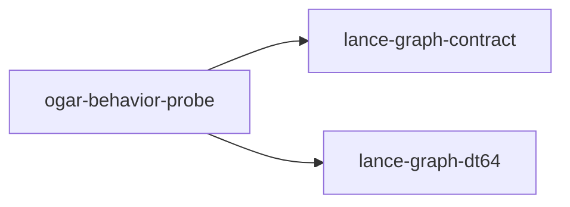

# ogar-behavior-probe

crate: ogar-behavior-probe
path: crates/ogar-behavior-probe
workspace: excluded
digest: 5639497d40da38ef
evidence legend: ../index.md#evidence-legend

Generated; the code is the truth. See ../index.md.

## Depends on

- dep lance-graph-contract normal — crates/ogar-behavior-probe/Cargo.toml:22 CONFIRMED
- dep lance-graph-dt64 normal — crates/ogar-behavior-probe/Cargo.toml:21 CONFIRMED
- dep ogar-from-ruff normal — crates/ogar-behavior-probe/Cargo.toml:20 CONFIRMED
- dep ogar-loco normal — crates/ogar-behavior-probe/Cargo.toml:19 CONFIRMED
- dep ogar-vocab normal — crates/ogar-behavior-probe/Cargo.toml:18 CONFIRMED
- dep ruff_python_spo normal — crates/ogar-behavior-probe/Cargo.toml:25 CONFIRMED

## Depended on by

## Public items

- enum Coverage [pub] — crates/ogar-behavior-probe/src/census.rs:14 CONFIRMED
- struct Carries [pub] — crates/ogar-behavior-probe/src/census.rs:29 CONFIRMED
- fn carries [pub] — crates/ogar-behavior-probe/src/census.rs:39 CONFIRMED
- fn classify [pub] — crates/ogar-behavior-probe/src/census.rs:52 CONFIRMED
- struct Tally [pub] — crates/ogar-behavior-probe/src/census.rs:59 CONFIRMED
- fn tally [pub] — crates/ogar-behavior-probe/src/census.rs:69 CONFIRMED
- mod census [pub] — crates/ogar-behavior-probe/src/lib.rs:13 CONFIRMED
- mod projection [pub] — crates/ogar-behavior-probe/src/lib.rs:14 CONFIRMED
- mod revision [pub] — crates/ogar-behavior-probe/src/lib.rs:15 CONFIRMED
- enum Grade [pub] — crates/ogar-behavior-probe/src/projection.rs:30 CONFIRMED
- enum Field [pub] — crates/ogar-behavior-probe/src/projection.rs:40 CONFIRMED
- const FIELDS [pub] — crates/ogar-behavior-probe/src/projection.rs:56 CONFIRMED
- struct Graded [pub] — crates/ogar-behavior-probe/src/projection.rs:74 CONFIRMED
- struct Basis [pub] — crates/ogar-behavior-probe/src/projection.rs:81 CONFIRMED
- fn Basis::new [pub] — crates/ogar-behavior-probe/src/projection.rs:86 CONFIRMED
- fn Basis::position [pub] — crates/ogar-behavior-probe/src/projection.rs:90 CONFIRMED
- fn Basis::len [pub] — crates/ogar-behavior-probe/src/projection.rs:97 CONFIRMED
- fn Basis::is_empty [pub] — crates/ogar-behavior-probe/src/projection.rs:101 CONFIRMED
- struct Projection [pub] — crates/ogar-behavior-probe/src/projection.rs:108 CONFIRMED
- fn Projection::grade [pub] — crates/ogar-behavior-probe/src/projection.rs:120 CONFIRMED
- fn Projection::blockers [pub] — crates/ogar-behavior-probe/src/projection.rs:130 CONFIRMED
- fn project [pub] — crates/ogar-behavior-probe/src/projection.rs:264 CONFIRMED
- struct VocabTag [pub] — crates/ogar-behavior-probe/src/revision.rs:57 CONFIRMED
- enum RevError [pub] — crates/ogar-behavior-probe/src/revision.rs:64 CONFIRMED
- fn raw_body_rev [pub] — crates/ogar-behavior-probe/src/revision.rs:82 CONFIRMED
- fn body_rev [pub] — crates/ogar-behavior-probe/src/revision.rs:97 CONFIRMED
- fn envelope_rev [pub] — crates/ogar-behavior-probe/src/revision.rs:151 CONFIRMED
- fn is_reference [pub] — crates/ogar-behavior-probe/src/revision.rs:170 CONFIRMED

## Imports from in-scope crates

### lance-graph-contract
- use lance_graph_contract::class_view::WideFieldMask — crates/ogar-behavior-probe/src/projection.rs:25 CONFIRMED

## Calls

CALL_GRAPH=ARTIFACT_MISSING
- calls ARTIFACT_MISSING — no ruff_charon artifact for this crate UNKNOWN

## Architecture

- none

Generated from Cargo manifests — extracted relationships only.

