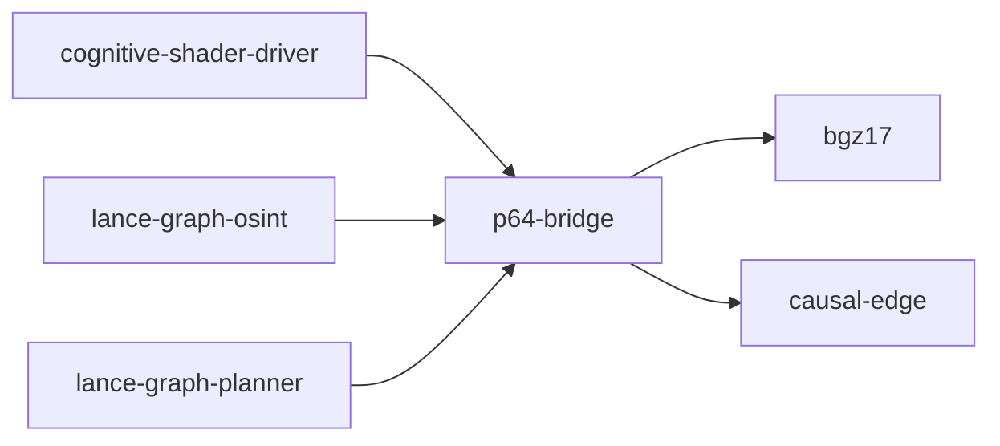

# p64-bridge

crate: p64-bridge
path: crates/p64-bridge
workspace: excluded
digest: 213994c027c71741
evidence legend: ../index.md#evidence-legend

Generated; the code is the truth. See ../index.md.

## Depends on

- dep bgz17 normal — crates/p64-bridge/Cargo.toml:11 CONFIRMED
- dep causal-edge normal — crates/p64-bridge/Cargo.toml:10 CONFIRMED

## Depended on by

- rdep cognitive-shader-driver normal — crates/cognitive-shader-driver/Cargo.toml:235 CONFIRMED
- rdep lance-graph-osint normal — crates/lance-graph-osint/Cargo.toml:16 CONFIRMED
- rdep lance-graph-planner normal — crates/lance-graph-planner/Cargo.toml:33 CONFIRMED

## Public items

- fn edge_to_block [pub] — crates/p64-bridge/src/lib.rs:30 CONFIRMED
- fn edge_nars_f32 [pub] — crates/p64-bridge/src/lib.rs:38 CONFIRMED
- fn edge_to_layer_mask [pub] — crates/p64-bridge/src/lib.rs:61 CONFIRMED
- fn edges_to_palette_rows [pub] — crates/p64-bridge/src/lib.rs:93 CONFIRMED
- fn edges_to_layered_rows [pub] — crates/p64-bridge/src/lib.rs:105 CONFIRMED
- const CAUSES [pub] — crates/p64-bridge/src/lib.rs:121 CONFIRMED
- const ENABLES [pub] — crates/p64-bridge/src/lib.rs:122 CONFIRMED
- const SUPPORTS [pub] — crates/p64-bridge/src/lib.rs:123 CONFIRMED
- const CONTRADICTS [pub] — crates/p64-bridge/src/lib.rs:124 CONFIRMED
- const REFINES [pub] — crates/p64-bridge/src/lib.rs:125 CONFIRMED
- const ABSTRACTS [pub] — crates/p64-bridge/src/lib.rs:126 CONFIRMED
- const GROUNDS [pub] — crates/p64-bridge/src/lib.rs:127 CONFIRMED
- const BECOMES [pub] — crates/p64-bridge/src/lib.rs:128 CONFIRMED
- struct StyleParams [pub] — crates/p64-bridge/src/lib.rs:137 CONFIRMED
- mod combine [pub] — crates/p64-bridge/src/lib.rs:146 CONFIRMED
- const UNION [pub] — crates/p64-bridge/src/lib.rs:147 CONFIRMED
- const INTERSECTION [pub] — crates/p64-bridge/src/lib.rs:148 CONFIRMED
- const MAJORITY [pub] — crates/p64-bridge/src/lib.rs:149 CONFIRMED
- const WEIGHTED [pub] — crates/p64-bridge/src/lib.rs:150 CONFIRMED
- mod contra [pub] — crates/p64-bridge/src/lib.rs:154 CONFIRMED
- const SUPPRESS [pub] — crates/p64-bridge/src/lib.rs:155 CONFIRMED
- const IGNORE [pub] — crates/p64-bridge/src/lib.rs:156 CONFIRMED
- const INVERT [pub] — crates/p64-bridge/src/lib.rs:157 CONFIRMED
- const TENSION [pub] — crates/p64-bridge/src/lib.rs:158 CONFIRMED
- fn style_by_ordinal [pub] — crates/p64-bridge/src/lib.rs:268 CONFIRMED
- fn style_by_name [pub] — crates/p64-bridge/src/lib.rs:274 CONFIRMED
- fn all_styles [pub] — crates/p64-bridge/src/lib.rs:284 CONFIRMED
- fn semiring_to_modes [pub] — crates/p64-bridge/src/lib.rs:301 CONFIRMED
- mod cognitive_shader [pub] — crates/p64-bridge/src/lib.rs:326 CONFIRMED
- struct CognitiveShader [pub] — crates/p64-bridge/src/lib.rs:343 CONFIRMED
- struct CascadeHit [pub] — crates/p64-bridge/src/lib.rs:354 CONFIRMED
- fn CognitiveShader<'a>::new [pub] — crates/p64-bridge/src/lib.rs:365 CONFIRMED
- fn CognitiveShader<'a>::cascade [pub] — crates/p64-bridge/src/lib.rs:383 CONFIRMED
- fn CognitiveShader<'a>::deduce_path [pub] — crates/p64-bridge/src/lib.rs:441 CONFIRMED
- fn CognitiveShader<'a>::layer_densities [pub] — crates/p64-bridge/src/lib.rs:503 CONFIRMED
- fn CognitiveShader<'a>::topology_bytes [pub] — crates/p64-bridge/src/lib.rs:513 CONFIRMED
- fn CognitiveShader<'a>::metric_bytes [pub] — crates/p64-bridge/src/lib.rs:517 CONFIRMED
- fn CognitiveShader<'a>::total_bytes [pub] — crates/p64-bridge/src/lib.rs:521 CONFIRMED

## Imports from in-scope crates

### bgz17
- use bgz17::distance_matrix::DistanceMatrix — crates/p64-bridge/src/lib.rs:330 CONFIRMED
- use bgz17::palette::Palette — crates/p64-bridge/src/lib.rs:332 CONFIRMED
- use bgz17::palette_semiring::PaletteSemiring — crates/p64-bridge/src/lib.rs:333 CONFIRMED
### causal-edge
- use causal_edge::edge::CausalEdge64 — crates/p64-bridge/src/lib.rs:19 CONFIRMED
- use causal_edge::edge::CausalEdge64 cfg=test — crates/p64-bridge/src/lib.rs:534 CONFIRMED
- use causal_edge::edge::InferenceType cfg=test — crates/p64-bridge/src/lib.rs:534 CONFIRMED
- use causal_edge::pearl::CausalMask cfg=test — crates/p64-bridge/src/lib.rs:535 CONFIRMED
- use causal_edge::plasticity::PlasticityState cfg=test — crates/p64-bridge/src/lib.rs:536 CONFIRMED

## Calls

CALL_GRAPH=ARTIFACT_MISSING
- calls ARTIFACT_MISSING — no ruff_charon artifact for this crate UNKNOWN

## Architecture

- none

Generated from Cargo manifests — extracted relationships only.

