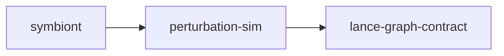

# perturbation-sim

crate: perturbation-sim
path: crates/perturbation-sim
workspace: excluded
digest: b98b8bb21938438d
evidence legend: ../index.md#evidence-legend

Generated; the code is the truth. See ../index.md.

## Depends on

- dep lance-graph-contract normal optional — crates/perturbation-sim/Cargo.toml:30 CONFIRMED
- dep ndarray normal optional — crates/perturbation-sim/Cargo.toml:37 CONFIRMED

## Depended on by

- rdep symbiont normal — crates/symbiont/Cargo.toml:38 CONFIRMED

## Public items

- enum BusKind [pub] — crates/perturbation-sim/src/acflow.rs:43 CONFIRMED
- struct AcBus [pub] — crates/perturbation-sim/src/acflow.rs:54 CONFIRMED
- struct AcLine [pub] — crates/perturbation-sim/src/acflow.rs:65 CONFIRMED
- struct AcSystem [pub] — crates/perturbation-sim/src/acflow.rs:75 CONFIRMED
- struct PowerFlowResult [pub] — crates/perturbation-sim/src/acflow.rs:82 CONFIRMED
- fn AcSystem::new [pub] — crates/perturbation-sim/src/acflow.rs:94 CONFIRMED
- fn AcSystem::ybus [pub] — crates/perturbation-sim/src/acflow.rs:104 CONFIRMED
- fn AcSystem::solve [pub] — crates/perturbation-sim/src/acflow.rs:140 CONFIRMED
- fn AcSystem::collapse_margin [pub] — crates/perturbation-sim/src/acflow.rs:248 CONFIRMED
- const SYMMETRY_TOL [pub] cfg=feature="pillar" — crates/perturbation-sim/src/angle_cov.rs:49 CONFIRMED
- fn angle_covariance [pub] cfg=feature="pillar" — crates/perturbation-sim/src/angle_cov.rs:64 CONFIRMED
- struct KronReduced [pub] — crates/perturbation-sim/src/basin.rs:38 CONFIRMED
- fn KronReduced::pos [pub] — crates/perturbation-sim/src/basin.rs:49 CONFIRMED
- fn kron_reduce [pub] — crates/perturbation-sim/src/basin.rs:58 CONFIRMED
- fn laplacian_pinv [pub] — crates/perturbation-sim/src/basin.rs:91 CONFIRMED
- fn effective_resistance [pub] — crates/perturbation-sim/src/basin.rs:96 CONFIRMED
- fn spectral_embedding [pub] — crates/perturbation-sim/src/basin.rs:103 CONFIRMED
- fn basin_lambda2 [pub] — crates/perturbation-sim/src/basin.rs:115 CONFIRMED
- struct Cheeger [pub] — crates/perturbation-sim/src/basin.rs:149 CONFIRMED
- fn cheeger_sweep [pub] — crates/perturbation-sim/src/basin.rs:163 CONFIRMED
- enum Regime [pub] — crates/perturbation-sim/src/basin.rs:253 CONFIRMED
- struct GoScore [pub] — crates/perturbation-sim/src/basin.rs:266 CONFIRMED
- fn infight_vs_raumgewinn [pub] — crates/perturbation-sim/src/basin.rs:275 CONFIRMED
- struct ContingencyFeatures [pub] — crates/perturbation-sim/src/basin.rs:305 CONFIRMED
- fn ContingencyFeatures::as_row [pub] — crates/perturbation-sim/src/basin.rs:320 CONFIRMED
- fn contingency_features [pub] — crates/perturbation-sim/src/basin.rs:332 CONFIRMED
- fn impulse_buffer [pub] — crates/perturbation-sim/src/buffer.rs:35 CONFIRMED
- struct Yield [pub] — crates/perturbation-sim/src/buffer.rs:44 CONFIRMED
- fn ketchup_yield [pub] — crates/perturbation-sim/src/buffer.rs:57 CONFIRMED
- fn compartment_buffer [pub] — crates/perturbation-sim/src/buffer.rs:73 CONFIRMED
- fn inertia_buffer_column [pub] — crates/perturbation-sim/src/buffer.rs:85 CONFIRMED
- struct CascadeConfig [pub] — crates/perturbation-sim/src/cascade.rs:13 CONFIRMED
- struct PerturbationShape [pub] — crates/perturbation-sim/src/cascade.rs:34 CONFIRMED
- fn PerturbationShape::n_tripped [pub] — crates/perturbation-sim/src/cascade.rs:52 CONFIRMED
- fn PerturbationShape::epicentre [pub] — crates/perturbation-sim/src/cascade.rs:58 CONFIRMED
- struct CascadeResult [pub] — crates/perturbation-sim/src/cascade.rs:68 CONFIRMED
- fn simulate_outage [pub] — crates/perturbation-sim/src/cascade.rs:89 CONFIRMED
- struct CascadeKey [pub] — crates/perturbation-sim/src/cascade_key.rs:52 CONFIRMED
- fn CascadeKey::from_spectral [pub] — crates/perturbation-sim/src/cascade_key.rs:81 CONFIRMED
- fn CascadeKey::to_guid_tiers [pub] — crates/perturbation-sim/src/cascade_key.rs:103 CONFIRMED
- fn CascadeKey::morton48 [pub] — crates/perturbation-sim/src/cascade_key.rs:111 CONFIRMED
- fn CascadeKey::shared_prefix_tiers [pub] — crates/perturbation-sim/src/cascade_key.rs:118 CONFIRMED
- fn CascadeKey::cascade_distance [pub] — crates/perturbation-sim/src/cascade_key.rs:134 CONFIRMED
- fn CascadeKey::tile [pub] — crates/perturbation-sim/src/cascade_key.rs:141 CONFIRMED
- fn cascade_keys [pub] — crates/perturbation-sim/src/cascade_key.rs:169 CONFIRMED
- struct IsaPath [pub] — crates/perturbation-sim/src/cascade_key.rs:203 CONFIRMED
- struct CascadeKeyV3 [pub] — crates/perturbation-sim/src/cascade_key.rs:226 CONFIRMED
- fn CascadeKeyV3::new [pub] — crates/perturbation-sim/src/cascade_key.rs:245 CONFIRMED
- fn CascadeKeyV3::place_chain [pub] — crates/perturbation-sim/src/cascade_key.rs:255 CONFIRMED
- fn CascadeKeyV3::tissue_chain [pub] — crates/perturbation-sim/src/cascade_key.rs:265 CONFIRMED
- fn CascadeKeyV3::to_guid_tiers [pub] — crates/perturbation-sim/src/cascade_key.rs:273 CONFIRMED
- fn CascadeKeyV3::part_of_distance [pub] — crates/perturbation-sim/src/cascade_key.rs:289 CONFIRMED
- fn CascadeKeyV3::is_a_distance [pub] — crates/perturbation-sim/src/cascade_key.rs:296 CONFIRMED
- fn cascade_keys_v3 [pub] — crates/perturbation-sim/src/cascade_key.rs:306 CONFIRMED
- const CHAODA_FLAG [pub] — crates/perturbation-sim/src/chaoda.rs:34 CONFIRMED
- fn cakes_neighbors [pub] — crates/perturbation-sim/src/chaoda.rs:49 CONFIRMED
- fn chaoda_scores [pub] — crates/perturbation-sim/src/chaoda.rs:72 CONFIRMED
- fn anomaly_ranking [pub] — crates/perturbation-sim/src/chaoda.rs:97 CONFIRMED
- fn resilience_basin_features [pub] — crates/perturbation-sim/src/chaoda.rs:113 CONFIRMED
- enum Encoding [pub] — crates/perturbation-sim/src/columns.rs:45 CONFIRMED
- struct SoaMemberSpec [pub] — crates/perturbation-sim/src/columns.rs:59 CONFIRMED
- const CONTINGENCY_FACTORS [pub] — crates/perturbation-sim/src/columns.rs:83 CONFIRMED
- const INERTIA [pub] — crates/perturbation-sim/src/columns.rs:95 CONFIRMED
- enum GuardrailVerdict [pub] — crates/perturbation-sim/src/columns.rs:111 CONFIRMED
- const INERTIA_SLOT [pub] — crates/perturbation-sim/src/columns.rs:123 CONFIRMED
- struct InertiaPromotion [pub] — crates/perturbation-sim/src/columns.rs:137 CONFIRMED
- const INERTIA_PROMOTION [pub] — crates/perturbation-sim/src/columns.rs:149 CONFIRMED
- fn study_slot_assignments [pub] — crates/perturbation-sim/src/columns.rs:159 CONFIRMED
- fn study_member_specs [pub] — crates/perturbation-sim/src/columns.rs:182 CONFIRMED
- struct Eigen [pub] — crates/perturbation-sim/src/eigen.rs:13 CONFIRMED
- fn Eigen::eigenvector [pub] — crates/perturbation-sim/src/eigen.rs:21 CONFIRMED
- fn Eigen::nullity [pub] — crates/perturbation-sim/src/eigen.rs:27 CONFIRMED
- fn Eigen::pseudo_apply [pub] — crates/perturbation-sim/src/eigen.rs:39 CONFIRMED
- fn Eigen::pseudo_inverse [pub] — crates/perturbation-sim/src/eigen.rs:64 CONFIRMED
- fn symmetric_eigen [pub] — crates/perturbation-sim/src/eigen.rs:93 CONFIRMED
- fn dc_flows [pub] — crates/perturbation-sim/src/flow.rs:11 CONFIRMED
- fn lodf [pub] — crates/perturbation-sim/src/flow.rs:41 CONFIRMED
- struct Edge [pub] — crates/perturbation-sim/src/graph.rs:10 CONFIRMED
- fn Edge::new [pub] — crates/perturbation-sim/src/graph.rs:18 CONFIRMED
- struct Grid [pub] — crates/perturbation-sim/src/graph.rs:30 CONFIRMED
- fn Grid::new [pub] — crates/perturbation-sim/src/graph.rs:36 CONFIRMED
- fn Grid::laplacian_of [pub] — crates/perturbation-sim/src/graph.rs:47 CONFIRMED
- fn Grid::laplacian [pub] — crates/perturbation-sim/src/graph.rs:65 CONFIRMED
- struct HhtlKey [pub] — crates/perturbation-sim/src/hhtl.rs:24 CONFIRMED
- fn hhtl_keys [pub] — crates/perturbation-sim/src/hhtl.rs:75 CONFIRMED
- fn basin_lambda2 [pub] — crates/perturbation-sim/src/hhtl.rs:108 CONFIRMED
- struct InertiaProvenance [pub] — crates/perturbation-sim/src/inertia_data.rs:23 CONFIRMED
- fn parse_bus_inertia [pub] — crates/perturbation-sim/src/inertia_data.rs:35 CONFIRMED
- fn inertia_for_buses [pub] — crates/perturbation-sim/src/inertia_data.rs:80 CONFIRMED
- fn proxy_inertia [pub] — crates/perturbation-sim/src/inertia_data.rs:109 CONFIRMED
- const X_PER_KM [pub] — crates/perturbation-sim/src/ingest.rs:30 CONFIRMED
- struct PypsaImport [pub] — crates/perturbation-sim/src/ingest.rs:34 CONFIRMED
- fn PypsaImport::largest_component [pub] — crates/perturbation-sim/src/ingest.rs:58 CONFIRMED
- fn estimate_snom_mva [pub] — crates/perturbation-sim/src/ingest.rs:127 CONFIRMED
- fn from_pypsa_csv [pub] — crates/perturbation-sim/src/ingest.rs:145 CONFIRMED
- mod acflow [pub] — crates/perturbation-sim/src/lib.rs:55 CONFIRMED
- mod angle_cov [pub] cfg=feature="pillar" — crates/perturbation-sim/src/lib.rs:57 CONFIRMED
- mod basin [pub] — crates/perturbation-sim/src/lib.rs:58 CONFIRMED
- mod buffer [pub] — crates/perturbation-sim/src/lib.rs:59 CONFIRMED
- mod cascade [pub] — crates/perturbation-sim/src/lib.rs:60 CONFIRMED
- mod cascade_key [pub] — crates/perturbation-sim/src/lib.rs:61 CONFIRMED
- mod chaoda [pub] — crates/perturbation-sim/src/lib.rs:62 CONFIRMED
- mod columns [pub] — crates/perturbation-sim/src/lib.rs:63 CONFIRMED
- mod eigen [pub] — crates/perturbation-sim/src/lib.rs:64 CONFIRMED
- mod flow [pub] — crates/perturbation-sim/src/lib.rs:65 CONFIRMED
- mod graph [pub] — crates/perturbation-sim/src/lib.rs:66 CONFIRMED
- mod hhtl [pub] — crates/perturbation-sim/src/lib.rs:67 CONFIRMED
- mod inertia_data [pub] — crates/perturbation-sim/src/lib.rs:68 CONFIRMED
- mod ingest [pub] — crates/perturbation-sim/src/lib.rs:69 CONFIRMED
- mod model [pub] — crates/perturbation-sim/src/lib.rs:70 CONFIRMED
- mod outage_oracle [pub] — crates/perturbation-sim/src/lib.rs:71 CONFIRMED
- mod perturbation [pub] — crates/perturbation-sim/src/lib.rs:72 CONFIRMED
- mod place_buffer [pub] — crates/perturbation-sim/src/lib.rs:73 CONFIRMED
- mod resilience [pub] — crates/perturbation-sim/src/lib.rs:74 CONFIRMED
- mod rolling_floor [pub] — crates/perturbation-sim/src/lib.rs:75 CONFIRMED
- mod sketch [pub] — crates/perturbation-sim/src/lib.rs:76 CONFIRMED
- mod splat [pub] — crates/perturbation-sim/src/lib.rs:77 CONFIRMED
- mod stats [pub] — crates/perturbation-sim/src/lib.rs:78 CONFIRMED
- mod timing [pub] — crates/perturbation-sim/src/lib.rs:79 CONFIRMED
- mod witness [pub] — crates/perturbation-sim/src/lib.rs:80 CONFIRMED
- enum DataLevel [pub] — crates/perturbation-sim/src/model.rs:36 CONFIRMED
- struct Capability [pub] — crates/perturbation-sim/src/model.rs:52 CONFIRMED
- fn assess_capability [pub] — crates/perturbation-sim/src/model.rs:68 CONFIRMED
- fn scale_susceptance [pub] — crates/perturbation-sim/src/model.rs:114 CONFIRMED
- fn with_uniform_derate [pub] — crates/perturbation-sim/src/model.rs:127 CONFIRMED
- enum AgeModel [pub] — crates/perturbation-sim/src/model.rs:142 CONFIRMED
- fn edge_age_factors [pub] — crates/perturbation-sim/src/model.rs:159 CONFIRMED
- fn apply_aging [pub] — crates/perturbation-sim/src/model.rs:206 CONFIRMED
- enum Observed [pub] — crates/perturbation-sim/src/outage_oracle.rs:10 CONFIRMED
- fn Observed::and [pub] — crates/perturbation-sim/src/outage_oracle.rs:18 CONFIRMED
- fn Observed::or [pub] — crates/perturbation-sim/src/outage_oracle.rs:27 CONFIRMED
- fn Observed::not [pub] — crates/perturbation-sim/src/outage_oracle.rs:35 CONFIRMED
- struct SiteFrame [pub] — crates/perturbation-sim/src/outage_oracle.rs:50 CONFIRMED
- enum Mechanism [pub] — crates/perturbation-sim/src/outage_oracle.rs:61 CONFIRMED
- enum OracleCheck [pub] — crates/perturbation-sim/src/outage_oracle.rs:71 CONFIRMED
- struct SiteAssessment [pub] — crates/perturbation-sim/src/outage_oracle.rs:78 CONFIRMED
- fn assess_site [pub] — crates/perturbation-sim/src/outage_oracle.rs:98 CONFIRMED
- struct SiteFocus [pub] — crates/perturbation-sim/src/outage_oracle.rs:129 CONFIRMED
- struct BoundObservation [pub] — crates/perturbation-sim/src/outage_oracle.rs:136 CONFIRMED
- struct BoundSiteFrame [pub] — crates/perturbation-sim/src/outage_oracle.rs:143 CONFIRMED
- struct SourcePins [pub] — crates/perturbation-sim/src/outage_oracle.rs:153 CONFIRMED
- enum Refusal [pub] — crates/perturbation-sim/src/outage_oracle.rs:161 CONFIRMED
- fn assess_bound [pub] — crates/perturbation-sim/src/outage_oracle.rs:170 CONFIRMED
- const SPECTRAL_GAP_FLOOR [pub] — crates/perturbation-sim/src/perturbation.rs:44 CONFIRMED
- const FRAGMENTATION_SENTINEL [pub] — crates/perturbation-sim/src/perturbation.rs:60 CONFIRMED
- struct SpectralPerturbation [pub] — crates/perturbation-sim/src/perturbation.rs:64 CONFIRMED
- fn SpectralPerturbation::connectivity_loss [pub] — crates/perturbation-sim/src/perturbation.rs:95 CONFIRMED
- fn spectral_perturbation [pub] — crates/perturbation-sim/src/perturbation.rs:106 CONFIRMED
- const GOLDEN_ANGLE [pub] — crates/perturbation-sim/src/place_buffer.rs:41 CONFIRMED
- fn helix_place [pub] — crates/perturbation-sim/src/place_buffer.rs:49 CONFIRMED
- fn f32_to_bf16 [pub] — crates/perturbation-sim/src/place_buffer.rs:64 CONFIRMED
- fn bf16_to_f32 [pub] — crates/perturbation-sim/src/place_buffer.rs:71 CONFIRMED
- struct BufferResidue [pub] — crates/perturbation-sim/src/place_buffer.rs:82 CONFIRMED
- fn BufferResidue::mean_permeability [pub] — crates/perturbation-sim/src/place_buffer.rs:91 CONFIRMED
- fn buffer_residue [pub] — crates/perturbation-sim/src/place_buffer.rs:110 CONFIRMED
- fn algebraic_connectivity [pub] — crates/perturbation-sim/src/resilience.rs:30 CONFIRMED
- fn kirchhoff_index [pub] — crates/perturbation-sim/src/resilience.rs:39 CONFIRMED
- struct Resilience [pub] — crates/perturbation-sim/src/resilience.rs:64 CONFIRMED
- fn Resilience::from_eigenvalues [pub] — crates/perturbation-sim/src/resilience.rs:77 CONFIRMED
- fn Resilience::mean_resistance [pub] — crates/perturbation-sim/src/resilience.rs:88 CONFIRMED
- enum FloorBand [pub] — crates/perturbation-sim/src/rolling_floor.rs:33 CONFIRMED
- fn weyl_over_fiedler [pub] — crates/perturbation-sim/src/rolling_floor.rs:52 CONFIRMED
- struct RollingFloor [pub] — crates/perturbation-sim/src/rolling_floor.rs:72 CONFIRMED
- fn RollingFloor::new [pub] — crates/perturbation-sim/src/rolling_floor.rs:82 CONFIRMED
- fn RollingFloor::preheat [pub] — crates/perturbation-sim/src/rolling_floor.rs:93 CONFIRMED
- fn RollingFloor::observe [pub] — crates/perturbation-sim/src/rolling_floor.rs:108 CONFIRMED
- fn RollingFloor::threshold [pub] — crates/perturbation-sim/src/rolling_floor.rs:125 CONFIRMED
- fn RollingFloor::z [pub] — crates/perturbation-sim/src/rolling_floor.rs:131 CONFIRMED
- fn RollingFloor::band [pub] — crates/perturbation-sim/src/rolling_floor.rs:140 CONFIRMED
- fn RollingFloor::mu [pub] — crates/perturbation-sim/src/rolling_floor.rs:164 CONFIRMED
- fn RollingFloor::sigma [pub] — crates/perturbation-sim/src/rolling_floor.rs:167 CONFIRMED
- fn RollingFloor::observations [pub] — crates/perturbation-sim/src/rolling_floor.rs:170 CONFIRMED
- struct StackResult [pub] — crates/perturbation-sim/src/rolling_floor.rs:177 CONFIRMED
- struct TierFloors [pub] — crates/perturbation-sim/src/rolling_floor.rs:192 CONFIRMED
- fn TierFloors::new [pub] — crates/perturbation-sim/src/rolling_floor.rs:199 CONFIRMED
- fn TierFloors::preheat [pub] — crates/perturbation-sim/src/rolling_floor.rs:208 CONFIRMED
- fn TierFloors::stack_early_exit [pub] — crates/perturbation-sim/src/rolling_floor.rs:224 CONFIRMED
- struct ResistanceSketch [pub] — crates/perturbation-sim/src/sketch.rs:46 CONFIRMED
- fn ResistanceSketch::resistance [pub] — crates/perturbation-sim/src/sketch.rs:54 CONFIRMED
- fn resistance_sketch [pub] — crates/perturbation-sim/src/sketch.rs:67 CONFIRMED
- fn fwht [pub] — crates/perturbation-sim/src/sketch.rs:116 CONFIRMED
- struct WalshEnergy [pub] — crates/perturbation-sim/src/sketch.rs:135 CONFIRMED
- fn walsh_pyramid_energy [pub] — crates/perturbation-sim/src/sketch.rs:146 CONFIRMED
- struct Splat [pub] — crates/perturbation-sim/src/splat.rs:27 CONFIRMED
- fn splat_neighborhood [pub] — crates/perturbation-sim/src/splat.rs:38 CONFIRMED
- fn morton2 [pub] — crates/perturbation-sim/src/splat.rs:83 CONFIRMED
- fn box_coarsen [pub] — crates/perturbation-sim/src/splat.rs:97 CONFIRMED
- fn ewa_coarsen [pub] — crates/perturbation-sim/src/splat.rs:111 CONFIRMED
- fn pearson [pub] — crates/perturbation-sim/src/stats.rs:11 CONFIRMED
- fn spearman [pub] — crates/perturbation-sim/src/stats.rs:32 CONFIRMED
- fn cronbach_alpha [pub] — crates/perturbation-sim/src/stats.rs:41 CONFIRMED
- fn icc_a1 [pub] — crates/perturbation-sim/src/stats.rs:61 CONFIRMED
- fn zscore [pub] — crates/perturbation-sim/src/stats.rs:97 CONFIRMED
- const F0_HZ [pub] — crates/perturbation-sim/src/timing.rs:25 CONFIRMED
- fn rocof_hz_per_s [pub] — crates/perturbation-sim/src/timing.rs:30 CONFIRMED
- fn per_hop_time [pub] — crates/perturbation-sim/src/timing.rs:40 CONFIRMED
- fn cascade_wall_time [pub] — crates/perturbation-sim/src/timing.rs:46 CONFIRMED
- fn implied_dt_per_hop [pub] — crates/perturbation-sim/src/timing.rs:51 CONFIRMED
- fn mechanism_from_timescale [pub] — crates/perturbation-sim/src/timing.rs:59 CONFIRMED
- const HHTL_WEIGHTS [pub] — crates/perturbation-sim/src/timing.rs:74 CONFIRMED
- truncated (210 total), see symbols.tsv

## Imports from in-scope crates

- none

## Calls

CALL_GRAPH=ARTIFACT_MISSING
- calls ARTIFACT_MISSING — no ruff_charon artifact for this crate UNKNOWN

## Architecture

- none

Generated from Cargo manifests — extracted relationships only.

