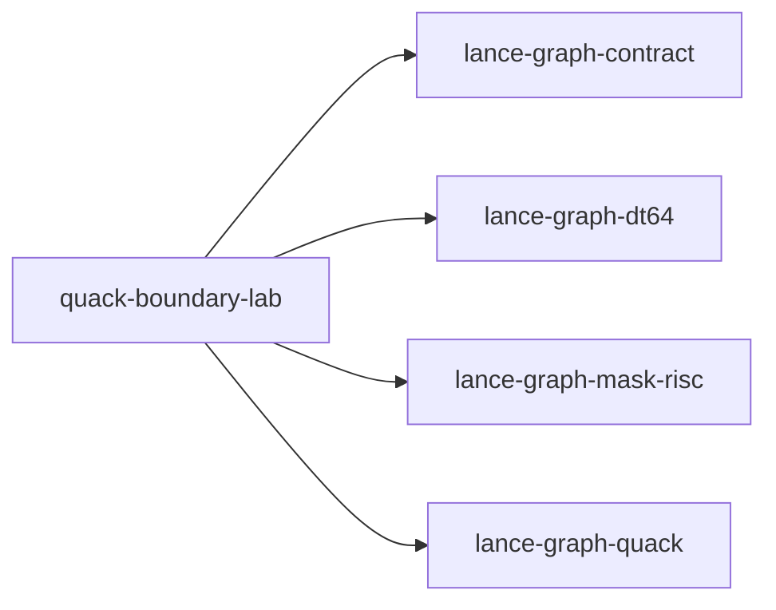

# quack-boundary-lab

crate: quack-boundary-lab
path: crates/quack-boundary-lab
workspace: member
digest: aab279d0e4f85af9
evidence legend: ../index.md#evidence-legend

Generated; the code is the truth. See ../index.md.

## Depends on

- dep hidden-state-twins-probe dev — crates/quack-boundary-lab/Cargo.toml:17 CONFIRMED
- dep lance-graph-contract normal — crates/quack-boundary-lab/Cargo.toml:9 CONFIRMED
- dep lance-graph-dt64 normal — crates/quack-boundary-lab/Cargo.toml:10 CONFIRMED
- dep lance-graph-mask-risc normal — crates/quack-boundary-lab/Cargo.toml:11 CONFIRMED
- dep lance-graph-quack normal — crates/quack-boundary-lab/Cargo.toml:12 CONFIRMED

## Depended on by

## Public items

- mod oracle [pub] — crates/quack-boundary-lab/src/lib.rs:45 CONFIRMED
- const CLASS [pub] — crates/quack-boundary-lab/src/lib.rs:48 CONFIRMED
- const VIEW_CLASS [pub] — crates/quack-boundary-lab/src/lib.rs:50 CONFIRMED
- const POSITION [pub] — crates/quack-boundary-lab/src/lib.rs:52 CONFIRMED
- const ROWS [pub] — crates/quack-boundary-lab/src/lib.rs:55 CONFIRMED
- const REGIONS [pub] — crates/quack-boundary-lab/src/lib.rs:57 CONFIRMED
- const PARTNERS [pub] — crates/quack-boundary-lab/src/lib.rs:59 CONFIRMED
- const ID [pub] — crates/quack-boundary-lab/src/lib.rs:62 CONFIRMED
- const AMOUNT [pub] — crates/quack-boundary-lab/src/lib.rs:63 CONFIRMED
- const QTY [pub] — crates/quack-boundary-lab/src/lib.rs:64 CONFIRMED
- const REGION [pub] — crates/quack-boundary-lab/src/lib.rs:65 CONFIRMED
- const PARTNER [pub] — crates/quack-boundary-lab/src/lib.rs:66 CONFIRMED
- const DISC_VALID [pub] — crates/quack-boundary-lab/src/lib.rs:67 CONFIRMED
- const DISCOUNT [pub] — crates/quack-boundary-lab/src/lib.rs:68 CONFIRMED
- const FIELDS [pub] — crates/quack-boundary-lab/src/lib.rs:70 CONFIRMED
- const READER [pub] — crates/quack-boundary-lab/src/lib.rs:83 CONFIRMED
- const OTHER_READER [pub] — crates/quack-boundary-lab/src/lib.rs:84 CONFIRMED
- struct Row [pub] — crates/quack-boundary-lab/src/lib.rs:88 CONFIRMED
- fn logical [pub] — crates/quack-boundary-lab/src/lib.rs:99 CONFIRMED
- fn stale_discount [pub] — crates/quack-boundary-lab/src/lib.rs:115 CONFIRMED
- enum RowOrder [pub] — crates/quack-boundary-lab/src/lib.rs:125 CONFIRMED
- struct Source [pub] — crates/quack-boundary-lab/src/lib.rs:133 CONFIRMED
- fn Source::new [pub] — crates/quack-boundary-lab/src/lib.rs:154 CONFIRMED
- fn Source::with_lane_ids [pub] — crates/quack-boundary-lab/src/lib.rs:191 CONFIRMED
- fn Source::renumber [pub] — crates/quack-boundary-lab/src/lib.rs:197 CONFIRMED
- fn Source::space [pub] — crates/quack-boundary-lab/src/lib.rs:202 CONFIRMED
- fn Source::frame_store [pub] — crates/quack-boundary-lab/src/lib.rs:207 CONFIRMED
- fn Source::serve [pub] — crates/quack-boundary-lab/src/lib.rs:212 CONFIRMED
- fn Source::reorder [pub] — crates/quack-boundary-lab/src/lib.rs:218 CONFIRMED
- fn Source::rederive_validity [pub] — crates/quack-boundary-lab/src/lib.rs:235 CONFIRMED
- fn Source::advance_source [pub] — crates/quack-boundary-lab/src/lib.rs:243 CONFIRMED
- fn Source::row [pub] — crates/quack-boundary-lab/src/lib.rs:250 CONFIRMED
- fn Source::raw_lanes [pub] — crates/quack-boundary-lab/src/lib.rs:263 CONFIRMED
- fn Source::validity_plane [pub] — crates/quack-boundary-lab/src/lib.rs:277 CONFIRMED
- fn Source::lane_addresses [pub] — crates/quack-boundary-lab/src/lib.rs:288 CONFIRMED
- fn Source::checksum [pub] — crates/quack-boundary-lab/src/lib.rs:301 CONFIRMED
- struct View [pub] — crates/quack-boundary-lab/src/lib.rs:361 CONFIRMED
- fn View::standard [pub] — crates/quack-boundary-lab/src/lib.rs:365 CONFIRMED
- fn View::swapped [pub] — crates/quack-boundary-lab/src/lib.rs:370 CONFIRMED
- struct World [pub] — crates/quack-boundary-lab/src/lib.rs:395 CONFIRMED
- fn World::new [pub] — crates/quack-boundary-lab/src/lib.rs:402 CONFIRMED
- fn World::with [pub] — crates/quack-boundary-lab/src/lib.rs:407 CONFIRMED
- fn World::bind_as [pub] — crates/quack-boundary-lab/src/lib.rs:434 CONFIRMED
- fn World::bind_fields [pub] — crates/quack-boundary-lab/src/lib.rs:445 CONFIRMED
- fn World::bind [pub] — crates/quack-boundary-lab/src/lib.rs:470 CONFIRMED
- struct Prepared [pub] — crates/quack-boundary-lab/src/lib.rs:486 CONFIRMED
- fn Prepared::under [pub] — crates/quack-boundary-lab/src/lib.rs:496 CONFIRMED
- fn Prepared::over [pub] — crates/quack-boundary-lab/src/lib.rs:506 CONFIRMED
- enum Refused [pub] — crates/quack-boundary-lab/src/lib.rs:517 CONFIRMED
- fn admitted [pub] — crates/quack-boundary-lab/src/lib.rs:538 CONFIRMED
- fn bound_positions [pub] — crates/quack-boundary-lab/src/lib.rs:590 CONFIRMED
- fn operand [pub] — crates/quack-boundary-lab/src/lib.rs:597 CONFIRMED
- fn unbound [pub] — crates/quack-boundary-lab/src/lib.rs:607 CONFIRMED
- fn sum_qty_id_in_amount_gt [pub] — crates/quack-boundary-lab/src/oracle.rs:8 CONFIRMED
- fn count_amount_gt [pub] — crates/quack-boundary-lab/src/oracle.rs:20 CONFIRMED
- fn sum_qty_amount_gt [pub] — crates/quack-boundary-lab/src/oracle.rs:25 CONFIRMED
- type RegionFold [pub] — crates/quack-boundary-lab/src/oracle.rs:37 CONFIRMED
- fn by_region_amount_gt [pub] — crates/quack-boundary-lab/src/oracle.rs:41 CONFIRMED
- fn mask_amount_gt [pub] — crates/quack-boundary-lab/src/oracle.rs:57 CONFIRMED
- fn count_discount_gt_3vl [pub] — crates/quack-boundary-lab/src/oracle.rs:70 CONFIRMED
- fn count_orders_with_partner_tier_gt [pub] — crates/quack-boundary-lab/src/oracle.rs:81 CONFIRMED

## Imports from in-scope crates

### lance-graph-contract
- use lance_graph_contract::class_view::ClassId — crates/quack-boundary-lab/src/lib.rs:32 CONFIRMED
- use lance_graph_contract::class_view::ClassView — crates/quack-boundary-lab/src/lib.rs:32 CONFIRMED
- use lance_graph_contract::class_view::WideFieldMask — crates/quack-boundary-lab/src/lib.rs:32 CONFIRMED
- use lance_graph_contract::ontology::DisplayTemplate — crates/quack-boundary-lab/src/lib.rs:33 CONFIRMED
- use lance_graph_contract::ontology::FieldRef — crates/quack-boundary-lab/src/lib.rs:33 CONFIRMED
### lance-graph-dt64
- use lance_graph_dt64::dr::Frame — crates/quack-boundary-lab/src/lib.rs:34 CONFIRMED
- use lance_graph_dt64::dr::FrameRefusal — crates/quack-boundary-lab/src/lib.rs:34 CONFIRMED
- use lance_graph_dt64::dr::FrameRevisions — crates/quack-boundary-lab/src/lib.rs:34 CONFIRMED
- use lance_graph_dt64::dr::FrameStore — crates/quack-boundary-lab/src/lib.rs:34 CONFIRMED
- use lance_graph_dt64::dr::Scope — crates/quack-boundary-lab/src/lib.rs:34 CONFIRMED
- use lance_graph_dt64::BindStore — crates/quack-boundary-lab/src/lib.rs:36 CONFIRMED
- use lance_graph_dt64::ClassSchema — crates/quack-boundary-lab/src/lib.rs:36 CONFIRMED
- use lance_graph_dt64::CoordSpace — crates/quack-boundary-lab/src/lib.rs:36 CONFIRMED
- use lance_graph_dt64::Extent — crates/quack-boundary-lab/src/lib.rs:36 CONFIRMED
- use lance_graph_dt64::LaneAddr — crates/quack-boundary-lab/src/lib.rs:36 CONFIRMED
- use lance_graph_dt64::LaneBinding — crates/quack-boundary-lab/src/lib.rs:36 CONFIRMED
- use lance_graph_dt64::LaneRefusal — crates/quack-boundary-lab/src/lib.rs:36 CONFIRMED
- use lance_graph_dt64::LaneRequest — crates/quack-boundary-lab/src/lib.rs:36 CONFIRMED
- use lance_graph_dt64::LaneSource — crates/quack-boundary-lab/src/lib.rs:37 CONFIRMED
- use lance_graph_dt64::MethodBinding — crates/quack-boundary-lab/src/lib.rs:37 CONFIRMED
- use lance_graph_dt64::RouteAt — crates/quack-boundary-lab/src/lib.rs:37 CONFIRMED
- use lance_graph_dt64::SchemaRev — crates/quack-boundary-lab/src/lib.rs:37 CONFIRMED
### lance-graph-mask-risc
- use lance_graph_mask_risc::ExecError — crates/quack-boundary-lab/src/lib.rs:40 CONFIRMED
- use lance_graph_mask_risc::Foreign — crates/quack-boundary-lab/src/lib.rs:40 CONFIRMED
- use lance_graph_mask_risc::LaneRef — crates/quack-boundary-lab/src/lib.rs:40 CONFIRMED
- use lance_graph_mask_risc::Out — crates/quack-boundary-lab/src/lib.rs:40 CONFIRMED
- use lance_graph_mask_risc::Planes — crates/quack-boundary-lab/src/lib.rs:40 CONFIRMED
- use lance_graph_mask_risc::Program — crates/quack-boundary-lab/src/lib.rs:40 CONFIRMED
- use lance_graph_mask_risc::Scratch — crates/quack-boundary-lab/src/lib.rs:40 CONFIRMED
- use lance_graph_mask_risc::Value — crates/quack-boundary-lab/src/lib.rs:40 CONFIRMED
- use lance_graph_mask_risc::execute_into — crates/quack-boundary-lab/src/lib.rs:40 CONFIRMED
### lance-graph-quack
- use lance_graph_quack::Col — crates/quack-boundary-lab/src/lib.rs:43 CONFIRMED

## Calls

CALL_GRAPH=ARTIFACT_MISSING
- calls ARTIFACT_MISSING — no ruff_charon artifact for this crate UNKNOWN

## Architecture

- none

Generated from Cargo manifests — extracted relationships only.

