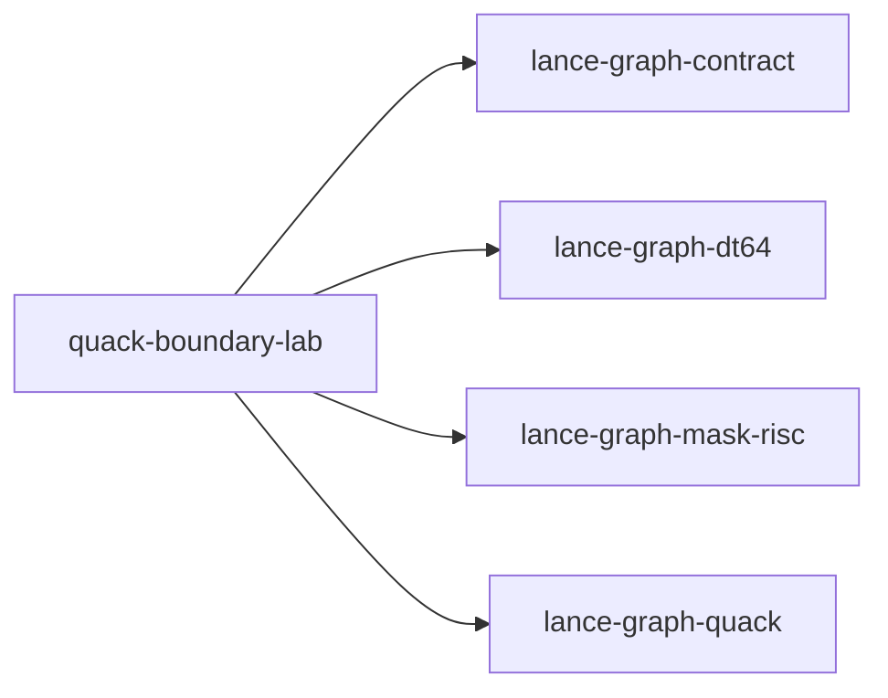

# quack-boundary-lab

crate: quack-boundary-lab
path: crates/quack-boundary-lab
workspace: member
digest: f53addc65dcf11e8
evidence legend: ../index.md#evidence-legend

Generated; the code is the truth. See ../index.md.

## Depends on

- dep dr256-ternlog-lab dev — crates/quack-boundary-lab/Cargo.toml:20 CONFIRMED
- dep hidden-state-twins-probe dev — crates/quack-boundary-lab/Cargo.toml:17 CONFIRMED
- dep lance-graph-contract normal — crates/quack-boundary-lab/Cargo.toml:9 CONFIRMED
- dep lance-graph-dt64 normal — crates/quack-boundary-lab/Cargo.toml:10 CONFIRMED
- dep lance-graph-mask-risc normal — crates/quack-boundary-lab/Cargo.toml:11 CONFIRMED
- dep lance-graph-quack normal — crates/quack-boundary-lab/Cargo.toml:12 CONFIRMED
- dep weather-poc dev — crates/quack-boundary-lab/Cargo.toml:22 CONFIRMED

## Depended on by

## Public items

- const MAX_PLANES [pub] — crates/quack-boundary-lab/src/derived.rs:23 CONFIRMED
- enum Recipe [pub] — crates/quack-boundary-lab/src/derived.rs:27 CONFIRMED
- enum PlaneRefusal [pub] — crates/quack-boundary-lab/src/derived.rs:39 CONFIRMED
- struct DerivedPlane [pub] — crates/quack-boundary-lab/src/derived.rs:67 CONFIRMED
- fn DerivedPlane::recipe [pub] — crates/quack-boundary-lab/src/derived.rs:75 CONFIRMED
- fn DerivedPlane::space [pub] — crates/quack-boundary-lab/src/derived.rs:79 CONFIRMED
- fn DerivedPlane::words [pub] — crates/quack-boundary-lab/src/derived.rs:84 CONFIRMED
- fn DerivedPlane::bytes [pub] — crates/quack-boundary-lab/src/derived.rs:89 CONFIRMED
- fn DerivedPlane::bit [pub] — crates/quack-boundary-lab/src/derived.rs:103 CONFIRMED
- fn DerivedPlane::guard [pub] — crates/quack-boundary-lab/src/derived.rs:134 CONFIRMED
- fn DerivedPlane::foreign_visible [pub] — crates/quack-boundary-lab/src/derived.rs:182 CONFIRMED
- fn check_planes [pub] — crates/quack-boundary-lab/src/derived.rs:225 CONFIRMED
- fn admitted_planes [pub] — crates/quack-boundary-lab/src/derived.rs:267 CONFIRMED
- mod derived [pub] — crates/quack-boundary-lab/src/lib.rs:45 CONFIRMED
- mod oracle [pub] — crates/quack-boundary-lab/src/lib.rs:46 CONFIRMED
- const CLASS [pub] — crates/quack-boundary-lab/src/lib.rs:49 CONFIRMED
- const VIEW_CLASS [pub] — crates/quack-boundary-lab/src/lib.rs:51 CONFIRMED
- const POSITION [pub] — crates/quack-boundary-lab/src/lib.rs:53 CONFIRMED
- const ROWS [pub] — crates/quack-boundary-lab/src/lib.rs:56 CONFIRMED
- const REGIONS [pub] — crates/quack-boundary-lab/src/lib.rs:58 CONFIRMED
- const PARTNERS [pub] — crates/quack-boundary-lab/src/lib.rs:60 CONFIRMED
- const ID [pub] — crates/quack-boundary-lab/src/lib.rs:63 CONFIRMED
- const AMOUNT [pub] — crates/quack-boundary-lab/src/lib.rs:64 CONFIRMED
- const QTY [pub] — crates/quack-boundary-lab/src/lib.rs:65 CONFIRMED
- const REGION [pub] — crates/quack-boundary-lab/src/lib.rs:66 CONFIRMED
- const PARTNER [pub] — crates/quack-boundary-lab/src/lib.rs:67 CONFIRMED
- const DISC_VALID [pub] — crates/quack-boundary-lab/src/lib.rs:68 CONFIRMED
- const DISCOUNT [pub] — crates/quack-boundary-lab/src/lib.rs:69 CONFIRMED
- const FIELDS [pub] — crates/quack-boundary-lab/src/lib.rs:71 CONFIRMED
- const READER [pub] — crates/quack-boundary-lab/src/lib.rs:84 CONFIRMED
- const OTHER_READER [pub] — crates/quack-boundary-lab/src/lib.rs:85 CONFIRMED
- struct Row [pub] — crates/quack-boundary-lab/src/lib.rs:89 CONFIRMED
- fn logical [pub] — crates/quack-boundary-lab/src/lib.rs:100 CONFIRMED
- fn stale_discount [pub] — crates/quack-boundary-lab/src/lib.rs:116 CONFIRMED
- enum RowOrder [pub] — crates/quack-boundary-lab/src/lib.rs:126 CONFIRMED
- struct Source [pub] — crates/quack-boundary-lab/src/lib.rs:134 CONFIRMED
- fn Source::new [pub] — crates/quack-boundary-lab/src/lib.rs:155 CONFIRMED
- fn Source::with_lane_ids [pub] — crates/quack-boundary-lab/src/lib.rs:192 CONFIRMED
- fn Source::renumber [pub] — crates/quack-boundary-lab/src/lib.rs:198 CONFIRMED
- fn Source::space [pub] — crates/quack-boundary-lab/src/lib.rs:203 CONFIRMED
- fn Source::frame_store [pub] — crates/quack-boundary-lab/src/lib.rs:208 CONFIRMED
- fn Source::serve [pub] — crates/quack-boundary-lab/src/lib.rs:213 CONFIRMED
- fn Source::reorder [pub] — crates/quack-boundary-lab/src/lib.rs:219 CONFIRMED
- fn Source::rederive_validity [pub] — crates/quack-boundary-lab/src/lib.rs:236 CONFIRMED
- fn Source::rewrite_amount [pub] — crates/quack-boundary-lab/src/lib.rs:245 CONFIRMED
- fn Source::advance_source [pub] — crates/quack-boundary-lab/src/lib.rs:253 CONFIRMED
- fn Source::row [pub] — crates/quack-boundary-lab/src/lib.rs:260 CONFIRMED
- fn Source::raw_lanes [pub] — crates/quack-boundary-lab/src/lib.rs:273 CONFIRMED
- fn Source::validity_plane [pub] — crates/quack-boundary-lab/src/lib.rs:287 CONFIRMED
- fn Source::lane_addresses [pub] — crates/quack-boundary-lab/src/lib.rs:298 CONFIRMED
- fn Source::checksum [pub] — crates/quack-boundary-lab/src/lib.rs:311 CONFIRMED
- struct View [pub] — crates/quack-boundary-lab/src/lib.rs:371 CONFIRMED
- fn View::standard [pub] — crates/quack-boundary-lab/src/lib.rs:375 CONFIRMED
- fn View::swapped [pub] — crates/quack-boundary-lab/src/lib.rs:380 CONFIRMED
- struct World [pub] — crates/quack-boundary-lab/src/lib.rs:405 CONFIRMED
- fn World::new [pub] — crates/quack-boundary-lab/src/lib.rs:412 CONFIRMED
- fn World::with [pub] — crates/quack-boundary-lab/src/lib.rs:417 CONFIRMED
- fn World::bind_as [pub] — crates/quack-boundary-lab/src/lib.rs:444 CONFIRMED
- fn World::bind_fields [pub] — crates/quack-boundary-lab/src/lib.rs:455 CONFIRMED
- fn World::bind [pub] — crates/quack-boundary-lab/src/lib.rs:480 CONFIRMED
- struct Prepared [pub] — crates/quack-boundary-lab/src/lib.rs:496 CONFIRMED
- fn Prepared::under [pub] — crates/quack-boundary-lab/src/lib.rs:506 CONFIRMED
- fn Prepared::over [pub] — crates/quack-boundary-lab/src/lib.rs:516 CONFIRMED
- enum Refused [pub] — crates/quack-boundary-lab/src/lib.rs:527 CONFIRMED
- fn admitted [pub] — crates/quack-boundary-lab/src/lib.rs:550 CONFIRMED
- fn bound_positions [pub] — crates/quack-boundary-lab/src/lib.rs:602 CONFIRMED
- fn operand [pub] — crates/quack-boundary-lab/src/lib.rs:609 CONFIRMED
- fn unbound [pub] — crates/quack-boundary-lab/src/lib.rs:619 CONFIRMED
- fn sum_qty_id_in_amount_gt [pub] — crates/quack-boundary-lab/src/oracle.rs:8 CONFIRMED
- fn count_amount_gt [pub] — crates/quack-boundary-lab/src/oracle.rs:20 CONFIRMED
- fn sum_qty_amount_gt [pub] — crates/quack-boundary-lab/src/oracle.rs:25 CONFIRMED
- type RegionFold [pub] — crates/quack-boundary-lab/src/oracle.rs:37 CONFIRMED
- fn by_region_amount_gt [pub] — crates/quack-boundary-lab/src/oracle.rs:41 CONFIRMED
- fn mask_amount_gt [pub] — crates/quack-boundary-lab/src/oracle.rs:57 CONFIRMED
- fn count_discount_gt_3vl [pub] — crates/quack-boundary-lab/src/oracle.rs:70 CONFIRMED
- fn count_orders_with_partner_tier_gt [pub] — crates/quack-boundary-lab/src/oracle.rs:81 CONFIRMED

## Imports from in-scope crates

### lance-graph-contract
- use lance_graph_contract::class_view::ClassId — crates/quack-boundary-lab/src/lib.rs:32 CONFIRMED
- use lance_graph_contract::class_view::ClassView — crates/quack-boundary-lab/src/lib.rs:32 CONFIRMED
- use lance_graph_contract::class_view::WideFieldMask — crates/quack-boundary-lab/src/lib.rs:32 CONFIRMED
- use lance_graph_contract::ontology::DisplayTemplate — crates/quack-boundary-lab/src/lib.rs:33 CONFIRMED
- use lance_graph_contract::ontology::FieldRef — crates/quack-boundary-lab/src/lib.rs:33 CONFIRMED
### lance-graph-dt64
- use lance_graph_dt64::dr::Frame — crates/quack-boundary-lab/src/derived.rs:13 CONFIRMED
- use lance_graph_dt64::dr::FrameRefusal — crates/quack-boundary-lab/src/derived.rs:13 CONFIRMED
- use lance_graph_dt64::CoordSpace — crates/quack-boundary-lab/src/derived.rs:14 CONFIRMED
- use lance_graph_dt64::Guard — crates/quack-boundary-lab/src/derived.rs:14 CONFIRMED
- use lance_graph_dt64::LaneBinding — crates/quack-boundary-lab/src/derived.rs:14 CONFIRMED
- use lance_graph_dt64::LaneSource — crates/quack-boundary-lab/src/derived.rs:14 CONFIRMED
- use lance_graph_dt64::MethodId — crates/quack-boundary-lab/src/derived.rs:14 CONFIRMED
- use lance_graph_dt64::Refusal — crates/quack-boundary-lab/src/derived.rs:14 CONFIRMED
- use lance_graph_dt64::dr::Frame — crates/quack-boundary-lab/src/lib.rs:34 CONFIRMED
- use lance_graph_dt64::dr::FrameRefusal — crates/quack-boundary-lab/src/lib.rs:34 CONFIRMED
- use lance_graph_dt64::dr::FrameRevisions — crates/quack-boundary-lab/src/lib.rs:34 CONFIRMED
- use lance_graph_dt64::dr::FrameStore — crates/quack-boundary-lab/src/lib.rs:34 CONFIRMED
- use lance_graph_dt64::dr::Scope — crates/quack-boundary-lab/src/lib.rs:34 CONFIRMED
- use lance_graph_dt64::BindStore — crates/quack-boundary-lab/src/lib.rs:36 CONFIRMED
- use lance_graph_dt64::ClassSchema — crates/quack-boundary-lab/src/lib.rs:36 CONFIRMED
- use lance_graph_dt64::CoordSpace — crates/quack-boundary-lab/src/lib.rs:36 CONFIRMED
- use lance_graph_dt64::Extent — crates/quack-boundary-lab/src/lib.rs:36 CONFIRMED
- use lance_graph_dt64::LaneAddr — crates/quack-boundary-lab/src/lib.rs:36 CONFIRMED
- use lance_graph_dt64::LaneBinding — crates/quack-boundary-lab/src/lib.rs:36 CONFIRMED
- use lance_graph_dt64::LaneRefusal — crates/quack-boundary-lab/src/lib.rs:36 CONFIRMED
- use lance_graph_dt64::LaneRequest — crates/quack-boundary-lab/src/lib.rs:36 CONFIRMED
- use lance_graph_dt64::LaneSource — crates/quack-boundary-lab/src/lib.rs:37 CONFIRMED
- use lance_graph_dt64::MethodBinding — crates/quack-boundary-lab/src/lib.rs:37 CONFIRMED
- use lance_graph_dt64::RouteAt — crates/quack-boundary-lab/src/lib.rs:37 CONFIRMED
- use lance_graph_dt64::SchemaRev — crates/quack-boundary-lab/src/lib.rs:37 CONFIRMED
### lance-graph-mask-risc
- use lance_graph_mask_risc::ExecError — crates/quack-boundary-lab/src/derived.rs:16 CONFIRMED
- use lance_graph_mask_risc::Foreign — crates/quack-boundary-lab/src/derived.rs:16 CONFIRMED
- use lance_graph_mask_risc::LaneRef — crates/quack-boundary-lab/src/derived.rs:16 CONFIRMED
- use lance_graph_mask_risc::Out — crates/quack-boundary-lab/src/derived.rs:16 CONFIRMED
- use lance_graph_mask_risc::Planes — crates/quack-boundary-lab/src/derived.rs:16 CONFIRMED
- use lance_graph_mask_risc::Program — crates/quack-boundary-lab/src/derived.rs:16 CONFIRMED
- use lance_graph_mask_risc::Scratch — crates/quack-boundary-lab/src/derived.rs:16 CONFIRMED
- use lance_graph_mask_risc::Value — crates/quack-boundary-lab/src/derived.rs:16 CONFIRMED
- use lance_graph_mask_risc::execute_into — crates/quack-boundary-lab/src/derived.rs:16 CONFIRMED
- use lance_graph_mask_risc::ExecError — crates/quack-boundary-lab/src/lib.rs:40 CONFIRMED
- use lance_graph_mask_risc::Foreign — crates/quack-boundary-lab/src/lib.rs:40 CONFIRMED
- use lance_graph_mask_risc::LaneRef — crates/quack-boundary-lab/src/lib.rs:40 CONFIRMED
- use lance_graph_mask_risc::Out — crates/quack-boundary-lab/src/lib.rs:40 CONFIRMED
- use lance_graph_mask_risc::Planes — crates/quack-boundary-lab/src/lib.rs:40 CONFIRMED
- use lance_graph_mask_risc::Program — crates/quack-boundary-lab/src/lib.rs:40 CONFIRMED
- use lance_graph_mask_risc::Scratch — crates/quack-boundary-lab/src/lib.rs:40 CONFIRMED
- use lance_graph_mask_risc::Value — crates/quack-boundary-lab/src/lib.rs:40 CONFIRMED
- use lance_graph_mask_risc::execute_into — crates/quack-boundary-lab/src/lib.rs:40 CONFIRMED
### lance-graph-quack
- use lance_graph_quack::Agg — crates/quack-boundary-lab/src/derived.rs:18 CONFIRMED
- use lance_graph_quack::Filter — crates/quack-boundary-lab/src/derived.rs:18 CONFIRMED
- use lance_graph_quack::Query — crates/quack-boundary-lab/src/derived.rs:18 CONFIRMED
- use lance_graph_quack::lower — crates/quack-boundary-lab/src/derived.rs:18 CONFIRMED
- use lance_graph_quack::Col — crates/quack-boundary-lab/src/lib.rs:43 CONFIRMED

## Calls

CALL_GRAPH=ARTIFACT_MISSING
- calls ARTIFACT_MISSING — no ruff_charon artifact for this crate UNKNOWN

## Architecture

- none

Generated from Cargo manifests — extracted relationships only.

