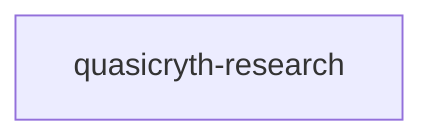

# quasicryth-research

crate: quasicryth-research
path: crates/quasicryth-research
workspace: excluded
digest: 0b33aba384794485
evidence legend: ../index.md#evidence-legend

Generated; the code is the truth. See ../index.md.

## Depends on

## Depended on by

## Public items

- const AC_PREC [pub] — crates/quasicryth-research/src/arith_coder.rs:21 CONFIRMED
- const AC_FULL [pub] — crates/quasicryth-research/src/arith_coder.rs:23 CONFIRMED
- const AC_HALF [pub] — crates/quasicryth-research/src/arith_coder.rs:25 CONFIRMED
- const AC_QTR [pub] — crates/quasicryth-research/src/arith_coder.rs:27 CONFIRMED
- const AC_MAX_FREQ [pub] — crates/quasicryth-research/src/arith_coder.rs:29 CONFIRMED
- struct Model256 [pub] — crates/quasicryth-research/src/arith_coder.rs:40 CONFIRMED
- fn Model256::new [pub] — crates/quasicryth-research/src/arith_coder.rs:54 CONFIRMED
- fn Model256::update [pub] — crates/quasicryth-research/src/arith_coder.rs:62 CONFIRMED
- fn Model256::cdf [pub] — crates/quasicryth-research/src/arith_coder.rs:76 CONFIRMED
- fn Model256::freq [pub] — crates/quasicryth-research/src/arith_coder.rs:89 CONFIRMED
- fn Model256::total [pub] — crates/quasicryth-research/src/arith_coder.rs:96 CONFIRMED
- struct VModel [pub] — crates/quasicryth-research/src/arith_coder.rs:111 CONFIRMED
- fn VModel::new [pub] — crates/quasicryth-research/src/arith_coder.rs:125 CONFIRMED
- fn VModel::n_sym [pub] — crates/quasicryth-research/src/arith_coder.rs:142 CONFIRMED
- fn VModel::total [pub] — crates/quasicryth-research/src/arith_coder.rs:149 CONFIRMED
- fn VModel::update [pub] — crates/quasicryth-research/src/arith_coder.rs:154 CONFIRMED
- fn VModel::cum_lo [pub] — crates/quasicryth-research/src/arith_coder.rs:173 CONFIRMED
- fn VModel::freq_of [pub] — crates/quasicryth-research/src/arith_coder.rs:181 CONFIRMED
- fn VModel::find [pub] — crates/quasicryth-research/src/arith_coder.rs:188 CONFIRMED
- struct Encoder [pub] — crates/quasicryth-research/src/arith_coder.rs:238 CONFIRMED
- fn Encoder::new [pub] — crates/quasicryth-research/src/arith_coder.rs:259 CONFIRMED
- fn Encoder::encode [pub] — crates/quasicryth-research/src/arith_coder.rs:277 CONFIRMED
- fn Encoder::finish [pub] — crates/quasicryth-research/src/arith_coder.rs:309 CONFIRMED
- struct Decoder [pub] — crates/quasicryth-research/src/arith_coder.rs:347 CONFIRMED
- fn Decoder<'a>::new [pub] — crates/quasicryth-research/src/arith_coder.rs:359 CONFIRMED
- fn Decoder<'a>::decode_256 [pub] — crates/quasicryth-research/src/arith_coder.rs:388 CONFIRMED
- fn Decoder<'a>::decode_v [pub] — crates/quasicryth-research/src/arith_coder.rs:408 CONFIRMED
- fn ac_enc_sym [pub] — crates/quasicryth-research/src/arith_coder.rs:449 CONFIRMED
- fn ac_dec_sym [pub] — crates/quasicryth-research/src/arith_coder.rs:457 CONFIRMED
- fn ac_enc_v [pub] — crates/quasicryth-research/src/arith_coder.rs:470 CONFIRMED
- fn ac_dec_v [pub] — crates/quasicryth-research/src/arith_coder.rs:479 CONFIRMED
- const NG_LENS [pub] — crates/quasicryth-research/src/codebook.rs:29 CONFIRMED
- struct CodebookSizes [pub] — crates/quasicryth-research/src/codebook.rs:36 CONFIRMED
- fn CodebookSizes::auto [pub] — crates/quasicryth-research/src/codebook.rs:65 CONFIRMED
- fn CodebookSizes::ngram_budget [pub] — crates/quasicryth-research/src/codebook.rs:163 CONFIRMED
- trait Codebook [pub] — crates/quasicryth-research/src/codebook.rs:184 CONFIRMED
- struct FlatCodebook [pub] — crates/quasicryth-research/src/codebook.rs:215 CONFIRMED
- fn FlatCodebook::build [pub] — crates/quasicryth-research/src/codebook.rs:238 CONFIRMED
- struct CowArt [pub] — crates/quasicryth-research/src/codebook.rs:428 CONFIRMED
- fn CowArt::new [pub] — crates/quasicryth-research/src/codebook.rs:442 CONFIRMED
- fn CowArt::len [pub] — crates/quasicryth-research/src/codebook.rs:452 CONFIRMED
- fn CowArt::is_empty [pub] — crates/quasicryth-research/src/codebook.rs:459 CONFIRMED
- fn CowArt::get [pub] — crates/quasicryth-research/src/codebook.rs:465 CONFIRMED
- fn CowArt::insert [pub] — crates/quasicryth-research/src/codebook.rs:476 CONFIRMED
- struct CowRadixCodebook [pub] — crates/quasicryth-research/src/codebook.rs:514 CONFIRMED
- fn CowRadixCodebook::build [pub] — crates/quasicryth-research/src/codebook.rs:531 CONFIRMED
- const PHI [pub] — crates/quasicryth-research/src/constants.rs:13 CONFIRMED
- const INV_PHI [pub] — crates/quasicryth-research/src/constants.rs:18 CONFIRMED
- const MAX_HIER [pub] — crates/quasicryth-research/src/constants.rs:24 CONFIRMED
- const N_LEVELS [pub] — crates/quasicryth-research/src/constants.rs:27 CONFIRMED
- const HIER_WORD_LENS [pub] — crates/quasicryth-research/src/constants.rs:34 CONFIRMED
- const LEVEL_WORDS [pub] — crates/quasicryth-research/src/constants.rs:39 CONFIRMED
- const N_CODEBOOKS [pub] — crates/quasicryth-research/src/constants.rs:42 CONFIRMED
- const N_TILINGS [pub] — crates/quasicryth-research/src/constants.rs:49 CONFIRMED
- const N_TILINGS_FIB [pub] — crates/quasicryth-research/src/constants.rs:52 CONFIRMED
- fn noble5_alpha [pub] — crates/quasicryth-research/src/constants.rs:61 CONFIRMED
- fn sqrt58_alpha [pub] — crates/quasicryth-research/src/constants.rs:69 CONFIRMED
- fn sqrt13_alpha [pub] — crates/quasicryth-research/src/constants.rs:77 CONFIRMED
- fn tiling_descs [pub] — crates/quasicryth-research/src/constants.rs:94 CONFIRMED
- fn build_hierarchy [pub] — crates/quasicryth-research/src/hierarchy.rs:35 CONFIRMED
- fn hier_context [pub] — crates/quasicryth-research/src/hierarchy.rs:115 CONFIRMED
- fn detect_deep_positions [pub] — crates/quasicryth-research/src/hierarchy.rs:157 CONFIRMED
- fn deep_counts [pub] — crates/quasicryth-research/src/hierarchy.rs:229 CONFIRMED
- mod arith_coder [pub] — crates/quasicryth-research/src/lib.rs:75 CONFIRMED
- mod codebook [pub] — crates/quasicryth-research/src/lib.rs:76 CONFIRMED
- mod constants [pub] — crates/quasicryth-research/src/lib.rs:77 CONFIRMED
- mod hierarchy [pub] — crates/quasicryth-research/src/lib.rs:78 CONFIRMED
- mod md5 [pub] — crates/quasicryth-research/src/lib.rs:79 CONFIRMED
- mod pipeline [pub] — crates/quasicryth-research/src/lib.rs:80 CONFIRMED
- mod tiling [pub] — crates/quasicryth-research/src/lib.rs:81 CONFIRMED
- mod tok [pub] — crates/quasicryth-research/src/lib.rs:82 CONFIRMED
- mod types [pub] — crates/quasicryth-research/src/lib.rs:83 CONFIRMED
- struct Md5 [pub] — crates/quasicryth-research/src/md5.rs:134 CONFIRMED
- fn Md5::new [pub] — crates/quasicryth-research/src/md5.rs:149 CONFIRMED
- fn Md5::update [pub] — crates/quasicryth-research/src/md5.rs:158 CONFIRMED
- fn Md5::finalize [pub] — crates/quasicryth-research/src/md5.rs:174 CONFIRMED
- fn md5 [pub] — crates/quasicryth-research/src/md5.rs:194 CONFIRMED
- enum Variant [pub] — crates/quasicryth-research/src/pipeline.rs:51 CONFIRMED
- enum PipelineError [pub] — crates/quasicryth-research/src/pipeline.rs:60 CONFIRMED
- fn compress [pub] — crates/quasicryth-research/src/pipeline.rs:106 CONFIRMED
- fn decompress [pub] — crates/quasicryth-research/src/pipeline.rs:162 CONFIRMED
- fn qc_word_tiling [pub] — crates/quasicryth-research/src/tiling.rs:107 CONFIRMED
- fn qc_word_tiling_alpha [pub] — crates/quasicryth-research/src/tiling.rs:113 CONFIRMED
- fn gen_from_desc [pub] — crates/quasicryth-research/src/tiling.rs:120 CONFIRMED
- fn thue_morse_tiling [pub] — crates/quasicryth-research/src/tiling.rs:152 CONFIRMED
- fn rudin_shapiro_tiling [pub] — crates/quasicryth-research/src/tiling.rs:182 CONFIRMED
- fn period_doubling_tiling [pub] — crates/quasicryth-research/src/tiling.rs:199 CONFIRMED
- fn period5_tiling [pub] — crates/quasicryth-research/src/tiling.rs:225 CONFIRMED
- fn sanddrift_tiling [pub] — crates/quasicryth-research/src/tiling.rs:253 CONFIRMED
- fn verify_no_adjacent_s [pub] — crates/quasicryth-research/src/tiling.rs:298 CONFIRMED
- struct Token [pub] — crates/quasicryth-research/src/tok.rs:26 CONFIRMED
- fn is_alpha_or_hi [pub] — crates/quasicryth-research/src/tok.rs:37 CONFIRMED
- fn is_ws [pub] — crates/quasicryth-research/src/tok.rs:44 CONFIRMED
- fn apply_case [pub] — crates/quasicryth-research/src/tok.rs:53 CONFIRMED
- struct TokenStream [pub] — crates/quasicryth-research/src/tok.rs:83 CONFIRMED
- struct TokenSpan [pub] — crates/quasicryth-research/src/tok.rs:95 CONFIRMED
- fn TokenStream::token [pub] — crates/quasicryth-research/src/tok.rs:107 CONFIRMED
- fn TokenStream::len [pub] — crates/quasicryth-research/src/tok.rs:118 CONFIRMED
- fn TokenStream::is_empty [pub] — crates/quasicryth-research/src/tok.rs:125 CONFIRMED
- fn TokenStream::round_trip [pub] — crates/quasicryth-research/src/tok.rs:134 CONFIRMED
- fn tokenize [pub] — crates/quasicryth-research/src/tok.rs:150 CONFIRMED
- fn word_split [pub] — crates/quasicryth-research/src/tok.rs:241 CONFIRMED
- struct Tile [pub] — crates/quasicryth-research/src/types.rs:11 CONFIRMED
- fn Tile::small [pub] — crates/quasicryth-research/src/types.rs:24 CONFIRMED
- fn Tile::large [pub] — crates/quasicryth-research/src/types.rs:35 CONFIRMED
- struct HLevel [pub] — crates/quasicryth-research/src/types.rs:47 CONFIRMED
- struct ParentMap [pub] — crates/quasicryth-research/src/types.rs:61 CONFIRMED
- struct Hierarchy [pub] — crates/quasicryth-research/src/types.rs:73 CONFIRMED
- fn Hierarchy::empty [pub(crate)] — crates/quasicryth-research/src/types.rs:81 CONFIRMED
- fn Hierarchy::n_levels [pub] — crates/quasicryth-research/src/types.rs:91 CONFIRMED
- fn Hierarchy::level_count [pub] — crates/quasicryth-research/src/types.rs:98 CONFIRMED
- struct DeepPositions [pub] — crates/quasicryth-research/src/types.rs:110 CONFIRMED
- struct TilingDesc [pub] — crates/quasicryth-research/src/types.rs:124 CONFIRMED

## Imports from in-scope crates

- none

## Calls

CALL_GRAPH=ARTIFACT_MISSING
- calls ARTIFACT_MISSING — no ruff_charon artifact for this crate UNKNOWN

## Architecture

- none

Generated from Cargo manifests — extracted relationships only.

