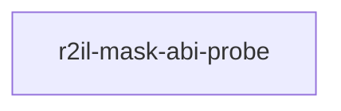

# r2il-mask-abi-probe

crate: r2il-mask-abi-probe
path: crates/r2il-mask-abi-probe
workspace: excluded
digest: 30d0ad7f4bbddcc6
evidence legend: ../index.md#evidence-legend

Generated; the code is the truth. See ../index.md.

## Depends on

- dep lance-graph-contract dev — crates/r2il-mask-abi-probe/Cargo.toml:33 CONFIRMED
- dep lance-graph-mask-risc dev — crates/r2il-mask-abi-probe/Cargo.toml:18 CONFIRMED
- dep lance-graph-quack dev — crates/r2il-mask-abi-probe/Cargo.toml:21 CONFIRMED
- dep lance-graph-r2il dev — crates/r2il-mask-abi-probe/Cargo.toml:24 CONFIRMED
- dep ogar-loco dev — crates/r2il-mask-abi-probe/Cargo.toml:29 CONFIRMED
- dep ogar-r2il dev — crates/r2il-mask-abi-probe/Cargo.toml:28 CONFIRMED

## Depended on by

## Public items

## Imports from in-scope crates

- none

## Calls

CALL_GRAPH=ARTIFACT_MISSING
- calls ARTIFACT_MISSING — no ruff_charon artifact for this crate UNKNOWN

## Architecture

- none

Generated from Cargo manifests — extracted relationships only.

