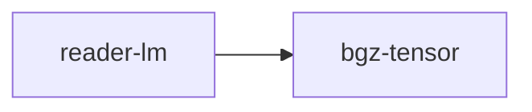

# reader-lm

crate: reader-lm
path: crates/reader-lm
workspace: excluded
digest: 8d6cc81794eba1b4
evidence legend: ../index.md#evidence-legend

Generated; the code is the truth. See ../index.md.

## Depends on

- dep bgz-tensor normal — crates/reader-lm/Cargo.toml:11 CONFIRMED
- dep ndarray normal — crates/reader-lm/Cargo.toml:10 CONFIRMED
- dep tokenizers normal optional — crates/reader-lm/Cargo.toml:12 CONFIRMED

## Depended on by

## Public items

- enum HtmlStructure [pub] — crates/reader-lm/src/classifier.rs:6 CONFIRMED
- fn classify_structure [pub] — crates/reader-lm/src/classifier.rs:11 CONFIRMED
- fn text_fingerprint [pub] — crates/reader-lm/src/classifier.rs:24 CONFIRMED
- fn segment_markdown [pub] — crates/reader-lm/src/classifier.rs:36 CONFIRMED
- struct Qwen2LayerWeights [pub] — crates/reader-lm/src/inference.rs:6 CONFIRMED
- struct Qwen2Model [pub] — crates/reader-lm/src/inference.rs:18 CONFIRMED
- struct ReaderLmEngine [pub] — crates/reader-lm/src/inference.rs:25 CONFIRMED
- struct KvCache [pub] — crates/reader-lm/src/inference.rs:31 CONFIRMED
- fn ReaderLmEngine::new [pub] — crates/reader-lm/src/inference.rs:38 CONFIRMED
- fn ReaderLmEngine::load_model [pub] — crates/reader-lm/src/inference.rs:42 CONFIRMED
- fn ReaderLmEngine::reset [pub] — crates/reader-lm/src/inference.rs:49 CONFIRMED
- fn ReaderLmEngine::forward [pub] — crates/reader-lm/src/inference.rs:59 CONFIRMED
- fn ReaderLmEngine::generate [pub] — crates/reader-lm/src/inference.rs:186 CONFIRMED
- fn ReaderLmEngine::html_to_markdown [pub] — crates/reader-lm/src/inference.rs:210 CONFIRMED
- mod weights [pub] — crates/reader-lm/src/lib.rs:34 CONFIRMED
- mod inference [pub] — crates/reader-lm/src/lib.rs:35 CONFIRMED
- mod classifier [pub] — crates/reader-lm/src/lib.rs:36 CONFIRMED
- mod tokenizer [pub] — crates/reader-lm/src/lib.rs:37 CONFIRMED
- fn tokenize [pub] — crates/reader-lm/src/tokenizer.rs:7 CONFIRMED
- fn token_count [pub] — crates/reader-lm/src/tokenizer.rs:18 CONFIRMED
- fn load_real_tokenizer [pub] cfg=feature="real-tokenizer" — crates/reader-lm/src/tokenizer.rs:24 CONFIRMED
- fn load_from_file [pub] cfg=feature="real-tokenizer" — crates/reader-lm/src/tokenizer.rs:31 CONFIRMED
- fn tokenize_real [pub] cfg=feature="real-tokenizer" — crates/reader-lm/src/tokenizer.rs:38 CONFIRMED
- const DEFAULT_BGZ7_PATH [pub] — crates/reader-lm/src/weights.rs:13 CONFIRMED
- const VOCAB_SIZE [pub] — crates/reader-lm/src/weights.rs:16 CONFIRMED
- const HIDDEN_DIM [pub] — crates/reader-lm/src/weights.rs:17 CONFIRMED
- const NUM_LAYERS [pub] — crates/reader-lm/src/weights.rs:18 CONFIRMED
- const NUM_HEADS [pub] — crates/reader-lm/src/weights.rs:19 CONFIRMED
- const NUM_KV_HEADS [pub] — crates/reader-lm/src/weights.rs:20 CONFIRMED
- const HEAD_DIM [pub] — crates/reader-lm/src/weights.rs:21 CONFIRMED
- const MLP_DIM [pub] — crates/reader-lm/src/weights.rs:22 CONFIRMED
- const MAX_SEQ_LEN [pub] — crates/reader-lm/src/weights.rs:23 CONFIRMED
- const DEFAULT_SPD [pub] — crates/reader-lm/src/weights.rs:26 CONFIRMED
- struct ReaderLmStackedWeights [pub] — crates/reader-lm/src/weights.rs:33 CONFIRMED
- struct LayerWeights [pub] — crates/reader-lm/src/weights.rs:46 CONFIRMED
- fn LayerWeights::role [pub] — crates/reader-lm/src/weights.rs:77 CONFIRMED
- fn ReaderLmStackedWeights::load_from_gguf [pub] — crates/reader-lm/src/weights.rs:94 CONFIRMED
- fn ReaderLmStackedWeights::load_from_gguf_bytes [pub] — crates/reader-lm/src/weights.rs:100 CONFIRMED
- fn ReaderLmStackedWeights::hydrate_role [pub] — crates/reader-lm/src/weights.rs:151 CONFIRMED
- struct ReaderLmWeights [pub] — crates/reader-lm/src/weights.rs:166 CONFIRMED
- fn ReaderLmWeights::load [pub] — crates/reader-lm/src/weights.rs:172 CONFIRMED
- fn ReaderLmWeights::load_default [pub] — crates/reader-lm/src/weights.rs:183 CONFIRMED
- fn ReaderLmWeights::all_rows [pub] — crates/reader-lm/src/weights.rs:187 CONFIRMED
- fn ReaderLmWeights::q_proj_rows [pub] — crates/reader-lm/src/weights.rs:191 CONFIRMED
- fn ReaderLmWeights::k_proj_rows [pub] — crates/reader-lm/src/weights.rs:192 CONFIRMED
- fn ReaderLmWeights::v_proj_rows [pub] — crates/reader-lm/src/weights.rs:193 CONFIRMED
- fn ReaderLmWeights::gate_proj_rows [pub] — crates/reader-lm/src/weights.rs:194 CONFIRMED

## Imports from in-scope crates

### bgz-tensor
- use bgz_tensor::stacked_n::StackedN — crates/reader-lm/src/weights.rs:10 CONFIRMED
- use bgz_tensor::variance::Role — crates/reader-lm/src/weights.rs:11 CONFIRMED

## Calls

CALL_GRAPH=ARTIFACT_MISSING
- calls ARTIFACT_MISSING — no ruff_charon artifact for this crate UNKNOWN

## Architecture

- none

Generated from Cargo manifests — extracted relationships only.

