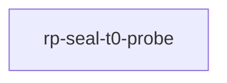

# rp-seal-t0-probe

crate: rp-seal-t0-probe
path: crates/rp-seal-t0-probe
workspace: excluded
digest: 357bded4e38d9f79
evidence legend: ../index.md#evidence-legend

Generated; the code is the truth. See ../index.md.

## Depends on

- dep blake3 normal — crates/rp-seal-t0-probe/Cargo.toml:19 CONFIRMED
- dep ndarray normal — crates/rp-seal-t0-probe/Cargo.toml:20 CONFIRMED

## Depended on by

## Public items

- trait PetalDigest [pub] — crates/rp-seal-t0-probe/src/cascade_seal.rs:38 CONFIRMED
- struct Blake3Digest [pub] — crates/rp-seal-t0-probe/src/cascade_seal.rs:50 CONFIRMED
- struct Crc32cDigest [pub] — crates/rp-seal-t0-probe/src/cascade_seal.rs:85 CONFIRMED
- struct Xxh3Digest [pub] — crates/rp-seal-t0-probe/src/cascade_seal.rs:113 CONFIRMED
- struct CascadeSeal [pub] — crates/rp-seal-t0-probe/src/cascade_seal.rs:144 CONFIRMED
- fn CascadeSeal<'d,D>::new [pub] — crates/rp-seal-t0-probe/src/cascade_seal.rs:160 CONFIRMED
- fn CascadeSeal<'d,D>::resolve_petal [pub] — crates/rp-seal-t0-probe/src/cascade_seal.rs:186 CONFIRMED
- fn CascadeSeal<'d,D>::finalize [pub] — crates/rp-seal-t0-probe/src/cascade_seal.rs:199 CONFIRMED
- fn CascadeSeal<'d,D>::root [pub] — crates/rp-seal-t0-probe/src/cascade_seal.rs:237 CONFIRMED
- const CHUNK_BYTES [pub] — crates/rp-seal-t0-probe/src/lib.rs:27 CONFIRMED
- const FULL_CHUNKS [pub] — crates/rp-seal-t0-probe/src/lib.rs:29 CONFIRMED
- struct Locus [pub] — crates/rp-seal-t0-probe/src/lib.rs:36 CONFIRMED
- fn chunk_content [pub] — crates/rp-seal-t0-probe/src/lib.rs:44 CONFIRMED
- struct Cycle [pub] — crates/rp-seal-t0-probe/src/lib.rs:66 CONFIRMED
- fn Cycle::sealed [pub] — crates/rp-seal-t0-probe/src/lib.rs:74 CONFIRMED
- enum Injection [pub] — crates/rp-seal-t0-probe/src/lib.rs:96 CONFIRMED
- fn Injection::apply [pub] — crates/rp-seal-t0-probe/src/lib.rs:135 CONFIRMED
- fn Injection::reseal_stale [pub] — crates/rp-seal-t0-probe/src/lib.rs:209 CONFIRMED
- trait Scheme [pub] — crates/rp-seal-t0-probe/src/lib.rs:225 CONFIRMED
- struct S1Unbound [pub] — crates/rp-seal-t0-probe/src/lib.rs:235 CONFIRMED
- struct S6Bound [pub] — crates/rp-seal-t0-probe/src/lib.rs:251 CONFIRMED
- fn audit [pub] — crates/rp-seal-t0-probe/src/lib.rs:270 CONFIRMED
- fn false_accepts [pub] — crates/rp-seal-t0-probe/src/lib.rs:292 CONFIRMED
- fn false_alarms [pub] — crates/rp-seal-t0-probe/src/lib.rs:299 CONFIRMED
- fn null_control [pub] — crates/rp-seal-t0-probe/src/lib.rs:307 CONFIRMED
- fn run_one [pub] — crates/rp-seal-t0-probe/src/lib.rs:325 CONFIRMED

## Imports from in-scope crates

- none

## Calls

CALL_GRAPH=ARTIFACT_MISSING
- calls ARTIFACT_MISSING — no ruff_charon artifact for this crate UNKNOWN

## Architecture

- none

Generated from Cargo manifests — extracted relationships only.

