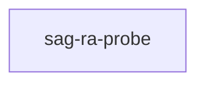

# sag-ra-probe

crate: sag-ra-probe
path: crates/sag-ra-probe
workspace: excluded
digest: ba21286601c9c6af
evidence legend: ../index.md#evidence-legend

Generated; the code is the truth. See ../index.md.

## Depends on

- dep anyhow normal — crates/sag-ra-probe/Cargo.toml:18 CONFIRMED
- dep ra_ap_hir normal — crates/sag-ra-probe/Cargo.toml:19 CONFIRMED
- dep ra_ap_ide normal — crates/sag-ra-probe/Cargo.toml:20 CONFIRMED
- dep ra_ap_load-cargo normal — crates/sag-ra-probe/Cargo.toml:21 CONFIRMED
- dep ra_ap_project_model normal — crates/sag-ra-probe/Cargo.toml:22 CONFIRMED
- dep ra_ap_syntax normal — crates/sag-ra-probe/Cargo.toml:23 CONFIRMED
- dep unicode-properties normal — crates/sag-ra-probe/Cargo.toml:29 CONFIRMED

## Depended on by

## Public items

## Imports from in-scope crates

- none

## Calls

CALL_GRAPH=ARTIFACT_MISSING
- calls ARTIFACT_MISSING — no ruff_charon artifact for this crate UNKNOWN

## Architecture

- none

Generated from Cargo manifests — extracted relationships only.

