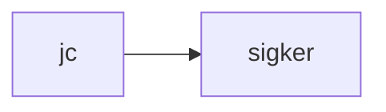

# sigker

crate: sigker
path: crates/sigker
workspace: excluded
digest: 89300faf088069db
evidence legend: ../index.md#evidence-legend

Generated; the code is the truth. See ../index.md.

## Depends on

- dep ndarray normal — crates/sigker/Cargo.toml:17 CONFIRMED

## Depended on by

- rdep jc normal optional — crates/jc/Cargo.toml:22 CONFIRMED

## Public items

- enum CodecRouteSigker [pub] — crates/sigker/src/codec.rs:65 CONFIRMED
- fn CodecRouteSigker::route [pub] — crates/sigker/src/codec.rs:78 CONFIRMED
- enum Regime [pub] — crates/sigker/src/codec.rs:90 CONFIRMED
- enum CarrierKind [pub] — crates/sigker/src/codec.rs:101 CONFIRMED
- struct CubatureBasis [pub] — crates/sigker/src/cubature.rs:94 CONFIRMED
- fn CubatureBasis::cardinality [pub] — crates/sigker/src/cubature.rs:107 CONFIRMED
- fn CubatureBasis::validate_basics [pub] — crates/sigker/src/cubature.rs:121 CONFIRMED
- fn trivial_constant_cubature [pub] — crates/sigker/src/cubature.rs:187 CONFIRMED
- fn hydrate_signature [pub] — crates/sigker/src/cubature.rs:218 CONFIRMED
- fn signature_kernel [pub] — crates/sigker/src/kernel.rs:38 CONFIRMED
- fn signature_kernel_normalized [pub] — crates/sigker/src/kernel.rs:57 CONFIRMED
- fn signature_kernel_pde [pub] — crates/sigker/src/kernel.rs:119 CONFIRMED
- fn linear_path_kernel_closed_form [pub] — crates/sigker/src/kernel.rs:137 CONFIRMED
- mod codec [pub] — crates/sigker/src/lib.rs:63 CONFIRMED
- mod cubature [pub] — crates/sigker/src/lib.rs:64 CONFIRMED
- mod kernel [pub] — crates/sigker/src/lib.rs:65 CONFIRMED
- mod log_signature [pub] — crates/sigker/src/lib.rs:66 CONFIRMED
- mod randomized [pub] — crates/sigker/src/lib.rs:67 CONFIRMED
- mod shuffle [pub] — crates/sigker/src/lib.rs:68 CONFIRMED
- mod signature [pub] — crates/sigker/src/lib.rs:69 CONFIRMED
- fn witt_component [pub] — crates/sigker/src/log_signature.rs:139 CONFIRMED
- fn witt_dimension [pub] — crates/sigker/src/log_signature.rs:154 CONFIRMED
- fn enumerate_lyndon_words [pub] — crates/sigker/src/log_signature.rs:164 CONFIRMED
- fn is_lyndon [pub] — crates/sigker/src/log_signature.rs:197 CONFIRMED
- fn bracket_expansion [pub] — crates/sigker/src/log_signature.rs:227 CONFIRMED
- struct LogSignature [pub] — crates/sigker/src/log_signature.rs:268 CONFIRMED
- fn LogSignature::len [pub] — crates/sigker/src/log_signature.rs:278 CONFIRMED
- fn LogSignature::is_empty [pub] — crates/sigker/src/log_signature.rs:281 CONFIRMED
- fn LogSignature::dot [pub] — crates/sigker/src/log_signature.rs:285 CONFIRMED
- fn LogSignature::cosine [pub] — crates/sigker/src/log_signature.rs:294 CONFIRMED
- fn LogSignature::reconstruct_tensor_log [pub] — crates/sigker/src/log_signature.rs:309 CONFIRMED
- fn LogSignature::compression_vs_signature [pub] — crates/sigker/src/log_signature.rs:324 CONFIRMED
- fn log_signature_truncated [pub] — crates/sigker/src/log_signature.rs:343 CONFIRMED
- fn project_onto_lyndon_basis [pub] — crates/sigker/src/log_signature.rs:368 CONFIRMED
- fn max_abs [pub] — crates/sigker/src/log_signature.rs:390 CONFIRMED
- fn tensor_log [pub] — crates/sigker/src/log_signature.rs:401 CONFIRMED
- struct RandomizedSignatureBuilder [pub] — crates/sigker/src/randomized.rs:58 CONFIRMED
- fn RandomizedSignatureBuilder::new [pub] — crates/sigker/src/randomized.rs:69 CONFIRMED
- fn RandomizedSignatureBuilder::encode [pub] — crates/sigker/src/randomized.rs:120 CONFIRMED
- struct RandomizedSignature [pub] — crates/sigker/src/randomized.rs:135 CONFIRMED
- fn RandomizedSignature::dim [pub] — crates/sigker/src/randomized.rs:141 CONFIRMED
- fn RandomizedSignature::dot [pub] — crates/sigker/src/randomized.rs:146 CONFIRMED
- fn RandomizedSignature::cosine [pub] — crates/sigker/src/randomized.rs:156 CONFIRMED
- fn shuffle_product [pub] — crates/sigker/src/shuffle.rs:36 CONFIRMED
- struct Signature [pub] — crates/sigker/src/signature.rs:38 CONFIRMED
- fn Signature::identity [pub] — crates/sigker/src/signature.rs:49 CONFIRMED
- fn Signature::len [pub] — crates/sigker/src/signature.rs:60 CONFIRMED
- fn Signature::is_empty [pub] — crates/sigker/src/signature.rs:64 CONFIRMED
- fn signature_truncated [pub] — crates/sigker/src/signature.rs:96 CONFIRMED
- fn tensor_multiply [pub(crate)] — crates/sigker/src/signature.rs:153 CONFIRMED
- fn pow_usize [pub(crate)] — crates/sigker/src/signature.rs:199 CONFIRMED

## Imports from in-scope crates

- none

## Calls

CALL_GRAPH=ARTIFACT_MISSING
- calls ARTIFACT_MISSING — no ruff_charon artifact for this crate UNKNOWN

## Architecture

- none

Generated from Cargo manifests — extracted relationships only.

