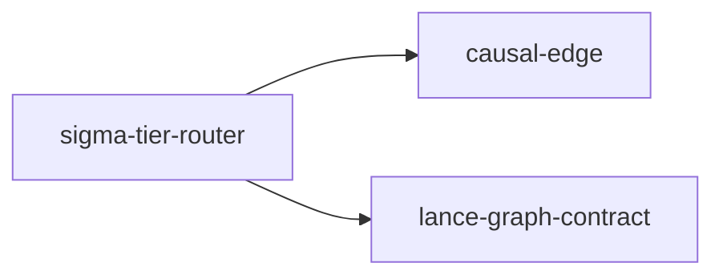

# sigma-tier-router

crate: sigma-tier-router
path: crates/sigma-tier-router
workspace: member
digest: 70d2c505687cfc4c
evidence legend: ../index.md#evidence-legend

Generated; the code is the truth. See ../index.md.

## Depends on

- dep causal-edge normal — crates/sigma-tier-router/Cargo.toml:8 CONFIRMED
- dep lance-graph-contract normal — crates/sigma-tier-router/Cargo.toml:9 CONFIRMED

## Depended on by

## Public items

- struct SigmaTierBands [pub] — crates/sigma-tier-router/src/lib.rs:54 CONFIRMED
- fn SigmaTierBands::jirak_p [pub] — crates/sigma-tier-router/src/lib.rs:102 CONFIRMED
- fn SigmaTierBands::hand_tuned [pub] — crates/sigma-tier-router/src/lib.rs:134 CONFIRMED
- fn SigmaTierBands::default_bands [pub] — crates/sigma-tier-router/src/lib.rs:150 CONFIRMED
- fn SigmaTierBands::is_monotonic [pub] — crates/sigma-tier-router/src/lib.rs:158 CONFIRMED
- fn SigmaTierBands::tier_for [pub] — crates/sigma-tier-router/src/lib.rs:166 CONFIRMED
- struct ResonanceState [pub] — crates/sigma-tier-router/src/lib.rs:196 CONFIRMED
- fn ResonanceState::zero [pub] — crates/sigma-tier-router/src/lib.rs:207 CONFIRMED
- fn ResonanceState::update [pub] — crates/sigma-tier-router/src/lib.rs:216 CONFIRMED
- enum RestReason [pub] — crates/sigma-tier-router/src/lib.rs:230 CONFIRMED
- enum DispatchOutcome [pub] — crates/sigma-tier-router/src/lib.rs:248 CONFIRMED
- struct SigmaTierRouter [pub] — crates/sigma-tier-router/src/lib.rs:292 CONFIRMED
- fn SigmaTierRouter::new [pub] — crates/sigma-tier-router/src/lib.rs:309 CONFIRMED
- fn SigmaTierRouter::tick [pub] — crates/sigma-tier-router/src/lib.rs:329 CONFIRMED
- fn SigmaTierRouter::current_tier [pub] — crates/sigma-tier-router/src/lib.rs:336 CONFIRMED
- fn SigmaTierRouter::dispatch [pub] — crates/sigma-tier-router/src/lib.rs:356 CONFIRMED

## Imports from in-scope crates

### lance-graph-contract
- use lance_graph_contract::mul::GateDecision — crates/sigma-tier-router/src/lib.rs:34 CONFIRMED
- use lance_graph_contract::mul::i4_eval::gate_decision_i4 — crates/sigma-tier-router/src/lib.rs:34 CONFIRMED
- use lance_graph_contract::qualia::QualiaI4_16D — crates/sigma-tier-router/src/lib.rs:35 CONFIRMED
- use lance_graph_contract::qualia::QualiaI4_16D cfg=test — crates/sigma-tier-router/src/lib.rs:422 CONFIRMED

## Calls

CALL_GRAPH=ARTIFACT_MISSING
- calls ARTIFACT_MISSING — no ruff_charon artifact for this crate UNKNOWN

## Architecture

- none

Generated from Cargo manifests — extracted relationships only.

