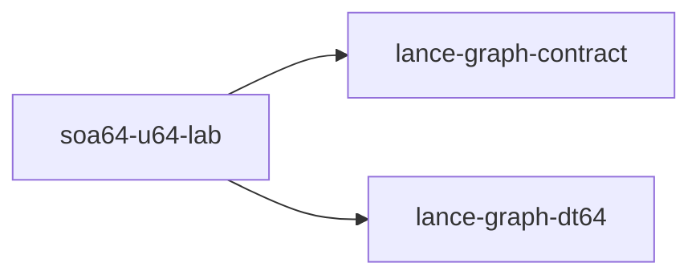

# soa64-u64-lab

crate: soa64-u64-lab
path: crates/soa64-u64-lab
workspace: excluded
digest: ead76d38fed4517f
evidence legend: ../index.md#evidence-legend

Generated; the code is the truth. See ../index.md.

## Depends on

- dep lance-graph-contract normal — crates/soa64-u64-lab/Cargo.toml:17 CONFIRMED
- dep lance-graph-dt64 normal — crates/soa64-u64-lab/Cargo.toml:16 CONFIRMED

## Depended on by

## Public items

- const K [pub] — crates/soa64-u64-lab/src/arms.rs:20 CONFIRMED
- enum Query [pub] — crates/soa64-u64-lab/src/arms.rs:24 CONFIRMED
- fn demanded_fields [pub] — crates/soa64-u64-lab/src/arms.rs:40 CONFIRMED
- trait Arm [pub] — crates/soa64-u64-lab/src/arms.rs:51 CONFIRMED
- struct Aos [pub] — crates/soa64-u64-lab/src/arms.rs:80 CONFIRMED
- fn Aos::build [pub] — crates/soa64-u64-lab/src/arms.rs:86 CONFIRMED
- struct SoaU64 [pub] — crates/soa64-u64-lab/src/arms.rs:164 CONFIRMED
- fn SoaU64::build [pub] — crates/soa64-u64-lab/src/arms.rs:175 CONFIRMED
- fn SoaU64::frames [pub] — crates/soa64-u64-lab/src/arms.rs:197 CONFIRMED
- fn SoaU64::n [pub] — crates/soa64-u64-lab/src/arms.rs:202 CONFIRMED
- fn SoaU64::lane [pub] — crates/soa64-u64-lab/src/arms.rs:208 CONFIRMED
- enum NarrowLane [pub] — crates/soa64-u64-lab/src/arms.rs:285 CONFIRMED
- fn NarrowLane::get [pub] — crates/soa64-u64-lab/src/arms.rs:305 CONFIRMED
- fn NarrowLane::width_bits [pub] — crates/soa64-u64-lab/src/arms.rs:315 CONFIRMED
- struct SoaNarrow [pub] — crates/soa64-u64-lab/src/arms.rs:413 CONFIRMED
- fn SoaNarrow::build [pub] — crates/soa64-u64-lab/src/arms.rs:419 CONFIRMED
- fn SoaNarrow::lane [pub] — crates/soa64-u64-lab/src/arms.rs:427 CONFIRMED
- fn get [pub] — crates/soa64-u64-lab/src/arms.rs:489 CONFIRMED
- struct SoaBitpack [pub] — crates/soa64-u64-lab/src/arms.rs:543 CONFIRMED
- fn SoaBitpack::build [pub] — crates/soa64-u64-lab/src/arms.rs:551 CONFIRMED
- struct HashRow [pub] — crates/soa64-u64-lab/src/arms.rs:664 CONFIRMED
- fn HashRow::build [pub] — crates/soa64-u64-lab/src/arms.rs:672 CONFIRMED
- fn HashRow::lookups [pub] — crates/soa64-u64-lab/src/arms.rs:692 CONFIRMED
- fn HashRow::reset_lookups [pub] — crates/soa64-u64-lab/src/arms.rs:696 CONFIRMED
- const FIELDS [pub] — crates/soa64-u64-lab/src/fixture.rs:8 CONFIRMED
- fn splitmix64 [pub] — crates/soa64-u64-lab/src/fixture.rs:11 CONFIRMED
- fn node_guid [pub] — crates/soa64-u64-lab/src/fixture.rs:20 CONFIRMED
- struct FieldSpec [pub] — crates/soa64-u64-lab/src/fixture.rs:26 CONFIRMED
- fn field_bits [pub] — crates/soa64-u64-lab/src/fixture.rs:32 CONFIRMED
- fn field_spec [pub] — crates/soa64-u64-lab/src/fixture.rs:43 CONFIRMED
- fn mask_to [pub] — crates/soa64-u64-lab/src/fixture.rs:51 CONFIRMED
- fn value [pub] — crates/soa64-u64-lab/src/fixture.rs:61 CONFIRMED
- fn present [pub] — crates/soa64-u64-lab/src/fixture.rs:71 CONFIRMED
- fn probes [pub] — crates/soa64-u64-lab/src/fixture.rs:80 CONFIRMED
- struct Fixture [pub] — crates/soa64-u64-lab/src/fixture.rs:90 CONFIRMED
- fn Fixture::new [pub] — crates/soa64-u64-lab/src/fixture.rs:97 CONFIRMED
- fn tile_slot [pub] — crates/soa64-u64-lab/src/fixture.rs:107 CONFIRMED
- struct G2L [pub] — crates/soa64-u64-lab/src/fixture.rs:114 CONFIRMED
- fn G2L::new [pub] — crates/soa64-u64-lab/src/fixture.rs:121 CONFIRMED
- fn G2L::lookup [pub] — crates/soa64-u64-lab/src/fixture.rs:135 CONFIRMED
- mod arms [pub] — crates/soa64-u64-lab/src/lib.rs:13 CONFIRMED
- mod fixture [pub] — crates/soa64-u64-lab/src/lib.rs:14 CONFIRMED
- mod oracle [pub] — crates/soa64-u64-lab/src/lib.rs:15 CONFIRMED
- mod socket [pub] — crates/soa64-u64-lab/src/lib.rs:16 CONFIRMED
- fn oracle [pub] — crates/soa64-u64-lab/src/oracle.rs:8 CONFIRMED
- const CLASS [pub] — crates/soa64-u64-lab/src/socket.rs:22 CONFIRMED
- const VIEW_CLASS [pub] — crates/soa64-u64-lab/src/socket.rs:24 CONFIRMED
- const POSITION [pub] — crates/soa64-u64-lab/src/socket.rs:26 CONFIRMED
- const READER [pub] — crates/soa64-u64-lab/src/socket.rs:28 CONFIRMED
- const SPACE_A [pub] — crates/soa64-u64-lab/src/socket.rs:30 CONFIRMED
- const SPACE_OTHER [pub] — crates/soa64-u64-lab/src/socket.rs:35 CONFIRMED
- struct View [pub] — crates/soa64-u64-lab/src/socket.rs:41 CONFIRMED
- fn View::sixty_four [pub] — crates/soa64-u64-lab/src/socket.rs:44 CONFIRMED
- struct World [pub] — crates/soa64-u64-lab/src/socket.rs:71 CONFIRMED
- fn World::new [pub] — crates/soa64-u64-lab/src/socket.rs:78 CONFIRMED
- struct U64Source [pub] — crates/soa64-u64-lab/src/socket.rs:113 CONFIRMED
- fn U64Source<'a>::new [pub] — crates/soa64-u64-lab/src/socket.rs:125 CONFIRMED
- fn bind_demanded [pub] — crates/soa64-u64-lab/src/socket.rs:176 CONFIRMED
- fn sum_where_via_socket [pub] — crates/soa64-u64-lab/src/socket.rs:201 CONFIRMED
- fn fold_via_socket [pub] — crates/soa64-u64-lab/src/socket.rs:219 CONFIRMED
- fn reordered_b [pub] — crates/soa64-u64-lab/src/socket.rs:239 CONFIRMED

## Imports from in-scope crates

### lance-graph-contract
- use lance_graph_contract::class_view::ClassId — crates/soa64-u64-lab/src/socket.rs:10 CONFIRMED
- use lance_graph_contract::class_view::ClassView — crates/soa64-u64-lab/src/socket.rs:10 CONFIRMED
- use lance_graph_contract::class_view::WideFieldMask — crates/soa64-u64-lab/src/socket.rs:10 CONFIRMED
- use lance_graph_contract::ontology::DisplayTemplate — crates/soa64-u64-lab/src/socket.rs:11 CONFIRMED
- use lance_graph_contract::ontology::FieldRef — crates/soa64-u64-lab/src/socket.rs:11 CONFIRMED
### lance-graph-dt64
- use lance_graph_dt64::dr::FrameRevisions — crates/soa64-u64-lab/src/arms.rs:15 CONFIRMED
- use lance_graph_dt64::dr::FrameStore — crates/soa64-u64-lab/src/arms.rs:15 CONFIRMED
- use lance_graph_dt64::dr::Frame — crates/soa64-u64-lab/src/socket.rs:12 CONFIRMED
- use lance_graph_dt64::dr::FrameStore — crates/soa64-u64-lab/src/socket.rs:12 CONFIRMED
- use lance_graph_dt64::dr::Scope — crates/soa64-u64-lab/src/socket.rs:12 CONFIRMED
- use lance_graph_dt64::BindStore — crates/soa64-u64-lab/src/socket.rs:14 CONFIRMED
- use lance_graph_dt64::ClassSchema — crates/soa64-u64-lab/src/socket.rs:14 CONFIRMED
- use lance_graph_dt64::CoordSpace — crates/soa64-u64-lab/src/socket.rs:14 CONFIRMED
- use lance_graph_dt64::Extent — crates/soa64-u64-lab/src/socket.rs:14 CONFIRMED
- use lance_graph_dt64::LaneAddr — crates/soa64-u64-lab/src/socket.rs:14 CONFIRMED
- use lance_graph_dt64::LaneBinding — crates/soa64-u64-lab/src/socket.rs:14 CONFIRMED
- use lance_graph_dt64::LaneRefusal — crates/soa64-u64-lab/src/socket.rs:14 CONFIRMED
- use lance_graph_dt64::LaneRequest — crates/soa64-u64-lab/src/socket.rs:14 CONFIRMED
- use lance_graph_dt64::LaneSource — crates/soa64-u64-lab/src/socket.rs:15 CONFIRMED
- use lance_graph_dt64::RouteAt — crates/soa64-u64-lab/src/socket.rs:15 CONFIRMED
- use lance_graph_dt64::SchemaRev — crates/soa64-u64-lab/src/socket.rs:15 CONFIRMED

## Calls

CALL_GRAPH=ARTIFACT_MISSING
- calls ARTIFACT_MISSING — no ruff_charon artifact for this crate UNKNOWN

## Architecture

- none

Generated from Cargo manifests — extracted relationships only.

