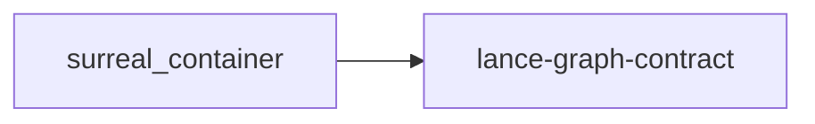

# surreal_container

crate: surreal_container
path: crates/surreal_container
workspace: member
digest: f48bffc5f9476b8f
evidence legend: ../index.md#evidence-legend

Generated; the code is the truth. See ../index.md.

## Depends on

- dep lance-graph-contract normal — crates/surreal_container/Cargo.toml:51 CONFIRMED
- dep futures normal — crates/surreal_container/Cargo.toml:64 CONFIRMED
- dep lance normal — crates/surreal_container/Cargo.toml:53 CONFIRMED
- dep lancedb normal optional — crates/surreal_container/Cargo.toml:60 CONFIRMED
- dep snafu normal — crates/surreal_container/Cargo.toml:65 CONFIRMED
- dep tempfile dev — crates/surreal_container/Cargo.toml:75 CONFIRMED
- dep tokio dev — crates/surreal_container/Cargo.toml:74 CONFIRMED
- dep tokio normal — crates/surreal_container/Cargo.toml:63 CONFIRMED

## Depended on by

## Public items

- struct SurrealStore [pub] — crates/surreal_container/src/lib.rs:85 CONFIRMED
- fn SurrealStore::test_placeholder [pub(crate)] cfg=test — crates/surreal_container/src/lib.rs:101 CONFIRMED
- fn SurrealStore::open [pub] — crates/surreal_container/src/lib.rs:124 CONFIRMED
- fn SurrealStore::ds [pub] — crates/surreal_container/src/lib.rs:156 CONFIRMED
- enum SurrealContainerError [pub] — crates/surreal_container/src/lib.rs:166 CONFIRMED
- mod write [pub] — crates/surreal_container/src/lib.rs:210 CONFIRMED
- mod read [pub] — crates/surreal_container/src/lib.rs:214 CONFIRMED
- mod fold [pub] — crates/surreal_container/src/lib.rs:218 CONFIRMED
- mod catalog [pub] — crates/surreal_container/src/lib.rs:224 CONFIRMED
- mod cache [pub] — crates/surreal_container/src/lib.rs:228 CONFIRMED
- mod epoch [pub] — crates/surreal_container/src/lib.rs:232 CONFIRMED
- mod ring [pub] — crates/surreal_container/src/lib.rs:236 CONFIRMED
- mod compaction [pub] — crates/surreal_container/src/lib.rs:240 CONFIRMED
- mod writer_invariants [pub] — crates/surreal_container/src/lib.rs:244 CONFIRMED
- mod view [pub] — crates/surreal_container/src/lib.rs:253 CONFIRMED
- struct SurrealMailboxView [pub] — crates/surreal_container/src/view.rs:83 CONFIRMED
- fn SurrealMailboxView<'a>::from_columns [pub] — crates/surreal_container/src/view.rs:121 CONFIRMED
- fn read_via_kv_lance [pub] — crates/surreal_container/src/view.rs:218 CONFIRMED

## Imports from in-scope crates

### lance-graph-contract
- use lance_graph_contract::collapse_gate::MailboxId — crates/surreal_container/src/view.rs:64 CONFIRMED
- use lance_graph_contract::kanban::KanbanColumn — crates/surreal_container/src/view.rs:65 CONFIRMED
- use lance_graph_contract::soa_view::MailboxSoaView — crates/surreal_container/src/view.rs:66 CONFIRMED
- use lance_graph_contract::scheduler::DatasetVersion cfg=test — crates/surreal_container/src/view.rs:243 CONFIRMED
- use lance_graph_contract::scheduler::NextPhaseScheduler cfg=test — crates/surreal_container/src/view.rs:243 CONFIRMED
- use lance_graph_contract::scheduler::VersionScheduler cfg=test — crates/surreal_container/src/view.rs:243 CONFIRMED

## Calls

CALL_GRAPH=ARTIFACT_MISSING
- calls ARTIFACT_MISSING — no ruff_charon artifact for this crate UNKNOWN

## Architecture

- arch Quack lance-selective-read allow/block prefilter + attested range read [LAB] validation=OK — crates/crepe-plan-probe/examples/where_lance_arm.rs:45 LAB

Generated from Cargo manifests — extracted relationships only.

