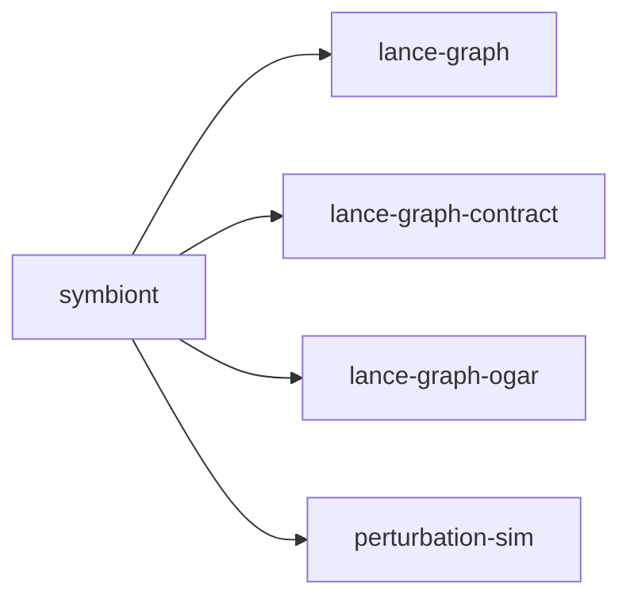

# symbiont

crate: symbiont
path: crates/symbiont
workspace: excluded
digest: 7220560f807186d1
evidence legend: ../index.md#evidence-legend

Generated; the code is the truth. See ../index.md.

## Depends on

- dep lance-graph normal — crates/symbiont/Cargo.toml:37 CONFIRMED
- dep lance-graph-contract normal — crates/symbiont/Cargo.toml:41 CONFIRMED
- dep lance-graph-ogar normal — crates/symbiont/Cargo.toml:65 CONFIRMED
- dep perturbation-sim normal — crates/symbiont/Cargo.toml:38 CONFIRMED
- dep ndarray normal — crates/symbiont/Cargo.toml:44 CONFIRMED
- dep ogar-adapter-surrealql normal — crates/symbiont/Cargo.toml:57 CONFIRMED
- dep ogar-ontology normal — crates/symbiont/Cargo.toml:56 CONFIRMED
- dep ogar-vocab normal — crates/symbiont/Cargo.toml:55 CONFIRMED
- dep ractor normal — crates/symbiont/Cargo.toml:51 CONFIRMED
- dep surrealdb-core normal — crates/symbiont/Cargo.toml:52 CONFIRMED

## Depended on by

## Public items

- const MAX_BOARDS [pub] — crates/symbiont/src/bridge.rs:32 CONFIRMED
- fn energy [pub] — crates/symbiont/src/bridge.rs:45 CONFIRMED
- fn build_demo_grid [pub] — crates/symbiont/src/bridge.rs:64 CONFIRMED
- fn grid_to_noderows [pub] — crates/symbiont/src/bridge.rs:88 CONFIRMED
- fn run_demo [pub] — crates/symbiont/src/bridge.rs:100 CONFIRMED
- fn run_scale_demo [pub] — crates/symbiont/src/bridge.rs:120 CONFIRMED
- fn energy_of [pub] — crates/symbiont/src/domino.rs:81 CONFIRMED
- fn run_poc [pub] — crates/symbiont/src/domino.rs:157 CONFIRMED
- fn seed_boards [pub] — crates/symbiont/src/domino.rs:203 CONFIRMED
- fn domino_sweep [pub] — crates/symbiont/src/domino.rs:210 CONFIRMED
- struct SymbiontBoard [pub] — crates/symbiont/src/kanban_loop.rs:61 CONFIRMED
- fn SymbiontBoard::spawn [pub] — crates/symbiont/src/kanban_loop.rs:75 CONFIRMED
- fn SymbiontBoard::step [pub] — crates/symbiont/src/kanban_loop.rs:114 CONFIRMED
- fn SymbiontBoard::run_to_absorbing [pub] — crates/symbiont/src/kanban_loop.rs:124 CONFIRMED
- fn run_demo [pub] — crates/symbiont/src/kanban_loop.rs:196 CONFIRMED
- fn hhtl_path_of [pub] — crates/symbiont/src/key_render.rs:33 CONFIRMED
- struct RenderedNode [pub] — crates/symbiont/src/key_render.rs:39 CONFIRMED
- struct KeyGraph [pub] — crates/symbiont/src/key_render.rs:55 CONFIRMED
- fn render_key_only [pub] — crates/symbiont/src/key_render.rs:64 CONFIRMED
- fn run_demo [pub] — crates/symbiont/src/key_render.rs:97 CONFIRMED

## Imports from in-scope crates

### lance-graph-contract
- use lance_graph_contract::canonical_node::NodeRowPacket — crates/symbiont/src/bridge.rs:24 CONFIRMED
- use lance_graph_contract::canonical_node::ValueTenant — crates/symbiont/src/bridge.rs:24 CONFIRMED
- use lance_graph_contract::soa_envelope::SoaEnvelope — crates/symbiont/src/bridge.rs:25 CONFIRMED
- use lance_graph_contract::EdgeBlock — crates/symbiont/src/bridge.rs:26 CONFIRMED
- use lance_graph_contract::NodeGuid — crates/symbiont/src/bridge.rs:26 CONFIRMED
- use lance_graph_contract::NodeRow — crates/symbiont/src/bridge.rs:26 CONFIRMED
- use lance_graph_contract::canonical_node::NodeRow — crates/symbiont/src/domino.rs:24 CONFIRMED
- use lance_graph_contract::canonical_node::ValueTenant — crates/symbiont/src/domino.rs:24 CONFIRMED
- use lance_graph_contract::nan_projection::project_energy_nonfinite — crates/symbiont/src/domino.rs:25 CONFIRMED
- use lance_graph_contract::EdgeBlock — crates/symbiont/src/domino.rs:26 CONFIRMED
- use lance_graph_contract::NodeGuid — crates/symbiont/src/domino.rs:26 CONFIRMED
- use lance_graph_contract::canonical_node::EdgeBlock — crates/symbiont/src/kanban_loop.rs:47 CONFIRMED
- use lance_graph_contract::canonical_node::NodeRow — crates/symbiont/src/kanban_loop.rs:47 CONFIRMED
- use lance_graph_contract::hhtl::NiblePath — crates/symbiont/src/kanban_loop.rs:48 CONFIRMED
- use lance_graph_contract::kanban::ExecTarget — crates/symbiont/src/kanban_loop.rs:49 CONFIRMED
- use lance_graph_contract::kanban::KanbanColumn — crates/symbiont/src/kanban_loop.rs:49 CONFIRMED
- use lance_graph_contract::kanban::KanbanMove — crates/symbiont/src/kanban_loop.rs:49 CONFIRMED
- use lance_graph_contract::scheduler::DatasetVersion — crates/symbiont/src/kanban_loop.rs:50 CONFIRMED
- use lance_graph_contract::scheduler::NextPhaseScheduler — crates/symbiont/src/kanban_loop.rs:50 CONFIRMED
- use lance_graph_contract::scheduler::VersionScheduler — crates/symbiont/src/kanban_loop.rs:50 CONFIRMED
- use lance_graph_contract::soa_view::MailboxSoaOwner — crates/symbiont/src/kanban_loop.rs:51 CONFIRMED
- use lance_graph_contract::soa_view::MailboxSoaView — crates/symbiont/src/kanban_loop.rs:51 CONFIRMED
- use lance_graph_contract::kanban::LIBET_COMMIT_WINDOW_US cfg=test — crates/symbiont/src/kanban_loop.rs:215 CONFIRMED
- use lance_graph_contract::canonical_node::NodeRow — crates/symbiont/src/key_render.rs:22 CONFIRMED
- use lance_graph_contract::hhtl::NiblePath — crates/symbiont/src/key_render.rs:23 CONFIRMED
- use lance_graph_contract::NodeGuid — crates/symbiont/src/key_render.rs:24 CONFIRMED
### perturbation-sim
- use perturbation_sim::CascadeConfig — crates/symbiont/src/bridge.rs:27 CONFIRMED
- use perturbation_sim::Edge — crates/symbiont/src/bridge.rs:27 CONFIRMED
- use perturbation_sim::Grid — crates/symbiont/src/bridge.rs:27 CONFIRMED
- use perturbation_sim::simulate_outage — crates/symbiont/src/bridge.rs:27 CONFIRMED

## Calls

CALL_GRAPH=ARTIFACT_MISSING
- calls ARTIFACT_MISSING — no ruff_charon artifact for this crate UNKNOWN

## Architecture

- none

Generated from Cargo manifests — extracted relationships only.

