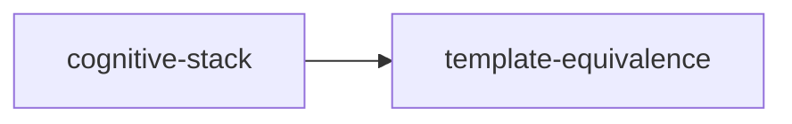

# template-equivalence

crate: template-equivalence
path: crates/template-equivalence
workspace: excluded
digest: f23f53a543753885
evidence legend: ../index.md#evidence-legend

Generated; the code is the truth. See ../index.md.

## Depends on

## Depended on by

- rdep cognitive-stack normal — crates/cognitive-stack/Cargo.toml:40 CONFIRMED

## Public items

- enum EquivalenceClass [pub] — crates/template-equivalence/src/lib.rs:18 CONFIRMED
- struct ReplayObservation [pub] — crates/template-equivalence/src/lib.rs:28 CONFIRMED
- struct EquivalenceConfig [pub] — crates/template-equivalence/src/lib.rs:40 CONFIRMED
- struct EquivalenceReport [pub] — crates/template-equivalence/src/lib.rs:57 CONFIRMED
- fn EquivalenceReport::passes [pub] — crates/template-equivalence/src/lib.rs:65 CONFIRMED
- trait EquivalenceChecker [pub] — crates/template-equivalence/src/lib.rs:71 CONFIRMED
- struct StructuralChecker [pub] — crates/template-equivalence/src/lib.rs:78 CONFIRMED

## Imports from in-scope crates

- none

## Calls

CALL_GRAPH=ARTIFACT_MISSING
- calls ARTIFACT_MISSING — no ruff_charon artifact for this crate UNKNOWN

## Architecture

- none

Generated from Cargo manifests — extracted relationships only.

