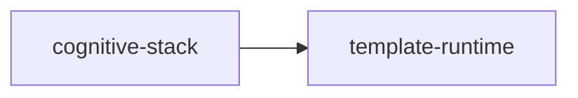

# template-runtime

crate: template-runtime
path: crates/template-runtime
workspace: excluded
digest: bbcc57c5bfe7d616
evidence legend: ../index.md#evidence-legend

Generated; the code is the truth. See ../index.md.

## Depends on

## Depended on by

- rdep cognitive-stack normal — crates/cognitive-stack/Cargo.toml:39 CONFIRMED

## Public items

- struct CompiledStep [pub] — crates/template-runtime/src/lib.rs:20 CONFIRMED
- struct CompiledTemplate [pub] — crates/template-runtime/src/lib.rs:28 CONFIRMED
- struct ExecutionInput [pub] — crates/template-runtime/src/lib.rs:36 CONFIRMED
- struct StepOutput [pub] — crates/template-runtime/src/lib.rs:43 CONFIRMED
- struct ExecutionOutput [pub] — crates/template-runtime/src/lib.rs:50 CONFIRMED
- enum RuntimeError [pub] — crates/template-runtime/src/lib.rs:57 CONFIRMED
- trait OgarAction [pub] — crates/template-runtime/src/lib.rs:83 CONFIRMED
- struct ActionRegistry [pub] — crates/template-runtime/src/lib.rs:93 CONFIRMED
- fn ActionRegistry::new [pub] — crates/template-runtime/src/lib.rs:98 CONFIRMED
- fn ActionRegistry::register [pub] — crates/template-runtime/src/lib.rs:101 CONFIRMED
- fn ActionRegistry::get [pub] — crates/template-runtime/src/lib.rs:104 CONFIRMED
- fn ActionRegistry::len [pub] — crates/template-runtime/src/lib.rs:107 CONFIRMED
- fn ActionRegistry::is_empty [pub] — crates/template-runtime/src/lib.rs:110 CONFIRMED
- trait TemplateExecutor [pub] — crates/template-runtime/src/lib.rs:116 CONFIRMED
- struct ReflexExecutor [pub] — crates/template-runtime/src/lib.rs:122 CONFIRMED
- fn ReflexExecutor::new [pub] — crates/template-runtime/src/lib.rs:127 CONFIRMED

## Imports from in-scope crates

- none

## Calls

CALL_GRAPH=ARTIFACT_MISSING
- calls ARTIFACT_MISSING — no ruff_charon artifact for this crate UNKNOWN

## Architecture

- none

Generated from Cargo manifests — extracted relationships only.

