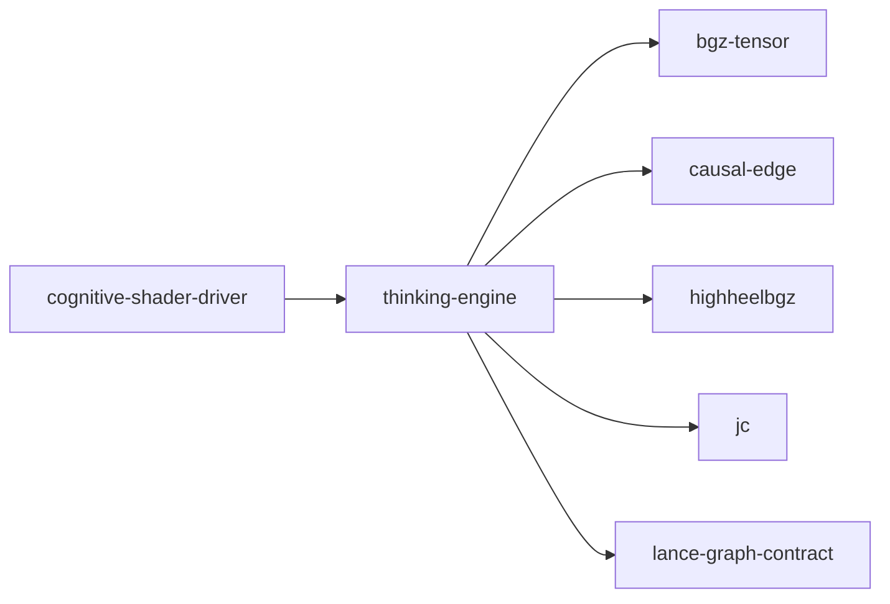

# thinking-engine

crate: thinking-engine
path: crates/thinking-engine
workspace: excluded
digest: a2b1d973a2428d01
evidence legend: ../index.md#evidence-legend

Generated; the code is the truth. See ../index.md.

## Depends on

- dep bgz-tensor normal — crates/thinking-engine/Cargo.toml:19 CONFIRMED
- dep bgz17 dev — crates/thinking-engine/Cargo.toml:50 CONFIRMED
- dep causal-edge normal — crates/thinking-engine/Cargo.toml:16 CONFIRMED
- dep highheelbgz normal — crates/thinking-engine/Cargo.toml:20 CONFIRMED
- dep jc normal — crates/thinking-engine/Cargo.toml:23 CONFIRMED
- dep lance-graph-contract normal — crates/thinking-engine/Cargo.toml:17 CONFIRMED
- dep candle-core normal optional — crates/thinking-engine/Cargo.toml:29 CONFIRMED
- dep candle-nn normal optional — crates/thinking-engine/Cargo.toml:30 CONFIRMED
- dep candle-transformers normal optional — crates/thinking-engine/Cargo.toml:31 CONFIRMED
- dep half dev — crates/thinking-engine/Cargo.toml:45 CONFIRMED
- dep hf-hub normal optional — crates/thinking-engine/Cargo.toml:32 CONFIRMED
- dep ndarray normal — crates/thinking-engine/Cargo.toml:18 CONFIRMED
- dep rayon dev — crates/thinking-engine/Cargo.toml:42 CONFIRMED
- dep safetensors dev — crates/thinking-engine/Cargo.toml:44 CONFIRMED
- dep serde normal — crates/thinking-engine/Cargo.toml:26 CONFIRMED
- dep serde_json normal — crates/thinking-engine/Cargo.toml:25 CONFIRMED
- dep tokenizers dev — crates/thinking-engine/Cargo.toml:43 CONFIRMED
- dep tokenizers normal optional — crates/thinking-engine/Cargo.toml:24 CONFIRMED

## Depended on by

- rdep cognitive-shader-driver normal optional — crates/cognitive-shader-driver/Cargo.toml:242 CONFIRMED

## Public items

- enum Architecture [pub] — crates/thinking-engine/src/auto_detect.rs:13 CONFIRMED
- struct DetectedModel [pub] — crates/thinking-engine/src/auto_detect.rs:31 CONFIRMED
- fn detect_from_config_json [pub] — crates/thinking-engine/src/auto_detect.rs:48 CONFIRMED
- fn detect_from_gguf_metadata [pub] — crates/thinking-engine/src/auto_detect.rs:127 CONFIRMED
- struct ResonanceDto [pub] — crates/thinking-engine/src/awareness_dto.rs:21 CONFIRMED
- enum GestaltState [pub] — crates/thinking-engine/src/awareness_dto.rs:59 CONFIRMED
- fn ResonanceDto::from_superposition [pub] — crates/thinking-engine/src/awareness_dto.rs:72 CONFIRMED
- struct QualiaDto [pub] — crates/thinking-engine/src/awareness_dto.rs:131 CONFIRMED
- fn QualiaDto::from_qualia [pub] — crates/thinking-engine/src/awareness_dto.rs:175 CONFIRMED
- struct MomentDto [pub] — crates/thinking-engine/src/awareness_dto.rs:239 CONFIRMED
- struct BF16ThinkingEngine [pub] — crates/thinking-engine/src/bf16_engine.rs:21 CONFIRMED
- fn BF16ThinkingEngine::new [pub] — crates/thinking-engine/src/bf16_engine.rs:46 CONFIRMED
- fn BF16ThinkingEngine::from_f32_cosines [pub] — crates/thinking-engine/src/bf16_engine.rs:70 CONFIRMED
- fn BF16ThinkingEngine::from_f64_cosines [pub] — crates/thinking-engine/src/bf16_engine.rs:77 CONFIRMED
- fn BF16ThinkingEngine::from_codebook [pub] — crates/thinking-engine/src/bf16_engine.rs:85 CONFIRMED
- fn BF16ThinkingEngine::from_mean_pair_cosines [pub] — crates/thinking-engine/src/bf16_engine.rs:110 CONFIRMED
- fn BF16ThinkingEngine::load [pub] — crates/thinking-engine/src/bf16_engine.rs:160 CONFIRMED
- fn BF16ThinkingEngine::save [pub] — crates/thinking-engine/src/bf16_engine.rs:173 CONFIRMED
- fn BF16ThinkingEngine::cycle [pub] — crates/thinking-engine/src/bf16_engine.rs:186 CONFIRMED
- fn BF16ThinkingEngine::cycle_with_temperature [pub] — crates/thinking-engine/src/bf16_engine.rs:265 CONFIRMED
- fn BF16ThinkingEngine::think [pub] — crates/thinking-engine/src/bf16_engine.rs:286 CONFIRMED
- fn BF16ThinkingEngine::think_with_temperature [pub] — crates/thinking-engine/src/bf16_engine.rs:304 CONFIRMED
- fn BF16ThinkingEngine::perturb [pub] — crates/thinking-engine/src/bf16_engine.rs:326 CONFIRMED
- fn BF16ThinkingEngine::reset [pub] — crates/thinking-engine/src/bf16_engine.rs:342 CONFIRMED
- fn BF16ThinkingEngine::commit [pub] — crates/thinking-engine/src/bf16_engine.rs:350 CONFIRMED
- fn BF16ThinkingEngine::distance_table_ref [pub] — crates/thinking-engine/src/bf16_engine.rs:362 CONFIRMED
- fn BF16ThinkingEngine::entropy [pub] — crates/thinking-engine/src/bf16_engine.rs:367 CONFIRMED
- fn BF16ThinkingEngine::active_count [pub] — crates/thinking-engine/src/bf16_engine.rs:378 CONFIRMED
- fn BF16ThinkingEngine::sign_stats [pub] — crates/thinking-engine/src/bf16_engine.rs:383 CONFIRMED
- static BGE_M3_HDR_TABLE [pub] — crates/thinking-engine/src/bge_m3_lens.rs:16 CONFIRMED
- static BGE_M3_CODEBOOK_INDEX [pub] — crates/thinking-engine/src/bge_m3_lens.rs:20 CONFIRMED
- const BGE_M3_N_CENTROIDS [pub] — crates/thinking-engine/src/bge_m3_lens.rs:22 CONFIRMED
- const BGE_M3_VOCAB_SIZE [pub] — crates/thinking-engine/src/bge_m3_lens.rs:23 CONFIRMED
- fn bge_m3_lookup [pub] — crates/thinking-engine/src/bge_m3_lens.rs:26 CONFIRMED
- fn bge_m3_lookup_many [pub] — crates/thinking-engine/src/bge_m3_lens.rs:30 CONFIRMED
- fn bge_m3_distance [pub] — crates/thinking-engine/src/bge_m3_lens.rs:35 CONFIRMED
- fn bge_m3_engine [pub] — crates/thinking-engine/src/bge_m3_lens.rs:39 CONFIRMED
- fn vote_distance [pub] — crates/thinking-engine/src/bge_m3_lens.rs:45 CONFIRMED
- const BRANCH [pub] — crates/thinking-engine/src/branching.rs:34 CONFIRMED
- const L1 [pub] — crates/thinking-engine/src/branching.rs:37 CONFIRMED
- const L2 [pub] — crates/thinking-engine/src/branching.rs:38 CONFIRMED
- const L3 [pub] — crates/thinking-engine/src/branching.rs:39 CONFIRMED
- const L3_PER_L2 [pub] — crates/thinking-engine/src/branching.rs:42 CONFIRMED
- struct BranchingEngine [pub] — crates/thinking-engine/src/branching.rs:93 CONFIRMED
- fn BranchingEngine::new [pub] — crates/thinking-engine/src/branching.rs:102 CONFIRMED
- fn BranchingEngine::perturb [pub] — crates/thinking-engine/src/branching.rs:112 CONFIRMED
- fn BranchingEngine::cycle [pub] — crates/thinking-engine/src/branching.rs:135 CONFIRMED
- fn BranchingEngine::think [pub] — crates/thinking-engine/src/branching.rs:173 CONFIRMED
- fn BranchingEngine::energy_l1 [pub] — crates/thinking-engine/src/branching.rs:197 CONFIRMED
- fn BranchingEngine::energy_l2 [pub] — crates/thinking-engine/src/branching.rs:200 CONFIRMED
- fn BranchingEngine::energy_l3 [pub] — crates/thinking-engine/src/branching.rs:203 CONFIRMED
- fn BranchingEngine::reset [pub] — crates/thinking-engine/src/branching.rs:208 CONFIRMED
- struct BranchResult [pub] — crates/thinking-engine/src/branching.rs:220 CONFIRMED
- fn spiral_to_table_index [pub] — crates/thinking-engine/src/bridge.rs:18 CONFIRMED
- fn build_spiral_distance_table [pub] — crates/thinking-engine/src/bridge.rs:62 CONFIRMED
- fn hydrate_and_cosine [pub] — crates/thinking-engine/src/bridge.rs:86 CONFIRMED
- fn enrich_table_from_source [pub] — crates/thinking-engine/src/bridge.rs:107 CONFIRMED
- struct Temperature [pub] — crates/thinking-engine/src/builder.rs:33 CONFIRMED
- fn Temperature::standard [pub] — crates/thinking-engine/src/builder.rs:36 CONFIRMED
- fn Temperature::analytical [pub] — crates/thinking-engine/src/builder.rs:39 CONFIRMED
- fn Temperature::creative [pub] — crates/thinking-engine/src/builder.rs:42 CONFIRMED
- fn Temperature::balanced [pub] — crates/thinking-engine/src/builder.rs:45 CONFIRMED
- fn Temperature::focused [pub] — crates/thinking-engine/src/builder.rs:48 CONFIRMED
- fn Temperature::from_preset [pub] — crates/thinking-engine/src/builder.rs:52 CONFIRMED
- enum ThinkingPreset [pub] — crates/thinking-engine/src/builder.rs:71 CONFIRMED
- fn ThinkingPreset::to_pooling [pub] — crates/thinking-engine/src/builder.rs:84 CONFIRMED
- enum Lens [pub] — crates/thinking-engine/src/builder.rs:108 CONFIRMED
- enum TableType [pub] — crates/thinking-engine/src/builder.rs:122 CONFIRMED
- enum BuiltEngine [pub] — crates/thinking-engine/src/builder.rs:134 CONFIRMED
- fn BuiltEngine::perturb [pub] — crates/thinking-engine/src/builder.rs:142 CONFIRMED
- fn BuiltEngine::reset [pub] — crates/thinking-engine/src/builder.rs:151 CONFIRMED
- fn BuiltEngine::energy [pub] — crates/thinking-engine/src/builder.rs:160 CONFIRMED
- fn BuiltEngine::cycles [pub] — crates/thinking-engine/src/builder.rs:169 CONFIRMED
- fn BuiltEngine::size [pub] — crates/thinking-engine/src/builder.rs:178 CONFIRMED
- fn BuiltEngine::think [pub] — crates/thinking-engine/src/builder.rs:187 CONFIRMED
- fn BuiltEngine::think_with_temperature [pub] — crates/thinking-engine/src/builder.rs:204 CONFIRMED
- type CommitSink [pub] — crates/thinking-engine/src/builder.rs:223 CONFIRMED
- struct ThinkingEngineBuilder [pub] — crates/thinking-engine/src/builder.rs:226 CONFIRMED
- fn ThinkingEngineBuilder::new [pub] — crates/thinking-engine/src/builder.rs:240 CONFIRMED
- fn ThinkingEngineBuilder::lens [pub] — crates/thinking-engine/src/builder.rs:253 CONFIRMED
- fn ThinkingEngineBuilder::table_type [pub] — crates/thinking-engine/src/builder.rs:259 CONFIRMED
- fn ThinkingEngineBuilder::pooling [pub] — crates/thinking-engine/src/builder.rs:265 CONFIRMED
- fn ThinkingEngineBuilder::thinking_preset [pub] — crates/thinking-engine/src/builder.rs:271 CONFIRMED
- fn ThinkingEngineBuilder::temperature [pub] — crates/thinking-engine/src/builder.rs:278 CONFIRMED
- fn ThinkingEngineBuilder::max_cycles [pub] — crates/thinking-engine/src/builder.rs:284 CONFIRMED
- fn ThinkingEngineBuilder::raw_cosines [pub] — crates/thinking-engine/src/builder.rs:294 CONFIRMED
- fn ThinkingEngineBuilder::on_commit [pub] — crates/thinking-engine/src/builder.rs:301 CONFIRMED
- fn ThinkingEngineBuilder::build [pub] — crates/thinking-engine/src/builder.rs:307 CONFIRMED
- struct ConfiguredEngine [pub] — crates/thinking-engine/src/builder.rs:367 CONFIRMED
- fn ConfiguredEngine::process [pub] — crates/thinking-engine/src/builder.rs:383 CONFIRMED
- fn ConfiguredEngine::inner [pub] — crates/thinking-engine/src/builder.rs:410 CONFIRMED
- fn ConfiguredEngine::pooling [pub] — crates/thinking-engine/src/builder.rs:415 CONFIRMED
- const JINA_CENTROID_LABELS [pub] — crates/thinking-engine/src/centroid_labels.rs:4 CONFIRMED
- struct CodebookIndex [pub] — crates/thinking-engine/src/codebook_index.rs:14 CONFIRMED
- fn CodebookIndex::new [pub] — crates/thinking-engine/src/codebook_index.rs:28 CONFIRMED
- fn CodebookIndex::lookup [pub] — crates/thinking-engine/src/codebook_index.rs:49 CONFIRMED
- fn CodebookIndex::lookup_many [pub] — crates/thinking-engine/src/codebook_index.rs:60 CONFIRMED
- fn CodebookIndex::save [pub] — crates/thinking-engine/src/codebook_index.rs:65 CONFIRMED
- fn CodebookIndex::load [pub] — crates/thinking-engine/src/codebook_index.rs:77 CONFIRMED
- fn CodebookIndex::len [pub] — crates/thinking-engine/src/codebook_index.rs:108 CONFIRMED
- fn CodebookIndex::is_empty [pub] — crates/thinking-engine/src/codebook_index.rs:113 CONFIRMED
- fn CodebookIndex::table_size [pub] — crates/thinking-engine/src/codebook_index.rs:118 CONFIRMED
- fn CodebookIndex::model [pub] — crates/thinking-engine/src/codebook_index.rs:123 CONFIRMED
- fn CodebookIndex::unique_centroids [pub] — crates/thinking-engine/src/codebook_index.rs:128 CONFIRMED
- fn CodebookIndex::centroid_counts [pub] — crates/thinking-engine/src/codebook_index.rs:137 CONFIRMED
- fn CodebookIndex::indices [pub] — crates/thinking-engine/src/codebook_index.rs:146 CONFIRMED
- type ThinkingStyle [pub] — crates/thinking-engine/src/cognitive_stack.rs:27 CONFIRMED
- trait EngineStyleExt [pub] — crates/thinking-engine/src/cognitive_stack.rs:31 CONFIRMED
- struct StyleParams [pub] — crates/thinking-engine/src/cognitive_stack.rs:42 CONFIRMED
- enum GateState [pub] — crates/thinking-engine/src/cognitive_stack.rs:183 CONFIRMED
- const SD_FLOW_THRESHOLD [pub] — crates/thinking-engine/src/cognitive_stack.rs:192 CONFIRMED
- const SD_BLOCK_THRESHOLD [pub] — crates/thinking-engine/src/cognitive_stack.rs:193 CONFIRMED
- fn GateState::from_sd [pub] — crates/thinking-engine/src/cognitive_stack.rs:197 CONFIRMED
- fn GateState::from_sd_styled [pub] — crates/thinking-engine/src/cognitive_stack.rs:208 CONFIRMED
- struct MetaCognition [pub] — crates/thinking-engine/src/cognitive_stack.rs:224 CONFIRMED
- struct MetaAssessment [pub] — crates/thinking-engine/src/cognitive_stack.rs:233 CONFIRMED
- fn MetaCognition::new [pub] — crates/thinking-engine/src/cognitive_stack.rs:248 CONFIRMED
- fn MetaCognition::record [pub] — crates/thinking-engine/src/cognitive_stack.rs:258 CONFIRMED
- fn MetaCognition::brier_score [pub] — crates/thinking-engine/src/cognitive_stack.rs:270 CONFIRMED
- fn MetaCognition::is_well_calibrated [pub] — crates/thinking-engine/src/cognitive_stack.rs:278 CONFIRMED
- fn MetaCognition::assess [pub] — crates/thinking-engine/src/cognitive_stack.rs:283 CONFIRMED
- struct SpoTriple [pub] — crates/thinking-engine/src/cognitive_trace.rs:12 CONFIRMED
- struct CognitiveTrace [pub] — crates/thinking-engine/src/cognitive_trace.rs:22 CONFIRMED
- struct LensTrace [pub] — crates/thinking-engine/src/cognitive_trace.rs:60 CONFIRMED
- fn CognitiveTrace::extract_spo [pub] — crates/thinking-engine/src/cognitive_trace.rs:73 CONFIRMED
- fn CognitiveTrace::append_to_knowledge_graph [pub] — crates/thinking-engine/src/cognitive_trace.rs:127 CONFIRMED
- fn CognitiveTrace::summary [pub] — crates/thinking-engine/src/cognitive_trace.rs:150 CONFIRMED
- struct CompositeResult [pub] — crates/thinking-engine/src/composite_engine.rs:18 CONFIRMED
- fn CompositeResult::summary [pub] — crates/thinking-engine/src/composite_engine.rs:29 CONFIRMED
- struct CompositeEngine [pub] — crates/thinking-engine/src/composite_engine.rs:59 CONFIRMED
- fn CompositeEngine::new [pub] — crates/thinking-engine/src/composite_engine.rs:64 CONFIRMED
- fn CompositeEngine::add_engine [pub] — crates/thinking-engine/src/composite_engine.rs:69 CONFIRMED
- fn CompositeEngine::add_u8_lens [pub] — crates/thinking-engine/src/composite_engine.rs:74 CONFIRMED
- fn CompositeEngine::add_bf16_lens [pub] — crates/thinking-engine/src/composite_engine.rs:82 CONFIRMED
- fn CompositeEngine::perturb_lens [pub] — crates/thinking-engine/src/composite_engine.rs:90 CONFIRMED
- fn CompositeEngine::perturb_all [pub] — crates/thinking-engine/src/composite_engine.rs:100 CONFIRMED
- fn CompositeEngine::think_all [pub] — crates/thinking-engine/src/composite_engine.rs:107 CONFIRMED
- fn CompositeEngine::reset_all [pub] — crates/thinking-engine/src/composite_engine.rs:166 CONFIRMED
- fn CompositeEngine::lens_count [pub] — crates/thinking-engine/src/composite_engine.rs:173 CONFIRMED
- fn contract_style_to_engine [pub] — crates/thinking-engine/src/contract_bridge.rs:20 CONFIRMED
- fn cluster_to_archetype [pub] — crates/thinking-engine/src/contract_bridge.rs:28 CONFIRMED
- struct CascadeConfig [pub] — crates/thinking-engine/src/contract_bridge.rs:42 CONFIRMED
- fn CascadeConfig::from_contract [pub] — crates/thinking-engine/src/contract_bridge.rs:55 CONFIRMED
- fn CascadeConfig::from_superposition [pub] — crates/thinking-engine/src/contract_bridge.rs:91 CONFIRMED
- struct FastBusDto [pub] — crates/thinking-engine/src/contract_bridge.rs:157 CONFIRMED
- fn FastBusDto::from_thought [pub] — crates/thinking-engine/src/contract_bridge.rs:183 CONFIRMED
- const FastBusDto::SIZE [pub] — crates/thinking-engine/src/contract_bridge.rs:218 CONFIRMED
- struct LearnerStats [pub] — crates/thinking-engine/src/contrastive_learner.rs:15 CONFIRMED
- struct ContrastiveLearner [pub] — crates/thinking-engine/src/contrastive_learner.rs:29 CONFIRMED
- fn ContrastiveLearner::new [pub] — crates/thinking-engine/src/contrastive_learner.rs:50 CONFIRMED
- fn ContrastiveLearner::update_pair [pub] — crates/thinking-engine/src/contrastive_learner.rs:75 CONFIRMED
- fn ContrastiveLearner::update_fan_out [pub] — crates/thinking-engine/src/contrastive_learner.rs:101 CONFIRMED
- fn ContrastiveLearner::table [pub] — crates/thinking-engine/src/contrastive_learner.rs:113 CONFIRMED
- fn ContrastiveLearner::stats [pub] — crates/thinking-engine/src/contrastive_learner.rs:118 CONFIRMED
- fn ContrastiveLearner::decay_lr [pub] — crates/thinking-engine/src/contrastive_learner.rs:131 CONFIRMED
- const CH_BECOMES [pub] — crates/thinking-engine/src/domino.rs:23 CONFIRMED
- const CH_CAUSES [pub] — crates/thinking-engine/src/domino.rs:24 CONFIRMED
- const CH_SUPPORTS [pub] — crates/thinking-engine/src/domino.rs:25 CONFIRMED
- const CH_REFINES [pub] — crates/thinking-engine/src/domino.rs:26 CONFIRMED
- const CH_GROUNDS [pub] — crates/thinking-engine/src/domino.rs:27 CONFIRMED
- const CH_ABSTRACTS [pub] — crates/thinking-engine/src/domino.rs:28 CONFIRMED
- const CH_RELATES [pub] — crates/thinking-engine/src/domino.rs:29 CONFIRMED
- const CH_CONTRADICTS [pub] — crates/thinking-engine/src/domino.rs:30 CONFIRMED
- struct CascadeAtom [pub] — crates/thinking-engine/src/domino.rs:34 CONFIRMED
- struct CognitiveMarkers [pub] — crates/thinking-engine/src/domino.rs:47 CONFIRMED
- struct StageResult [pub] — crates/thinking-engine/src/domino.rs:72 CONFIRMED
- struct Transition [pub] — crates/thinking-engine/src/domino.rs:87 CONFIRMED
- struct DissonanceProfile [pub] — crates/thinking-engine/src/domino.rs:96 CONFIRMED
- fn classify_transition [pub] — crates/thinking-engine/src/domino.rs:112 CONFIRMED
- fn measure_dissonance [pub] — crates/thinking-engine/src/domino.rs:186 CONFIRMED
- fn finalize_stage [pub(crate)] — crates/thinking-engine/src/domino.rs:271 CONFIRMED
- fn is_focus_stable [pub(crate)] — crates/thinking-engine/src/domino.rs:344 CONFIRMED
- struct DominoCascade [pub] — crates/thinking-engine/src/domino.rs:357 CONFIRMED
- fn DominoCascade<'a>::new [pub] — crates/thinking-engine/src/domino.rs:375 CONFIRMED
- fn DominoCascade<'a>::with_ghost_bias [pub] — crates/thinking-engine/src/domino.rs:398 CONFIRMED
- fn DominoCascade<'a>::cascade [pub] — crates/thinking-engine/src/domino.rs:404 CONFIRMED
- fn DominoCascade<'a>::think [pub] — crates/thinking-engine/src/domino.rs:569 CONFIRMED
- enum SourceType [pub] — crates/thinking-engine/src/dto.rs:12 CONFIRMED
- enum ThinkingScale [pub] — crates/thinking-engine/src/dto.rs:26 CONFIRMED
- struct StreamDto [pub] — crates/thinking-engine/src/dto.rs:40 CONFIRMED
- struct PerturbationDto [pub] — crates/thinking-engine/src/dto.rs:66 CONFIRMED
- type ResonanceDto [pub] — crates/thinking-engine/src/dto.rs:80 CONFIRMED
- fn PerturbationDto::from_energy [pub] — crates/thinking-engine/src/dto.rs:84 CONFIRMED
- fn PerturbationDto::from_energy_f32 [pub] — crates/thinking-engine/src/dto.rs:89 CONFIRMED
- fn PerturbationDto::from_energy_vec [pub] — crates/thinking-engine/src/dto.rs:108 CONFIRMED
- fn PerturbationDto::entropy [pub] — crates/thinking-engine/src/dto.rs:113 CONFIRMED
- fn PerturbationDto::active_count [pub] — crates/thinking-engine/src/dto.rs:123 CONFIRMED
- struct BusDto [pub] — crates/thinking-engine/src/dto.rs:135 CONFIRMED
- struct ThoughtStruct [pub] — crates/thinking-engine/src/dto.rs:149 CONFIRMED
- fn ThoughtStruct::from_engine [pub] — crates/thinking-engine/src/dto.rs:164 CONFIRMED
- fn ThoughtStruct::with_text [pub] — crates/thinking-engine/src/dto.rs:175 CONFIRMED
- struct ThoughtIndex [pub] — crates/thinking-engine/src/dto.rs:188 CONFIRMED
- fn ThoughtIndex::new [pub] — crates/thinking-engine/src/dto.rs:199 CONFIRMED
- fn ThoughtIndex::push [pub] — crates/thinking-engine/src/dto.rs:211 CONFIRMED
- fn ThoughtIndex::len [pub] — crates/thinking-engine/src/dto.rs:227 CONFIRMED
- fn ThoughtIndex::is_empty [pub] — crates/thinking-engine/src/dto.rs:230 CONFIRMED
- struct DualResult [pub] — crates/thinking-engine/src/dual_engine.rs:10 CONFIRMED
- fn DualResult::summary [pub] — crates/thinking-engine/src/dual_engine.rs:35 CONFIRMED
- struct DualEngine [pub] — crates/thinking-engine/src/dual_engine.rs:64 CONFIRMED
- fn DualEngine::new [pub] — crates/thinking-engine/src/dual_engine.rs:73 CONFIRMED
- truncated (621 total), see symbols.tsv

## Imports from in-scope crates

### bgz-tensor
- use bgz_tensor::stacked_n::bf16_to_f32 — crates/thinking-engine/src/bf16_engine.rs:16 CONFIRMED
- use bgz_tensor::stacked_n::f32_to_bf16 — crates/thinking-engine/src/bf16_engine.rs:16 CONFIRMED
- use bgz_tensor::gamma_phi::gamma_phi_decode — crates/thinking-engine/src/reencode_safety.rs:19 CONFIRMED
- use bgz_tensor::gamma_phi::gamma_phi_encode — crates/thinking-engine/src/reencode_safety.rs:19 CONFIRMED
- use bgz_tensor::stacked_n::bf16_to_f32 — crates/thinking-engine/src/reencode_safety.rs:20 CONFIRMED
- use bgz_tensor::stacked_n::f32_to_bf16 — crates/thinking-engine/src/reencode_safety.rs:20 CONFIRMED
- use bgz_tensor::stacked_n::ClamCodebook — crates/thinking-engine/src/role_tables.rs:20 CONFIRMED
- use bgz_tensor::stacked_n::bf16_to_f32 — crates/thinking-engine/src/role_tables.rs:20 CONFIRMED
- use bgz_tensor::stacked_n::bf16_to_f32 — crates/thinking-engine/src/spiral_segment.rs:16 CONFIRMED
- use bgz_tensor::stacked_n::f32_to_bf16 — crates/thinking-engine/src/spiral_segment.rs:16 CONFIRMED
### causal-edge
- use causal_edge::CausalEdge64 as SpoEdge — crates/thinking-engine/src/layered.rs:25 CONFIRMED
- use causal_edge::CausalMask — crates/thinking-engine/src/layered.rs:25 CONFIRMED
- use causal_edge::CausalEdge64 as SpoEdge cfg=test — crates/thinking-engine/src/layered.rs:727 CONFIRMED
### highheelbgz
- use highheelbgz::CoarseBand — crates/thinking-engine/src/bridge.rs:8 CONFIRMED
- use highheelbgz::SpiralAddress — crates/thinking-engine/src/bridge.rs:8 CONFIRMED
- use highheelbgz::SpiralWalk — crates/thinking-engine/src/bridge.rs:8 CONFIRMED
- use highheelbgz::SpiralAddress cfg=test — crates/thinking-engine/src/bridge.rs:139 CONFIRMED
### jc
- use jc::drift::reencode_batch — crates/thinking-engine/src/reencode_safety.rs:21 CONFIRMED
- use jc::drift::reencode_drift — crates/thinking-engine/src/reencode_safety.rs:21 CONFIRMED
- pub-use jc::drift::DeltaSummary as CorrectionStats — crates/thinking-engine/src/silu_correction.rs:201 CONFIRMED
### lance-graph-contract
- use lance_graph_contract::escalation::GhostEcho — crates/thinking-engine/src/awareness_dto.rs:11 CONFIRMED
- pub-use lance_graph_contract::bridge_gate::CognitiveAuthResult — crates/thinking-engine/src/bridge_gate.rs:15 CONFIRMED
- pub-use lance_graph_contract::bridge_gate::CognitiveBridgeError — crates/thinking-engine/src/bridge_gate.rs:15 CONFIRMED
- pub-use lance_graph_contract::bridge_gate::CognitiveBridgeGate — crates/thinking-engine/src/bridge_gate.rs:15 CONFIRMED
- pub-use lance_graph_contract::bridge_gate::auth_to_result — crates/thinking-engine/src/bridge_gate.rs:15 CONFIRMED
- pub-use lance_graph_contract::bridge_gate::CognitiveOpKind — crates/thinking-engine/src/bridge_gate.rs:16 CONFIRMED
- pub-use lance_graph_contract::bridge_gate::DenyAllGate — crates/thinking-engine/src/bridge_gate.rs:16 CONFIRMED
- pub-use lance_graph_contract::bridge_gate::PassthroughGate — crates/thinking-engine/src/bridge_gate.rs:16 CONFIRMED
- pub-use lance_graph_contract::style_family::StyleFamily — crates/thinking-engine/src/cognitive_stack.rs:22 CONFIRMED
- pub-use lance_graph_contract::cognitive_shader::RungLevel — crates/thinking-engine/src/cognitive_stack.rs:219 CONFIRMED
- use lance_graph_contract::escalation::GhostEcho — crates/thinking-engine/src/persona.rs:24 CONFIRMED
- use lance_graph_contract::escalation::GhostEcho — crates/thinking-engine/src/world_model.rs:16 CONFIRMED

## Calls

CALL_GRAPH=ARTIFACT_MISSING
- calls ARTIFACT_MISSING — no ruff_charon artifact for this crate UNKNOWN

## Architecture

- none

Generated from Cargo manifests — extracted relationships only.

