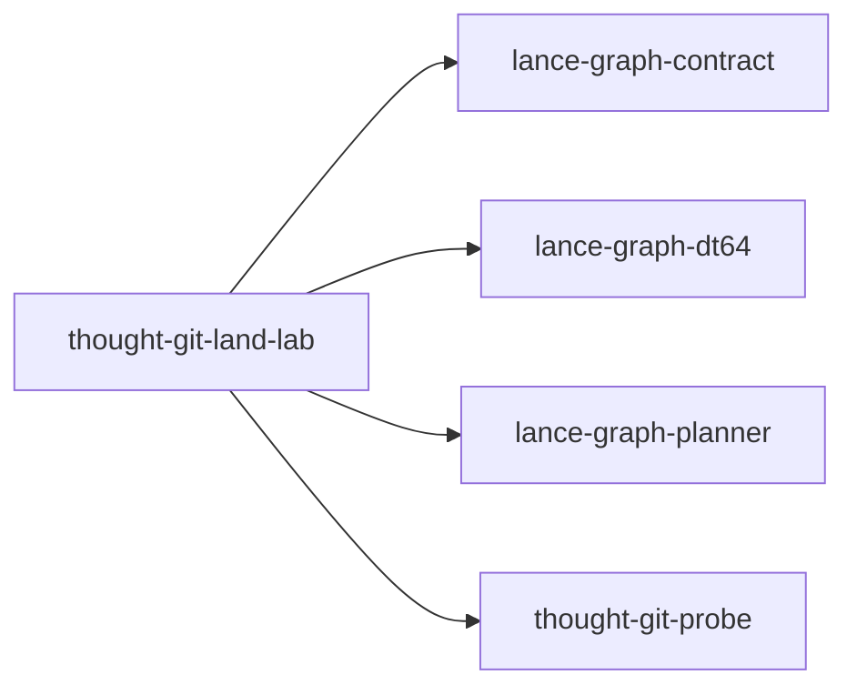

# thought-git-land-lab

crate: thought-git-land-lab
path: crates/thought-git-land-lab
workspace: excluded
digest: 7cde8e31dffa4545
evidence legend: ../index.md#evidence-legend

Generated; the code is the truth. See ../index.md.

## Depends on

- dep lance-graph-contract normal — crates/thought-git-land-lab/Cargo.toml:14 CONFIRMED
- dep lance-graph-dt64 normal — crates/thought-git-land-lab/Cargo.toml:15 CONFIRMED
- dep lance-graph-planner normal — crates/thought-git-land-lab/Cargo.toml:18 CONFIRMED
- dep thought-git-probe normal — crates/thought-git-land-lab/Cargo.toml:13 CONFIRMED
- dep tokio dev — crates/thought-git-land-lab/Cargo.toml:21 CONFIRMED

## Depended on by

## Public items

- struct MapStamp [pub] — crates/thought-git-land-lab/src/bound.rs:25 CONFIRMED
- enum Admitted [pub] — crates/thought-git-land-lab/src/bound.rs:36 CONFIRMED
- enum SpaceRefusal [pub] — crates/thought-git-land-lab/src/bound.rs:48 CONFIRMED
- fn MapStamp::of [pub] — crates/thought-git-land-lab/src/bound.rs:87 CONFIRMED
- fn MapStamp::admits [pub] — crates/thought-git-land-lab/src/bound.rs:106 CONFIRMED
- struct BoundThought [pub] — crates/thought-git-land-lab/src/bound.rs:145 CONFIRMED
- fn BoundThought::new [pub] — crates/thought-git-land-lab/src/bound.rs:162 CONFIRMED
- fn BoundThought::stamp [pub] — crates/thought-git-land-lab/src/bound.rs:197 CONFIRMED
- fn BoundThought::lanes [pub] — crates/thought-git-land-lab/src/bound.rs:203 CONFIRMED
- fn BoundThought::admit [pub] — crates/thought-git-land-lab/src/bound.rs:212 CONFIRMED
- const ROW_BYTES [pub] — crates/thought-git-land-lab/src/land.rs:36 CONFIRMED
- const MAX_LANES [pub] — crates/thought-git-land-lab/src/land.rs:39 CONFIRMED
- enum RowError [pub] — crates/thought-git-land-lab/src/land.rs:48 CONFIRMED
- fn encode_row [pub] — crates/thought-git-land-lab/src/land.rs:71 CONFIRMED
- fn decode_row [pub] — crates/thought-git-land-lab/src/land.rs:101 CONFIRMED
- struct CyclePlan [pub] — crates/thought-git-land-lab/src/land.rs:130 CONFIRMED
- fn plan_cycle [pub] — crates/thought-git-land-lab/src/land.rs:161 CONFIRMED
- enum LandError [pub] — crates/thought-git-land-lab/src/land.rs:198 CONFIRMED
- fn land_cycle [pub] — crates/thought-git-land-lab/src/land.rs:216 CONFIRMED
- trait ReplayImage [pub] — crates/thought-git-land-lab/src/land.rs:236 CONFIRMED
- enum ReplayRefusal [pub] — crates/thought-git-land-lab/src/land.rs:243 CONFIRMED
- fn replay_landed [pub] — crates/thought-git-land-lab/src/land.rs:271 CONFIRMED
- mod bound [pub] — crates/thought-git-land-lab/src/lib.rs:22 CONFIRMED
- mod land [pub] — crates/thought-git-land-lab/src/lib.rs:23 CONFIRMED

## Imports from in-scope crates

### lance-graph-dt64
- use lance_graph_dt64::dr::LocalMap — crates/thought-git-land-lab/src/bound.rs:20 CONFIRMED
- use lance_graph_dt64::dr::Width — crates/thought-git-land-lab/src/bound.rs:20 CONFIRMED
### lance-graph-planner
- use lance_graph_planner::persist_sink::CommitOutcome — crates/thought-git-land-lab/src/land.rs:30 CONFIRMED
- use lance_graph_planner::persist_sink::CycleFrame — crates/thought-git-land-lab/src/land.rs:30 CONFIRMED
- use lance_graph_planner::persist_sink::CycleId — crates/thought-git-land-lab/src/land.rs:30 CONFIRMED
- use lance_graph_planner::persist_sink::MailboxId — crates/thought-git-land-lab/src/land.rs:30 CONFIRMED
- use lance_graph_planner::persist_sink::PersistError — crates/thought-git-land-lab/src/land.rs:30 CONFIRMED
- use lance_graph_planner::persist_sink::SweepSlot — crates/thought-git-land-lab/src/land.rs:30 CONFIRMED
- use lance_graph_planner::persist_sink::WalSink — crates/thought-git-land-lab/src/land.rs:30 CONFIRMED
- use lance_graph_planner::persist_sink::persist_cycle — crates/thought-git-land-lab/src/land.rs:30 CONFIRMED
### thought-git-probe
- use thought_git_probe::fixtures::Cell — crates/thought-git-land-lab/src/bound.rs:21 CONFIRMED
- use thought_git_probe::fixtures::Outcome — crates/thought-git-land-lab/src/bound.rs:21 CONFIRMED
- use thought_git_probe::fixtures::Thought — crates/thought-git-land-lab/src/bound.rs:21 CONFIRMED
- use thought_git_probe::fixtures::Cell — crates/thought-git-land-lab/src/land.rs:32 CONFIRMED
- use thought_git_probe::fixtures::Thought — crates/thought-git-land-lab/src/land.rs:32 CONFIRMED
- use thought_git_probe::oracle::Givens — crates/thought-git-land-lab/src/land.rs:33 CONFIRMED
- use thought_git_probe::oracle::Version — crates/thought-git-land-lab/src/land.rs:33 CONFIRMED
- use thought_git_probe::oracle::next_version — crates/thought-git-land-lab/src/land.rs:33 CONFIRMED

## Calls

CALL_GRAPH=ARTIFACT_MISSING
- calls ARTIFACT_MISSING — no ruff_charon artifact for this crate UNKNOWN

## Architecture

- none

Generated from Cargo manifests — extracted relationships only.

