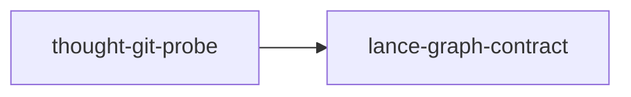

# thought-git-probe

crate: thought-git-probe
path: crates/thought-git-probe
workspace: excluded
digest: 77158349ee2ed7ed
evidence legend: ../index.md#evidence-legend

Generated; the code is the truth. See ../index.md.

## Depends on

- dep lance-graph-contract normal — crates/thought-git-probe/Cargo.toml:13 CONFIRMED

## Depended on by

## Public items

- const ROWS [pub] — crates/thought-git-probe/src/fixtures.rs:12 CONFIRMED
- const LANES [pub] — crates/thought-git-probe/src/fixtures.rs:14 CONFIRMED
- struct Cell [pub] — crates/thought-git-probe/src/fixtures.rs:18 CONFIRMED
- fn cell [pub] — crates/thought-git-probe/src/fixtures.rs:25 CONFIRMED
- enum Outcome [pub] — crates/thought-git-probe/src/fixtures.rs:31 CONFIRMED
- struct Thought [pub] — crates/thought-git-probe/src/fixtures.rs:44 CONFIRMED
- fn Thought::new [pub] — crates/thought-git-probe/src/fixtures.rs:54 CONFIRMED
- fn givens [pub] — crates/thought-git-probe/src/fixtures.rs:73 CONFIRMED
- fn main_version [pub] — crates/thought-git-probe/src/fixtures.rs:79 CONFIRMED
- fn rubicon_outcomes [pub] — crates/thought-git-probe/src/fixtures.rs:85 CONFIRMED
- fn unremarkable_stack [pub] — crates/thought-git-probe/src/fixtures.rs:97 CONFIRMED
- fn contradiction_thought [pub] — crates/thought-git-probe/src/fixtures.rs:116 CONFIRMED
- fn divergent_pair [pub] — crates/thought-git-probe/src/fixtures.rs:126 CONFIRMED
- const REGRESSION_SCANPATH [pub] — crates/thought-git-probe/src/fixtures.rs:134 CONFIRMED
- const SMOOTH_SCANPATH [pub] — crates/thought-git-probe/src/fixtures.rs:136 CONFIRMED
- const SURPRISE_EXPECTED [pub] — crates/thought-git-probe/src/fixtures.rs:139 CONFIRMED
- const SURPRISE_ATTENDED [pub] — crates/thought-git-probe/src/fixtures.rs:140 CONFIRMED
- fn unwritten_cells [pub] — crates/thought-git-probe/src/fixtures.rs:144 CONFIRMED
- fn all_writes [pub] — crates/thought-git-probe/src/fixtures.rs:150 CONFIRMED
- mod fixtures [pub] — crates/thought-git-probe/src/lib.rs:26 CONFIRMED
- mod oracle [pub] — crates/thought-git-probe/src/lib.rs:27 CONFIRMED
- mod receipt [pub] — crates/thought-git-probe/src/lib.rs:28 CONFIRMED
- mod slots [pub] — crates/thought-git-probe/src/lib.rs:29 CONFIRMED
- mod squash [pub] — crates/thought-git-probe/src/lib.rs:30 CONFIRMED
- struct Givens [pub] — crates/thought-git-probe/src/oracle.rs:23 CONFIRMED
- struct Contradiction [pub] — crates/thought-git-probe/src/oracle.rs:27 CONFIRMED
- struct Divergence [pub] — crates/thought-git-probe/src/oracle.rs:37 CONFIRMED
- struct Version [pub] — crates/thought-git-probe/src/oracle.rs:46 CONFIRMED
- fn Version::read [pub] — crates/thought-git-probe/src/oracle.rs:56 CONFIRMED
- fn next_version [pub] — crates/thought-git-probe/src/oracle.rs:67 CONFIRMED
- fn squash [pub] — crates/thought-git-probe/src/oracle.rs:114 CONFIRMED
- struct BaseRef [pub] — crates/thought-git-probe/src/receipt.rs:56 CONFIRMED
- struct VersionStore [pub] — crates/thought-git-probe/src/receipt.rs:64 CONFIRMED
- struct Contribution [pub] — crates/thought-git-probe/src/receipt.rs:72 CONFIRMED
- struct CommitWitness [pub] — crates/thought-git-probe/src/receipt.rs:82 CONFIRMED
- enum CommitError [pub] — crates/thought-git-probe/src/receipt.rs:106 CONFIRMED
- fn VersionStore::new [pub] — crates/thought-git-probe/src/receipt.rs:115 CONFIRMED
- fn VersionStore::seal [pub] — crates/thought-git-probe/src/receipt.rs:128 CONFIRMED
- fn VersionStore::get [pub] — crates/thought-git-probe/src/receipt.rs:140 CONFIRMED
- fn VersionStore::commit_cycle [pub] — crates/thought-git-probe/src/receipt.rs:153 CONFIRMED
- fn VersionStore::witness [pub] — crates/thought-git-probe/src/receipt.rs:187 CONFIRMED
- fn VersionStore::witness_mut [pub] — crates/thought-git-probe/src/receipt.rs:192 CONFIRMED
- fn VersionStore::tamper [pub] — crates/thought-git-probe/src/receipt.rs:198 CONFIRMED
- struct AlreadySealed [pub] — crates/thought-git-probe/src/receipt.rs:205 CONFIRMED
- struct ProgramId [pub] — crates/thought-git-probe/src/receipt.rs:210 CONFIRMED
- const DERIVE [pub] — crates/thought-git-probe/src/receipt.rs:219 CONFIRMED
- struct ProgramInputs [pub] — crates/thought-git-probe/src/receipt.rs:224 CONFIRMED
- fn ProgramInputs::try_new [pub] — crates/thought-git-probe/src/receipt.rs:234 CONFIRMED
- fn ProgramInputs::new [pub] — crates/thought-git-probe/src/receipt.rs:256 CONFIRMED
- struct ExecConfig [pub] — crates/thought-git-probe/src/receipt.rs:265 CONFIRMED
- const EXEC_DEFAULT [pub] — crates/thought-git-probe/src/receipt.rs:284 CONFIRMED
- struct Fold [pub] — crates/thought-git-probe/src/receipt.rs:292 CONFIRMED
- fn fold_writes [pub] — crates/thought-git-probe/src/receipt.rs:317 CONFIRMED
- struct Receipt [pub] — crates/thought-git-probe/src/receipt.rs:368 CONFIRMED
- struct ReceiptIdentity [pub] — crates/thought-git-probe/src/receipt.rs:392 CONFIRMED
- fn Receipt::identity [pub] — crates/thought-git-probe/src/receipt.rs:408 CONFIRMED
- enum Refusal [pub] — crates/thought-git-probe/src/receipt.rs:426 CONFIRMED
- struct Plan [pub] — crates/thought-git-probe/src/receipt.rs:491 CONFIRMED
- fn capture [pub] — crates/thought-git-probe/src/receipt.rs:508 CONFIRMED
- struct Replayed [pub] — crates/thought-git-probe/src/receipt.rs:550 CONFIRMED
- fn replay [pub] — crates/thought-git-probe/src/receipt.rs:564 CONFIRMED
- fn replay_live [pub] — crates/thought-git-probe/src/receipt.rs:603 CONFIRMED
- struct MetaKey [pub] — crates/thought-git-probe/src/receipt.rs:621 CONFIRMED
- struct MetaRow [pub] — crates/thought-git-probe/src/receipt.rs:630 CONFIRMED
- struct MetadataTable [pub] — crates/thought-git-probe/src/receipt.rs:697 CONFIRMED
- fn MetadataTable::stage [pub] — crates/thought-git-probe/src/receipt.rs:709 CONFIRMED
- fn MetadataTable::seal [pub] — crates/thought-git-probe/src/receipt.rs:765 CONFIRMED
- fn MetadataTable::row [pub] — crates/thought-git-probe/src/receipt.rs:784 CONFIRMED
- fn MetadataTable::row_mut [pub] — crates/thought-git-probe/src/receipt.rs:789 CONFIRMED
- fn MetadataTable::landed [pub] — crates/thought-git-probe/src/receipt.rs:801 CONFIRMED
- fn MetadataTable::incomplete [pub] — crates/thought-git-probe/src/receipt.rs:822 CONFIRMED
- fn MetadataTable::replay_landed [pub] — crates/thought-git-probe/src/receipt.rs:839 CONFIRMED
- const LIVE_SLOTS [pub] — crates/thought-git-probe/src/slots.rs:28 CONFIRMED
- enum Eviction [pub] — crates/thought-git-probe/src/slots.rs:32 CONFIRMED
- struct Slot [pub] — crates/thought-git-probe/src/slots.rs:41 CONFIRMED
- enum Pressure [pub] — crates/thought-git-probe/src/slots.rs:49 CONFIRMED
- struct Stale [pub] — crates/thought-git-probe/src/slots.rs:66 CONFIRMED
- struct SlotPool [pub] — crates/thought-git-probe/src/slots.rs:80 CONFIRMED
- fn SlotPool::new [pub] — crates/thought-git-probe/src/slots.rs:89 CONFIRMED
- fn SlotPool::live [pub] — crates/thought-git-probe/src/slots.rs:100 CONFIRMED
- fn SlotPool::branch [pub] — crates/thought-git-probe/src/slots.rs:108 CONFIRMED
- fn SlotPool::touch [pub] — crates/thought-git-probe/src/slots.rs:141 CONFIRMED
- fn SlotPool::thought [pub] — crates/thought-git-probe/src/slots.rs:153 CONFIRMED
- fn SlotPool::free [pub] — crates/thought-git-probe/src/slots.rs:163 CONFIRMED
- struct Lane [pub] — crates/thought-git-probe/src/squash.rs:14 CONFIRMED
- fn Lane::new [pub] — crates/thought-git-probe/src/squash.rs:21 CONFIRMED
- fn Lane::landed [pub] — crates/thought-git-probe/src/squash.rs:28 CONFIRMED
- fn Lane::ops [pub] — crates/thought-git-probe/src/squash.rs:34 CONFIRMED
- fn Lane::final_state [pub] — crates/thought-git-probe/src/squash.rs:40 CONFIRMED
- enum Refusal [pub] — crates/thought-git-probe/src/squash.rs:52 CONFIRMED
- struct Squashed [pub] — crates/thought-git-probe/src/squash.rs:66 CONFIRMED
- fn Squashed::as_thought [pub] — crates/thought-git-probe/src/squash.rs:77 CONFIRMED
- fn squash_gate [pub] — crates/thought-git-probe/src/squash.rs:99 CONFIRMED
- enum Reader [pub] — crates/thought-git-probe/src/squash.rs:182 CONFIRMED
- struct Witness [pub] — crates/thought-git-probe/src/squash.rs:198 CONFIRMED
- enum ProtectedRefusal [pub] — crates/thought-git-probe/src/squash.rs:206 CONFIRMED
- fn land_interleaved [pub] — crates/thought-git-probe/src/squash.rs:217 CONFIRMED
- fn history_contradictions [pub] — crates/thought-git-probe/src/squash.rs:252 CONFIRMED
- fn history_divergences [pub] — crates/thought-git-probe/src/squash.rs:261 CONFIRMED
- fn history_multiplicity [pub] — crates/thought-git-probe/src/squash.rs:270 CONFIRMED
- fn squashed_multiplicity [pub] — crates/thought-git-probe/src/squash.rs:285 CONFIRMED
- fn protected_squash [pub] — crates/thought-git-probe/src/squash.rs:296 CONFIRMED
- struct Bytes [pub] — crates/thought-git-probe/src/squash.rs:350 CONFIRMED
- fn bytes [pub] — crates/thought-git-probe/src/squash.rs:363 CONFIRMED

## Imports from in-scope crates

- none

## Calls

CALL_GRAPH=ARTIFACT_MISSING
- calls ARTIFACT_MISSING — no ruff_charon artifact for this crate UNKNOWN

## Architecture

- none

Generated from Cargo manifests — extracted relationships only.

