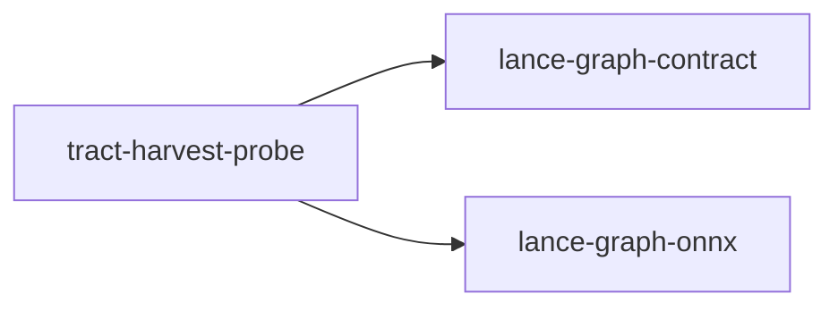

# tract-harvest-probe

crate: tract-harvest-probe
path: crates/tract-harvest-probe
workspace: excluded
digest: 3acc861cc398ea8e
evidence legend: ../index.md#evidence-legend

Generated; the code is the truth. See ../index.md.

## Depends on

- dep lance-graph-contract normal — crates/tract-harvest-probe/Cargo.toml:25 CONFIRMED
- dep lance-graph-onnx normal — crates/tract-harvest-probe/Cargo.toml:22 CONFIRMED
- dep dr-math-binding-probe normal — crates/tract-harvest-probe/Cargo.toml:24 CONFIRMED
- dep ndarray normal — crates/tract-harvest-probe/Cargo.toml:26 CONFIRMED
- dep prost normal — crates/tract-harvest-probe/Cargo.toml:29 CONFIRMED
- dep serde_json normal — crates/tract-harvest-probe/Cargo.toml:30 CONFIRMED
- dep sha2 normal — crates/tract-harvest-probe/Cargo.toml:27 CONFIRMED
- dep tract-onnx normal — crates/tract-harvest-probe/Cargo.toml:21 CONFIRMED

## Depended on by

## Public items

- struct Routes [pub] — crates/tract-harvest-probe/src/bind.rs:29 CONFIRMED
- enum Unresolved [pub] — crates/tract-harvest-probe/src/bind.rs:36 CONFIRMED
- fn route [pub] — crates/tract-harvest-probe/src/bind.rs:50 CONFIRMED
- fn resolve [pub] — crates/tract-harvest-probe/src/bind.rs:74 CONFIRMED
- const TILE [pub] — crates/tract-harvest-probe/src/dr3.rs:38 CONFIRMED
- const MAX_POSITIONS [pub] — crates/tract-harvest-probe/src/dr3.rs:41 CONFIRMED
- struct Tiled [pub] — crates/tract-harvest-probe/src/dr3.rs:46 CONFIRMED
- fn Tiled::set [pub] — crates/tract-harvest-probe/src/dr3.rs:51 CONFIRMED
- fn Tiled::contains [pub] — crates/tract-harvest-probe/src/dr3.rs:59 CONFIRMED
- fn Tiled::pairs [pub] — crates/tract-harvest-probe/src/dr3.rs:66 CONFIRMED
- fn Tiled::transpose [pub] — crates/tract-harvest-probe/src/dr3.rs:81 CONFIRMED
- fn Tiled::compose [pub] — crates/tract-harvest-probe/src/dr3.rs:93 CONFIRMED
- struct OnnxGraph [pub] — crates/tract-harvest-probe/src/dr3.rs:111 CONFIRMED
- fn OnnxGraph::build [pub] — crates/tract-harvest-probe/src/dr3.rs:146 CONFIRMED
- fn OnnxGraph::dep [pub] — crates/tract-harvest-probe/src/dr3.rs:245 CONFIRMED
- fn OnnxGraph::dep_from_edges [pub] — crates/tract-harvest-probe/src/dr3.rs:253 CONFIRMED
- fn OnnxGraph::schedule [pub] — crates/tract-harvest-probe/src/dr3.rs:273 CONFIRMED
- fn tract_facts [pub] — crates/tract-harvest-probe/src/dr3.rs:323 CONFIRMED
- fn tract_facts_path [pub] — crates/tract-harvest-probe/src/dr3.rs:332 CONFIRMED
- struct Outlet [pub] — crates/tract-harvest-probe/src/dr3.rs:345 CONFIRMED
- struct Rejected [pub] — crates/tract-harvest-probe/src/dr3.rs:352 CONFIRMED
- struct FactSources [pub] — crates/tract-harvest-probe/src/dr3.rs:370 CONFIRMED
- fn FactSources::merged [pub] — crates/tract-harvest-probe/src/dr3.rs:386 CONFIRMED
- fn FactSources::merged_for [pub] — crates/tract-harvest-probe/src/dr3.rs:402 CONFIRMED
- fn FactSources::disagreements [pub] — crates/tract-harvest-probe/src/dr3.rs:413 CONFIRMED
- fn source_producers [pub] — crates/tract-harvest-probe/src/dr3.rs:435 CONFIRMED
- fn tract_slot [pub] — crates/tract-harvest-probe/src/dr3.rs:500 CONFIRMED
- fn admit [pub] — crates/tract-harvest-probe/src/dr3.rs:508 CONFIRMED
- fn tract_fact_sources [pub] — crates/tract-harvest-probe/src/dr3.rs:548 CONFIRMED
- fn tract_fact_sources_path [pub] — crates/tract-harvest-probe/src/dr3.rs:559 CONFIRMED
- enum Dep [pub] — crates/tract-harvest-probe/src/fold.rs:26 CONFIRMED
- fn classify [pub] — crates/tract-harvest-probe/src/fold.rs:48 CONFIRMED
- fn census [pub] — crates/tract-harvest-probe/src/fold.rs:101 CONFIRMED
- struct Folded [pub] — crates/tract-harvest-probe/src/fold.rs:117 CONFIRMED
- fn Folded::retained [pub] — crates/tract-harvest-probe/src/fold.rs:133 CONFIRMED
- fn shape_value [pub] — crates/tract-harvest-probe/src/fold.rs:155 CONFIRMED
- fn with_initializer_facts [pub] — crates/tract-harvest-probe/src/fold.rs:176 CONFIRMED
- fn fold [pub] — crates/tract-harvest-probe/src/fold.rs:195 CONFIRMED
- struct RowRange [pub] — crates/tract-harvest-probe/src/gather.rs:15 CONFIRMED
- fn row_ranges [pub] — crates/tract-harvest-probe/src/gather.rs:22 CONFIRMED
- fn drafts [pub(crate)] — crates/tract-harvest-probe/src/generated.rs:41 CONFIRMED
- mod bind [pub] — crates/tract-harvest-probe/src/lib.rs:21 CONFIRMED
- mod dr3 [pub] — crates/tract-harvest-probe/src/lib.rs:22 CONFIRMED
- mod fold [pub] — crates/tract-harvest-probe/src/lib.rs:23 CONFIRMED
- mod gather [pub] — crates/tract-harvest-probe/src/lib.rs:24 CONFIRMED
- mod plan [pub] — crates/tract-harvest-probe/src/lib.rs:26 CONFIRMED
- mod provenance [pub] — crates/tract-harvest-probe/src/lib.rs:27 CONFIRMED
- mod registry [pub] — crates/tract-harvest-probe/src/lib.rs:28 CONFIRMED
- mod source [pub] — crates/tract-harvest-probe/src/lib.rs:29 CONFIRMED
- mod tract_index [pub] — crates/tract-harvest-probe/src/lib.rs:30 CONFIRMED
- mod triage [pub] — crates/tract-harvest-probe/src/lib.rs:31 CONFIRMED
- mod value [pub] — crates/tract-harvest-probe/src/lib.rs:32 CONFIRMED
- struct Bound [pub] — crates/tract-harvest-probe/src/plan.rs:25 CONFIRMED
- struct Plan [pub] — crates/tract-harvest-probe/src/plan.rs:35 CONFIRMED
- fn digest64 [pub(crate)] — crates/tract-harvest-probe/src/plan.rs:47 CONFIRMED
- fn revisions [pub] — crates/tract-harvest-probe/src/plan.rs:57 CONFIRMED
- fn resolve [pub] — crates/tract-harvest-probe/src/plan.rs:71 CONFIRMED
- fn Plan<'_>::run [pub] — crates/tract-harvest-probe/src/plan.rs:166 CONFIRMED
- fn Plan<'_>::census [pub] — crates/tract-harvest-probe/src/plan.rs:218 CONFIRMED
- fn coverage [pub] — crates/tract-harvest-probe/src/plan.rs:230 CONFIRMED
- struct StageProvenance [pub] — crates/tract-harvest-probe/src/provenance.rs:10 CONFIRMED
- fn stage [pub] — crates/tract-harvest-probe/src/provenance.rs:26 CONFIRMED
- fn of_graph [pub] — crates/tract-harvest-probe/src/provenance.rs:69 CONFIRMED
- enum K3 [pub] — crates/tract-harvest-probe/src/registry.rs:59 CONFIRMED
- enum Dim [pub] — crates/tract-harvest-probe/src/registry.rs:67 CONFIRMED
- struct Fact [pub] — crates/tract-harvest-probe/src/registry.rs:74 CONFIRMED
- struct NodeView [pub] — crates/tract-harvest-probe/src/registry.rs:81 CONFIRMED
- enum Numeric [pub] — crates/tract-harvest-probe/src/registry.rs:89 CONFIRMED
- enum Refusal [pub] — crates/tract-harvest-probe/src/registry.rs:98 CONFIRMED
- type Polyfill [pub] — crates/tract-harvest-probe/src/registry.rs:132 CONFIRMED
- type Guard [pub] — crates/tract-harvest-probe/src/registry.rs:135 CONFIRMED
- struct AttrRule [pub] — crates/tract-harvest-probe/src/registry.rs:146 CONFIRMED
- const MASK_BLOCK [pub] — crates/tract-harvest-probe/src/registry.rs:153 CONFIRMED
- const ONNX_LENS [pub] — crates/tract-harvest-probe/src/registry.rs:156 CONFIRMED
- struct MethodKey [pub] — crates/tract-harvest-probe/src/registry.rs:160 CONFIRMED
- struct Method [pub] — crates/tract-harvest-probe/src/registry.rs:168 CONFIRMED
- struct Registration [pub] — crates/tract-harvest-probe/src/registry.rs:177 CONFIRMED
- struct Registry [pub] — crates/tract-harvest-probe/src/registry.rs:198 CONFIRMED
- fn signature_dtype [pub] — crates/tract-harvest-probe/src/registry.rs:212 CONFIRMED
- fn render_signature [pub] — crates/tract-harvest-probe/src/registry.rs:227 CONFIRMED
- fn Registry::build [pub] — crates/tract-harvest-probe/src/registry.rs:261 CONFIRMED
- fn Registry::method [pub] — crates/tract-harvest-probe/src/registry.rs:297 CONFIRMED
- fn Registry::exposes [pub] — crates/tract-harvest-probe/src/registry.rs:302 CONFIRMED
- fn Registry::expose [pub] — crates/tract-harvest-probe/src/registry.rs:309 CONFIRMED
- fn Registry::revision [pub] — crates/tract-harvest-probe/src/registry.rs:323 CONFIRMED
- fn Registry::key_of [pub] — crates/tract-harvest-probe/src/registry.rs:332 CONFIRMED
- fn Registry::get [pub] — crates/tract-harvest-probe/src/registry.rs:345 CONFIRMED
- fn Registry::lookup [pub] — crates/tract-harvest-probe/src/registry.rs:353 CONFIRMED
- fn attrs_match [pub(crate)] — crates/tract-harvest-probe/src/registry.rs:370 CONFIRMED
- fn guard_true [pub(crate)] — crates/tract-harvest-probe/src/registry.rs:427 CONFIRMED
- fn guard_gather [pub(crate)] — crates/tract-harvest-probe/src/registry.rs:600 CONFIRMED
- fn guard_reshape [pub(crate)] — crates/tract-harvest-probe/src/registry.rs:733 CONFIRMED
- fn guard_expand [pub(crate)] — crates/tract-harvest-probe/src/registry.rs:992 CONFIRMED
- fn f32_arg [pub(crate)] — crates/tract-harvest-probe/src/registry.rs:1017 CONFIRMED
- fn shape_slice [pub] — crates/tract-harvest-probe/src/registry.rs:1224 CONFIRMED
- fn do_gather_i64 [pub(crate)] — crates/tract-harvest-probe/src/registry.rs:1278 CONFIRMED
- fn do_reshape [pub(crate)] — crates/tract-harvest-probe/src/registry.rs:1329 CONFIRMED
- const RANGE_CAPACITY [pub] — crates/tract-harvest-probe/src/registry.rs:1444 CONFIRMED
- fn do_expand [pub(crate)] — crates/tract-harvest-probe/src/registry.rs:1690 CONFIRMED
- const OPSETS [pub(crate)] — crates/tract-harvest-probe/src/registry.rs:2152 CONFIRMED
- const NO_ATTRS [pub(crate)] — crates/tract-harvest-probe/src/registry.rs:2153 CONFIRMED
- fn registry [pub] — crates/tract-harvest-probe/src/registry.rs:2240 CONFIRMED
- fn hand_written [pub] — crates/tract-harvest-probe/src/registry.rs:2745 CONFIRMED
- fn sha256_hex [pub] — crates/tract-harvest-probe/src/source.rs:15 CONFIRMED
- enum Attr [pub] — crates/tract-harvest-probe/src/source.rs:23 CONFIRMED
- struct SourceNode [pub] — crates/tract-harvest-probe/src/source.rs:52 CONFIRMED
- fn SourceNode::default_domain [pub] — crates/tract-harvest-probe/src/source.rs:66 CONFIRMED
- fn SourceNode::attr [pub] — crates/tract-harvest-probe/src/source.rs:70 CONFIRMED
- enum Placement [pub] — crates/tract-harvest-probe/src/source.rs:77 CONFIRMED
- struct SourceInitializer [pub] — crates/tract-harvest-probe/src/source.rs:89 CONFIRMED
- struct SourceInventory [pub] — crates/tract-harvest-probe/src/source.rs:101 CONFIRMED
- fn SourceInventory::inline_constants_from_manifest [pub] — crates/tract-harvest-probe/src/source.rs:151 CONFIRMED
- fn SourceInventory::inline_external_constant [pub] — crates/tract-harvest-probe/src/source.rs:223 CONFIRMED
- fn SourceInventory::from_bytes [pub] — crates/tract-harvest-probe/src/source.rs:246 CONFIRMED
- fn SourceInventory::from_proto [pub] — crates/tract-harvest-probe/src/source.rs:252 CONFIRMED
- fn SourceInventory::default_opset [pub] — crates/tract-harvest-probe/src/source.rs:314 CONFIRMED
- fn SourceInventory::node_producing [pub] — crates/tract-harvest-probe/src/source.rs:321 CONFIRMED
- fn SourceInventory::node_named [pub] — crates/tract-harvest-probe/src/source.rs:327 CONFIRMED
- fn SourceInventory::initializer [pub] — crates/tract-harvest-probe/src/source.rs:331 CONFIRMED
- struct AttrRead [pub] — crates/tract-harvest-probe/src/tract_index.rs:20 CONFIRMED
- struct OpEntry [pub] — crates/tract-harvest-probe/src/tract_index.rs:30 CONFIRMED
- fn index [pub] — crates/tract-harvest-probe/src/tract_index.rs:126 CONFIRMED
- enum Gap [pub] — crates/tract-harvest-probe/src/triage.rs:30 CONFIRMED
- fn Gap::kind [pub] — crates/tract-harvest-probe/src/triage.rs:40 CONFIRMED
- struct Arg [pub] — crates/tract-harvest-probe/src/triage.rs:51 CONFIRMED
- struct NativeHint [pub] — crates/tract-harvest-probe/src/triage.rs:60 CONFIRMED
- struct Finding [pub] — crates/tract-harvest-probe/src/triage.rs:70 CONFIRMED
- fn role [pub] — crates/tract-harvest-probe/src/triage.rs:85 CONFIRMED
- fn constant_names [pub] — crates/tract-harvest-probe/src/triage.rs:111 CONFIRMED
- fn triage [pub] — crates/tract-harvest-probe/src/triage.rs:129 CONFIRMED
- fn groups [pub] — crates/tract-harvest-probe/src/triage.rs:219 CONFIRMED
- struct Group [pub] — crates/tract-harvest-probe/src/triage.rs:248 CONFIRMED
- fn parse_hints [pub] — crates/tract-harvest-probe/src/triage.rs:261 CONFIRMED
- fn dims [pub] — crates/tract-harvest-probe/src/triage.rs:292 CONFIRMED
- enum DType [pub] — crates/tract-harvest-probe/src/value.rs:13 CONFIRMED
- fn DType::from_onnx [pub] — crates/tract-harvest-probe/src/value.rs:26 CONFIRMED
- enum Value [pub] — crates/tract-harvest-probe/src/value.rs:41 CONFIRMED
- fn Value::dtype [pub] — crates/tract-harvest-probe/src/value.rs:53 CONFIRMED
- fn Value::shape [pub] — crates/tract-harvest-probe/src/value.rs:62 CONFIRMED
- fn Value::f32s [pub] — crates/tract-harvest-probe/src/value.rs:73 CONFIRMED
- fn Value::i64s [pub] — crates/tract-harvest-probe/src/value.rs:81 CONFIRMED
- fn decode [pub] — crates/tract-harvest-probe/src/value.rs:96 CONFIRMED

## Imports from in-scope crates

### lance-graph-contract
- use lance_graph_contract::class_view::ClassId — crates/tract-harvest-probe/src/bind.rs:23 CONFIRMED
- use lance_graph_contract::class_view::ClassId — crates/tract-harvest-probe/src/registry.rs:51 CONFIRMED
- use lance_graph_contract::class_view::WideFieldMask — crates/tract-harvest-probe/src/registry.rs:51 CONFIRMED

## Calls

CALL_GRAPH=ARTIFACT_MISSING
- calls ARTIFACT_MISSING — no ruff_charon artifact for this crate UNKNOWN

## Architecture

- arch mask-risc quarantines graph_hop gather [CONFIRMED] validation=OK — crates/lance-graph-mask-risc/Cargo.toml:30 CONFIRMED

Generated from Cargo manifests — extracted relationships only.

