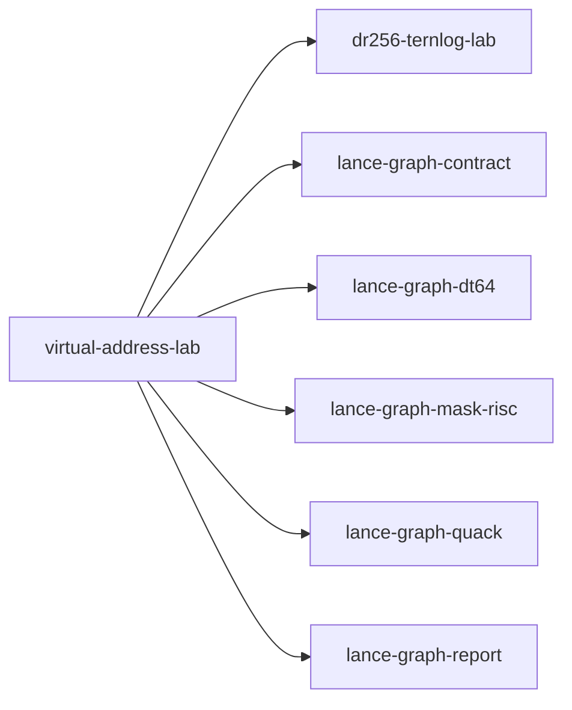

# virtual-address-lab

crate: virtual-address-lab
path: crates/virtual-address-lab
workspace: member
digest: 62cdee8010a1cdf1
evidence legend: ../index.md#evidence-legend

Generated; the code is the truth. See ../index.md.

## Depends on

- dep causal-edge dev — crates/virtual-address-lab/Cargo.toml:22 CONFIRMED
- dep cognitive-shader-driver dev — crates/virtual-address-lab/Cargo.toml:21 CONFIRMED
- dep dr256-ternlog-lab normal — crates/virtual-address-lab/Cargo.toml:17 CONFIRMED
- dep lance-graph-contract normal — crates/virtual-address-lab/Cargo.toml:9 CONFIRMED
- dep lance-graph-dt64 normal — crates/virtual-address-lab/Cargo.toml:10 CONFIRMED
- dep lance-graph-mailbox-lanes dev — crates/virtual-address-lab/Cargo.toml:24 CONFIRMED
- dep lance-graph-mask-risc normal — crates/virtual-address-lab/Cargo.toml:11 CONFIRMED
- dep lance-graph-quack normal — crates/virtual-address-lab/Cargo.toml:12 CONFIRMED
- dep lance-graph-r2il dev — crates/virtual-address-lab/Cargo.toml:25 CONFIRMED
- dep lance-graph-report normal — crates/virtual-address-lab/Cargo.toml:14 CONFIRMED

## Depended on by

## Public items

- struct Ledgers [pub] — crates/virtual-address-lab/src/behaviour.rs:32 CONFIRMED
- fn behaviour [pub] — crates/virtual-address-lab/src/behaviour.rs:45 CONFIRMED
- fn admit_routed [pub] — crates/virtual-address-lab/src/behaviour.rs:60 CONFIRMED
- struct GuardMask [pub] — crates/virtual-address-lab/src/behaviour.rs:133 CONFIRMED
- fn GuardMask::holds [pub] — crates/virtual-address-lab/src/behaviour.rs:143 CONFIRMED
- fn GuardMask::rows_held [pub] — crates/virtual-address-lab/src/behaviour.rs:155 CONFIRMED
- fn guard_mask [pub] — crates/virtual-address-lab/src/behaviour.rs:163 CONFIRMED
- fn operands [pub] — crates/virtual-address-lab/src/behaviour.rs:226 CONFIRMED
- type AxisMask [pub] — crates/virtual-address-lab/src/cube.rs:8 CONFIRMED
- const FULL [pub] — crates/virtual-address-lab/src/cube.rs:10 CONFIRMED
- fn axis [pub] — crates/virtual-address-lab/src/cube.rs:12 CONFIRMED
- fn has [pub] — crates/virtual-address-lab/src/cube.rs:20 CONFIRMED
- fn pop [pub] — crates/virtual-address-lab/src/cube.rs:24 CONFIRMED
- fn address [pub] — crates/virtual-address-lab/src/cube.rs:30 CONFIRMED
- fn decode [pub] — crates/virtual-address-lab/src/cube.rs:35 CONFIRMED
- fn count_factorized [pub] — crates/virtual-address-lab/src/cube.rs:44 CONFIRMED
- fn reflect [pub] — crates/virtual-address-lab/src/cube.rs:49 CONFIRMED
- fn rotate [pub] — crates/virtual-address-lab/src/cube.rs:60 CONFIRMED
- fn count_coupled [pub] — crates/virtual-address-lab/src/cube.rs:79 CONFIRMED
- fn unstructured [pub] — crates/virtual-address-lab/src/cube.rs:95 CONFIRMED
- fn count_unstructured [pub] — crates/virtual-address-lab/src/cube.rs:105 CONFIRMED
- const CLASS [pub] — crates/virtual-address-lab/src/grid.rs:22 CONFIRMED
- const BEHAVIOUR [pub] — crates/virtual-address-lab/src/grid.rs:25 CONFIRMED
- const UNRELATED [pub] — crates/virtual-address-lab/src/grid.rs:27 CONFIRMED
- const POLYFILL [pub] — crates/virtual-address-lab/src/grid.rs:29 CONFIRMED
- const POSITION [pub] — crates/virtual-address-lab/src/grid.rs:31 CONFIRMED
- const READER [pub] — crates/virtual-address-lab/src/grid.rs:33 CONFIRMED
- struct Grid [pub] — crates/virtual-address-lab/src/grid.rs:57 CONFIRMED
- fn Grid::new [pub] — crates/virtual-address-lab/src/grid.rs:76 CONFIRMED
- fn Grid::three [pub] — crates/virtual-address-lab/src/grid.rs:102 CONFIRMED
- fn Grid::lanes [pub] — crates/virtual-address-lab/src/grid.rs:106 CONFIRMED
- fn Grid::len [pub] — crates/virtual-address-lab/src/grid.rs:110 CONFIRMED
- fn Grid::is_empty [pub] — crates/virtual-address-lab/src/grid.rs:114 CONFIRMED
- fn Grid::source_bytes [pub] — crates/virtual-address-lab/src/grid.rs:118 CONFIRMED
- fn Grid::space [pub] — crates/virtual-address-lab/src/grid.rs:122 CONFIRMED
- fn Grid::frame_store [pub] — crates/virtual-address-lab/src/grid.rs:126 CONFIRMED
- fn Grid::cell [pub] — crates/virtual-address-lab/src/grid.rs:131 CONFIRMED
- fn Grid::raw_lane [pub] — crates/virtual-address-lab/src/grid.rs:136 CONFIRMED
- fn Grid::matrix [pub] — crates/virtual-address-lab/src/grid.rs:141 CONFIRMED
- fn Grid::issue_order [pub] — crates/virtual-address-lab/src/grid.rs:163 CONFIRMED
- fn Grid::issue_filter [pub] — crates/virtual-address-lab/src/grid.rs:182 CONFIRMED
- fn Grid::issue_list [pub] — crates/virtual-address-lab/src/grid.rs:190 CONFIRMED
- fn Grid::issue_list_in [pub] — crates/virtual-address-lab/src/grid.rs:195 CONFIRMED
- fn Grid::raw_positions [pub] — crates/virtual-address-lab/src/grid.rs:201 CONFIRMED
- fn Grid::for_class [pub] — crates/virtual-address-lab/src/grid.rs:210 CONFIRMED
- fn Grid::with_lane_ids [pub] — crates/virtual-address-lab/src/grid.rs:216 CONFIRMED
- fn Grid::advance_source [pub] — crates/virtual-address-lab/src/grid.rs:223 CONFIRMED
- fn Grid::rewrite_lane [pub] — crates/virtual-address-lab/src/grid.rs:231 CONFIRMED
- struct View [pub] — crates/virtual-address-lab/src/grid.rs:306 CONFIRMED
- fn View::new [pub] — crates/virtual-address-lab/src/grid.rs:309 CONFIRMED
- fn View::named [pub] — crates/virtual-address-lab/src/grid.rs:318 CONFIRMED
- struct World [pub] — crates/virtual-address-lab/src/grid.rs:348 CONFIRMED
- fn World::new [pub] — crates/virtual-address-lab/src/grid.rs:356 CONFIRMED
- fn World::with [pub] — crates/virtual-address-lab/src/grid.rs:361 CONFIRMED
- fn World::named [pub] — crates/virtual-address-lab/src/grid.rs:366 CONFIRMED
- fn World::routed_to_behaviour [pub] — crates/virtual-address-lab/src/grid.rs:374 CONFIRMED
- fn World::bind_as [pub] — crates/virtual-address-lab/src/grid.rs:442 CONFIRMED
- fn World::bind_fields [pub] — crates/virtual-address-lab/src/grid.rs:447 CONFIRMED
- fn World::bind [pub] — crates/virtual-address-lab/src/grid.rs:469 CONFIRMED
- fn World::bind_source [pub] — crates/virtual-address-lab/src/grid.rs:474 CONFIRMED
- mod behaviour [pub] — crates/virtual-address-lab/src/lib.rs:23 CONFIRMED
- mod cube [pub] — crates/virtual-address-lab/src/lib.rs:24 CONFIRMED
- mod grid [pub] — crates/virtual-address-lab/src/lib.rs:25 CONFIRMED
- mod method [pub] — crates/virtual-address-lab/src/lib.rs:26 CONFIRMED
- mod owner [pub] — crates/virtual-address-lab/src/lib.rs:27 CONFIRMED
- mod physical [pub] — crates/virtual-address-lab/src/lib.rs:28 CONFIRMED
- mod recipe [pub] — crates/virtual-address-lab/src/lib.rs:29 CONFIRMED
- mod view [pub] — crates/virtual-address-lab/src/lib.rs:30 CONFIRMED
- struct Method [pub] — crates/virtual-address-lab/src/method.rs:21 CONFIRMED
- struct Cell [pub] — crates/virtual-address-lab/src/method.rs:29 CONFIRMED
- fn Method::new [pub] — crates/virtual-address-lab/src/method.rs:35 CONFIRMED
- fn Method::then [pub] — crates/virtual-address-lab/src/method.rs:43 CONFIRMED
- fn Method::cell [pub] — crates/virtual-address-lab/src/method.rs:52 CONFIRMED
- fn Method::field [pub] — crates/virtual-address-lab/src/method.rs:59 CONFIRMED
- fn Method::read_cell [pub] — crates/virtual-address-lab/src/method.rs:67 CONFIRMED
- fn Method::read [pub] — crates/virtual-address-lab/src/method.rs:103 CONFIRMED
- const BASIS [pub] — crates/virtual-address-lab/src/owner.rs:29 CONFIRMED
- enum Column [pub] — crates/virtual-address-lab/src/owner.rs:33 CONFIRMED
- fn column_of [pub] — crates/virtual-address-lab/src/owner.rs:41 CONFIRMED
- enum Value [pub] — crates/virtual-address-lab/src/owner.rs:51 CONFIRMED
- struct Reads [pub] — crates/virtual-address-lab/src/owner.rs:58 CONFIRMED
- struct VirtualProperty [pub] — crates/virtual-address-lab/src/owner.rs:72 CONFIRMED
- struct Address [pub] — crates/virtual-address-lab/src/owner.rs:81 CONFIRMED
- fn VirtualProperty<'_>::address [pub] — crates/virtual-address-lab/src/owner.rs:93 CONFIRMED
- fn VirtualProperty<'_>::admit [pub] — crates/virtual-address-lab/src/owner.rs:109 CONFIRMED
- fn VirtualProperty<'_>::column [pub] — crates/virtual-address-lab/src/owner.rs:119 CONFIRMED
- fn VirtualProperty<'_>::read [pub] — crates/virtual-address-lab/src/owner.rs:127 CONFIRMED
- type Matrix [pub] — crates/virtual-address-lab/src/physical.rs:8 CONFIRMED
- struct Moved [pub] — crates/virtual-address-lab/src/physical.rs:12 CONFIRMED
- fn transpose [pub] — crates/virtual-address-lab/src/physical.rs:24 CONFIRMED
- fn reverse_rows [pub] — crates/virtual-address-lab/src/physical.rs:33 CONFIRMED
- fn reverse_cols [pub] — crates/virtual-address-lab/src/physical.rs:39 CONFIRMED
- fn apply [pub] — crates/virtual-address-lab/src/physical.rs:49 CONFIRMED
- fn apply_chain [pub] — crates/virtual-address-lab/src/physical.rs:75 CONFIRMED
- struct Recipe [pub] — crates/virtual-address-lab/src/recipe.rs:19 CONFIRMED
- const Recipe::IDENTITY [pub] — crates/virtual-address-lab/src/recipe.rs:34 CONFIRMED
- const Recipe::ROTATE90 [pub] — crates/virtual-address-lab/src/recipe.rs:35 CONFIRMED
- const Recipe::ROTATE180 [pub] — crates/virtual-address-lab/src/recipe.rs:36 CONFIRMED
- const Recipe::ROTATE270 [pub] — crates/virtual-address-lab/src/recipe.rs:37 CONFIRMED
- const Recipe::MIRROR_X [pub] — crates/virtual-address-lab/src/recipe.rs:39 CONFIRMED
- const Recipe::MIRROR_Y [pub] — crates/virtual-address-lab/src/recipe.rs:41 CONFIRMED
- const Recipe::TRANSPOSE [pub] — crates/virtual-address-lab/src/recipe.rs:42 CONFIRMED
- const Recipe::ANTI_TRANSPOSE [pub] — crates/virtual-address-lab/src/recipe.rs:43 CONFIRMED
- const Recipe::ALL [pub] — crates/virtual-address-lab/src/recipe.rs:46 CONFIRMED
- const Recipe::NAMES [pub] — crates/virtual-address-lab/src/recipe.rs:57 CONFIRMED
- fn Recipe::index [pub] — crates/virtual-address-lab/src/recipe.rs:69 CONFIRMED
- fn Recipe::name [pub] — crates/virtual-address-lab/src/recipe.rs:76 CONFIRMED
- fn Recipe::reverses_positions [pub] — crates/virtual-address-lab/src/recipe.rs:82 CONFIRMED
- fn Recipe::swaps [pub] — crates/virtual-address-lab/src/recipe.rs:87 CONFIRMED
- fn Recipe::view_dims [pub] — crates/virtual-address-lab/src/recipe.rs:92 CONFIRMED
- fn Recipe::resolve [pub] — crates/virtual-address-lab/src/recipe.rs:102 CONFIRMED
- fn Recipe::lane_at [pub] — crates/virtual-address-lab/src/recipe.rs:121 CONFIRMED
- fn Recipe::then [pub] — crates/virtual-address-lab/src/recipe.rs:131 CONFIRMED
- fn Recipe::inverse [pub] — crates/virtual-address-lab/src/recipe.rs:150 CONFIRMED
- fn Recipe::normalize [pub] — crates/virtual-address-lab/src/recipe.rs:158 CONFIRMED
- fn Recipe::digest [pub] — crates/virtual-address-lab/src/recipe.rs:163 CONFIRMED
- fn Recipe::field_of [pub] — crates/virtual-address-lab/src/recipe.rs:170 CONFIRMED
- struct Ledger [pub] — crates/virtual-address-lab/src/view.rs:16 CONFIRMED
- enum Refused [pub] — crates/virtual-address-lab/src/view.rs:25 CONFIRMED
- struct RowObject [pub] — crates/virtual-address-lab/src/view.rs:68 CONFIRMED
- fn RowObject::get [pub] — crates/virtual-address-lab/src/view.rs:76 CONFIRMED
- fn field_through [pub] — crates/virtual-address-lab/src/view.rs:108 CONFIRMED
- fn field_in [pub] — crates/virtual-address-lab/src/view.rs:113 CONFIRMED
- fn fold_property [pub] — crates/virtual-address-lab/src/view.rs:133 CONFIRMED

## Imports from in-scope crates

### dr256-ternlog-lab
- use dr256_ternlog_lab::order_store::KeyLane — crates/virtual-address-lab/src/grid.rs:10 CONFIRMED
- use dr256_ternlog_lab::order_store::SealedOrder — crates/virtual-address-lab/src/grid.rs:10 CONFIRMED
- use dr256_ternlog_lab::OrderIndex — crates/virtual-address-lab/src/grid.rs:11 CONFIRMED
- use dr256_ternlog_lab::Table — crates/virtual-address-lab/src/grid.rs:11 CONFIRMED
### lance-graph-contract
- use lance_graph_contract::class_view::WideFieldMask — crates/virtual-address-lab/src/behaviour.rs:18 CONFIRMED
- use lance_graph_contract::set_algebra::Cmp as SetCmp — crates/virtual-address-lab/src/behaviour.rs:19 CONFIRMED
- use lance_graph_contract::set_algebra::Logic — crates/virtual-address-lab/src/behaviour.rs:19 CONFIRMED
- use lance_graph_contract::set_algebra::Res — crates/virtual-address-lab/src/behaviour.rs:19 CONFIRMED
- use lance_graph_contract::set_algebra::SetExpr — crates/virtual-address-lab/src/behaviour.rs:19 CONFIRMED
- use lance_graph_contract::morton8x8::Morton8x8 — crates/virtual-address-lab/src/cube.rs:4 CONFIRMED
- use lance_graph_contract::class_view::ClassId — crates/virtual-address-lab/src/grid.rs:12 CONFIRMED
- use lance_graph_contract::class_view::ClassView — crates/virtual-address-lab/src/grid.rs:12 CONFIRMED
- use lance_graph_contract::class_view::WideFieldMask — crates/virtual-address-lab/src/grid.rs:12 CONFIRMED
- use lance_graph_contract::ontology::DisplayTemplate — crates/virtual-address-lab/src/grid.rs:13 CONFIRMED
- use lance_graph_contract::ontology::FieldRef — crates/virtual-address-lab/src/grid.rs:13 CONFIRMED
- use lance_graph_contract::soa_view::MailboxSoaView — crates/virtual-address-lab/src/owner.rs:20 CONFIRMED
### lance-graph-dt64
- use lance_graph_dt64::CoordSpace — crates/virtual-address-lab/src/behaviour.rs:21 CONFIRMED
- use lance_graph_dt64::Guard — crates/virtual-address-lab/src/behaviour.rs:21 CONFIRMED
- use lance_graph_dt64::LaneBinding — crates/virtual-address-lab/src/behaviour.rs:21 CONFIRMED
- use lance_graph_dt64::MethodBinding — crates/virtual-address-lab/src/behaviour.rs:21 CONFIRMED
- use lance_graph_dt64::MethodRef — crates/virtual-address-lab/src/behaviour.rs:21 CONFIRMED
- use lance_graph_dt64::Resolved — crates/virtual-address-lab/src/behaviour.rs:21 CONFIRMED
- use lance_graph_dt64::SchemaRev — crates/virtual-address-lab/src/behaviour.rs:21 CONFIRMED
- use lance_graph_dt64::dr::MapRefusal — crates/virtual-address-lab/src/cube.rs:5 CONFIRMED
- use lance_graph_dt64::dr::Width — crates/virtual-address-lab/src/cube.rs:5 CONFIRMED
- use lance_graph_dt64::dr::address as tile_address — crates/virtual-address-lab/src/cube.rs:5 CONFIRMED
- use lance_graph_dt64::dr::coordinates — crates/virtual-address-lab/src/cube.rs:5 CONFIRMED
- use lance_graph_dt64::dr::Frame — crates/virtual-address-lab/src/grid.rs:14 CONFIRMED
- use lance_graph_dt64::dr::FrameRevisions — crates/virtual-address-lab/src/grid.rs:14 CONFIRMED
- use lance_graph_dt64::dr::FrameStore — crates/virtual-address-lab/src/grid.rs:14 CONFIRMED
- use lance_graph_dt64::dr::Scope — crates/virtual-address-lab/src/grid.rs:14 CONFIRMED
- use lance_graph_dt64::BindStore — crates/virtual-address-lab/src/grid.rs:16 CONFIRMED
- use lance_graph_dt64::ClassSchema — crates/virtual-address-lab/src/grid.rs:16 CONFIRMED
- use lance_graph_dt64::CoordSpace — crates/virtual-address-lab/src/grid.rs:16 CONFIRMED
- use lance_graph_dt64::Extent — crates/virtual-address-lab/src/grid.rs:16 CONFIRMED
- use lance_graph_dt64::LaneAddr — crates/virtual-address-lab/src/grid.rs:16 CONFIRMED
- use lance_graph_dt64::LaneBinding — crates/virtual-address-lab/src/grid.rs:16 CONFIRMED
- use lance_graph_dt64::LaneRefusal — crates/virtual-address-lab/src/grid.rs:16 CONFIRMED
- use lance_graph_dt64::LaneRequest — crates/virtual-address-lab/src/grid.rs:16 CONFIRMED
- use lance_graph_dt64::LaneSource — crates/virtual-address-lab/src/grid.rs:17 CONFIRMED
- use lance_graph_dt64::MethodBinding — crates/virtual-address-lab/src/grid.rs:17 CONFIRMED
- use lance_graph_dt64::RouteAt — crates/virtual-address-lab/src/grid.rs:17 CONFIRMED
- use lance_graph_dt64::SchemaRev — crates/virtual-address-lab/src/grid.rs:17 CONFIRMED
- use lance_graph_dt64::SelAddr — crates/virtual-address-lab/src/grid.rs:17 CONFIRMED
- use lance_graph_dt64::SelectionSource — crates/virtual-address-lab/src/grid.rs:17 CONFIRMED
- use lance_graph_dt64::LaneBinding — crates/virtual-address-lab/src/method.rs:12 CONFIRMED
- use lance_graph_dt64::LaneBinding — crates/virtual-address-lab/src/view.rs:7 CONFIRMED
- use lance_graph_dt64::LaneRefusal — crates/virtual-address-lab/src/view.rs:7 CONFIRMED
### lance-graph-mask-risc
- use lance_graph_mask_risc::Foreign — crates/virtual-address-lab/src/behaviour.rs:23 CONFIRMED
- use lance_graph_mask_risc::LaneRef — crates/virtual-address-lab/src/behaviour.rs:23 CONFIRMED
- use lance_graph_mask_risc::Out — crates/virtual-address-lab/src/behaviour.rs:23 CONFIRMED
- use lance_graph_mask_risc::Planes — crates/virtual-address-lab/src/behaviour.rs:23 CONFIRMED
- use lance_graph_mask_risc::Scratch — crates/virtual-address-lab/src/behaviour.rs:23 CONFIRMED
- use lance_graph_mask_risc::execute_into — crates/virtual-address-lab/src/behaviour.rs:23 CONFIRMED
- use lance_graph_mask_risc::words_for — crates/virtual-address-lab/src/behaviour.rs:23 CONFIRMED
- use lance_graph_mask_risc::LaneRef — crates/virtual-address-lab/src/grid.rs:19 CONFIRMED
- use lance_graph_mask_risc::LaneRef — crates/virtual-address-lab/src/method.rs:13 CONFIRMED
- use lance_graph_mask_risc::LaneRef — crates/virtual-address-lab/src/view.rs:8 CONFIRMED
- use lance_graph_mask_risc::Value — crates/virtual-address-lab/src/view.rs:8 CONFIRMED
### lance-graph-quack
- use lance_graph_quack::Agg — crates/virtual-address-lab/src/behaviour.rs:24 CONFIRMED
- use lance_graph_quack::Cmp — crates/virtual-address-lab/src/behaviour.rs:24 CONFIRMED
- use lance_graph_quack::Col — crates/virtual-address-lab/src/behaviour.rs:24 CONFIRMED
- use lance_graph_quack::Filter — crates/virtual-address-lab/src/behaviour.rs:24 CONFIRMED
- use lance_graph_quack::Query — crates/virtual-address-lab/src/behaviour.rs:24 CONFIRMED
- use lance_graph_quack::lower — crates/virtual-address-lab/src/behaviour.rs:24 CONFIRMED
### lance-graph-report
- use lance_graph_report::bound_sel::BoundFold — crates/virtual-address-lab/src/view.rs:9 CONFIRMED
- use lance_graph_report::bound_sel::BoundSelRefusal — crates/virtual-address-lab/src/view.rs:9 CONFIRMED
- use lance_graph_report::bound_sel::fold_bound_selection — crates/virtual-address-lab/src/view.rs:9 CONFIRMED

## Calls

CALL_GRAPH=ARTIFACT_MISSING
- calls ARTIFACT_MISSING — no ruff_charon artifact for this crate UNKNOWN

## Architecture

- none

Generated from Cargo manifests — extracted relationships only.

