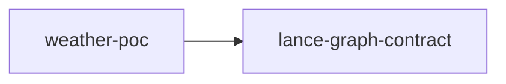

# weather-poc

crate: weather-poc
path: crates/weather-poc
workspace: excluded
digest: 680af06c0dcf2f95
evidence legend: ../index.md#evidence-legend

Generated; the code is the truth. See ../index.md.

## Depends on

- dep jc dev — crates/weather-poc/Cargo.toml:34 CONFIRMED
- dep lance-graph-contract normal optional — crates/weather-poc/Cargo.toml:28 CONFIRMED

## Depended on by

## Public items

- const W1_FACET_COUNT [pub] — crates/weather-poc/src/bake.rs:31 CONFIRMED
- const W1_IMAGE_LEN [pub] — crates/weather-poc/src/bake.rs:34 CONFIRMED
- const GLOBAL_CELL_COUNT [pub] — crates/weather-poc/src/bake.rs:37 CONFIRMED
- struct PackedWeatherCell [pub] — crates/weather-poc/src/bake.rs:49 CONFIRMED
- fn PackedWeatherCell::facet_image [pub] — crates/weather-poc/src/bake.rs:64 CONFIRMED
- enum BakeError [pub] — crates/weather-poc/src/bake.rs:76 CONFIRMED
- enum BakeStreamError [pub] — crates/weather-poc/src/bake.rs:119 CONFIRMED
- fn pack_cell [pub] — crates/weather-poc/src/bake.rs:148 CONFIRMED
- fn bake_timestep [pub] — crates/weather-poc/src/bake.rs:194 CONFIRMED
- fn weather_value_offset [pub] cfg=feature="canonical-row" — crates/weather-poc/src/canonical.rs:26 CONFIRMED
- fn weather_tail_capacity [pub] cfg=feature="canonical-row" — crates/weather-poc/src/canonical.rs:34 CONFIRMED
- enum CanonicalRowError [pub] cfg=feature="canonical-row" — crates/weather-poc/src/canonical.rs:40 CONFIRMED
- enum CanonicalBakeError [pub] cfg=feature="canonical-row" — crates/weather-poc/src/canonical.rs:87 CONFIRMED
- fn assemble_row [pub] cfg=feature="canonical-row" — crates/weather-poc/src/canonical.rs:127 CONFIRMED
- fn row_bytes [pub] cfg=feature="canonical-row" — crates/weather-poc/src/canonical.rs:166 CONFIRMED
- fn bake_timestep_to_writer [pub] cfg=feature="canonical-row" — crates/weather-poc/src/canonical.rs:181 CONFIRMED
- const LO_PERCENTILE [pub] — crates/weather-poc/src/floor.rs:43 CONFIRMED
- const HI_PERCENTILE [pub] — crates/weather-poc/src/floor.rs:47 CONFIRMED
- struct SaturationScore [pub] — crates/weather-poc/src/floor.rs:57 CONFIRMED
- struct CalibratedFloor [pub] — crates/weather-poc/src/floor.rs:81 CONFIRMED
- fn CalibratedFloor::quantize [pub] — crates/weather-poc/src/floor.rs:100 CONFIRMED
- fn CalibratedFloor::bucket_center [pub] — crates/weather-poc/src/floor.rs:115 CONFIRMED
- fn CalibratedFloor::decode [pub] — crates/weather-poc/src/floor.rs:129 CONFIRMED
- fn CalibratedFloor::floor_version [pub] — crates/weather-poc/src/floor.rs:159 CONFIRMED
- fn CalibratedFloor::bounds [pub] — crates/weather-poc/src/floor.rs:164 CONFIRMED
- fn CalibratedFloor::occupancy [pub] — crates/weather-poc/src/floor.rs:171 CONFIRMED
- fn CalibratedFloor::samples [pub] — crates/weather-poc/src/floor.rs:178 CONFIRMED
- fn CalibratedFloor::saturation [pub] — crates/weather-poc/src/floor.rs:185 CONFIRMED
- fn CalibratedFloor::saturation_of [pub] — crates/weather-poc/src/floor.rs:231 CONFIRMED
- fn calibrate [pub] — crates/weather-poc/src/floor.rs:313 CONFIRMED
- const LAT_COUNT [pub] — crates/weather-poc/src/key.rs:53 CONFIRMED
- const LON_COUNT [pub] — crates/weather-poc/src/key.rs:60 CONFIRMED
- const KEY_LEN [pub] — crates/weather-poc/src/key.rs:63 CONFIRMED
- fn encode_key [pub] — crates/weather-poc/src/key.rs:90 CONFIRMED
- fn decode_key [pub] — crates/weather-poc/src/key.rs:121 CONFIRMED
- struct CellBox [pub] — crates/weather-poc/src/key.rs:143 CONFIRMED
- fn box_ranges [pub] — crates/weather-poc/src/key.rs:173 CONFIRMED
- const FACET_LEN [pub] — crates/weather-poc/src/lane.rs:88 CONFIRMED
- const PAIR_COUNT [pub] — crates/weather-poc/src/lane.rs:95 CONFIRMED
- fn slot_offset [pub] — crates/weather-poc/src/lane.rs:115 CONFIRMED
- struct UnpackedField [pub] — crates/weather-poc/src/lane.rs:134 CONFIRMED
- enum LaneError [pub] — crates/weather-poc/src/lane.rs:153 CONFIRMED
- fn pack_facet [pub] — crates/weather-poc/src/lane.rs:358 CONFIRMED
- fn unpack_facet [pub] — crates/weather-poc/src/lane.rs:431 CONFIRMED
- fn stamped_floor_versions [pub] — crates/weather-poc/src/lane.rs:505 CONFIRMED
- mod bake [pub] — crates/weather-poc/src/lib.rs:36 CONFIRMED
- mod canonical [pub] cfg=feature="canonical-row" — crates/weather-poc/src/lib.rs:39 CONFIRMED
- mod floor [pub] — crates/weather-poc/src/lib.rs:40 CONFIRMED
- mod key [pub] — crates/weather-poc/src/lib.rs:41 CONFIRMED
- mod lane [pub] — crates/weather-poc/src/lib.rs:42 CONFIRMED
- mod manifest [pub] — crates/weather-poc/src/lib.rs:43 CONFIRMED
- enum PairByte [pub] — crates/weather-poc/src/manifest.rs:67 CONFIRMED
- struct ManifestEntry [pub] — crates/weather-poc/src/manifest.rs:91 CONFIRMED
- enum ManifestError [pub] — crates/weather-poc/src/manifest.rs:117 CONFIRMED
- struct FieldManifest [pub] — crates/weather-poc/src/manifest.rs:223 CONFIRMED
- fn FieldManifest::parse [pub] — crates/weather-poc/src/manifest.rs:242 CONFIRMED
- fn FieldManifest::committed [pub] — crates/weather-poc/src/manifest.rs:350 CONFIRMED
- fn FieldManifest::entries [pub] — crates/weather-poc/src/manifest.rs:356 CONFIRMED
- fn FieldManifest::resolve [pub] — crates/weather-poc/src/manifest.rs:363 CONFIRMED
- fn FieldManifest::resolve_slot [pub] — crates/weather-poc/src/manifest.rs:372 CONFIRMED

## Imports from in-scope crates

### lance-graph-contract
- use lance_graph_contract::canonical_node::EdgeBlock cfg=feature="canonical-row" — crates/weather-poc/src/canonical.rs:14 CONFIRMED
- use lance_graph_contract::canonical_node::NODE_ROW_STRIDE cfg=feature="canonical-row" — crates/weather-poc/src/canonical.rs:14 CONFIRMED
- use lance_graph_contract::canonical_node::NodeGuid cfg=feature="canonical-row" — crates/weather-poc/src/canonical.rs:14 CONFIRMED
- use lance_graph_contract::canonical_node::NodeRow cfg=feature="canonical-row" — crates/weather-poc/src/canonical.rs:14 CONFIRMED
- use lance_graph_contract::canonical_node::VALUE_SLAB_LEN cfg=feature="canonical-row" — crates/weather-poc/src/canonical.rs:14 CONFIRMED
- use lance_graph_contract::canonical_node::ValueSchema cfg=feature="canonical-row" — crates/weather-poc/src/canonical.rs:14 CONFIRMED
- use lance_graph_contract::canonical_node::VALUE_SLAB_ROW_OFFSET cfg=feature="canonical-row" — crates/weather-poc/src/canonical.rs:15 CONFIRMED
- use lance_graph_contract::canonical_node::VALUE_TENANTS cfg=feature="canonical-row" — crates/weather-poc/src/canonical.rs:15 CONFIRMED

## Calls

CALL_GRAPH=ARTIFACT_MISSING
- calls ARTIFACT_MISSING — no ruff_charon artifact for this crate UNKNOWN

## Architecture

- none

Generated from Cargo manifests — extracted relationships only.

